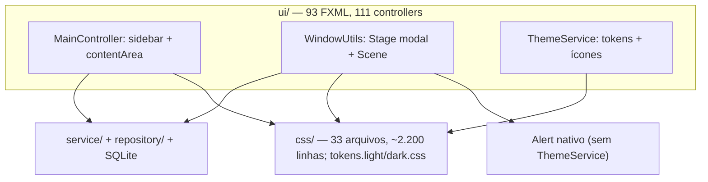

# Design — adopt-atlantafx

## 2.1 Codebase analysis

Resumo da codekb validada pelo usuário em 2026-10-29 (commit d38e3ee1). Detalhes em `.aidlc/codekb/MOINEX/`. [user]

MOINEX é um app desktop de finanças pessoais: JavaFX 23.0.1 + Spring Boot 3.5.11 + Kotlin 2.1.0, SQLite local, scripts Python para cotações, chat de IA com 4 provedores. Monólito em camadas `ui → service → repository`; os controllers FXML são beans Spring. [src: .aidlc/codekb/MOINEX/architecture.md]

Caption: o estilo vem de tokens CSS aplicados por `ThemeService` no root e em cada Scene; os `Alert` nativos ficam fora desse caminho.

**Estado atual do estilo (relevante para esta mudança)**
- Base é o Modena (nenhum `setUserAgentStylesheet` no código); `tokens.*.css` redefine `-fx-base`, `-fx-background`, `-fx-accent` etc. no `.root` e define ~60 tokens `theme-*`. [src: css/theme/tokens.dark.css:7-16]
- JFoenix só para `JFXButton`: 95 usos em 81 FXML e 14 arquivos Kotlin; a regra `.jfx-button` é o estilo de botão do app (pílula, raio 20, borda 2px). [src: css/component/buttons.css:1-12]
- ~400 linhas de CSS redesenham controles nativos (`combo-box`, `data-picker`, `table-view`, `progress-bar`, `menu-button`, `buttons`).
- Estilos inline: 17 `style=` em FXML, 14 `setStyle` em Kotlin, constantes `-fx-*` em `Styles.kt`.
- Troca de tema só atualiza o `rootPane` registrado; janelas já abertas não mudam. `Alert` nativos não recebem tema.
- Ícones: 82 PNGs, recoloridos com `ColorAdjust` no modo escuro; chat de IA usa `WebView` com CSS próprio; 7 gráficos custom.

**Identidade a preservar** `[user]`: paleta Dracula no escuro, botões em pílula, verde da sidebar (#0a614e). [mem: M-001]

**Baseline**: `./gradlew test` com 1374 testes, 0 falhas, 0 erros; não há testes de UI, e a verificação visual é manual. [src: .aidlc/codekb/MOINEX/quality-and-risks.md]

### Assumptions & open questions
- A1 (state.md): "substituir JavaFX por AtlantaFX" significa adotar o AtlantaFX como tema e remover o JFoenix; JavaFX continua como toolkit. Confirmação em 2.3.
- Aberta para 2.3: o tema claro continua sendo mantido com a mesma prioridade do escuro?
- Aberta para 2.3: manter o verde da sidebar também no tema claro?
## 2.2 Team practices

Projeto de um mantenedor, prática afirmada pelo usuário em 2026-10-29. [user]

| Prática | Como é feito | Evidência |
|---|---|---|
| Branching | Branches por tipo (`feat/*`, `refactor/*`, `chore/*`) mergeadas no `main`; esta mudança usa **`feat/atlantafx`** | [src: git branch -a] [user] |
| Commits | Conventional Commits (`feat`, `fix`, `chore`, `refactor`, `docs`); commit só quando o usuário pede ou depois de ele ver o diff; `Co-Authored-By` permitido, nunca link de sessão | [src: git log -100] [src: CLAUDE.md] [src: .aidlc/codekb/MOINEX/conventions.md] |
| Revisão | O autor revisa o diff antes de commitar; sem template de PR nem CODEOWNERS | [user] [src: .github/] |
| Testes | Kotest BehaviorSpec + MockK + fábricas, H2; 1374 testes passando; nada em `ui/` | [src: .aidlc/codekb/MOINEX/quality-and-risks.md] |
| Validação de UI | Manual: rodar o app e navegar; a Construction deve entregar uma checklist de telas e janelas por Unit, nos dois temas | [user] |
| CI | GitHub Actions: build, spotless/ktlint, test+Jacoco, SonarCloud; hook pré-commit com `ktlintCheck` + `test` | [src: .github/workflows/pipeline.yml] [src: .githooks/pre-commit] |
| Estilo | ktlint/Spotless; sem comentários `//` explicativos (KDoc ok); cores só por tokens `theme-*` no CSS | [src: .editorconfig] [src: css/theme/] |
| Release | Tag anotada `vX.Y.Z` no `main`, versão do `build.gradle.kts` sincronizada em commit próprio | [src: CLAUDE.md] |

### Assumptions & open questions
- Nenhuma nova. Práticas inferidas do repositório foram confirmadas nas respostas acima.

## 2.6 Domain & components
### Components (responsibility, interfaces, data ownership)
### Decisions
## 2.7 Units of work
### Dependency order
### Story → Unit map
## 2.8 Contracts
