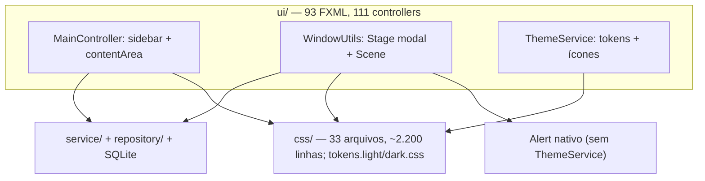
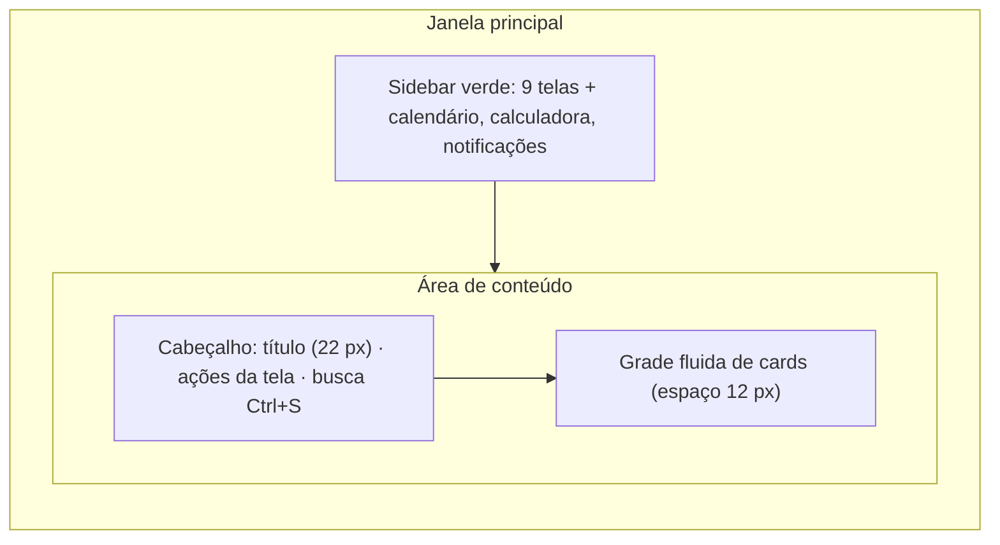
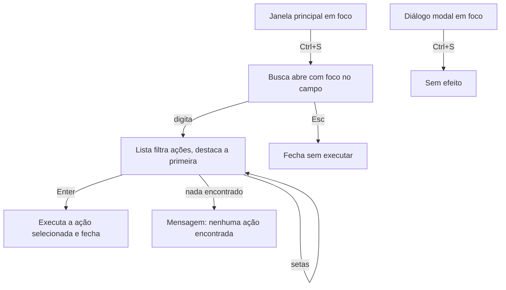
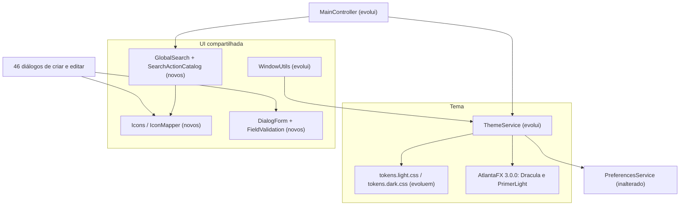
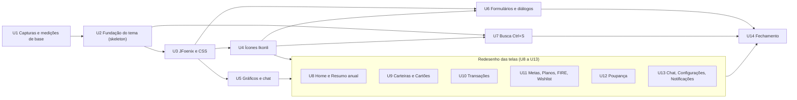
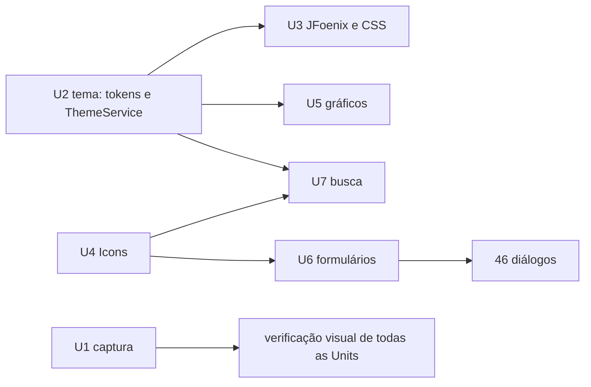
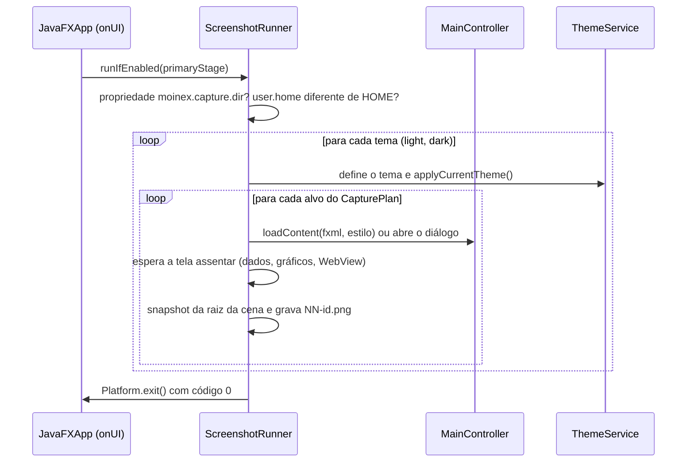
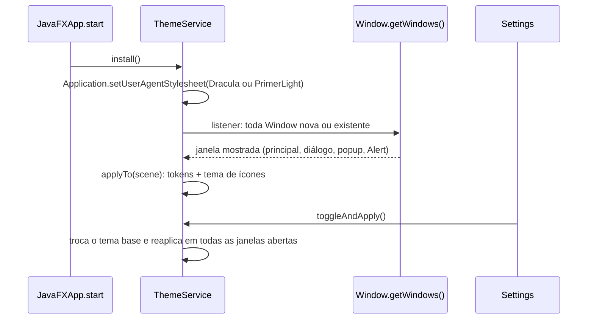

# Design — adopt-atlantafx

## 2.1 Codebase analysis

Resumo da codekb validada pelo usuário em 2026-10-29 (commit d38e3ee1). Detalhes em `.aidlc/codekb/MOINEX/`. [user]

MOINEX é um app desktop de finanças pessoais: JavaFX 27.0.1 + Spring Boot 4.1.2 + Kotlin 2.4.21 (JDK 25, release v2.19.0), SQLite local, scripts Python para cotações, chat de IA com 4 provedores. Monólito em camadas `ui → service → repository`; os controllers FXML são beans Spring. [src: .aidlc/codekb/MOINEX/architecture.md]


Caption: o estilo vem de tokens CSS aplicados por `ThemeService` no root e em cada Scene; os `Alert` nativos ficam fora desse caminho.

**Estado atual do estilo (relevante para esta mudança)**
- Base é o Modena (nenhum `setUserAgentStylesheet` no código); `tokens.*.css` redefine `-fx-base`, `-fx-background`, `-fx-accent` etc. no `.root` e define ~60 tokens `theme-*`. [src: css/theme/tokens.dark.css:7-16]
- JFoenix só para `JFXButton`: 95 usos em 81 FXML e 14 arquivos Kotlin; a regra `.jfx-button` é o estilo de botão do app (pílula, raio 20, borda 2px). [src: css/component/buttons.css:1-12]
- ~400 linhas de CSS redesenham controles nativos (`combo-box`, `data-picker`, `table-view`, `progress-bar`, `menu-button`, `buttons`).
- Estilos inline: 17 `style=` em FXML, 14 `setStyle` em Kotlin, constantes `-fx-*` em `Styles.kt`.
- Troca de tema só atualiza o `rootPane` registrado; janelas já abertas não mudam. `Alert` nativos não recebem tema.
- Ícones: 82 PNGs, recoloridos com `ColorAdjust` no modo escuro; chat de IA usa `WebView` com CSS próprio; 7 gráficos custom.

**Identidade a preservar** `[user]`: paleta Dracula no escuro, botões em pílula, verde da sidebar (#0a614e). [mem: M-001]

**Baseline**: `./gradlew clean build jacocoTestReport` com JDK 25 (HEAD 08bbf24f): 1374 testes, 0 falhas, 0 erros; não há testes de UI, e a verificação visual é manual. [src: .aidlc/codekb/MOINEX/quality-and-risks.md]

### Assumptions & open questions
- A1 (state.md): "substituir JavaFX por AtlantaFX" = adotar o AtlantaFX 3.0.0 como tema e remover o JFoenix; o JavaFX continua como toolkit. Confirmada no 2.3.
- Resolvida no 2.3: o verde da sidebar vale nos dois temas (A2).
- Atualização 2026-10-29: o pré-requisito (Java 25, JavaFX 27, Kotlin 2.4, Spring Boot 4) está na `main` desde v2.19.0; a codekb foi refrescada para o HEAD 08bbf24f.
## 2.2 Team practices

Projeto de um mantenedor, prática afirmada pelo usuário em 2026-10-29. [user]

| Prática | Como é feito | Evidência |
|---|---|---|
| Branching | Branches por tipo (`feat/*`, `refactor/*`, `chore/*`) mergeadas no `main`; esta mudança usa **`feat/atlantafx`** | [src: git branch -a] [user] |
| Commits | Conventional Commits (`feat`, `fix`, `chore`, `refactor`, `docs`); commit só quando o usuário pede ou depois de ele ver o diff; `Co-Authored-By` permitido, nunca link de sessão | [src: git log -100] [src: CLAUDE.md] [src: .aidlc/codekb/MOINEX/conventions.md] |
| Revisão | O autor revisa o diff antes de commitar; sem template de PR nem CODEOWNERS | [user] [src: .github/] |
| Testes | Kotest BehaviorSpec + MockK + fábricas, H2; 1374 testes passando; nada em `ui/` | [src: .aidlc/codekb/MOINEX/quality-and-risks.md] |
| Validação de UI | Manual: rodar o app e navegar; a Construction deve entregar uma checklist de telas e janelas por Unit, nos dois temas | [user] |
| CI | GitHub Actions: build, spotless/ktlint, test+Jacoco, SonarCloud; hook pré-commit com `ktlintCheck` + `test` | [src: .github/workflows/pipeline.yml] [src: .githooks/pre-commit] |
| Estilo | ktlint/Spotless; sem comentários `//` explicativos (KDoc ok); cores só por tokens `theme-*` no CSS | [src: .editorconfig] [src: css/theme/] |
| Release | Tag anotada `vX.Y.Z` no `main`, versão do `build.gradle.kts` sincronizada em commit próprio | [src: CLAUDE.md] |

### Assumptions & open questions
- Nenhuma nova. Práticas inferidas do repositório foram confirmadas nas respostas acima.

## 2.5 Refined mockups

**Design** — fundamentado em `requirements.md` § 2.3 e § 2.4, na codekb e nas respostas do usuário de 2026-10-29. Os componentes do AtlantaFX citados foram conferidos no jar da versão 3.0.0. [src: repo1.maven.org atlantafx-base 3.0.0]

### Como ver o desenho

- Abra `.aidlc/261029-adopt-atlantafx/mockups/mockups.html` no navegador. O botão do topo alterna claro/escuro. Mostra a Home (US-7), um diálogo com erro de validação (US-15), a busca Ctrl+S (US-16), os estados e a paleta, com dados fictícios.
- As capturas de prévia ficam em `build/mockup-preview/` (ignorada pelo git, não versionada).
- O HTML é uma referência visual; a implementação usa JavaFX e CSS do AtlantaFX, não HTML.

### Decisões do usuário que moldam o desenho

| Tema | Decisão | Fonte |
|---|---|---|
| Home | Mesma estrutura de hoje (Carteiras, Cartões, Resumo do mês; depois Fluxo de dinheiro e Últimas transações), com cards limpos e largura fluida | [user] |
| Cards | Borda fina e cantos arredondados (`Styles.BORDERED` + `Styles.ROUNDED`), sem sombra | [user] |
| Formulários | Uma coluna, rótulo acima do campo, erro logo abaixo, Cancelar e Salvar no rodapé | [user] |
| Atalho | Só **Ctrl+S (search)**; digita-se o que procura e a lista mostra as ações | [user] |
| Identidade | Dracula no escuro, botões em pílula e sidebar verde: `#0A614E` no escuro e o teal atual `#1ABC9C` no claro (revisado em 2026-10-29 depois das capturas "antes") | [user] [mem: M-001] |
| Cartões de carteira e de crédito | Cards lisos de borda fina, sem o gradiente colorido de hoje (decisão de 2026-10-29, contra a recomendação de manter) | [user] |

### 1. Estrutura da janela


Caption: a sidebar continua com os mesmos 9 destinos e 3 atalhos de rodapé do `main.fxml`; muda o cabeçalho, que ganha o indicador da busca, e a grade, que deixa de ter larguras mínimas fixas (hoje a Home usa `minWidth` de 400 a 800). [src: src/main/resources/ui/main/main.fxml] [src: src/main/resources/ui/main/home.fxml]

- Sidebar: no escuro fundo `#0A614E`, hover e item ativo `#106E5B`, texto e ícones `#F8F8F2` (6,95:1); no claro fundo `#1ABC9C`, hover e item ativo `#48C9B0`, texto e ícones `#1F2328` (6,56:1 e 7,72:1). Barra do item ativo na cor do texto da sidebar (não roxa, para passar 3:1) e emblema roxo com texto `#282A36` (5,90:1) nas notificações. Hoje ela fica recolhida só com ícones e expande pelo botão de menu; o mockup mostra a versão expandida.
- Se a sidebar usa o controle `Sidebar` do AtlantaFX ou o `VBox` atual restilizado é decisão de arquitetura do 2.6.

### 2. Cores e tokens

Medi o contraste dos tokens atuais e dos propostos contra as superfícies reais de cada tema. Meta: NFR-2 (4,5:1 para texto, 3:1 para texto grande e componentes de interface).

**Tokens atuais que reprovam e seu substituto**

| Token atual | Valor | Contraste | Problema | Substituto |
|---|---|---|---|---|
| `theme-text-secondary`/`muted` (escuro) | `#6272A4` | 3,03:1 no card, 2,35:1 no pane | falha AA | `#BFBFC3` (7,77:1) |
| `theme-text-disabled` (claro) | `#999999` | 2,85:1 | falha AA | `#6E7781` só para texto grande ou desabilitado |
| destaque como texto (claro) | `#BD93F9` | 2,41:1 | falha | `#6D4FC2` (5,92:1) |
| `theme-warning` como texto (claro) | `#F5B427` | 1,84:1 | falha | `#9A6700` (4,87:1) |
| `theme-positive` (claro) | `#28A745` | 3,13:1 | só texto grande | `#1A7F37` (5,08:1) |
| texto claro sobre botão roxo | `#F8F8F2` sobre `#BD93F9` | 2,26:1 | falha | texto `#282A36` (5,90:1) |

**Paleta proposta**

| Papel (token) | Escuro | Claro | Observação |
|---|---|---|---|
| Janela (`theme-bg-base`) | `#21222C` | `#F6F8FA` | no escuro reaproveita `theme-bg-card-alt` |
| Card (`theme-bg-card`) | `#282A36` | `#FFFFFF` | no escuro o card é mais claro que a janela, ao contrário de hoje |
| Fundo de campos e barras (`theme-bg-inset`) | `#181920` | `#EFF2F5` | |
| Borda decorativa (`theme-border`) | `#44475A` | `#D1D9E0` | cards e divisórias |
| Borda de campo (`theme-border-field`, nova) | `#6272A4` (3,03:1) | `#818B98` (3,45:1) | componente interativo precisa de 3:1 |
| Texto primário | `#F8F8F2` (13,4:1) | `#1F2328` (15,8:1) | |
| Texto secundário | `#BFBFC3` (7,8:1) | `#59636E` (6,1:1) | |
| Destaque, preenchimento | `#BD93F9` | `#BD93F9` | com texto `#282A36` por cima |
| Destaque, texto/foco | `#BD93F9` (5,9:1) | `#6D4FC2` (5,9:1) | links e anel de foco |
| Positivo | `#50FA7B` (10,4:1) | `#1A7F37` (5,1:1) | também sinalizado por texto e sinal |
| Negativo | `#FF5555` (4,5:1) | `#C62F3E` (5,4:1) | idem |
| Aviso | `#FFB86C` (8,4:1) | `#9A6700` (4,9:1) | idem |
| Sidebar (`theme-bg-sidebar`) | `#0A614E` | `#1ABC9C` | hover e ativo `#106E5B` / `#48C9B0`; texto e ícones `#F8F8F2` / `#1F2328` |

O mapeamento destes tokens para as variáveis `-color-*` do AtlantaFX (por exemplo `-color-bg-default`, `-color-fg-default`, `-color-accent-*`) e a sobreposição do roxo do Dracula nativo (`#9580FF`, que difere do `#BD93F9` do MOINEX) são verificados no spike da primeira Unit (A3). O script de NFR-2 repete estas medições a cada mudança de token.

### 3. Componentes do AtlantaFX a usar

| Necessidade | Componente candidato (3.0.0) | Onde |
|---|---|---|
| Cards de bloco | `Styles.BORDERED` + `Styles.ROUNDED` num `VBox`, ou o controle `Card` | Todas as telas |
| Números em destaque | Estilos `Styles.TITLE_1` a `TITLE_4`, `TEXT_MUTED`, `TEXT_CAPTION` | Totais, saldos |
| Mensagens de estado | `Message` (variantes `SUCCESS`, `WARNING`, `DANGER`) | Erros, avisos, vazio |
| Campo com ícone | `CustomTextField` e `InputGroup` | Buscas das listas e da busca global |
| Abas | `TabPane` com os estilos de abas do tema | Metas/Planos/FIRE/Wishlist e Poupança |
| Filtro de poucas opções | `SegmentedControl` | Filtros de status das listas |
| Liga/desliga | `ToggleSwitch` | Opções booleanas dos formulários e Configurações |
| Busca global | `ModalPane` com lista e `CustomTextField` | Ctrl+S |
| Progresso | `ProgressBar` estilizada ou `RingProgressIndicator` | Metas, limites de cartão |

A escolha final entre controle e estilo (por exemplo `Card` ou `VBox` estilizado, `Sidebar` ou `VBox`) fica para o 2.6. Os toasts de notificação do app (`NotificationToastOverlay`) continuam próprios. [src: src/main/kotlin/org/moinex/ui/common/NotificationToastOverlay.kt]

### 4. Padrão de página

| Elemento | Especificação |
|---|---|
| Espaçamentos | Escala 4, 8, 12, 16, 24 px; espaço entre cards 12; padding de card 14 × 16; margem da página 16 a 20 |
| Cantos | Cards 12 px; botões em pílula 20 px com borda de 2 px; campos 8 px |
| Tipografia | Título da tela 22 px negrito; título de card 15 px negrito; legenda 12 px secundária; valor principal 26 px negrito |
| Cabeçalho | Título à esquerda, ações primárias da tela e indicador `Buscar telas e ações  Ctrl S` à direita |
| Tabelas | Dentro do card, sem borda dupla, cabeçalho secundário 12 px, linhas com 7 px de espaço vertical, valores alinhados à direita, receita/despesa por cor, sinal e texto |
| Botões | Primário: preenchido roxo com texto `#282A36`; secundário: contorno; destrutivo: contorno vermelho; todos em pílula |
| Larguras | Grade fluida; nenhuma largura mínima maior que 320 px; rolagem vertical na página |
| Foco | Anel de 3 px na cor de destaque em texto, visível em todos os controles |

### 5. Telas por grupo (US-7 a US-14)

Os blocos de hoje vêm dos FXML e das chaves de tradução de cada tela. [src: src/main/resources/ui/main/*.fxml]

| História | Tela | Blocos de hoje | Desenho proposto |
|---|---|---|---|
| US-7 | Início | Carteiras, Cartões, Resumo do mês, Fluxo de dinheiro (Sankey), Últimas transações, botão de recalcular patrimônio | Estrutura mantida (mockup 1): três cards em cima, dois embaixo; largura fluida; os cartões de carteira e de crédito viram cards lisos, sem gradiente; botão de recalcular vira ação secundária no cabeçalho |
| US-7 | Resumo anual | Título e período, receita, despesa, saldo e taxa de poupança, fluxo mensal, receita e despesa por categoria, maiores despesas, insights | Faixa de quatro indicadores no topo, depois fluxo mensal, duas tabelas por categoria lado a lado, maiores despesas e insights |
| US-8 | Carteiras | Saldo total, saldo por tipo, fluxo de dinheiro, lista de carteiras; botões de adicionar carteira, transferência, transferências e arquivadas | Saldo total em destaque, lista de carteiras em cards, gráficos em dois cards; botões no cabeçalho |
| US-9 | Cartões | Cartões, total de dívidas, fluxo de dívidas, lista de dívidas com busca; botões de adicionar cartão, dívida, arquivados e periódicas | Cards de cartão com barra de limite e vencimento, total em destaque, tabela de dívidas num card com busca no topo |
| US-10 | Transações | Resumo mensal, fluxo por categoria, lista com busca e período; botões de receita, despesa, categorias e periódicas | Resumo e gráfico em cima, lista em card com filtros no topo (período e busca), ações no cabeçalho |
| US-11 | Metas e planos (abas Metas, Planos, FIRE) | Metas em andamento e concluídas com filtros; planos com grupos de orçamento, distribuição e linha do tempo; FIRE com formulário, resultado e gráfico | Abas no topo; metas em cards com barra de progresso; FIRE com formulário em uma coluna à esquerda e resultado e gráfico à direita |
| US-12 | Metas e planos, aba Wishlist | Filtros de categoria e status, busca, tabela e dois gráficos | Filtros em `SegmentedControl` e busca, tabela num card, gráficos em dois cards |
| US-13 | Poupança (abas Visão geral, Ações e fundos, Bonds) | Indicadores do Brasil, commodities, alocação e metas de alocação, métricas; tabelas com muitos botões de ação | Visão geral em cards; tabelas com ações agrupadas em um menu por linha em vez de uma fileira de botões |
| US-14 | Chat de IA | Aviso, histórico, campo de mensagem, anexar, enviar, indicador de "pensando" | Bolhas com as cores do tema, campo fixo no rodapé, aviso como `Message` |
| US-14 | Configurações | Seção de IA (provedor, modelo, chave, testar, salvar, limpar), banco de dados (local, alterar, reinício), idioma, meta de taxa de poupança | Uma coluna agrupada em cards por seção; ações no rodapé de cada card |
| US-14 | Central de notificações | Marcar todas como lidas, limpar tudo, estado vazio | Painel lateral no tema novo, estado vazio com `Message`, ações no cabeçalho do painel |

### 6. Formulários e diálogos (US-15)

Anatomia do diálogo de criar ou editar (mockup 2):

1. Título do diálogo (17 px negrito).
2. Campos em uma coluna; rótulo secundário 12 px acima, campo abaixo.
3. Erro de validação logo abaixo do campo, em vermelho do tema, com ícone de aviso.
4. Rodapé à direita: `Cancelar` (contorno) e `Salvar` (preenchido roxo); a tecla de cada um aparece como dica.

| Estado | Aparência | Comportamento |
|---|---|---|
| Padrão | Borda de campo (3:1), fundo inset | Foco inicial no primeiro campo editável |
| Foco | Anel de 3 px em destaque | Tab percorre os campos na ordem visual |
| Erro | Borda e mensagem em vermelho | Confirmar com campo inválido mantém a janela aberta e leva o foco ao primeiro erro |
| Desabilitado | Texto secundário, sem borda destacada | Não recebe foco |

Teclas: Enter confirma quando o formulário é válido, Esc cancela; nos 9 diálogos de visualização, Esc fecha. O comportamento vem de uma base comum aos 46 diálogos de criar e editar; já existem 14 classes `base` compartilhadas. [src: src/main/kotlin/org/moinex/ui/dialog]

### 7. Busca global por Ctrl+S (US-16)


Caption: a busca só existe na janela principal; em diálogos modais Ctrl+S não faz nada, porque Enter já salva.

Catálogo inicial de ações (23). A busca ignora maiúsculas e acentos e procura no nome e em sinônimos (por exemplo "gasto" encontra "Nova despesa").

| Grupo | Ações |
|---|---|
| Telas (9) | Início, Carteiras, Cartões, Transações, Metas e planos, Poupança, Resumo anual, Chat de IA, Configurações |
| Abas (7) | Metas, Planos, FIRE, Wishlist, Visão geral, Ações e fundos, Bonds |
| Lançamentos (3) | Nova despesa, Nova receita, Nova transferência |
| Aplicativo (4) | Alternar tema, Abrir calendário, Abrir calculadora, Abrir notificações |

Sem texto digitado, a lista mostra os quatro grupos na ordem acima. Cada linha mostra ícone, nome e, à direita, a tela de origem quando ajuda a desambiguar.

### 8. Estados

| Estado | Componente | Exemplo |
|---|---|---|
| Vazio | Card centralizado com título, frase e botão primário | "Nenhuma meta ainda" com `Nova meta` |
| Sucesso | `Message` verde, some sozinha | "Transação salva" |
| Aviso | `Message` amarela | "Fatura perto do limite" |
| Erro | `Message` vermelha, permanece até fechar | "Não foi possível atualizar as cotações" |
| Carregando | Indicador de progresso no card, sem bloquear a janela | Cotações e gráficos |

### 9. Acessibilidade

- Contraste: tabela da seção 2, com meta de NFR-2 verificada por script.
- Cor nunca é o único sinal: valores positivos e negativos levam sinal e, nos gráficos, legenda em texto.
- Foco visível em todos os controles; ordem de Tab segue a ordem visual; botões só com ícone têm dica de texto (tooltip) e nome acessível.
- Alvos clicáveis com pelo menos 28 px de altura.
- Toda ação de mouse tem equivalente de teclado (Tab, Enter, Esc e a busca Ctrl+S).

### 10. Plano de capturas (NFR-3)

- As capturas "antes" das telas principais, nos dois temas, são feitas **antes de qualquer alteração**, como primeira tarefa da Construction.
- As capturas "depois" são geradas por tela e por tema ao fim de cada história de redesenho e guardadas em `construction/screenshots/`, com o par antes/depois para sua aprovação no checkpoint.
- Telas cobertas: Início, Resumo anual, Carteiras, Cartões, Transações, Metas, Planos, FIRE, Wishlist, Poupança (visão geral, ações e fundos, bonds), Chat de IA, Configurações, Central de notificações, mais um diálogo de formulário com erro, a busca e um `Alert`.

### Assumptions & open questions

- A9 — confirmed: no: no escuro a janela `#21222C` com card `#282A36` (card mais claro que a janela) substitui a relação atual (card mais escuro que a base); escolhido porque todos os textos passam AA nessas superfícies e `#3D3F4A` reprovava.
- A10 — confirmed: no: o catálogo de 23 ações basta no começo; outras entram a pedido.
- A11 — confirmed: no: dá para sobrepor o roxo do Dracula nativo (`#9580FF`) por `#BD93F9` via variáveis `-color-accent-*`; verificar no spike (A3).
- A12 — confirmed: no: o menu por linha nas tabelas de Poupança substitui a fileira de botões sem perder nenhuma ação; confirmar tela a tela na Construction.
- Aberta para o 2.6: usar o controle `Sidebar`, `Card` e `ModalPane` do AtlantaFX ou estilizar os controles atuais; pacote do Ikonli (A4).

## 2.6 Domain & components

**Architect** — mudança só na camada de apresentação: `service/`, `repository/`, `model/` e o banco não mudam (restrição do § 2.3). Não há entidades de domínio novas; os "componentes" abaixo são partes da UI e da infraestrutura de tema. Fatos verificados em 2026-10-29: `atlantafx-base`, `atlantafx-validation` 3.0.0 e `ikonli-javafx`/`ikonli-material2-pack` 12.4.0 estão no Maven Central; o Ikonli 12.4.0 é bytecode Java 11 e só exige `javafx.controls`. [src: repo1.maven.org]

### Components


Caption: tema, ícones, busca global e formulários viram peças compartilhadas; nenhuma delas fala com `service/` além das ações que a busca dispara (abrir telas e diálogos).

| Componente | Estado | Responsabilidade | Interfaces | Dono dos dados |
|---|---|---|---|---|
| `ThemeService` | evolui | Aplica o tema base do AtlantaFX (Dracula no escuro, PrimerLight no claro), a camada de tokens e a troca claro/escuro em **todas as janelas abertas e futuras**, inclusive `Alert` | `toggleAndApply()`, `isDark()`, `applyTo(scene)` (mantido por compatibilidade) | Preferência de tema continua no `PreferencesService` |
| `tokens.light.css`, `tokens.dark.css` | evoluem | Tokens `theme-*` como camada semântica sobre as variáveis `-color-*` do AtlantaFX; novo token `theme-border-field`; paleta do § 2.5 | Consumidos pelos CSS de tela e de componente | Valores de cor |
| `Icons` / `IconMapper` | novos | Constantes de glifos Ikonli (Material 2) e mapa nome de arquivo PNG → glifo para os ícones guiados por dados (tipo de carteira), com PNG de reserva | `Icons.ADD`, `iconFor(walletTypeIconFile)` | Mapa em código; o banco não muda |
| `GlobalSearch` + `SearchActionCatalog` | novos | Overlay aberto por Ctrl+S, filtro de ações e execução; catálogo de 23 ações do § 2.5 | `SearchAction(id, group, titleKey, keywords, icon, run)`, `open()`, `close()` | Catálogo em código; títulos nas duas `.properties` |
| `DialogForm` + `FieldValidation` | novos | Foco inicial, Enter confirma, Esc cancela e erro inline junto ao campo; usa `atlantafx-validation` | `DialogForm.install(root, onSave, onCancel)`, `FieldValidation.required(field, errorLabel)` | Mensagens de erro nas `.properties` |
| `WindowUtils` | evolui | Abre janelas e diálogos sem adicionar tokens manualmente (o `ThemeService` cuida); `show*Dialog` passam a usar o tema | Assinaturas atuais mantidas | n/a |
| `MainController` | evolui | Registra o atalho Ctrl+S só na janela principal, hospeda o overlay da busca e o cabeçalho com o indicador | n/a | Estado de navegação atual |

### Decisions

#### ADR-1 Tema: AtlantaFX como base global e tokens como camada por janela — Status: accepted (UNIT-2, 2026-10-29)
- **Contexto:** hoje o `ThemeService` troca uma folha de tokens só no `rootPane` registrado, e cada janela nova recebe os tokens por chamadas espalhadas (`MainController`, `WindowUtils`); os `Alert` ficam sem tema (FR-3, FR-7).
- **Decisão:** definir o tema base com `ThemeManager.instance().setTheme(...)` (ou `Application.setUserAgentStylesheet`), que vale para todas as janelas de uma vez; manter os tokens como folha de autor por `Scene`, aplicada por um único listener em `Window.getWindows()` que cobre janelas existentes, novas e `Alert`; a troca de tema reaplica os tokens em todas as janelas abertas.
- **Alternativas:** (a) criar um tema próprio copiando o CSS do Dracula e embutindo os tokens, descartada por duplicar ~165 KB de CSS do AtlantaFX e dificultar atualizações; (b) usar `ThemeOption` do AtlantaFX para injetar os tokens, adiada ao spike porque a API não foi exercitada.
- **Consequências:** remove as chamadas manuais de tokens; `Alert` e diálogos passam a seguir o tema; depende de o AtlantaFX 3.0.0 aceitar a sobreposição de `-color-accent-*` (A3, A11).
- **Resultado da UNIT-2:** confirmado com ajustes. O tema base usa `Application.setUserAgentStylesheet` (o `ThemeManager` não foi necessário). Sobrepor só as variáveis semânticas `-color-accent-fg` e `-color-accent-emphasis` não bastou, porque o botão em foco usa o degrau `-color-accent-6`; foi preciso sobrepor a rampa `-color-accent-0` a `-color-accent-9`. A identidade dos botões vai em uma folha `base.css` aplicada pelo `ThemeService`, porque o `Alert` não carrega o `buttons.css`.
- **Relacionado:** FR-1, FR-2, FR-3, FR-7, US-1, US-4.

#### ADR-2 Estilizar os controles atuais em vez de adotar `Sidebar`, `Card` e `Tile` do AtlantaFX — Status: proposed
- **Contexto:** o AtlantaFX 3.0.0 oferece `Sidebar`, `Card` e `Tile`, mas o `MainController` já tem sidebar recolhível com animações e as telas usam `AnchorPane` e `VBox` com classes CSS (93 FXML).
- **Decisão:** manter a sidebar de botões e os blocos como `VBox`/`AnchorPane`, com classes CSS e estilos `Styles.BORDERED` e `Styles.ROUNDED` para cards.
- **Alternativas:** reescrever a sidebar com o controle `Sidebar` e os blocos com `Card`, descartada por exigir reescrever FXML e controllers sem ganho visual para este intent.
- **Consequências:** menor risco e diff menor; se o controle novo compensar no futuro, a troca é isolada.
- **Relacionado:** FR-4, FR-9, US-2, US-7 a US-14.

#### ADR-3 Ícones: Ikonli com o pacote Material 2 — Status: proposed
- **Contexto:** 69 PNGs de interface (`common` 48, `sidebar` 12, `wallet_type` 9), recoloridos com `ColorAdjust`; 269 usos de ícones em FXML (259 de `common` e 10 de `sidebar`) e outros em Kotlin; o ícone do tipo de carteira vem do banco (`wallet.type.icon`, nome de arquivo).
- **Decisão:** adotar `org.kordamp.ikonli:ikonli-javafx` e `ikonli-material2-pack` 12.4.0; nos FXML usar `FontIcon` com `iconLiteral`; a cor vem de `-fx-icon-color` dos tokens; para tipos de carteira, um mapa nome de arquivo → glifo em `IconMapper`, com o PNG antigo como reserva para nomes desconhecidos. Mapeamento dos 69 em anexo: todos têm glifo no pacote (verificado), e 11 são aproximações a revisar visualmente na Construction; os que não agradarem ficam em PNG.
- **Alternativas:** Bootstrap Icons do Ikonli (62 de 69, edição antiga sem `piggy-bank`, `bank` e `coin`), descartado; misturar dois pacotes, descartado por duplicar fontes e estilos.
- **Consequências:** remove o `ColorAdjust` e o `applyIconTheme`; troca `ImageView` por `FontIcon` em até 75 FXML; o pacote traz as fontes (760 KB). Os 4 ícones do app, as 9 bandeiras e os emojis ficam em PNG.
- **Relacionado:** FR-8, US-5, A4.

#### ADR-4 Busca global: overlay próprio no root, como a central de notificações — Status: proposed
- **Contexto:** o `MainController` já implementa um painel com scrim sobre o `rootPane` para as notificações; o AtlantaFX tem `ModalPane`, mas ele exige ser a camada superior de um `StackPane`.
- **Decisão:** implementar a busca como overlay (scrim + painel) no `rootPane`, reaproveitando o padrão e as animações existentes; o atalho Ctrl+S é registrado como filtro de eventos de teclado da `Scene` principal, nunca das janelas modais.
- **Alternativas:** `ModalPane` do AtlantaFX, descartado por exigir reorganizar a raiz da cena.
- **Consequências:** consistente com o resto do app; Ctrl+S fica sem efeito em diálogos modais (AC5 da US-16).
- **Relacionado:** FR-11, US-16.

#### ADR-5 Formulários: validação com `atlantafx-validation` e comportamento por composição — Status: proposed
- **Contexto:** cada diálogo tem seu `handleSave()` que valida campos vazios e mostra um `Alert` genérico, e erros de serviço via `showErrorDialog` (212 chamadas em 60 arquivos); os 46 diálogos de criar e editar herdam de 14 classes `base` diferentes.
- **Decisão:** não criar uma nova classe base; usar composição: `DialogForm.install(...)` define foco inicial, Enter e Esc, e `FieldValidation` liga uma regra do `atlantafx-validation` (`Rule.on(property)`) a um rótulo de erro abaixo do campo; o `Alert` genérico de campos vazios é substituído por erros inline; erros que vêm dos serviços continuam em `Alert` (já temado).
- **Alternativas:** subir a lógica numa classe base única, descartada pelas 14 bases existentes; escrever validação própria sem a biblioteca, mantida como reserva se a API não servir.
- **Consequências:** nova dependência `atlantafx-validation` 3.0.0; novas chaves de tradução só por acréscimo (NFR-7); cada diálogo migra sem mudar sua herança.
- **Relacionado:** FR-10, US-15.

#### ADR-6 Remover o JFoenix com substituição mecânica de `JFXButton` por `Button` — Status: proposed
- **Contexto:** o JFoenix é usado só pelo `JFXButton` (81 FXML e 14 arquivos Kotlin) e o estilo do botão está em `.jfx-button`.
- **Decisão:** trocar o import e a tag em todos os FXML e os tipos `lateinit var` nos arquivos Kotlin; mover a regra de `.jfx-button` para `.button` (pílula, raio 20, borda 2 px) no CSS dos tokens.
- **Alternativas:** manter o JFoenix só para o botão, descartado por ser dependência sem manutenção.
- **Consequências:** mudança grande em número de arquivos, mas mecânica e verificável por busca ("jfoenix" sem resultados).
- **Relacionado:** FR-5, US-3.

### Anexo: mapeamento dos 69 ícones (Ikonli Material 2)

Aproximações marcadas com ✱ devem ser conferidas nas capturas; qualquer uma que não agrade fica em PNG.

**common (48)**

| PNG | Glifo |
|---|---|
| `add.png` | `mdal-add` |
| `archive.png` | `mdal-archive` |
| `arrow_left.png` | `mdal-arrow_back` |
| `arrow_right.png` | `mdal-arrow_forward` |
| `calculator.png` | `mdal-calculate` |
| `calendar.png` | `mdal-calendar_today` |
| `category.png` | `mdal-category` |
| `check.png` | `mdal-check` |
| `coin.png` | `mdmz-monetization_on` ✱ |
| `credit_card.png` | `mdal-credit_card` |
| `crypto_exchange.png` | `mdmz-swap_horiz` |
| `cryptocurrency.png` | `mdmz-toll` ✱ |
| `csv_import.png` | `mdal-file_upload` |
| `default.png` | `mdal-help_outline` ✱ |
| `description.png` | `mdal-description` |
| `details.png` | `mdal-info` ✱ |
| `digits.png` | `mdal-dialpad` ✱ |
| `edit.png` | `mdal-edit` |
| `expense.png` | `mdal-arrow_downward` |
| `expense_black.png` | `mdal-arrow_downward` |
| `find.png` | `mdmz-search` |
| `goal.png` | `mdal-flag` |
| `hide.png` | `mdmz-visibility_off` |
| `income.png` | `mdal-arrow_upward` |
| `income_black.png` | `mdal-arrow_upward` |
| `list.png` | `mdal-list` |
| `notification.png` | `mdmz-notifications` |
| `options.png` | `mdmz-more_vert` |
| `pencil.png` | `mdal-edit` |
| `pending.png` | `mdal-hourglass_empty` |
| `percent.png` | `mdmz-percentage` ✱ |
| `profit.png` | `mdmz-trending_up` |
| `purchased.png` | `mdmz-shopping_cart` |
| `quantity.png` | `mdal-format_list_numbered` ✱ |
| `question.png` | `mdal-help_outline` |
| `refund.png` | `mdmz-undo` |
| `reload.png` | `mdmz-refresh` |
| `remove.png` | `mdal-close` |
| `show.png` | `mdmz-visibility` |
| `sign_in.png` | `mdal-login` |
| `sign_out.png` | `mdal-exit_to_app` ✱ |
| `success.png` | `mdal-check_circle` |
| `trade.png` | `mdmz-swap_horiz` |
| `transaction.png` | `mdmz-receipt` |
| `transfer.png` | `mdal-compare_arrows` |
| `transfer_money.png` | `mdmz-send` |
| `trash.png` | `mdal-delete` |
| `trophy.png` | `mdal-emoji_events` |

**sidebar (12)**

| PNG | Glifo |
|---|---|
| `ai-chat.png` | `mdal-chat` |
| `category.png` | `mdal-category` |
| `credit-card.png` | `mdal-credit_card` |
| `goal.png` | `mdal-flag` |
| `home.png` | `mdal-home` |
| `import.png` | `mdal-file_upload` |
| `menu.png` | `mdmz-menu` |
| `savings.png` | `mdmz-money` ✱ |
| `settings.png` | `mdmz-settings` |
| `summary.png` | `mdal-bar_chart` |
| `transaction.png` | `mdmz-receipt` |
| `wallet.png` | `mdal-account_balance_wallet` |

**wallet_type (9)**

| PNG | Glifo |
|---|---|
| `broker.png` | `mdmz-show_chart` |
| `checking.png` | `mdal-account_balance` |
| `cryptocurrency.png` | `mdmz-toll` ✱ |
| `food_voucher.png` | `mdmz-restaurant` |
| `goal.png` | `mdal-flag` |
| `meal_voucher.png` | `mdal-fastfood` |
| `others.png` | `mdmz-more_horiz` |
| `savings.png` | `mdmz-money` ✱ |
| `wallet.png` | `mdal-account_balance_wallet` |

### Assumptions & open questions

- A4 — verificada em parte: todos os 69 PNGs têm glifo no pacote Material 2; 11 são aproximações (✱). Falta a conferência visual nas capturas da Construction.
- A13 — confirmed: no: `ThemeManager.setTheme` aceita a camada de tokens por `Scene` sem conflito com o tema (verificar no spike da primeira Unit, junto com A3 e A11).
- A14 — confirmed: no: a API do `atlantafx-validation` 3.0.0 (`Rule.on(...)`) serve para validar campos de formulário do MOINEX; se não servir, vale a validação própria (reserva do ADR-5).
- A15 — confirmed: no: o listener em `Window.getWindows()` alcança também as janelas dos `Alert` nativos; verificar no spike.

## 2.7 Units of work

**Architect (delivery)** — 14 Units, em ordem topológica. Tamanhos relativos (P, M, G) são estimativas minhas, não compromisso de prazo. Cada Unit é verificável sozinha pelo comando de verificação (definido e aprovado no 2.9) mais os critérios de aceitação das histórias que ela possui. A **UNIT-2 é o walking skeleton**: a menor fatia ponta a ponta do tema (janela principal, um diálogo e um `Alert` mudando de tema juntos); as demais só começam depois de você aprová-la.

Decisões do usuário que moldam as Units: capturas geradas por uma **ferramenta de desenvolvimento** no app, ativada só por `-Dmoinex.capture.dir`, com banco fictício de `scripts/generate_dummy_data.py`; capturas ficam **locais**, ignoradas pelo git (`.aidlc/**/screenshots/`). [user]

### Dependency order


Caption: a fundação do tema (U2) abre tudo; JFoenix e ícones (U3, U4) precedem as telas porque tocam os mesmos FXML; as seis Units de redesenho são independentes entre si.

Ordem topológica serial (padrão): U1, U2, U3, U4, U5, U6, U7, U8, U9, U10, U11, U12, U13, U14.

### UNIT-1 Capturas e medições de base · Tamanho M
- **Propósito:** registrar o estado "antes" e ter a ferramenta que gera as capturas "depois".
- **Cobre:** NFR-3 (base) e NFR-5 (base).
- **Escopo dentro:** recurso de captura de desenvolvimento (desligado por padrão, ativado por `-Dmoinex.capture.dir`) que abre cada tela nos dois temas e salva um PNG por tela; banco fictício para as capturas; capturas "antes" das telas listadas no § 2.5 (item 10); medição do tempo até a janela principal (média de 5 execuções); regra `.aidlc/**/screenshots/` no `.gitignore`.
- **Fora:** qualquer mudança visual.
- **Interfaces:** propriedade de sistema `moinex.capture.dir`.
- **Depende de:** nenhuma.
- **Definition of Done:** verificação verde; capturas "antes" geradas nos dois temas; `construction/baseline.md` com o tempo de base; com a propriedade ausente o app se comporta como hoje.

### UNIT-2 Fundação do tema (walking skeleton) · Tamanho G
- **Propósito:** AtlantaFX 3.0.0 como tema base, tokens do § 2.5 e troca de tema em todas as janelas.
- **Cobre:** US-1, US-2, US-4; FR-1, FR-2, FR-3, FR-4 (cores, destaque, sidebar e pílula), FR-7; NFR-2.
- **Escopo dentro:** dependência `atlantafx-base`; `ThemeService` com `ThemeManager` e listener em `Window.getWindows()`; `tokens.light.css` e `tokens.dark.css` com a paleta aprovada mapeada em `-color-*`; regra de pílula para `.button` (a `.jfx-button` convive até a UNIT-3); `Alert` temado; teste de contraste dos pares de tokens (NFR-2) no `./gradlew test`; verificação das suposições A3, A11, A13 e A15.
- **Fora:** remoção do JFoenix, ícones, redesenho.
- **Interfaces:** `ThemeService.toggleAndApply()`, tokens `theme-*`.
- **Depende de:** UNIT-1.
- **Definition of Done:** verificação verde incluindo o teste de contraste; app abre com Dracula e PrimerLight; alternar o tema muda janela principal, um diálogo aberto e um `Alert` juntos; capturas desse conjunto; **aprovação explícita do skeleton pelo usuário**; ADR-1 confirmado ou revisado.

### UNIT-3 JFoenix e CSS redundante · Tamanho G
- **Propósito:** remover o JFoenix e o CSS que só redesenha controles nativos.
- **Cobre:** US-3; FR-5, FR-6; NFR-4 (parte).
- **Escopo dentro:** `JFXButton` por `Button` em 81 FXML e 14 arquivos Kotlin; remover a dependência e a regra `.jfx-button`; reduzir `combo-box`, `data-picker`, `table-view`, `progress-bar`, `menu-button` e `buttons` ao que é identidade ou semântica; achar cores hexadecimais fora dos tokens.
- **Fora:** ícones, layout das telas.
- **Depende de:** UNIT-2.
- **Definition of Done:** busca por "jfoenix" sem resultados em código, FXML, CSS e build; verificação verde; capturas das telas principais sem regressão visual; cada regra de CSS restante justificada.

### UNIT-4 Ícones Ikonli · Tamanho G
- **Propósito:** ícones vetoriais que acompanham o tema.
- **Cobre:** US-5; FR-8.
- **Escopo dentro:** dependências `ikonli-javafx` e `ikonli-material2-pack` 12.4.0; `Icons` e `IconMapper`; `ImageView` por `FontIcon` nos FXML e no Kotlin para os 69 PNGs de interface; remover `applyIconTheme` e o `ColorAdjust`; manter em PNG os 4 ícones do app, as 9 bandeiras e os emojis.
- **Fora:** layout das telas.
- **Depende de:** UNIT-3 (mesmos FXML; evita conflito).
- **Definition of Done:** verificação verde; nenhuma referência a `icon/common`, `icon/sidebar` ou `icon/wallet_type` além das reservas listadas; as 11 aproximações revisadas por você nas capturas.

### UNIT-5 Gráficos e chat no tema · Tamanho M
- **Propósito:** gráficos e chat de IA no tema novo.
- **Cobre:** US-6; FR-12.
- **Escopo dentro:** `charts.css`, `timeline-chart.css`, os gráficos de `common/chart/` e o CSS do `WebView` do chat ligados aos tokens e às cores de série definidas para os dois temas.
- **Fora:** layout das telas que hospedam os gráficos.
- **Depende de:** UNIT-3.
- **Definition of Done:** verificação verde; capturas antes/depois dos gráficos e do chat nos dois temas aprovadas; legendas e eixos dentro de NFR-2.

### UNIT-6 Formulários e diálogos · Tamanho G
- **Propósito:** validação inline, foco, Enter e Esc nos diálogos.
- **Cobre:** US-15; FR-10; NFR-7 (chaves novas).
- **Escopo dentro:** dependência `atlantafx-validation` 3.0.0; `DialogForm` e `FieldValidation`; migração dos 46 diálogos de criar e editar em fatias por domínio (investimentos 17, transações 11, cartões 7, planejamento 4, raiz 3, metas 2, wishlist 2) e Esc nos 9 de visualização; layout em uma coluna; novas chaves de tradução por acréscimo.
- **Fora:** erros vindos dos serviços continuam em `Alert`.
- **Depende de:** UNIT-3, UNIT-4.
- **Definition of Done:** verificação verde com testes unitários da lógica de `FieldValidation`; checklist manual por domínio; capturas de diálogos com erro nos dois temas; ADR-5 confirmado ou revisado (A14).

### UNIT-7 Busca global por Ctrl+S · Tamanho M
- **Propósito:** busca de ações aberta por Ctrl+S.
- **Cobre:** US-16; FR-11; NFR-7 (chaves novas).
- **Escopo dentro:** `GlobalSearch` e `SearchActionCatalog` (23 ações); overlay no `rootPane`; filtro de teclado só na janela principal; indicador `Ctrl S` no cabeçalho; chaves de tradução; testes unitários do filtro (acentos, sinônimos, ordenação).
- **Fora:** buscar transações, entidades ou ativos; outros atalhos.
- **Depende de:** UNIT-2, UNIT-4.
- **Definition of Done:** verificação verde com os testes do filtro; smoke manual: Ctrl+S abre, filtra, executa e Esc fecha, e não faz nada em diálogos modais.

### UNIT-8 a UNIT-13 Redesenho das telas (um bloco por grupo) · Tamanho P a G
Critérios comuns de cada Unit: layout do § 2.5 (item 5) em FXML, CSS e controllers; nenhuma ação existente se perde (checklist de botões da tela); contraste dentro de NFR-2; capturas antes/depois nos dois temas aprovadas por você (NFR-3); verificação verde. Fora de todas: regras de negócio.

| Unit | Tela ou grupo | Histórias | Tamanho |
|---|---|---|---|
| UNIT-8 | Início e Resumo anual | US-7 | M |
| UNIT-9 | Carteiras e Cartões | US-8, US-9 | G |
| UNIT-10 | Transações | US-10 | M |
| UNIT-11 | Metas, Planos, FIRE e Wishlist | US-11, US-12 | G |
| UNIT-12 | Poupança (visão geral, ações e fundos, bonds) | US-13 | G |
| UNIT-13 | Chat de IA, Configurações e Central de notificações | US-14 | M |

**Depende de:** UNIT-4 e UNIT-5 (botões, ícones e gráficos já no padrão novo).

### UNIT-14 Fechamento · Tamanho P
- **Propósito:** consolidar, medir e documentar.
- **Cobre:** NFR-1 (final), NFR-3 (consolidado), NFR-4 (final), NFR-5 (depois), NFR-6.
- **Escopo dentro:** CSS morto removido; busca final de hexadecimais fora dos tokens; medição de desempenho comparada à base; atualizar `CLAUDE.md` e `README.md` (AtlantaFX e Ikonli no lugar do JFoenix); capturas finais.
- **Depende de:** UNIT-6, UNIT-7 e UNIT-8 a UNIT-13.
- **Definition of Done:** `./gradlew clean build jacocoTestReport` verde; NFR-5 dentro do limite ou aceito por você; documentação atualizada.

### Story → Unit map

| História | Unit | | História | Unit |
|---|---|---|---|---|
| US-1 | UNIT-2 | | US-9 | UNIT-9 |
| US-2 | UNIT-2 | | US-10 | UNIT-10 |
| US-3 | UNIT-3 | | US-11 | UNIT-11 |
| US-4 | UNIT-2 | | US-12 | UNIT-11 |
| US-5 | UNIT-4 | | US-13 | UNIT-12 |
| US-6 | UNIT-5 | | US-14 | UNIT-13 |
| US-7 | UNIT-8 | | US-15 | UNIT-6 |
| US-8 | UNIT-9 | | US-16 | UNIT-7 |

### Cobertura de requisitos

Cada história tem exatamente uma Unit; um FR com várias histórias (como FR-9) é coberto pelas Units dessas histórias.

| FR | Histórias | Unit(s) |
|---|---|---|
| FR-1, FR-2, FR-3, FR-4, FR-7 | US-1, US-2, US-4 | UNIT-2 |
| FR-5, FR-6 | US-3 | UNIT-3 |
| FR-8 | US-5 | UNIT-4 |
| FR-12 | US-6 | UNIT-5 |
| FR-10 | US-15 | UNIT-6 |
| FR-11 | US-16 | UNIT-7 |
| FR-9 | US-7 a US-14 | UNIT-8 a UNIT-13 |

| NFR | Onde entra na Definition of Done |
|---|---|
| NFR-1 | Todas as Units (comando de verificação) e UNIT-14 (build completo) |
| NFR-2 | UNIT-2 (teste de contraste dos tokens); UNIT-5 e UNIT-8 a UNIT-13 (cores novas passam no teste) |
| NFR-3 | UNIT-1 (antes); UNIT-2 a UNIT-6 e UNIT-8 a UNIT-13 (depois); UNIT-14 (consolidado) |
| NFR-4 | UNIT-3 (limpeza); UNIT-14 (busca final) |
| NFR-5 | UNIT-1 (base); UNIT-14 (depois) |
| NFR-6 | Todas as Units (branch `feat/atlantafx`, commit só após você ver o diff) |
| NFR-7 | UNIT-6 e UNIT-7 (chaves novas); UNIT-14 (revisão do diff das `.properties`) |

### Assumptions & open questions

- A16 — confirmed: no: uma ferramenta de captura de desenvolvimento via `Node.snapshot` consegue renderizar as telas, inclusive as que têm `WebView` e gráficos, com o banco fictício; verificar na UNIT-1.
- A17 — confirmed: no: as 14 Units cabem na ordem serial sem conflitos entre elas, já que U3 e U4 vêm antes e tocam os mesmos FXML.
- Riscos: o skeleton (UNIT-2) concentra as suposições A3, A11, A13 e A15; se alguma falhar, os ADR-1 e ADR-2 voltam ao 2.6 antes da UNIT-3.

## 2.8 Contracts

**Architect** — não há API de rede nem esquema de banco novo. Os contratos abaixo são as interfaces **entre Units** (e entre elas e o resto do app): quem produz, quem consome e o que não pode mudar sem reabrir o design. Nomes seguem as convenções do repositório: chaves de tradução em minúsculas separadas por ponto, constantes em `TranslationKeys.kt` e `Styles.kt`, sem comentários `//` explicativos (KDoc é aceito). [src: src/main/kotlin/org/moinex/common/constant]


Caption: contratos que atravessam Units; as setas indicam quem consome o quê.

### 1. Tokens de cor (CSS) — produzido pela UNIT-2

Os dois arquivos, `tokens.light.css` e `tokens.dark.css`, definem **exatamente o mesmo conjunto de nomes**. Um teste de paridade e o teste de contraste (NFR-2) rodam no `./gradlew test`.

| Token | Papel | Valores (escuro / claro) |
|---|---|---|
| `theme-bg-base` | janela | `#21222C` / `#F6F8FA` |
| `theme-bg-card` | card e diálogo | `#282A36` / `#FFFFFF` |
| `theme-bg-inset` | fundo de campo, barra, linha selecionada | `#181920` / `#EFF2F5` |
| `theme-border` | borda decorativa | `#44475A` / `#D1D9E0` |
| `theme-border-field` (novo) | borda de campo e foco inativo | `#6272A4` / `#818B98` |
| `theme-text-primary` | texto principal | `#F8F8F2` / `#1F2328` |
| `theme-text-secondary` | texto de apoio | `#BFBFC3` / `#59636E` |
| `theme-text-subtle` (novo) | só texto grande ou desabilitado | `#7E7F86` / `#6E7781` |
| `theme-text-muted`, `theme-text-dim`, `theme-text-faint` | legados, sinônimos de `theme-text-secondary` até a UNIT-14 | igual ao secundário |
| `theme-accent` | preenchimento de destaque | `#BD93F9` / `#BD93F9` |
| `theme-on-accent` (novo) | texto sobre o destaque | `#282A36` / `#282A36` |
| `theme-accent-focus` (novo) | fundo do botão primário em foco (degrau 4 da rampa) | `#C7A3FA` / `#C7A3FA` |
| `theme-accent-text` (novo) | texto, link e anel de foco | `#BD93F9` / `#6D4FC2` |
| `theme-positive`, `theme-negative`, `theme-warning` | semântica | `#50FA7B`, `#FF5555`, `#FFB86C` / `#1A7F37`, `#C62F3E`, `#9A6700` |
| `theme-bg-sidebar`, `theme-bg-sidebar-hover` | sidebar | `#0A614E`, `#106E5B` / `#1ABC9C`, `#48C9B0` |
| `theme-on-sidebar` (novo) | texto, ícone e indicador na sidebar | `#F8F8F2` / `#1F2328` |
| `theme-icon` (novo) | cor padrão dos ícones | igual a `theme-text-primary` |

Os tokens atuais não listados acima continuam existindo até a UNIT-14, que remove os sem uso. A tabela de pares que o teste de contraste confere (texto sobre superfície, mínimo):

| Texto | Superfícies | Mínimo |
|---|---|---|
| `theme-text-primary`, `theme-text-secondary`, `theme-accent-text`, `theme-positive`, `theme-negative`, `theme-warning` | `theme-bg-base`, `theme-bg-card` | 4,5:1 |
| `theme-on-accent` | `theme-accent` | 4,5:1 |
| `theme-on-sidebar` | `theme-bg-sidebar`, `theme-bg-sidebar-hover` | 4,5:1 |
| `theme-border-field`, `theme-accent-text` (foco) | `theme-bg-card` | 3:1 |

### 2. `ThemeService` — produzido pela UNIT-2

```kotlin
class ThemeService(private val preferencesService: PreferencesService) {
    fun install()
    fun isDarkMode(): Boolean
    fun toggleAndApply()
    fun applyCurrentTheme()
    fun applyTo(scene: Scene)
}
```

- `install()` é chamado uma vez na inicialização do JavaFX: define o tema base (`Dracula` se escuro, `PrimerLight` se claro) com `Application.setUserAgentStylesheet` e registra o listener em `Window.getWindows()` que aplica a toda `Scene` existente ou futura, inclusive a dos `Alert`, a folha de tokens e a folha `base.css` (identidade: botão em pílula e botão primário).
- `toggleAndApply()` alterna a preferência (`ui.theme` no `PreferencesService`, claro por padrão), troca o tema base e reaplica os tokens a todas as janelas abertas.
- `applyTo(scene)` e `applyTo(parent)` continuam por compatibilidade, mas passam a ser idempotentes e deixam de ser necessários nos chamadores; a UNIT-3 remove as chamadas redundantes.
- Não muda: a chave `ui.theme` e seus valores `light` e `dark`.

### 3. Ícones — produzido pela UNIT-4

```kotlin
object Icons {
    const val ADD = "mdal-add"
}

fun icon(literal: String, size: Int = 16): FontIcon

object IconMapper {
    fun walletType(fileName: String, size: Int = 24): Node
}
```

- `Icons` tem uma constante por glifo do anexo do § 2.6; nos FXML o glifo é escrito direto em `<FontIcon iconLiteral="mdal-add"/>`, com a classe de estilo `app-icon`, que usa `-fx-icon-color: theme-icon`.
- `IconMapper.walletType(fileName)` recebe o nome do arquivo guardado no banco (`wallet.type.icon`, como `checking.png`) e devolve um `FontIcon`; para um nome fora do mapa devolve o `ImageView` do PNG antigo, para não quebrar tipos de carteira criados fora dos nove conhecidos.
- Não muda: o banco, o campo `icon` do tipo de carteira, as bandeiras de cartão (`crc_operator`), os ícones do app e os emojis.

### 4. Busca global — produzido pela UNIT-7

```kotlin
enum class SearchGroup { SCREENS, TABS, ENTRIES, APP }

data class SearchAction(
    val id: String,
    val group: SearchGroup,
    val titleKey: String,
    val keywordsKey: String,
    val icon: String,
    val run: () -> Unit,
)

interface SearchActionCatalog {
    fun actions(): List<SearchAction>
}

object SearchMatcher {
    fun rank(query: String, actions: List<SearchAction>, translate: (String) -> String): List<SearchAction>
}
```

- `SearchMatcher.rank` ignora maiúsculas e acentos, procura no título e nos sinônimos e devolve a lista ordenada (início do título primeiro, depois contém, depois sinônimo); sem texto, devolve o catálogo na ordem dos grupos. É lógica pura, coberta por testes unitários.
- Identificadores das 23 ações: `screen.home`, `screen.wallets`, `screen.creditCards`, `screen.transactions`, `screen.goalsPlans`, `screen.savings`, `screen.annualSummary`, `screen.aiChat`, `screen.settings`; `tab.goals`, `tab.plans`, `tab.fire`, `tab.wishlist`, `tab.savingsOverview`, `tab.stocksFunds`, `tab.bonds`; `entry.expense`, `entry.income`, `entry.transfer`; `app.toggleTheme`, `app.calendar`, `app.calculator`, `app.notifications`.
- Chaves de tradução (acrescentadas nas duas `.properties`): `search.placeholder`, `search.empty`, `search.group.screens`, `search.group.tabs`, `search.group.entries`, `search.group.app`, `search.hint.navigate`, `search.hint.execute`, `search.hint.close`, `main.search.hint`, e por ação `search.action.<id>` (título) e `search.action.<id>.keywords` (sinônimos separados por vírgula).
- Teclado: Ctrl+S como filtro de eventos de `KeyEvent.KEY_PRESSED` na `Scene` principal, nunca em janelas modais.

### 5. Formulários — produzido pela UNIT-6

```kotlin
object DialogForm {
    fun install(root: Parent, firstFocus: Node?, onSave: () -> Unit, onCancel: () -> Unit)
}

class FieldValidation(private val translate: (String) -> String) {
    fun required(control: Control, errorLabel: Label, messageKey: String = "dialog.validation.required")
    fun positiveNumber(control: TextField, errorLabel: Label)
    fun validate(): Boolean
}
```

- `DialogForm.install` dá o foco inicial ao `firstFocus` (ou ao primeiro campo editável), liga Enter a `onSave` e Esc a `onCancel`; Enter não dispara quando o foco está em área de texto de várias linhas nem em lista aberta.
- `FieldValidation.validate()` roda todas as regras registradas, mostra a mensagem no rótulo de erro de cada campo inválido, aplica a classe `field-invalid` ao campo e leva o foco ao primeiro inválido; devolve `true` só se tudo for válido. As regras usam o `atlantafx-validation`.
- Classes de estilo: `field-error` (rótulo de erro) e `field-invalid` (campo). Chaves de tradução acrescentadas: `dialog.validation.required`, `dialog.validation.invalidNumber`, `dialog.validation.positive`, `dialog.validation.invalidDate`.
- Compatibilidade: o `handleSave()` e o `handleCancel()` dos diálogos permanecem; o `Alert` de "campos vazios" é removido de cada diálogo à medida que ele migra.

### 6. Classes de estilo compartilhadas — produzido pela UNIT-2 e UNIT-3

Constantes em `Styles.kt` e regras no CSS comum: `card` (borda fina, cantos 12 px), `page-title`, `card-title`, `card-subtitle`, `value-large`, `app-icon`, `field-error`, `field-invalid`, `search-overlay`, `search-item`, `search-item-selected`. Cores só por tokens (NFR-4).

### 7. Ferramenta de captura — produzida pela UNIT-1

- **Ativação:** propriedade de sistema `moinex.capture.dir=<pasta>`; sem ela o app não executa nada disso.
- **Fluxo:** com a janela principal aberta, o runner percorre as telas na ordem abaixo, nos temas `light` e `dark`, salva um PNG por tela e tema e encerra o processo com código 0 ao terminar.
- **Saída:** `<pasta>/<tema>/<NN>-<id-da-tela>.png`, por exemplo `before/dark/03-wallets.png`. As pastas `before` e `after-UNIT-<n>` ficam em `.aidlc/261029-adopt-atlantafx/construction/screenshots/`, ignorada pelo git.
- **Telas (18):** `home`, `annual-summary`, `wallets`, `credit-cards`, `transactions`, `goals`, `plans`, `fire`, `wishlist`, `savings-overview`, `savings-stocks-funds`, `savings-bonds`, `ai-chat`, `settings`, `notifications`, `dialog-add-expense-error`, `search`, `alert-confirm`. As duas últimas só existem a partir da UNIT-2 e da UNIT-7; na captura "antes" ficam de fora.
- **Dados:** o banco fictício vem de `scripts/generate_dummy_data.py`, apontado por `user.home` descartável, como no smoke da Java 25; nunca o banco real.

### 8. Regras de mudança dos contratos

- Mudar um nome de token, a assinatura de uma API acima ou o conjunto de ações da busca depois de a Unit produtora estar verificada exige reabrir o 2.8 e avisar as Units consumidoras.
- Tokens podem ser adicionados sem reabrir; remover ou renomear, não.

### Assumptions & open questions

- A18 — confirmed: no: o `atlantafx-validation` consegue registrar regras sobre `ComboBox` e `DatePicker`, além de `TextField` (verificar na UNIT-6; a reserva é validar na mão no `FieldValidation`).
- A19 — confirmed: no: o runner de captura consegue abrir as telas e os diálogos sem interação humana; telas com `WebView` podem precisar de um pequeno atraso antes do snapshot (verificar na UNIT-1, junto com A16).

## 3.1 Functional design

### UNIT-1 — Functional design

**Architect** — ferramenta de desenvolvimento que gera as capturas "antes/depois" (NFR-3) e a medição de base (NFR-5). Não altera comportamento do app quando a propriedade `moinex.capture.dir` está ausente. Fatos do código usados: as telas entram por `MainController.loadContent(fxml, estilo)`; as subtelas de Metas/Planos/FIRE/Wishlist e da Poupança têm FXML próprio e carregam direto; os diálogos abrem em `showAndWait`, então o snapshot precisa ser agendado dentro do laço de eventos aninhado; o tema vem de `PreferencesService.theme` (`light` ou `dark`) e `ThemeService.applyCurrentTheme()`. [src: src/main/kotlin/org/moinex/ui/main/MainController.kt] [src: src/main/kotlin/org/moinex/common/util/WindowUtils.kt]


Caption: o runner é acionado depois que a janela principal aparece e só existe nesse fluxo; nada roda sem a propriedade.

**Componentes**

| Componente | Estado | Responsabilidade |
|---|---|---|
| `CapturePlan` | novo | Lista pura e ordenada dos alvos de captura e o nome do arquivo; testável sem JavaFX |
| `ScreenshotRunner` | novo (`@Component`) | Percorre o plano nos dois temas, assenta, tira o snapshot e grava o PNG |
| `JavaFXApp` | muda 1 linha | Chama `runIfEnabled` depois de mostrar a janela principal |
| `MainController` | muda visibilidade | `openNotificationPanel` e `closeNotificationPanel` passam de `private` a públicas (sem mudar comportamento) para a captura da central de notificações |
| `scripts/capture-screens.sh` | novo | Prepara o banco fictício num `user.home` descartável e executa o jar com a propriedade |

**Regras e decisões**

- **Alvos da UNIT-1 (16):** `home`, `annual-summary`, `wallets`, `credit-cards`, `transactions`, `goals`, `plans`, `fire`, `wishlist`, `savings-overview`, `savings-stocks-funds`, `savings-bonds`, `ai-chat`, `settings`, `notifications`, `dialog-add-expense-error`. `alert-confirm` entra na UNIT-2 e `search` na UNIT-7. O índice `NN` de cada id é fixo (01 a 18) para o "antes" e o "depois" terem o mesmo nome. Na captura "antes", `dialog-add-expense-error` mostra o diálogo vazio, porque o erro inline só existe depois da UNIT-6.
- **Janela:** o runner fixa a janela principal em 1440 × 900 e sai de modo maximizado, para comparar as capturas no mesmo tamanho.
- **Assentamento:** espera de 2,5 s por tela e 4 s para telas com `WebView` ou gráficos pesados (A16 e A19); valores ficam em constantes e podem subir se algum PNG sair vazio.
- **Snapshot:** da raiz da cena (`scene.root.snapshot`), incluindo a sidebar, em escala 1x.
- **Diálogo:** o runner agenda o snapshot e o fechamento com `Platform.runLater` antes de chamar `WindowUtils.openModalWindow`, porque o `showAndWait` roda um laço aninhado.
- **Segurança:** o runner **recusa executar** se `user.home` for igual ao `HOME` do ambiente (ou seja, o banco e as preferências reais do usuário), e mostra o erro. O tema escolhido pelo runner é gravado nas preferências do `user.home` descartável, nunca nas reais.
- **Pipeline de inicialização:** em modo captura o `AppStartupRunner` não executa a atualização de mercado nem os processamentos recorrentes (usa a mesma propriedade), para a captura não depender de rede nem mudar os dados durante a espera. Acréscimo feito na implementação, depois do gate do desenho.
- **Falhas:** se uma tela não carregar, o runner registra o erro, segue para a próxima e termina com código 0; o script conta os PNGs gerados.
- **Banco fictício:** a aplicação migra o banco ao subir; o script sobe o jar uma vez no `user.home` descartável até aparecer "Successfully applied" no log, encerra, roda `scripts/generate_dummy_data.py --db_path` e só então roda a captura.

**Testes (lógica pura, sem JavaFX):** ordem e índice dos alvos; nome do arquivo (`before/dark/03-wallets.png`); recusa quando `user.home` é igual a `HOME`; a captura mapeia exatamente os ids do § 2.8.

**Fora desta Unit:** qualquer mudança visual, a busca e o `Alert` (entram nas UNIT-7 e UNIT-2).

### UNIT-1 — NFR requirements, NFR design e Infrastructure design

Não se aplicam: é uma ferramenta de desenvolvimento, desligada por padrão, sem impacto de desempenho, segurança de rede ou infraestrutura. A única restrição de segurança (não tocar o banco e as preferências reais) está na regra de segurança acima.

### UNIT-2 — Functional design (walking skeleton)

**Architect** — a menor fatia ponta a ponta do tema: AtlantaFX como base, tokens do MOINEX por cima, e troca claro/escuro valendo para a janela principal, para janelas abertas e para `Alert`. Fatos verificados em 2026-10-29: o Dracula do AtlantaFX define as variáveis semânticas direto no `.root` (`-color-bg-*`, `-color-fg-*`, `-color-border-*`, `-color-accent-*`, `-color-success|warning|danger-*`), então um `.root` de autor consegue sobrepô-las; o tema escolhido é aplicado por `Application.setUserAgentStylesheet(theme.userAgentStylesheet)`; as variáveis `-fx-base`, `-fx-accent` e afins **não existem** no Dracula, portanto as do `.root` atual ficam inertes. [src: atlantafx-base 3.0.0, dracula.css]


Caption: um único ponto (o listener) cobre toda janela, inclusive a do `Alert`, e a troca reaplica em tudo que está aberto.

**Mudanças por componente**

| Componente | Mudança |
|---|---|
| `build.gradle.kts`, `libs.versions.toml` | dependência `io.github.mkpaz:atlantafx-base:3.0.0` |
| `ThemeService` | `install()` (tema base e listener); `toggleAndApply()` e `applyCurrentTheme()` trocam o tema base e reaplicam em todas as janelas; `applyTo(scene)` e `applyTo(parent)` continuam, idempotentes; enum `BaseTheme` pura (`DRACULA` no escuro, `PRIMER_LIGHT` no claro) para teste |
| `JavaFXApp.start` | chama `ThemeService.install()` antes de abrir a splash |
| `tokens.dark.css`, `tokens.light.css` | acrescentam `theme-border-field`, `theme-on-accent`, `theme-accent-text`, `theme-on-sidebar`, `theme-icon`, ajustam `theme-bg-base`, `theme-bg-card`, `theme-bg-inset`, `theme-text-*` e semânticas à paleta do § 2.8, e mapeiam para `-color-*` (tabela abaixo); os tokens antigos continuam |
| `WindowUtils` | remove as duas chamadas manuais `themeService.applyTo(this)` (o listener cobre) |
| `buttons.css`, `main.css` | regra de pílula para `.button` e `.jfx-button`; sidebar com os valores por tema |
| `CapturePlan`, `ScreenshotRunner` | novo alvo `alert-confirm` (18) |

**Mapeamento dos tokens para as variáveis do AtlantaFX** (no `.root` de cada arquivo de tokens)

| Variável do AtlantaFX | Valor |
|---|---|
| `-color-bg-default` | `theme-bg-base` |
| `-color-bg-overlay`, `-color-bg-subtle` | `theme-bg-card` |
| `-color-bg-inset` | `theme-bg-inset` |
| `-color-fg-default`, `-color-fg-muted`, `-color-fg-subtle` | `theme-text-primary`, `theme-text-secondary`, `theme-text-muted` |
| `-color-border-default` | `theme-border-field` |
| `-color-border-muted`, `-color-border-subtle` | `theme-border` |
| `-color-accent-fg` | `theme-accent-text` |
| `-color-accent-emphasis` | `theme-accent` |
| `-color-accent-muted`, `-color-accent-subtle` | `#BD93F9` com opacidade 0,4 e 0,1 |
| `-color-success-fg`, `-color-success-emphasis` | `theme-positive` |
| `-color-warning-fg`, `-color-warning-emphasis` | `theme-warning` |
| `-color-danger-fg`, `-color-danger-emphasis` | `theme-negative` |

**Pontos conhecidos e suposições a verificar nesta Unit**

- A3: o Dracula e o Primer Light carregam com JavaFX 27 e Java 25 sem ajuste além do mapeamento acima.
- A11: sobrepor `-color-accent-*` troca o roxo do Dracula (`#9580FF`) por `#BD93F9`.
- A13: a camada de tokens por `Scene` convive com o tema base sem conflito (um `.root` de autor vence o do agente de usuário).
- A15: o listener alcança a janela do `Alert`.
- Risco conhecido: no tema claro um botão `accent` usa texto de ênfase claro sobre `#BD93F9` (2,26:1); botões `accent` só existem a partir da UNIT-6 e lá recebem texto `theme-on-accent`.
- Uma troca de tema com janela **modal** aberta não é possível (a modal bloqueia as Configurações); a verificação usa janelas não modais já abertas.

**Testes (sem JavaFX):** `ThemeTokensTest` (mesmo conjunto de nomes nos dois arquivos de tokens, e os nomes do § 2.8 presentes); `ThemeContrastTest` (pares do § 2.8 acima do mínimo, lendo os CSS reais); `BaseThemeTest` (escuro vira `DRACULA`, claro vira `PRIMER_LIGHT`).

**Desenho das UNIT-3 a UNIT-14:** o desenho funcional dessas Units é o já aprovado nos §§ 2.5 a 2.8 (telas, componentes, ADRs e contratos); cada Unit só registra aqui um desvio, se houver. Sem desvio, os estágios 3.1 a 3.4 delas ficam cobertos por esses parágrafos.

### UNIT-2 — NFR requirements, NFR design e Infrastructure design

NFR-2 (contraste) é validado pelo `ThemeContrastTest`; desempenho (NFR-5) é medido só na UNIT-14. Não há infraestrutura nova.


#### ADR-7 Ações por linha: clique direito na linha, e ações de tela num botão "+" no rodapé — Status: accepted (2026-10-30, decisão do usuário)
- **Contexto:** as tabelas tinham uma fileira de botões de ação acima da busca, e a faixa central de botões ocupava espaço vertical (Carteiras, Transações, Cartões, Ações e fundos). Os botões ficavam cortados ou desalinhados da busca.
- **Decisão:** (a) ações específicas de uma linha ficam num menu aberto com clique direito sobre a linha, que mostra só as opções disponíveis; a tabela não tem mais coluna de botão. (b) As ações gerais da tela saem da faixa central e ficam num botão "+" no rodapé, à esquerda dos demais botões do rodapé, que abre um menu com as ações da tela. (c) As mesmas ações entram na busca Ctrl+S.
- **Escopo:** Wishlist (linhas) já aplicada; Carteiras (faixa central → "+") como piloto; demais telas depois da aprovação do piloto.
- **Consequências:** A12 fica substituído por esta decisão para Poupança (menu de linha agora é clique direito, não coluna). O Ctrl+S passa a listar ações específicas das telas além das já existentes.
- **Relacionado:** FR-9, US-8, US-11, US-12, US-13, A12.

