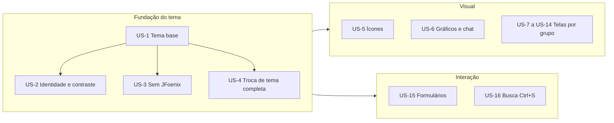

# Requirements — adopt-atlantafx

## Original request
Quero substituir JavaFX por AtlantaFX

(Leitura confirmada em 2026-10-29: adotar o AtlantaFX 3.0.0 como tema base no lugar do Modena e remover o JFoenix; o JavaFX continua como toolkit, agora na versão 27. Ampliada pelo usuário com migração de ícones e redesenho das telas principais.)

## 2.3 Requirements

Origem: respostas do usuário em 2026-10-29, codekb, memória do projeto. Pré-requisito já entregue: Java 25, JavaFX 27.0.1, Kotlin 2.4.21, Spring Boot 4.1.2 em `main` (v2.19.0). [src: .aidlc/261029-java-25-upgrade]

### Functional
| ID | Requirement | Rationale | Acceptance criteria | Priority | Source |
|---|---|---|---|---|---|
| FR-1 | O app usa o **AtlantaFX 3.0.0** (`io.github.mkpaz:atlantafx-base`) como user-agent stylesheet no lugar do Modena. | Tema moderno e coberto de controles; a 3.0.0 exige Java 25 e JavaFX 27. | Given o app iniciado, When a janela principal abre, Then `Application.userAgentStylesheet` aponta para o tema escolhido e nenhum controle usa o visual Modena. | Must | [user] [src: repo1.maven.org] |
| FR-2 | Tema escuro = `Dracula` do AtlantaFX; tema claro = `PrimerLight`. A troca claro/escuro continua nas Configurações e é persistida como hoje (`PreferencesService`). | Decisão do usuário; mantém o comportamento atual de preferência. | Given o tema escolhido, When reinicio o app, Then o mesmo tema é aplicado. | Must | [user] |
| FR-3 | Os tokens `theme-*` (`tokens.light.css`, `tokens.dark.css`) passam a ser uma camada semântica sobre as variáveis `-color-*` do AtlantaFX; as variáveis Modena (`-fx-base`, `-fx-background`, `-fx-accent`...) deixam de ser a base. | O Dracula/Primer do AtlantaFX não usa `-fx-base`; sem o mapeamento os tokens perdem efeito. | Given qualquer tela, When inspeciono o CSS, Then cores de texto, fundo e destaque derivam de `-color-*` via tokens, sem depender de `-fx-base`. | Must | [src: codekb/quality-and-risks.md] |
| FR-4 | A identidade do MOINEX é preservada nos dois temas: roxo de destaque `#BD93F9`, botões em pílula (raio 20, borda 2px) e sidebar verde (`#0a614e`, hover `#106e5b`). | Identidade definida pelo usuário. | Given qualquer tela nos dois temas, When comparo com o design de referência, Then botões, sidebar e destaque seguem essas cores e formas. | Must | [user] [mem: M-001] |
| FR-5 | O **JFoenix é removido**: dependência, imports e uso de `JFXButton` (81 FXML, 14 arquivos Kotlin) viram `Button`; a regra `.jfx-button` vira `.button` mantendo o visual de FR-4. | Biblioteca sem manutenção usada só para um botão. | Given o projeto, When busco "jfoenix", Then não há resultados em código, FXML, CSS ou build; os botões mantêm o visual. | Must | [src: codekb/technology-stack.md] |
| FR-6 | Os overrides de CSS que só redesenham controles nativos (`combo-box`, `data-picker`, `table-view`, `progress-bar`, `menu-button`, `buttons`; ~400 linhas) são removidos ou reduzidos ao que for identidade ou semântica. | O AtlantaFX já estiliza esses controles. | Given o CSS, When comparo antes/depois, Then cada regra restante tem justificativa (identidade, semântica ou controle custom). | Should | [src: codekb/quality-and-risks.md] |
| FR-7 | A troca de tema atualiza **todas as janelas abertas** (principal, diálogos, janelas de popup), e os `Alert`/diálogos nativos (`WindowUtils.show*Dialog`) passam a usar o tema. | Hoje só o `rootPane` atualiza e os `Alert` ficam sem tema. | Given um diálogo aberto, When alterno o tema, Then o diálogo muda na hora; Given um `Alert`, When ele abre, Then usa o tema atual. | Must | [user] |
| FR-8 | Os **69 ícones de interface** (`icon/common` 48, `icon/sidebar` 12, `icon/wallet_type` 9) migram de PNG para ícones vetoriais Ikonli (`FontIcon`), com cor vinda do tema (sem `ColorAdjust`). Ficam em PNG: os 4 ícones do app, as 9 bandeiras de cartão, os 4.009 emojis do chat de IA e os ícones cuja aproximação o usuário recusar na revisão visual (listados). | Decisão do usuário; ícones nítidos e temáveis. | Given as telas e diálogos, When alterno o tema, Then os ícones de interface aprovados mudam de cor sem efeito de imagem; os que ficaram em PNG estão listados e continuam inalterados. | Must | [user] |
| FR-9 | **Redesenho de todas as telas principais** (Home, Resumo anual, Chat de IA, Carteiras, Cartões, Transações, Metas/Planos/FIRE, Wishlist, Poupança — visão geral, ações e fundos, bonds —, Configurações, Central de notificações) com **hierarquia visual e mais respiro**: cards, títulos e espaçamentos consistentes, usando os estilos do AtlantaFX. | Objetivo do usuário. | Given cada tela principal, When aprovo as capturas antes/depois nos dois temas (NFR-3), Then a tela segue o desenho aprovado em 2.5. | Must | [user] |
| FR-10 | **Formulários e diálogos melhores** nos diálogos de criação, edição e visualização (78 arquivos): validação inline, foco inicial no primeiro campo, Enter confirma, Esc cancela, mensagens de erro junto ao campo. | Objetivo do usuário. | Given um diálogo de formulário, When deixo um campo obrigatório vazio e confirmo, Then o erro aparece junto ao campo sem fechar a janela; Enter salva e Esc cancela. | Must | [user] |
| FR-11 | **Navegação e busca**: um único atalho global, **Ctrl+S (search)**, abre uma busca; a pessoa digita o que procura e o app lista as ações correspondentes (ir para uma tela, criar despesa, receita ou transferência, alternar tema, abrir calendário ou calculadora). Não há outros atalhos globais. | Decisão do usuário (2026-10-29, revisada): um atalho só, simples de lembrar. | Given a janela principal, When pressiono Ctrl+S, Then abre a busca com foco no campo; digitar filtra as ações; Enter executa a selecionada; Esc fecha. | Must | [user] |
| FR-12 | O chat de IA (`WebView`) e os gráficos custom de `common/chart/` (`DoughnutChart`, `SankeyChart`, `CircularProgressBar`, `BudgetGroupTimelineChart`, `BudgetGroupGroupedBarChart`, `NetWorthLineChart`) usam as cores do tema novo e não regridem visualmente. | São componentes com CSS próprio. | Given os gráficos e o chat nos dois temas, When comparo antes/depois, Then cores, legendas e eixos acompanham o tema. | Must | [src: codekb/quality-and-risks.md] |

### Non-functional
| ID | Category | Measurable target | Verification | Source |
|---|---|---|---|---|
| NFR-1 | Regressão | Os 1374 testes atuais (ou mais) passam, 0 falhas, em JDK 25. | `JAVA_HOME=/usr/lib/jvm/java-25-openjdk-amd64 ./gradlew ktlintCheck spotlessCheck test` | [src: quality-and-risks.md] |
| NFR-2 | Acessibilidade | Contraste de texto **WCAG AA**: 4,5:1 para texto normal e 3:1 para texto grande, nos dois temas, para os pares texto/fundo dos tokens. | Script que calcula o contraste dos pares de tokens e falha abaixo da meta. | [user] |
| NFR-3 | Aceitação visual | Capturas **antes/depois** das telas principais, nos dois temas, aprovadas pelo usuário; mais a checklist manual de telas e janelas. | Capturas geradas na Construction e anexadas ao `construction/`; aprovação no checkpoint. | [user] [mem: M-003] |
| NFR-4 | Consistência de estilo | Nenhuma cor hexadecimal fixa em CSS fora dos arquivos de tokens e dos gráficos justificados. | `grep` por `#[0-9a-fA-F]{3,8}` nos CSS, com lista de exceções aprovadas. | [mem: M-001] [src: conventions.md] |
| NFR-5 | Desempenho | A abertura da janela principal e a navegação entre telas não pioram mais de 20% em relação à medição feita antes da mudança. | Medição do tempo até a janela principal antes e depois (limite proposto, ver A5). | [inferred] |
| NFR-6 | Reversibilidade | Trabalho na branch `feat/atlantafx`; sem commit antes de o usuário ver o diff. | Histórico do git. | [mem: M-002] [mem: M-004] |
| NFR-7 | i18n | Textos novos entram em `messages_pt_BR.properties` e `messages_en.properties` só com acréscimos de chaves; nunca reescrever o arquivo inteiro. | Revisão do diff dos `.properties`. | [src: CLAUDE.md] |

### Constraints · Out of scope · Glossary
- **Constraints:** JDK 25, JavaFX 27.0.1, Spring Boot 4.1.2 (já em `main`); camadas `service`, `repository` e banco não mudam; sem alterações de schema; preferência de tema persistida como hoje; `AtlantaFX` 3.0.0 usa módulos `atlantafx.base` (e, se necessário, `atlantafx.decorations`/`spins`/`validation`, a decidir no 2.6).
- **Out of scope:** atalhos de teclado além do Ctrl+S, busca de transações, carteiras, metas ou ativos (a busca encontra só telas e ações), reduzir cliques nas tarefas frequentes (não escolhido), oferecer outros temas do AtlantaFX (Nord, Cupertino) nas Configurações, migração para Compose Multiplatform ou mobile, novas funcionalidades de negócio, trocar os PNGs do app, das bandeiras de cartão e dos emojis.
- **Glossary:** *user-agent stylesheet* = folha de estilo base do JavaFX (hoje Modena); *token* = variável de cor semântica `theme-*`; *FontIcon* = nó do Ikonli que desenha um glifo vetorial; *WCAG AA* = nível de contraste mínimo de acessibilidade web.

### Assumptions & open questions
- A1 (confirmada): "substituir JavaFX por AtlantaFX" = AtlantaFX 3.0.0 como tema + remover JFoenix. [user]
- A2 (confirmada): sidebar verde nos dois temas. [user]
- A3 — confirmed: no: o AtlantaFX 3.0.0 (Dracula e PrimerLight) funciona com JavaFX 27.0.1 e Java 25 no MOINEX sem ajustes além do mapeamento de tokens. Verificar na primeira Unit (spike).
- A4 — confirmed: no: um pacote do Ikonli cobre os 69 ícones de interface; os que não tiverem equivalente ficam em PNG e são listados. Pacote a escolher no 2.6.
- A5 — confirmed: no: o limite de +20% em NFR-5 é uma proposta minha; o usuário pode trocar ou removê-lo no gate.
- A6 — confirmed: no: "todas as telas principais" inclui Chat de IA, Configurações e Central de notificações (o usuário marcou "Todas").
- Aberta para 2.4/2.5: forma exata da busca global (FR-11), e o desenho das telas (FR-9) saem dos mockups.

## 2.4 User stories

**Product** — histórias derivadas dos FR do § 2.3 e das respostas do usuário em 2026-10-29. [user]

### Personas

| Persona | Quem é | O que quer |
|---|---|---|
| P1 Dono do MOINEX | Pessoa física no Brasil que controla as próprias finanças em um desktop Linux ou Windows, uso individual e local. | Ver saldos e lançar transações rápido, com uma interface clara, agradável e legível em qualquer hora do dia. [src: .aidlc/codekb/MOINEX/overview.md] |
| P2 Mantenedor | A mesma pessoa no papel de quem evolui o código. | Uma base de estilo simples, sem dependências mortas e com cores num só lugar. [src: .aidlc/codekb/MOINEX/quality-and-risks.md] |

### Mapa das histórias

Caption: a fundação do tema vem primeiro; visual e interação dependem dela e podem andar em paralelo.

### Histórias de fundação (P2 e P1)

#### US-1 Tema base do AtlantaFX (FR-1, FR-2, FR-3) · Persona: P2 Mantenedor
Como mantenedor, quero que o app use o AtlantaFX como tema base, com tokens semânticos sobre as variáveis dele, para controlar as cores em um único lugar.

- AC1: Given o app iniciado com tema escuro, When a janela principal abre, Then o estilo base é o `Dracula` do AtlantaFX; com tema claro, o `PrimerLight`.
- AC2: Given os arquivos de tokens, When inspeciono o CSS, Then texto, fundo e destaque derivam de `-color-*` via tokens `theme-*`, sem depender de `-fx-base`.
- AC3: Given que escolhi um tema, When reinicio o app, Then o mesmo tema é aplicado.

#### US-2 Identidade e contraste (FR-4) · Persona: P1 Dono
Como dono do app, quero que ele continue com a cara do MOINEX nos dois temas e com texto legível, para reconhecê-lo e ler sem esforço.

- AC1: Given qualquer tela nos dois temas, When olho botões, sidebar e destaque, Then os botões são em pílula (raio 20, borda 2px), a sidebar é verde (`#0a614e`, hover `#106e5b`) e o destaque é `#BD93F9`.
- AC2: Given os pares texto/fundo dos tokens de cada tema, When rodo a verificação de contraste, Then todos atingem 4,5:1 (texto normal) ou 3:1 (texto grande), conforme NFR-2.

#### US-3 Sem JFoenix e com menos CSS (FR-5, FR-6) · Persona: P2 Mantenedor
Como mantenedor, quero remover o JFoenix e o CSS que só redesenha controles nativos, para ter menos código de estilo a manter.

- AC1: Given o projeto, When busco "jfoenix" em código, FXML, CSS e build, Then não há resultados e os botões mantêm o visual de US-2.
- AC2: Given os CSS de `combo-box`, `data-picker`, `table-view`, `progress-bar`, `menu-button` e `buttons`, When comparo antes e depois, Then cada regra restante tem justificativa (identidade, semântica ou controle custom).

#### US-4 Troca de tema que vale para tudo (FR-7) · Persona: P1 Dono
Como dono do app, quero que ao trocar o tema todas as janelas mudem na hora, inclusive os avisos, para não ver metade do app no tema errado.

- AC1: Given um diálogo aberto, When alterno o tema, Then o diálogo muda imediatamente.
- AC2: Given uma confirmação ou erro (`Alert`), When ela abre, Then usa o tema atual.

### Histórias visuais (P1)

#### US-5 Ícones nítidos que acompanham o tema (FR-8) · Persona: P1 Dono
Como dono do app, quero ícones vetoriais que mudem de cor com o tema, para vê-los nítidos em qualquer tamanho e tema.

- AC1: Given as telas e diálogos, When alterno o tema, Then os ícones de interface aprovados (dos 69 de common, sidebar e wallet_type) mudam de cor sem efeito de imagem; os recusados na revisão visual ficam em PNG e são listados.
- AC2: Given os 4 ícones do app, as 9 bandeiras de cartão e os emojis do chat, When abro o app, Then continuam em PNG, inalterados.

#### US-6 Gráficos e chat no tema novo (FR-12) · Persona: P1 Dono
Como dono do app, quero que gráficos e chat de IA usem as cores do tema, para não destoarem do restante.

- AC1: Given `DoughnutChart`, `SankeyChart`, `CircularProgressBar` e os gráficos de timeline, barras e patrimônio, When comparo antes e depois nos dois temas, Then cores, legendas e eixos acompanham o tema sem regressão.
- AC2: Given o chat de IA, When abro uma conversa nos dois temas, Then fundo, texto e links do conteúdo renderizado seguem o tema.

#### US-7 a US-14 Redesenho das telas principais (FR-9) · Persona: P1 Dono
Critérios comuns a cada tela: (a) hierarquia visual clara (cards, títulos e espaçamentos consistentes, estilos do AtlantaFX); (b) nenhuma ação existente se perde; (c) capturas antes/depois nos dois temas aprovadas por mim (NFR-3); (d) contraste conforme NFR-2.

| ID | Tela ou grupo | História |
|---|---|---|
| US-7 | Home e Resumo anual | Como dono do app, quero Home e Resumo anual com hierarquia visual clara, para achar saldo e resumo de relance. |
| US-8 | Carteiras | Como dono do app, quero a tela de Carteiras com mais respiro e hierarquia, para ver o saldo de cada conta com clareza. |
| US-9 | Cartões de crédito | Como dono do app, quero a tela de Cartões organizada com faturas e limites bem destacados. |
| US-10 | Transações | Como dono do app, quero a lista de Transações legível e espaçada, para revisar lançamentos sem cansar. |
| US-11 | Metas, Planos e FIRE | Como dono do app, quero Metas, Planos e a calculadora FIRE com progresso e valores em destaque. |
| US-12 | Wishlist | Como dono do app, quero a Wishlist com cartões consistentes com o resto do app. |
| US-13 | Poupança (visão geral, ações e fundos, bonds) | Como dono do app, quero a área de investimentos com hierarquia clara entre totais, alocação e posições. |
| US-14 | Chat de IA, Configurações e Central de notificações | Como dono do app, quero Chat, Configurações e Notificações no mesmo padrão visual das demais telas. |

### Histórias de interação (P1)

#### US-15 Formulários e diálogos melhores (FR-10) · Persona: P1 Dono
Como dono do app, quero formulários que me avisem do erro no próprio campo e se comportem como esperado, para lançar dados rápido e sem retrabalho.

- AC1: Given um diálogo de criar ou editar, When deixo um campo obrigatório vazio ou inválido e confirmo, Then a mensagem de erro aparece junto ao campo e a janela não fecha.
- AC2: Given um diálogo recém-aberto, When ele aparece, Then o foco está no primeiro campo editável.
- AC3: Given o formulário válido, When pressiono Enter, Then salva; When pressiono Esc, Then cancela.
- AC4: Given os 46 diálogos de criar/editar, When abro qualquer um, Then ele tem esse comportamento por uma base comum; nos 9 diálogos de visualização, Esc fecha.

#### US-16 Busca global por Ctrl+S (FR-11) · Persona: P1 Dono
Como dono do app, quero apertar Ctrl+S, digitar o que procuro e ver as ações correspondentes, para ir a uma tela ou criar um lançamento sem procurar no menu.

- AC1: Given a janela principal em qualquer tela, When pressiono Ctrl+S, Then abre a busca com o foco no campo de texto; Esc fecha.
- AC2: Given a busca aberta, When digito parte do nome de uma ação, Then a lista filtra e destaca a primeira; as setas movem a seleção e Enter executa.
- AC3: Given a busca aberta sem texto, When a abro, Then lista as ações disponíveis agrupadas (telas, lançamentos, aplicativo), cada uma com seu ícone.
- AC4: A busca encontra **apenas telas e ações** (não transações, entidades nem ativos), e não existem outros atalhos globais. [user]
- AC5: Given um diálogo modal aberto, When pressiono Ctrl+S, Then nada acontece (Enter já salva), para não ser confundido com "salvar".

### Rastreabilidade FR → história

| FR | Histórias |
|---|---|
| FR-1, FR-2, FR-3 | US-1 |
| FR-4 | US-2 |
| FR-5, FR-6 | US-3 |
| FR-7 | US-4 |
| FR-8 | US-5 |
| FR-9 | US-7, US-8, US-9, US-10, US-11, US-12, US-13, US-14 |
| FR-10 | US-15 |
| FR-11 | US-16 |
| FR-12 | US-6 |

### Assumptions & open questions
- A7 — confirmed: yes (verificado no código em 2026-10-29): o app não tem atalhos globais; as únicas teclas tratadas são locais (calculadora e sugestões). Ctrl+S não conflita. Em diálogos modais fica sem efeito (AC5), porque Ctrl+S costuma significar "salvar".
- A8 — confirmed: no: o catálogo de ações da busca (telas, despesa, receita, transferência, alternar tema, calendário, calculadora) é definido no 2.5 e basta no começo; outras ações vêm a pedido.
- Os 46 diálogos de criar/editar são 28 nas pastas `create` e `update` mais 18 `Add*`/`Edit*` nos domínios. [src: src/main/kotlin/org/moinex/ui/dialog]
