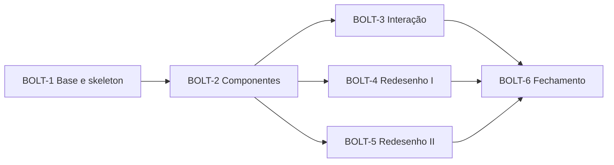

# Tasks — adopt-atlantafx

## 2.9 Delivery plan

- **Verification command:** `JAVA_HOME=/usr/lib/jvm/java-25-openjdk-amd64 ./gradlew ktlintCheck spotlessCheck test` (aprovado em 2026-10-29 pelo usuário). Cada Unit de interface soma: capturas "antes/depois" nos dois temas e a checklist manual (M-003). Os testes de paridade e de contraste dos tokens (UNIT-2) entram no `test`.
- Ordem segue o DAG do `design.md § 2.7`: UNIT-1, UNIT-2, UNIT-3, UNIT-4, UNIT-5, UNIT-6, UNIT-7, UNIT-8 a UNIT-13, UNIT-14.
- **Branch:** `feat/atlantafx` [mem: M-002]. **Commits:** só depois de você ver o diff de cada Unit [mem: M-004]; o hook de pré-commit roda `ktlintCheck` e `test`. **Push e CI** só com o seu "sim" na hora [mem: M-005].
- **Walking skeleton: on.** A UNIT-2 é a menor fatia ponta a ponta (janela principal, um diálogo e um `Alert` mudando de tema juntos); você a aprova explicitamente antes de a UNIT-3 começar.
- **Pré-requisito já entregue:** Java 25, JavaFX 27.0.1, Kotlin 2.4.21 e Spring Boot 4.1.2 em `main` (v2.19.0).

Caption: depois de BOLT-2, interação e os dois bolts de redesenho são independentes; em série por padrão.

### BOLT-1 — Units: UNIT-1, UNIT-2 — Owner: usuário (aprova) e Claude (executa) — Base e skeleton
- Goal: Branch, ferramenta de captura, capturas "antes", tema do AtlantaFX aplicado a janela principal, diálogo e `Alert`.
- Definition of Done: Skeleton aprovado por você; A3, A11, A13, A15, A16 e A19 respondidas; verificação verde.
- Confidence hypothesis: Média: o AtlantaFX 3.0.0 é novo e A3 e A11 podem exigir ajuste no ADR-1.
- Risks/sequencing: Se alguma suposição falhar, voltar ao 2.6 antes da UNIT-3.

### BOLT-2 — Units: UNIT-3, UNIT-4, UNIT-5 — Owner: usuário (aprova) e Claude (executa) — Padronização de componentes
- Goal: JFoenix fora, ícones vetoriais, gráficos e chat no tema.
- Definition of Done: Busca por "jfoenix" vazia; 69 ícones migrados com as aproximações revisadas; gráficos aprovados; verificação verde.
- Confidence hypothesis: Alta: troca mecânica, mas com muitos arquivos (81 FXML de botão e 75 de ícone).
- Risks/sequencing: UNIT-3 e UNIT-4 tocam os mesmos FXML, por isso em série.

### BOLT-3 — Units: UNIT-6, UNIT-7 — Owner: usuário (aprova) e Claude (executa) — Interação
- Goal: Formulários com validação inline e busca por Ctrl+S.
- Definition of Done: 46 diálogos migrados; busca com testes do filtro e smoke manual; verificação verde.
- Confidence hypothesis: Média: A14 e A18 sobre a biblioteca de validação.
- Risks/sequencing: Se a biblioteca não servir, a reserva é validação manual no `FieldValidation`.

### BOLT-4 — Units: UNIT-8, UNIT-9, UNIT-10 — Owner: usuário (aprova) e Claude (executa) — Redesenho I
- Goal: Início, Resumo anual, Carteiras, Cartões e Transações.
- Definition of Done: Capturas antes/depois aprovadas e nenhuma ação perdida.
- Confidence hypothesis: Média: depende do gosto na aprovação das capturas.
- Risks/sequencing: A cada tela, aprovação antes de seguir.

### BOLT-5 — Units: UNIT-11, UNIT-12, UNIT-13 — Owner: usuário (aprova) e Claude (executa) — Redesenho II
- Goal: Metas, Planos, FIRE, Wishlist, Poupança, Chat, Configurações e Notificações.
- Definition of Done: Capturas antes/depois aprovadas e nenhuma ação perdida.
- Confidence hypothesis: Média: tabelas da Poupança com menu por linha (A12).
- Risks/sequencing: Se o menu por linha não agradar, voltar à fileira de botões com o novo estilo.

### BOLT-6 — Units: UNIT-14 — Owner: usuário (aprova) e Claude (executa) — Fechamento
- Goal: Limpeza, medição, documentação e verificação final.
- Definition of Done: `clean build jacocoTestReport` verde, NFR-5 dentro do limite ou aceito, smoke do usuário.
- Confidence hypothesis: Alta.
- Risks/sequencing: —.

## Dependências externas e riscos

- Maven Central para `atlantafx-base`, `atlantafx-validation` 3.0.0, `ikonli-javafx` e `ikonli-material2-pack` 12.4.0 (verificados em 2026-10-29).
- Banco fictício de `scripts/generate_dummy_data.py` precisa servir ao schema atual (T-1.3).
- Em Wayland a captura é feita por dentro do app (`Node.snapshot`); a verificação manual continua necessária para o que o snapshot não mostra (animações, foco).

## Tasks

### UNIT-1 Capturas e medições de base   Status: not started
Covers: NFR-3 (base), NFR-5 (base), NFR-6. Depende de: nenhuma.
- [ ] T-1.1 Criar a branch `feat/atlantafx` a partir de `main` — covers NFR-6 — files: (git) — test: `git branch --show-current`
- [ ] T-1.2 Ignorar `.aidlc/**/screenshots/` no `.gitignore` — covers NFR-3 — files: .gitignore — test: `git check-ignore -v .aidlc/261029-adopt-atlantafx/construction/screenshots/a.png`
- [ ] T-1.3 Verificar `scripts/generate_dummy_data.py` contra o schema atual (34 migrations) e corrigir o que for preciso — covers NFR-3 — files: scripts/generate_dummy_data.py — test: rodar contra um banco migrado e abrir o app sem erro
- [ ] T-1.4 Criar `scripts/capture-screens.sh`: banco fictício em `user.home` descartável (migra, popula) e executa o jar com `-Dmoinex.capture.dir` — covers NFR-3 — files: scripts/capture-screens.sh — test: o script gera a pasta de saída
- [ ] T-1.5 Implementar o `ScreenshotRunner` de desenvolvimento: lê `moinex.capture.dir`, percorre as telas e os dois temas, salva um PNG por tela e encerra com código 0 — covers NFR-3 — files: src/main/kotlin/org/moinex/app/ScreenshotRunner.kt — test: teste unitário da ordem e dos nomes de arquivo; execução gera PNGs
- [ ] T-1.6 Cobrir as telas com `WebView` e gráficos (atraso curto antes do snapshot) e validar A16 e A19 — covers NFR-3 — files: ScreenshotRunner.kt — test: PNG do chat e do fluxo de dinheiro não vazios
- [ ] T-1.7 Gerar as capturas "antes" nos dois temas (16 telas, sem busca e `Alert`) em `construction/screenshots/before` — covers NFR-3 — files: (saída local) — test: 32 PNGs não vazios
- [ ] T-1.8 Medir o tempo até a janela principal (média de 5 execuções) e registrar em `construction/baseline.md` — covers NFR-5 — files: construction/baseline.md — test: arquivo com 5 medidas e a média
- [ ] T-1.9 Rodar a verificação e confirmar que sem a propriedade o app se comporta como hoje — covers NFR-1 — files: (todos) — test: `JAVA_HOME=/usr/lib/jvm/java-25-openjdk-amd64 ./gradlew ktlintCheck spotlessCheck test` e `bootRun` normal

### UNIT-2 Fundação do tema (walking skeleton)   Status: not started
Covers: US-1, US-2, US-4; FR-1, FR-2, FR-3, FR-4, FR-7; NFR-2. Depende de: UNIT-1. Aprovação explícita do skeleton antes da UNIT-3.
- [ ] T-2.1 Adicionar `io.github.mkpaz:atlantafx-base:3.0.0` ao catálogo e ao build — covers FR-1, US-1 — files: gradle/libs.versions.toml, build.gradle.kts — test: `./gradlew compileKotlin`
- [ ] T-2.2 `ThemeService.install()`: tema base por `ThemeManager` (Dracula no escuro, PrimerLight no claro), chamado na inicialização do JavaFX — covers FR-1, FR-2, US-1 — files: service/ThemeService.kt, app/JavaFXApp.kt — test: teste unitário da escolha de tema; app abre com o tema
- [ ] T-2.3 Listener em `Window.getWindows()` que aplica os tokens a toda `Scene`; `toggleAndApply()` reaplica em todas as janelas abertas — covers FR-7, US-4 — files: service/ThemeService.kt — test: diálogo aberto muda ao alternar (checklist manual)
- [ ] T-2.4 Reescrever `tokens.dark.css` e `tokens.light.css` com a paleta do § 2.8 mapeada em `-color-*`, mantendo os tokens antigos — covers FR-3, FR-4, US-1, US-2 — files: css/theme/tokens.*.css — test: captura nos dois temas
- [ ] T-2.5 Teste de paridade de nomes de token entre os dois arquivos (`ThemeTokensTest`) — covers FR-3, US-1 — files: src/test/kotlin/org/moinex/ui/theme/ThemeTokensTest.kt — test: `./gradlew test --tests "*ThemeTokensTest"`
- [ ] T-2.6 Teste de contraste dos pares do § 2.8 (`ThemeContrastTest`) — covers NFR-2, US-2 — files: src/test/kotlin/org/moinex/ui/theme/ThemeContrastTest.kt — test: `./gradlew test --tests "*ThemeContrastTest"`
- [ ] T-2.7 Sobrepor o roxo do Dracula por `#BD93F9` e confirmar A11 — covers FR-4, US-2 — files: css/theme/tokens.*.css — test: captura mostra o destaque `#BD93F9`
- [ ] T-2.8 Regra de pílula para `.button` (e `.jfx-button` durante a transição), sidebar verde e indicador claro — covers FR-4, US-2 — files: css/component/buttons.css, css/scene/main.css — test: captura da janela principal
- [ ] T-2.9 `Alert` temado em `WindowUtils.show*Dialog` e confirmar A15 — covers FR-7, US-4 — files: common/util/WindowUtils.kt — test: captura de um `Alert` nos dois temas
- [ ] T-2.10 Remover as chamadas manuais de tokens em `WindowUtils` e `MainController` (o listener cobre) — covers FR-7, US-4 — files: common/util/WindowUtils.kt, ui/main/MainController.kt — test: janelas novas já abrem com o tema
- [ ] T-2.11 Capturas do skeleton (janela principal, um diálogo e um `Alert`) nos dois temas e checklist de alternância com diálogo aberto — covers US-4, NFR-3 — files: (saída local) — test: capturas e checklist aprovados
- [ ] T-2.12 Registrar o resultado de A3, A11, A13 e A15 no `design.md` e atualizar o ADR-1; pedir a aprovação do skeleton — covers US-1 — files: design.md § 2.6 — test: aprovação do usuário
- [ ] T-2.13 Rodar a verificação — covers NFR-1 — files: (todos) — test: `JAVA_HOME=/usr/lib/jvm/java-25-openjdk-amd64 ./gradlew ktlintCheck spotlessCheck test`

### UNIT-3 JFoenix e CSS redundante   Status: not started
Covers: US-3; FR-5, FR-6; NFR-4 (parte). Depende de: UNIT-2.
- [ ] T-3.1 Script de substituição de `JFXButton` por `Button` (tag e import) nos 81 FXML — covers FR-5, US-3 — files: src/main/resources/ui/**/*.fxml — test: `grep -r JFXButton src/main/resources` sem resultados
- [ ] T-3.2 Revisar o diff e rodar o app: FXML de `main` e `common` (17) — covers FR-5, US-3 — files: ui/main, ui/common — test: navegar pelas telas principais
- [ ] T-3.3 Revisar o diff dos diálogos de `wallettransaction` e `creditcard` (25) — covers FR-5, US-3 — files: ui/dialog/wallettransaction, ui/dialog/creditcard — test: abrir um diálogo de cada
- [ ] T-3.4 Revisar o diff dos diálogos de `investment` (23) — covers FR-5, US-3 — files: ui/dialog/investment — test: abrir um diálogo de bonds e de ações
- [ ] T-3.5 Revisar o diff dos demais diálogos (16: add, ai, edit, financialplanning, goal, manage, wishlist) — covers FR-5, US-3 — files: ui/dialog/* — test: abrir um de cada pasta
- [ ] T-3.6 Trocar o tipo `JFXButton` por `Button` nos 14 arquivos Kotlin — covers FR-5, US-3 — files: ui/**/*.kt — test: `./gradlew compileKotlin`
- [ ] T-3.7 Remover a dependência `jfoenix` do catálogo e do build e a regra `.jfx-button` — covers FR-5, US-3 — files: gradle/libs.versions.toml, build.gradle.kts, css/component/buttons.css — test: `grep -ri jfoenix` sem resultados em código, FXML, CSS e build
- [ ] T-3.8 Script para tirar dos FXML as referências por nó a CSS de componente substituído (`combo-box`, `data-picker`, `buttons`, `menu-button`) — covers FR-6, US-3 — files: src/main/resources/ui/**/*.fxml — test: `grep` das referências removidas; telas continuam estilizadas
- [ ] T-3.9 Reduzir `combo-box.css`, `data-picker.css` e `menu-button.css` ao que é identidade ou semântica — covers FR-6, US-3 — files: css/component/ — test: captura de um diálogo com combo e data
- [ ] T-3.10 Reduzir `table-view.css` e `progress-bar.css` e justificar o que restar — covers FR-6, US-3 — files: css/component/ — test: captura de uma tabela e de uma barra
- [ ] T-3.11 Criar as classes compartilhadas do § 2.8 (`card`, `page-title`, `card-title`, `card-subtitle`, `value-large`) em `common-styles.css` e `Styles.kt` — covers FR-6, US-3 — files: css/common/common-styles.css, common/constant/Styles.kt — test: `./gradlew compileKotlin`
- [ ] T-3.12 Achar cores hexadecimais fora dos tokens, mover para tokens ou listar como exceção justificada — covers NFR-4 — files: css/** — test: lista de exceções no `construction/`
- [ ] T-3.13 Capturas das telas principais depois da UNIT-3 e comparação com o "antes" para regressões grosseiras — covers NFR-3 — files: (saída local) — test: capturas aprovadas
- [ ] T-3.14 Rodar a verificação — covers NFR-1 — files: (todos) — test: `JAVA_HOME=/usr/lib/jvm/java-25-openjdk-amd64 ./gradlew ktlintCheck spotlessCheck test`

### UNIT-4 Ícones Ikonli   Status: not started
Covers: US-5; FR-8. Depende de: UNIT-3.
- [ ] T-4.1 Adicionar `ikonli-javafx` e `ikonli-material2-pack` 12.4.0 ao catálogo e ao build — covers FR-8, US-5 — files: gradle/libs.versions.toml, build.gradle.kts — test: `./gradlew compileKotlin`
- [ ] T-4.2 Criar `Icons.kt` com as constantes dos 69 glifos (anexo do § 2.6) e a função `icon()`; teste de que todo literal existe no pacote — covers FR-8, US-5 — files: common/ui/Icons.kt, src/test/.../IconsTest.kt — test: `./gradlew test --tests "*IconsTest"`
- [ ] T-4.3 Criar `IconMapper.walletType` com a reserva em PNG e teste do mapa nome de arquivo → glifo — covers FR-8, US-5 — files: common/ui/IconMapper.kt, src/test/.../IconMapperTest.kt — test: `./gradlew test --tests "*IconMapperTest"`
- [ ] T-4.4 Classe `.app-icon` com `-fx-icon-color: theme-icon` nos CSS comuns — covers FR-8, US-5 — files: css/common/common-styles.css — test: captura de um ícone nos dois temas
- [ ] T-4.5 Sidebar e rodapé do `main.fxml` — covers FR-8, US-5 — files: ui/main/main.fxml — test: captura da janela principal
- [ ] T-4.6 FXML de `main` (13 arquivos com `ImageView`) — covers FR-8, US-5 — files: ui/main/*.fxml — test: navegar pelas telas
- [ ] T-4.7 FXML de `common` (4) e dos diálogos de `wallettransaction` (13) — covers FR-8, US-5 — files: ui/common, ui/dialog/wallettransaction — test: abrir diálogos
- [ ] T-4.8 FXML dos diálogos de `creditcard` (11), `financialplanning` (4), `goal` (2) e `wishlist` (2) — covers FR-8, US-5 — files: ui/dialog/* — test: abrir diálogos
- [ ] T-4.9 FXML dos diálogos de `investment` (21) — covers FR-8, US-5 — files: ui/dialog/investment — test: abrir diálogos
- [ ] T-4.10 FXML dos demais diálogos (add, ai, edit, manage: 5) — covers FR-8, US-5 — files: ui/dialog/* — test: abrir diálogos
- [ ] T-4.11 Kotlin: trocar `Image`/`ImageView` de ícone por `FontIcon` (sucesso, recarregar, mostrar/ocultar, troféu, receita/despesa, tipo de carteira) — covers FR-8, US-5 — files: WindowUtils.kt, Home/Savings/Wallet/GoalPane controllers — test: `./gradlew compileKotlin` e captura
- [ ] T-4.12 Remover `applyIconTheme`, o tratamento de `colored-icon` no `ThemeService` e os PNGs e constantes sem uso — covers FR-8, US-5 — files: common/extension/JavaFxUtils.kt, service/ThemeService.kt, common/constant/Files.kt — test: busca por `applyIconTheme` e `ColorAdjust` sem resultados
- [ ] T-4.13 Revisar com o usuário as 11 aproximações nas capturas; as recusadas ficam em PNG — covers FR-8, US-5 — files: design.md § 2.6 (anexo) — test: aprovação do usuário
- [ ] T-4.14 Rodar a verificação — covers NFR-1 — files: (todos) — test: `JAVA_HOME=/usr/lib/jvm/java-25-openjdk-amd64 ./gradlew ktlintCheck spotlessCheck test`

### UNIT-5 Gráficos e chat no tema   Status: not started
Covers: US-6; FR-12. Depende de: UNIT-3.
- [ ] T-5.1 Definir as cores de série `chart-color-1..20` para os dois temas dentro de NFR-2 — covers FR-12, US-6 — files: css/component/charts.css, css/theme/tokens.*.css — test: `ThemeContrastTest` estendido
- [ ] T-5.2 `charts.css` e `timeline-chart.css` ligados aos tokens — covers FR-12, US-6 — files: css/component/ — test: captura dos gráficos
- [ ] T-5.3 `DoughnutChart` e `CircularProgressBar` no tema novo — covers FR-12, US-6 — files: common/chart/ — test: captura nos dois temas
- [ ] T-5.4 `SankeyChart` no tema novo — covers FR-12, US-6 — files: common/chart/SankeyChart.kt — test: captura nos dois temas
- [ ] T-5.5 `BudgetGroupTimelineChart`, `BudgetGroupGroupedBarChart` e `NetWorthLineChart` no tema novo — covers FR-12, US-6 — files: common/chart/ — test: captura nos dois temas
- [ ] T-5.6 CSS do `WebView` do chat de IA com as cores dos tokens — covers FR-12, US-6 — files: ui/main/AiChatController.kt, ai/chat/MarkdownRenderer.kt — test: captura de uma conversa nos dois temas
- [ ] T-5.7 Capturas antes/depois dos gráficos e do chat para aprovação — covers NFR-3 — files: (saída local) — test: aprovação do usuário
- [ ] T-5.8 Rodar a verificação — covers NFR-1 — files: (todos) — test: `JAVA_HOME=/usr/lib/jvm/java-25-openjdk-amd64 ./gradlew ktlintCheck spotlessCheck test`

### UNIT-6 Formulários e diálogos   Status: not started
Covers: US-15; FR-10; NFR-7. Depende de: UNIT-3, UNIT-4.
- [ ] T-6.1 Adicionar `io.github.mkpaz:atlantafx-validation:3.0.0` ao catálogo e ao build — covers FR-10, US-15 — files: gradle/libs.versions.toml, build.gradle.kts — test: `./gradlew compileKotlin`
- [ ] T-6.2 `FieldValidation` com as regras `required`, `positiveNumber`, número e data inválidos, e testes unitários da lógica — covers FR-10, US-15 — files: common/ui/FieldValidation.kt, src/test/.../FieldValidationTest.kt — test: `./gradlew test --tests "*FieldValidationTest"`
- [ ] T-6.3 `DialogForm.install` (foco inicial, Enter, Esc) e teste da regra "Enter não dispara em área de texto" — covers FR-10, US-15 — files: common/ui/DialogForm.kt, src/test/.../DialogFormTest.kt — test: `./gradlew test --tests "*DialogFormTest"`
- [ ] T-6.4 CSS `field-error`, `field-invalid` e layout de uma coluna dos diálogos — covers FR-10, US-15 — files: css/common/common-styles.css — test: captura de um diálogo com erro
- [ ] T-6.5 Chaves `dialog.validation.*` por acréscimo nas duas `.properties` e em `TranslationKeys.kt` — covers NFR-7, US-15 — files: i18n/messages_*.properties, common/constant/TranslationKeys.kt — test: revisão do diff das `.properties`
- [ ] T-6.6 Piloto: `AddExpense`, `AddIncome` e `AddTransfer` migrados; confirmar A14 e A18 — covers FR-10, US-15 — files: ui/dialog/wallettransaction/create/ — test: abrir os três e provocar erro
- [ ] T-6.7 Migrar `AddRecurringTransaction`, `AddWallet`, `ChangeWalletBalance` e `ChangeWalletType` — covers FR-10, US-15 — files: ui/dialog/wallettransaction/ — test: abrir cada um e provocar erro
- [ ] T-6.8 Migrar `EditRecurringTransaction`, `EditTransaction`, `EditTransfer` e `RenameWallet` — covers FR-10, US-15 — files: ui/dialog/wallettransaction/ — test: abrir cada um e provocar erro
- [ ] T-6.9 Migrar os diálogos de `creditcard`: `AddCreditCard`, `AddCreditCardCredit`, `AddCreditCardDebt`, `EditCreditCard` — covers FR-10, US-15 — files: ui/dialog/creditcard/ — test: abrir cada um e provocar erro
- [ ] T-6.10 Migrar `AddRecurringCreditCardDebt`, `EditCreditCardDebt` e `EditRecurringCreditCardDebt` — covers FR-10, US-15 — files: ui/dialog/creditcard/ — test: abrir cada um e provocar erro
- [ ] T-6.11 Migrar `financialplanning` (4), `goal` (2) e `wishlist` (2) — covers FR-10, US-15 — files: ui/dialog/financialplanning, goal, wishlist — test: abrir cada um e provocar erro
- [ ] T-6.12 Migrar os três da raiz: `AddCalendarEvent`, `AddCategory` e `EditCategory` — covers FR-10, US-15 — files: ui/dialog/ — test: abrir cada um e provocar erro
- [ ] T-6.13 Migrar os de bonds: `AddBond`, `AddBondPurchase`, `AddBondSale`, `EditBond`, `EditBondPurchase`, `EditBondSale` — covers FR-10, US-15 — files: ui/dialog/investment/ — test: abrir cada um e provocar erro
- [ ] T-6.14 Migrar os de ações: `AddTicker`, `AddTickerPurchase`, `AddTickerSale`, `EditTicker` — covers FR-10, US-15 — files: ui/dialog/investment/ — test: abrir cada um e provocar erro
- [ ] T-6.15 Migrar `EditTickerPurchase`, `EditTickerSale`, `AddDividend` e `EditDividend` — covers FR-10, US-15 — files: ui/dialog/investment/ — test: abrir cada um e provocar erro
- [ ] T-6.16 Migrar `AddCryptoExchange`, `EditCryptoExchange` e `EditInvestmentTarget` — covers FR-10, US-15 — files: ui/dialog/investment/ — test: abrir cada um e provocar erro
- [ ] T-6.17 Esc fecha os 9 diálogos de visualização — covers FR-10, US-15 — files: ui/dialog/**/view/ — test: abrir cada um e apertar Esc
- [ ] T-6.18 Remover o `Alert` de campos vazios dos diálogos migrados e conferir que nenhuma regra de negócio mudou — covers FR-10, US-15 — files: ui/dialog/** — test: busca por `EMPTY_FIELDS` nos diálogos migrados
- [ ] T-6.19 Capturas de diálogos com erro nos dois temas e checklist por domínio; confirmar o ADR-5 — covers NFR-3, US-15 — files: (saída local) — test: aprovação do usuário
- [ ] T-6.20 Rodar a verificação — covers NFR-1 — files: (todos) — test: `JAVA_HOME=/usr/lib/jvm/java-25-openjdk-amd64 ./gradlew ktlintCheck spotlessCheck test`

### UNIT-7 Busca global por Ctrl+S   Status: not started
Covers: US-16; FR-11; NFR-7. Depende de: UNIT-2, UNIT-4.
- [ ] T-7.1 `SearchGroup`, `SearchAction` e `SearchMatcher` com testes (acentos, sinônimos, ordenação) — covers FR-11, US-16 — files: ui/common/search/, src/test/.../SearchMatcherTest.kt — test: `./gradlew test --tests "*SearchMatcherTest"`
- [ ] T-7.2 `SearchActionCatalog` com as 23 ações ligadas a `MainController.loadContent` e aos diálogos de despesa, receita e transferência — covers FR-11, US-16 — files: ui/common/search/SearchActionCatalog.kt — test: teste de que o catálogo tem 23 ações com ids únicos
- [ ] T-7.3 Chaves `search.*` e `main.search.hint`, títulos e sinônimos das 23 ações, por acréscimo nas duas `.properties` — covers NFR-7, US-16 — files: i18n/messages_*.properties, TranslationKeys.kt — test: revisão do diff das `.properties`
- [ ] T-7.4 Overlay `GlobalSearch` no `rootPane` (scrim, painel, lista, setas, Enter, Esc) reaproveitando o padrão da central de notificações — covers FR-11, US-16 — files: ui/common/GlobalSearch.kt, ui/main/MainController.kt — test: abrir e filtrar manualmente
- [ ] T-7.5 Filtro de teclado Ctrl+S na `Scene` principal e sem efeito nas janelas modais — covers FR-11, US-16 — files: ui/main/MainController.kt — test: Ctrl+S abre na principal e não faz nada num diálogo
- [ ] T-7.6 Indicador "Buscar telas e ações  Ctrl S" na barra superior da janela principal — covers FR-11, US-16 — files: ui/main/main.fxml, css/scene/main.css — test: captura nos dois temas
- [ ] T-7.7 Capturas da busca e checklist manual (abrir, filtrar, executar cada grupo, Esc) — covers NFR-3, US-16 — files: (saída local) — test: aprovação do usuário
- [ ] T-7.8 Rodar a verificação — covers NFR-1 — files: (todos) — test: `JAVA_HOME=/usr/lib/jvm/java-25-openjdk-amd64 ./gradlew ktlintCheck spotlessCheck test`

### UNIT-8 Redesenho: Início e Resumo anual   Status: not started
Covers: US-7; FR-9. Depende de: UNIT-4, UNIT-5.
- [ ] T-8.1 Início: grade fluida sem larguras mínimas fixas e os três blocos superiores como `card` — covers FR-9, US-7 — files: ui/main/home.fxml, css/scene/home.css — test: captura nos dois temas
- [ ] T-8.2 Início: Fluxo de dinheiro e Últimas transações em cards; "recalcular patrimônio" como ação secundária no cabeçalho — covers FR-9, US-7 — files: ui/main/home.fxml, HomeController.kt — test: captura e botão funcionando
- [ ] T-8.3 Início: painéis de carteira, cartão e resumo do mês (`ui/common`) no padrão novo — covers FR-9, US-7 — files: ui/common/*_pane.fxml, resume_pane.fxml — test: captura
- [ ] T-8.4 Resumo anual: faixa de quatro indicadores e fluxo mensal — covers FR-9, US-7 — files: ui/main/annual_summary.fxml, css/scene/annual_summary.css — test: captura
- [ ] T-8.5 Resumo anual: tabelas por categoria lado a lado, maiores despesas e insights — covers FR-9, US-7 — files: ui/main/annual_summary.fxml — test: captura
- [ ] T-8.6 Checklist de ações das duas telas e capturas antes/depois para aprovação — covers NFR-3, US-7 — files: (saída local) — test: aprovação do usuário
- [ ] T-8.7 Rodar a verificação — covers NFR-1 — files: (todos) — test: `JAVA_HOME=/usr/lib/jvm/java-25-openjdk-amd64 ./gradlew ktlintCheck spotlessCheck test`

### UNIT-9 Redesenho: Carteiras e Cartões   Status: not started
Covers: US-8, US-9; FR-9. Depende de: UNIT-4, UNIT-5.
- [ ] T-9.1 Carteiras: saldo total em destaque e lista de carteiras em cards — covers FR-9, US-8 — files: ui/main/wallet.fxml, css/scene/wallet.css — test: captura
- [ ] T-9.2 Carteiras: gráficos em dois cards e botões (adicionar carteira, transferência, transferências, arquivadas) no cabeçalho — covers FR-9, US-8 — files: ui/main/wallet.fxml — test: captura e botões funcionando
- [ ] T-9.3 Cartões: cards de cartão com barra de limite e vencimento — covers FR-9, US-9 — files: ui/main/credit_card.fxml, ui/common/credit_card_pane.fxml — test: captura
- [ ] T-9.4 Cartões: total de dívidas e gráfico de dívidas em cards — covers FR-9, US-9 — files: ui/main/credit_card.fxml — test: captura
- [ ] T-9.5 Cartões: tabela de dívidas num card com busca no topo e ações no cabeçalho — covers FR-9, US-9 — files: ui/main/credit_card.fxml, css/scene/credit-card.css — test: captura e ações funcionando
- [ ] T-9.6 Checklist de ações das duas telas e capturas antes/depois para aprovação — covers NFR-3, US-8, US-9 — files: (saída local) — test: aprovação do usuário
- [ ] T-9.7 Rodar a verificação — covers NFR-1 — files: (todos) — test: `JAVA_HOME=/usr/lib/jvm/java-25-openjdk-amd64 ./gradlew ktlintCheck spotlessCheck test`

### UNIT-10 Redesenho: Transações   Status: not started
Covers: US-10; FR-9. Depende de: UNIT-4, UNIT-5.
- [ ] T-10.1 Resumo mensal e gráfico por categoria em cards — covers FR-9, US-10 — files: ui/main/transaction.fxml, css/scene/transaction.css — test: captura
- [ ] T-10.2 Lista de transações em card com filtros (período e busca) no topo — covers FR-9, US-10 — files: ui/main/transaction.fxml — test: captura e filtros funcionando
- [ ] T-10.3 Ações (receita, despesa, categorias, periódicas) no cabeçalho — covers FR-9, US-10 — files: ui/main/transaction.fxml — test: botões abrem os diálogos
- [ ] T-10.4 Checklist de ações e capturas antes/depois para aprovação — covers NFR-3, US-10 — files: (saída local) — test: aprovação do usuário
- [ ] T-10.5 Rodar a verificação — covers NFR-1 — files: (todos) — test: `JAVA_HOME=/usr/lib/jvm/java-25-openjdk-amd64 ./gradlew ktlintCheck spotlessCheck test`

### UNIT-11 Redesenho: Metas, Planos, FIRE e Wishlist   Status: not started
Covers: US-11, US-12; FR-9. Depende de: UNIT-4, UNIT-5.
- [ ] T-11.1 Abas (Metas, Planos, FIRE, Wishlist) no padrão do tema — covers FR-9, US-11 — files: ui/main/goals_and_plans.fxml, css/scene/goals_and_plans.css — test: captura das quatro abas
- [ ] T-11.2 Metas: em andamento e concluídas em cards com barra de progresso e filtros — covers FR-9, US-11 — files: ui/main/goals.fxml, css/scene/goals.css — test: captura
- [ ] T-11.3 Planos: grupos de orçamento, distribuição e linha do tempo — covers FR-9, US-11 — files: ui/main/plans.fxml, css/scene/plans.css — test: captura
- [ ] T-11.4 FIRE: formulário em uma coluna à esquerda e resultado e gráfico à direita — covers FR-9, US-11 — files: ui/main/fire_calculator.fxml, css/scene/fire_calculator.css — test: captura e cálculo funcionando
- [ ] T-11.5 Wishlist: filtros em `SegmentedControl` e busca, tabela num card — covers FR-9, US-12 — files: ui/main/wishlist.fxml, css/scene/wishlist.css — test: captura e filtros funcionando
- [ ] T-11.6 Wishlist: dois gráficos em cards — covers FR-9, US-12 — files: ui/main/wishlist.fxml — test: captura
- [ ] T-11.7 Checklist de ações e capturas antes/depois para aprovação — covers NFR-3, US-11, US-12 — files: (saída local) — test: aprovação do usuário
- [ ] T-11.8 Rodar a verificação — covers NFR-1 — files: (todos) — test: `JAVA_HOME=/usr/lib/jvm/java-25-openjdk-amd64 ./gradlew ktlintCheck spotlessCheck test`

### UNIT-12 Redesenho: Poupança   Status: not started
Covers: US-13; FR-9. Depende de: UNIT-4, UNIT-5.
- [ ] T-12.1 Abas da Poupança (Visão geral, Ações e fundos, Bonds) no padrão do tema — covers FR-9, US-13 — files: ui/main/savings.fxml, css/scene/savings.css — test: captura das três abas
- [ ] T-12.2 Visão geral: indicadores do Brasil e commodities em cards — covers FR-9, US-13 — files: ui/main/savings_overview.fxml — test: captura
- [ ] T-12.3 Visão geral: alocação, metas de alocação e métricas — covers FR-9, US-13 — files: ui/main/savings_overview.fxml — test: captura
- [ ] T-12.4 Ações e fundos: tabela num card com menu de ações por linha no lugar da fileira de botões (A12) — covers FR-9, US-13 — files: ui/main/savings_stocks_funds.fxml — test: captura e todas as ações acessíveis
- [ ] T-12.5 Bonds: tabela num card com menu de ações por linha (A12) — covers FR-9, US-13 — files: ui/main/savings_bonds.fxml — test: captura e todas as ações acessíveis
- [ ] T-12.6 Checklist de ações e capturas antes/depois para aprovação — covers NFR-3, US-13 — files: (saída local) — test: aprovação do usuário
- [ ] T-12.7 Rodar a verificação — covers NFR-1 — files: (todos) — test: `JAVA_HOME=/usr/lib/jvm/java-25-openjdk-amd64 ./gradlew ktlintCheck spotlessCheck test`

### UNIT-13 Redesenho: Chat de IA, Configurações e Notificações   Status: not started
Covers: US-14; FR-9. Depende de: UNIT-4, UNIT-5.
- [ ] T-13.1 Chat de IA: bolhas no tema, campo fixo no rodapé e aviso como `Message` — covers FR-9, US-14 — files: ui/main/ai_chat.fxml, css/scene/ai_chat.css — test: captura e envio funcionando
- [ ] T-13.2 Configurações: cards por seção (IA, banco de dados, idioma, meta de poupança) com ações no rodapé — covers FR-9, US-14 — files: ui/main/settings.fxml, css/scene/settings.css — test: captura e salvar funcionando
- [ ] T-13.3 Central de notificações: painel no tema novo, estado vazio com `Message`, ações no cabeçalho — covers FR-9, US-14 — files: ui/main/notification_center.fxml, css/component/notification.css — test: captura e ações funcionando
- [ ] T-13.4 Checklist de ações e capturas antes/depois para aprovação — covers NFR-3, US-14 — files: (saída local) — test: aprovação do usuário
- [ ] T-13.5 Rodar a verificação — covers NFR-1 — files: (todos) — test: `JAVA_HOME=/usr/lib/jvm/java-25-openjdk-amd64 ./gradlew ktlintCheck spotlessCheck test`

### UNIT-14 Fechamento   Status: not started
Covers: NFR-1 (final), NFR-3 (consolidado), NFR-4 (final), NFR-5 (depois), NFR-6. Depende de: UNIT-6, UNIT-7, UNIT-8 a UNIT-13.
- [ ] T-14.1 Remover CSS morto e tokens antigos sem uso — covers NFR-4 — files: css/** — test: busca por tokens sem referência
- [ ] T-14.2 Busca final de cores hexadecimais fora dos tokens com a lista de exceções aprovada — covers NFR-4 — files: css/** — test: lista de exceções aprovada
- [ ] T-14.3 Medir de novo o tempo até a janela principal e comparar com a base (limite de 20%, A5) — covers NFR-5 — files: construction/baseline.md — test: comparação registrada
- [ ] T-14.4 Capturas finais consolidadas nos dois temas — covers NFR-3 — files: (saída local) — test: aprovação do usuário
- [ ] T-14.5 Revisar o diff final das `.properties` (só acréscimos) — covers NFR-7 — files: i18n/messages_*.properties — test: `git diff` mostra só linhas adicionadas
- [ ] T-14.6 Atualizar `CLAUDE.md` e `README.md` (AtlantaFX e Ikonli no lugar do JFoenix, pino do tema e ordem de tokens) — covers NFR-1 — files: CLAUDE.md, README.md — test: leitura
- [ ] T-14.7 `./gradlew clean build jacocoTestReport` em JDK 25 — covers NFR-1 — files: (todos) — test: BUILD SUCCESSFUL e 1374 testes ou mais
- [ ] T-14.8 Smoke manual completo (checklist de telas, diálogos, busca, tema) pelo usuário — covers NFR-3 — files: (todos) — test: checklist marcada pelo usuário

### Assumptions & open questions

- A3, A4, A11, A13, A14, A15, A16, A18 e A19 são respondidas nas tarefas indicadas (UNIT-1, UNIT-2, UNIT-4 e UNIT-6); as respostas atualizam o `state.md` e os ADRs.
- Total: 133 tarefas em 14 Units.
