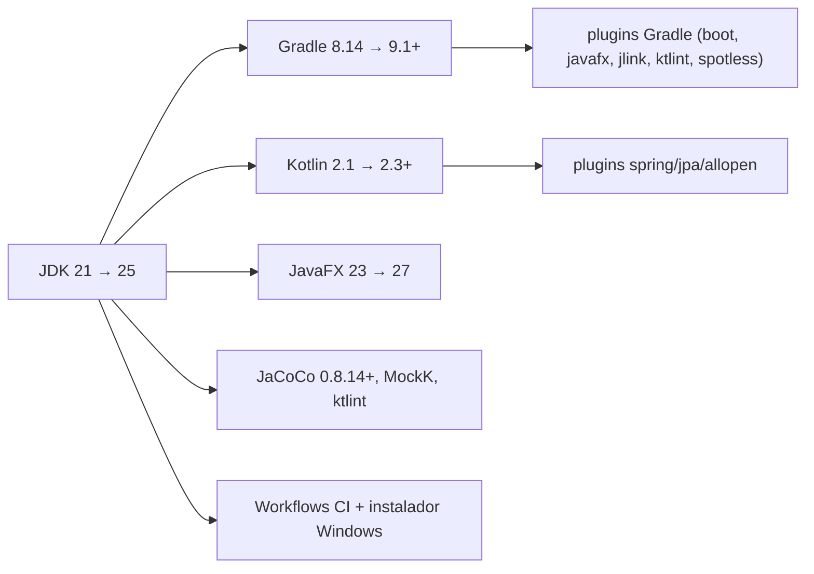

# Design — java-25-upgrade

## 2.1 Codebase analysis

Reaproveita `.aidlc/codekb/MOINEX/` (commit d38e3ee1 = HEAD, human-reviewed em 2026-10-29; não precisa de `update`). [src: .aidlc/codekb/MOINEX/README.md]

**Baseline**: `./gradlew test` com `JAVA_HOME` = JDK 21: 1374 testes, 0 falhas, ~1 min. [src: .aidlc/codekb/MOINEX/quality-and-risks.md]

**Pontos de build que a mudança toca** (lidos em 2026-10-29)
| Item | Hoje | Observação |
|---|---|---|
| JDK | 21 (`sourceCompatibility`/`release` = 21, Kotlin `jvmTarget` = 21) | JDK 25 já instalado na máquina, é o `java` padrão | [src: build.gradle.kts:101-104,125,183] |
| Gradle | 8.14 | Gradle só roda no Java 25 a partir da **9.1.0** (inferido de busca web; confirmar na Construction) [src: gradle/wrapper/gradle-wrapper.properties:3] |
| Kotlin | 2.1.0 (plugins `jvm`, `spring`, `jpa`, `allopen`) | precisa subir; o Gradle é testado com Kotlin até 2.3.20 (busca web); Maven Central tem 2.3.x e 2.4.x [src: build.gradle.kts:7-10] |
| JavaFX | 23.0.1 | JavaFX 27.0.1 existe no Maven Central [src: gradle/libs.versions.toml:20-22] |
| Spring Boot | 3.5.11 | decisão: manter 3.5.x ou ir para 4.x (migração grande) |
| JaCoCo | 0.8.13 | 0.8.14 é a primeira com suporte oficial a Java 25 (busca web) [src: gradle/libs.versions.toml:38] |
| MockK | 1.13.8 (68 arquivos de teste) | versão antiga; bytecode Java 25 pode exigir versão nova |
| Plugin jlink | `org.beryx.jlink` 3.0.1, aplicado sem bloco `jlink {}` | o instalador Windows usa `jpackage` via script [src: build.gradle.kts:14] [src: scripts/build-windows-installer.bat] |
| CI | `java-version: '21'` (Temurin) em `pipeline.yml` e `build-windows-installer.yml` | [src: .github/workflows/] |
| Docs/scripts | `Makefile:4` e `CLAUDE.md:32` fixam `java-21-openjdk-amd64`; `scripts/install.sh:171` cita "java 21" | [src: Makefile, CLAUDE.md, scripts/install.sh] |
| Dependências sem uso no código | Lombok (+ `annotationProcessor`), Mockito, google-java-format, reflections, commons-beanutils | nenhuma importação em `src/` [src: grep] |

Caption: tudo depende da escolha do JDK; Gradle e Kotlin são os dois elos que precisam subir antes do restante.

### Assumptions & open questions
- Confirmar no build: versão mínima do Gradle e compatibilidade dos plugins `org.openjfx.javafxplugin` 0.1.0, `org.beryx.jlink` 3.0.1, Spotless 6.25.0 e ktlint com Gradle 9.
- Tema da AtlantaFX (intent 261029-adopt-atlantafx) só depende de JDK 25 + JavaFX 27 estarem no main.
