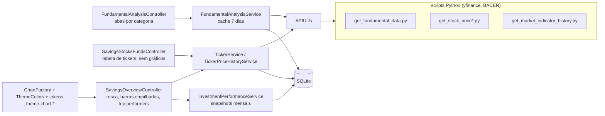
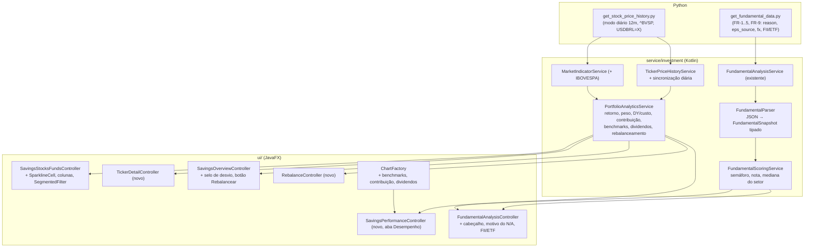
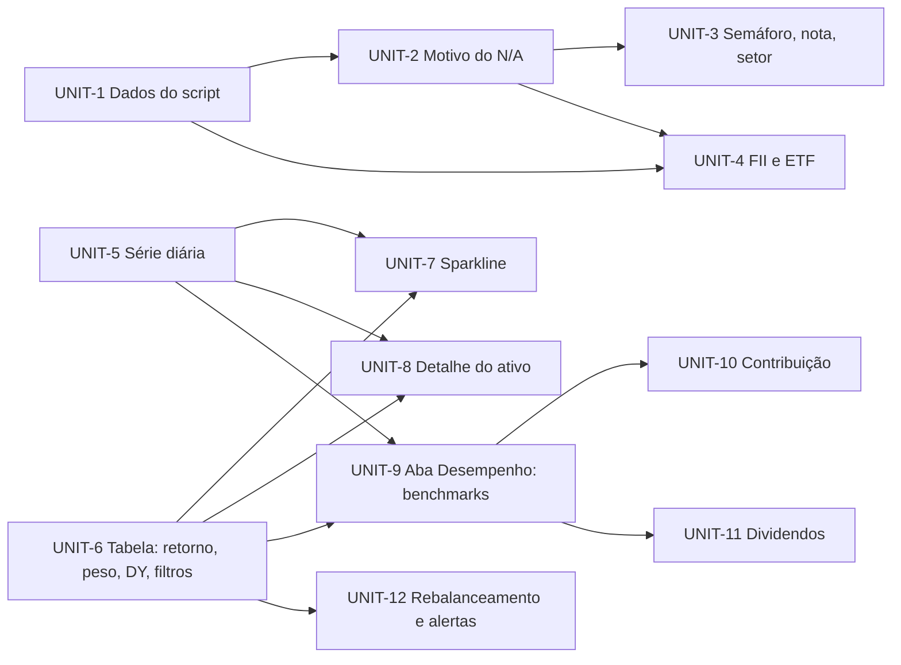

# Design — fundamentals-and-portfolio-views

## 2.1 Codebase analysis

Baseline: HEAD `c72d94af` (v2.20.2). KB completo em `.aidlc/codekb/MOINEX/` (atualizado em 2026-11-01, `human-reviewed` para UI/tema/investimentos). Testes: `./gradlew test` → 1411 testes, 0 falhas. [src: codekb/MOINEX/quality-and-risks.md]



Pontos que o intent toca:
- **Pipeline de dados fundamentalistas:** `get_fundamental_data.py` → `APIUtils.fetchFundamentalAnalysis` → `FundamentalAnalysisService` (JSON salvo cru em `fundamental_analysis.data_json`, 7 dias de cache, só STOCK e REIT) → `FundamentalAnalysisController` (uma aba por categoria; chave ausente = card some; valor nulo = `N/A`). [src: codekb/interactions.md §7]
- **Telas de carteira:** ações e fundos tem tabela e totais, sem gráficos; visão geral tem rosca, barras empilhadas, top performers, métricas, alocação vs. meta e mercado. [src: codekb/overview.md]
- **Dados disponíveis para novas visões:** preço histórico só de fim de mês e datas de operações; `Ticker` sem preço-alvo, moeda ou DY; `InvestmentPerformanceSnapshot` mensal. [src: codekb/data-model.md]
- **Infra reutilizável de UI:** `SegmentedFilter`, `RowContextMenu`, `ScreenActionProvider`, `ChartFactory`, tokens `theme-chart-*`, `ThemeColors`, `make demo` e `capture-screens.sh` para validação visual. [src: codekb/architecture.md]
- **Restrições:** o banco de uso real é somente leitura [user]; identidade visual (M-001); validação de UI rodando o app (M-003); sem commit antes do usuário ver o diff (M-004).
- **Working tree:** `get_fundamental_data.py` já tem a correção do CAGR (colunas vazias do yfinance 1.7.0), piso 0 no crescimento do valor justo e margem de segurança só com valor justo > 0; não commitada.

### Assumptions & open questions
- A1: os resultados do diagnóstico (PETR4/VALE3) vêm do yfinance em 2026-11-01 e podem variar. [inferred]
- Q: nenhum dado do banco real foi lido ainda; a leitura (read-only) fica para o 2.3 se precisarmos de tickers reais.

## 2.2 Team practices

Prática afirmadas em intents anteriores (memória do projeto) e reconfirmadas pelas evidências do repositório; nenhuma nova prática foi descoberta.

| Área | Prática | Evidência |
|---|---|---|
| Branching | Mudança que toca várias telas vai em branch tipada (`feat/*`, `refactor/*`, `chore/*`) e é mergeada no `main`; mudança pequena vai direto no `main` | [mem: M-002] [src: git branch -a] |
| Revisão | O dono vê o diff antes de cada commit; sem PR template nem CODEOWNERS; não commitar antes disso, nem com testes verdes | [mem: M-004] [src: .github/] |
| Commits | Conventional Commits; `Co-Authored-By` permitido; nunca link de sessão | [src: CLAUDE.md] [src: git log] |
| Testes | Kotest BehaviorSpec + MockK + H2; fábricas em `src/test/.../factory`; hook pré-commit roda `ktlintCheck` + `test` | [src: .githooks/pre-commit] [src: CLAUDE.md] |
| UI | Validação rodando o app, com checklist de telas nos dois temas; usar `make demo`/`capture-screens.sh` com dados fictícios | [mem: M-003] [mem: M-006] |
| Visual | Preservar paleta Dracula, botões em pílula e verde da sidebar; cores só via tokens `theme-*`/`ThemeColors` | [mem: M-001] [src: CLAUDE.md] |
| CI/Release | `pipeline.yml` (build, lint, test+Jacoco, Sonar); push de branch e workflows exigem sim explícito na hora; releases por tag `vX.Y.Z` | [mem: M-005] [src: .github/workflows/] |
| Estilo | Sem comentários `//` explicativos em Kotlin (KDoc ok); i18n só por edição de chaves, nunca reescrever o `.properties`; UTF-8 sem `\uXXXX` | [src: CLAUDE.md] |
| Dados | Banco real do dono só leitura | [user] (restrição deste intent) |

### Assumptions & open questions
- Decisão (gate 2.2): todo o intent vai direto no `main`, em commits pequenos e incrementais, cada um só depois do usuário ver o diff. Desvio consciente de M-002 (mudanças em várias telas em branch tipada), escolhido pelo dono. [user]

## 2.5 Refined mockups

Mockups HTML em `mockups/overview-layouts.html` (M3) e `mockups/screens.html` (M1, M2, M4, M5), por [mem: M-007]; os wireframes em texto abaixo são o resumo. Os números são ilustrativos, não dados reais. Base: capturas reais de `scripts/capture-screens.sh` (dados fictícios, tema escuro e claro, v2.20.2). Restrições observadas: a Visão Geral já ocupa a janela (3 colunas e carrossel de 2 gráficos à esquerda); a tabela de tickers tem 9 colunas sem retorno nem tendência; o rodapé tem o "+" flutuante e a busca global. Todas as telas seguem os tokens existentes (cores `theme-*`; positivo/negativo com `theme-positive-*`/`theme-negative-*`), ícones Ikonli e `SegmentedFilter`. [src: capturas 2026-11-01]

### M1 · Ações e Fundos (FR-11, FR-12, FR-14, US-7)

```text
┌ Capital Líquido ─ Valor Atual ─ Lucro/Prejuízo ─ Dividendos ───────────────────────┐
├────────────────────────────────────────────────────────────────────────────────────┤
│ Portfólio   [Atualizar Preços]   ( Todos | Ações | Fundos | Cripto )  🔍 buscar     │
│ Ordenar por: ( Retorno | Peso | Dia )                                               │
│ ID Logo Nome       Símbolo  Qtd  Preço  Valor   Médio  Tendência 12m  Retorno  Peso  DY/custo │
│ 3  🏦  Itaú PN     ITUB4.SA 200  28,90  5.780   26,50  ╱╲╱╱▁▂▅       +9,06%  8,9%  6,1%  │
│ 1  ⛽  Petrobras   PETR4.SA 100  38,50  3.850   35,20  ▇▅▃▂▃▅▆       +9,38%  5,9%  9,8%  │
│ 4  🛒  Magalu ON   MGLU3.SA 150  12,45  1.867   15,80  ▆▄▂▁▁▁▁      −21,20%  2,9%  0,0%  │
└────────────────────────────────────────────────────────────────────────────────────┘
```
- Nova coluna **Tendência 12m**: sparkline (linha de 90×24 px, cor positiva/negativa conforme o período) a partir da série diária (FR-15). **Retorno**, **Peso** e **DY sobre o custo** são colunas ordenáveis, alinhadas à direita; negativo em `theme-negative`, com sinal + ou − (cor nunca é o único indicador).
- `SegmentedFilter` de tipo (Todos/Ações/Fundos/Cripto) substitui o ComboBox de 4 opções; ordenação também pelo cabeçalho da coluna.
- Estados: sem série (ativo novo) mostra "—"; carregando mostra sparkline vazia; sem rede mantém o último dado.
- Duplo clique na linha (ou "Ver detalhe" no menu de contexto e na busca global) abre M2.

### M2 · Detalhe do ativo (FR-13, FR-15, US-8)

```text
┌ PETR4.SA · Petrobras PN ───────────────────────────────── [Análise fundamentalista] ┐
│ R$ 38,50  +0,8% hoje      Quantidade 100 · Médio R$ 35,20 · Retorno +9,38% (+R$ 330) │
│ ( 3M | 6M | 12M )                                                                    │
│ 42 ┤        ╭─╮     ▲compra                                                         │
│ 38 ┤   ╭──╮ │ ╰╮ ╭──╯────  ─ ─ ─ ─ preço médio 35,20                                 │
│ 34 ┤──╯  ▲ ╰─╯  ╰─▼venda                                                             │
│     jan   mar   mai   jul   set                                                      │
│ Operações: ▲ 12/03 compra 50 @ 33,00 · ▲ 02/07 compra 50 @ 37,40 · ▼ 10/09 venda ...│
└──────────────────────────────────────────────────────────────────────────────────────┘
```
- Gráfico de linha (fechamento diário), linha tracejada do preço médio, marcadores ▲ compra e ▼ venda com tooltip (data, quantidade, preço). Segmentado de período 3M/6M/12M. Fecha com Esc.

### M3 · Nova aba "Desempenho" em Savings (FR-16, FR-17, FR-18, US-9, US-10)

Decisão do dono: **layout B**, uma aba dedicada ao lado de Visão Geral, Ações e Fundos e Renda Fixa. Wireframe de alta fidelidade com a paleta real: `mockups/overview-layouts.html` (aba B). [user: gate 2.5]

```text
 Savings:  Visão Geral | Desempenho (nova) | Ações e Fundos | Renda Fixa
 ( 6M | 12M | Desde o início )                      filtro de período compartilhado
 ┌ Carteira vs benchmarks (linha, 4 séries) ────────┐ ┌ Contribuição por ativo ──────┐
 │ Carteira  CDI  Ibovespa  IPCA  (variação % acum.)│ │ barras horizontais em R$ + Total│
 └──────────────────────────────────────────────────┘ └──────────────────────────────┘
 ┌ Dividendos: barras mensais empilhadas por ativo, média mensal, projeção 12m ────────┐
 └──────────────────────────────────────────────────────────────────────────────────────┘
```
- **Benchmarks:** variação acumulada normalizada (base 0 no início do período); legenda com o valor final; a carteira é a linha mais espessa; cores via `theme-chart-series-*`.
- **Contribuição:** ordenada por impacto em R$ (positivo em `theme-positive`, negativo em `theme-negative`), barra final "Total" igual ao lucro da carteira; tooltip com % e valor.
- **Dividendos:** 12 meses empilhados por ativo, linha da média mensal e card "Projeção 12m" rotulado como estimativa (média dos últimos 12 meses).
- **Visão Geral (existente):** o carrossel de 2 páginas e o layout atual não mudam. Fica nela o plano de alocação com selo de desvio e o botão **Rebalancear** (M4); sem metas o botão fica oculto. O bloco "Piores" passa a listar só retornos negativos. [inferred: PETR4 e ITUB4 aparecem em "Melhores" e "Piores" nas capturas]

### M4 · Rebalanceamento (FR-19, US-10)

```text
┌ Sugestão de rebalanceamento ───────────────────────────────┐
│ Valor para aportar (opcional): [ R$ 0,00 ]                  │
│ Tipo         Atual   Meta    Desvio      Ação sugerida      │
│ Criptomoedas 47,8%   2,5%   +45,3 pp    Vender R$ 32.900    │
│ Fundos       11,8%  30,0%   −18,2 pp    Comprar R$ 13.200   │
│ Ações        20,1%  30,0%    −9,9 pp    Comprar R$ 7.200    │
│ Estimativa; não considera impostos nem custos.      [Fechar]│
└────────────────────────────────────────────────────────────┘
```
Se o usuário informa um aporte, a sugestão só direciona compras (sem vendas) até zerar o valor.

### M5 · Análise fundamentalista (FR-5, FR-7, FR-8, FR-9, FR-10, US-3, US-5, US-6)

```text
┌ PETR4.SA — Petrobras PN                                  ( Anual | Trimestral )  ⟳ ┐
│ ┌ Valuation ─────────────────────────┐ ┌ Qualidade ─────────────────┐              │
│ │ ● CARO   Preço 52,71               │ │  72 / 100  Boa             │              │
│ │ Graham Number 37,30 · Justo 39,23  │ │ Rentab. 80 · Dívida 65     │              │
│ │ Margem de segurança −34,4%         │ │ Cresc. 40 · Caixa 85       │              │
│ │ LPA do balanço (1,52) em uso ⓘ     │ └────────────────────────────┘              │
│ └────────────────────────────────────┘                                             │
│ Abas: Rentabilidade · Crescimento · Endividamento · Eficiência · Caixa · Valuation  │
│ Graham Number   Não aplicável: LPA negativo ⓘ        ref. 31/12/2025                │
│ ROE             12,4%  ▲ vs setor 9,1% (5 pares)       ref. 31/12/2025              │
└────────────────────────────────────────────────────────────────────────────────────┘
```
- **Semáforo**: selo com texto e ícone (● Barato / ● Justo / ● Caro) por faixas da margem de segurança (definidas no 2.8); desabilitado com motivo quando não há valor justo.
- **Nota de qualidade**: pontuação 0–100 com rótulo (Fraca/Regular/Boa/Excelente) e subnotas por dimensão; clique mostra a composição. Sem dados suficientes mostra "indisponível" com motivo.
- **Cards de métrica**: nunca somem; se faltar valor, mostram o motivo (FR-5), a data de referência e, quando houver pares, a comparação com a mediana do setor ("menos de 3 pares" quando insuficiente).
- **FIIs/ETFs** (FR-9): o diálogo troca as abas por Preço, Renda (DY, histórico de proventos) e Valor (P/VP), com aviso "Demonstrativos de empresa não se aplicam".

### Interação e acessibilidade
- Teclado: Esc fecha diálogos; Enter ativa o botão primário; setas do carrossel respondem a ←/→ quando focadas.
- Cor nunca é o único sinal: sinais + e −, ícones e rótulos nos semáforos.
- Tema claro e escuro: validar cada tela com `scripts/capture-screens.sh` nos dois temas antes de cada commit (checklist por Unit no 2.9). [mem: M-003]
- i18n: todos os rótulos novos em pt-BR e en.

### Assumptions & open questions
- A6 resolvida: nova aba "Desempenho" (layout B). [user]
- A7: o selo de semáforo usa faixas de margem de segurança (ex.: ≥ 20% barato; −20% a 20% justo; ≤ −20% caro), a confirmar no 2.8. [inferred]

## 2.6 Domain and components

Descoberta que simplifica o desenho: `ticker_price_history` já aceita linhas diárias (`UNIQUE(ticker_id, price_date)`, flag `is_month_end`), e `market_indicator_history` é genérica (`indicator_type`, `reference_date`, `rate_value`, `UNIQUE(indicator_type, reference_date)`). Logo **FR-15 e o Ibovespa não exigem nova tabela**. [src: db/migration/V015, V018]



Responsabilidades e dados:

| Componente | Responsabilidade | Dono dos dados |
|---|---|---|
| `get_fundamental_data.py` | Buscar e normalizar dados (períodos vazios, LPA, moeda, FII/ETF) e anexar `reason` por métrica | não persiste; devolve JSON |
| `FundamentalParser` (novo) | Ler `data_json` em `FundamentalSnapshot` tolerante a chaves ausentes | sem estado |
| `FundamentalScoringService` (novo) | Semáforo por margem de segurança, nota 0–100, mediana do setor entre análises salvas | lê `fundamental_analysis` |
| `TickerPriceHistoryService` | Sincronização diária incremental de 12 meses por ativo; mantém `is_month_end` correto | `ticker_price_history` |
| `MarketIndicatorService` | Histórico de CDI e IPCA (existente) e Ibovespa (novo tipo `IBOVESPA`, valor em pontos) | `market_indicator_history` |
| `PortfolioAnalyticsService` (novo) | Cálculos puros e testáveis: retorno, peso, DY sobre custo, contribuição por ativo, série de benchmarks normalizada, dividendos mensais e projeção, rebalanceamento | lê serviços e repositórios existentes |
| `SparklineCell` (novo) | Célula de tabela que desenha uma linha de 90×24 px com `Canvas`/`Polyline` e cores de `ThemeColors` | sem estado |
| `SavingsPerformanceController` (novo) | Aba Desempenho (M3) | via `PortfolioAnalyticsService` |
| `TickerDetailController`, `RebalanceController` (novos) | Diálogos M2 e M4 | via `PortfolioAnalyticsService` |

### ADRs

- **ADR-1 · Cálculos de carteira em Kotlin, num serviço puro.** Contexto: FR-12, FR-16..19 e NFR-5 pedem testes unitários. Decisão: `PortfolioAnalyticsService` recebe dados e devolve DTOs; sem JavaFX. Alternativas: calcular nos controllers (intestável, como hoje) ou em Python (sem acesso às operações do usuário). Consequência: controllers ficam finos; mais DTOs. Liga: FR-12, FR-16..19, NFR-5.
- **ADR-2 · Reusar `ticker_price_history` para a série diária.** Decisão: linhas diárias com `is_month_end` verdadeiro no último pregão do mês, preservando as consultas mensais existentes; modo diário no script de histórico e atualização incremental (só datas novas). Alternativa: tabela nova (duplica dados). Risco: queries que assumem poucas linhas; mitigar com testes de `InvestmentPerformanceService` e `TickerPriceHistoryService`. Liga: FR-11, FR-13, FR-15, NFR-1.
- **ADR-3 · Manter o JSON bruto em `data_json` e acrescentar campos de forma aditiva.** Decisão: novos campos (`reason`, `eps_source`, `financial_currency`, `fx_rate`, seções de FII/ETF) sem migration; `FundamentalParser` tolera ausência e versão antiga do cache. Consequência: caches de 7 dias anteriores continuam abrindo, mas sem motivos; um refresh os atualiza. Liga: FR-3..5, FR-9, NFR-2.
- **ADR-4 · Normalizar LPA e moeda no script, não na UI.** Decisão: o script escolhe a fonte do LPA e converte a moeda, registrando a origem no JSON, para uma única fonte de verdade e teste de contrato (FR-6). Alternativa: Kotlin recalcula (duplica regra). Liga: FR-3, FR-4, FR-6.
- **ADR-5 · Ibovespa em `market_indicator_history` como tipo `IBOVESPA`.** Decisão: reutilizar a tabela, `rate_value` guarda pontos de fechamento; CDI e IPCA já estão lá. Alternativa: tabela própria (mais correta semanticamente, mais uma migration). Consequência: o nome "rate_value" é impreciso para esse tipo; documentar no KDoc. Liga: FR-16.
- **ADR-6 · Nova aba como tela independente.** Decisão: `savings_performance.fxml` + `SavingsPerformanceController`, registrados como as demais abas de Savings; gráficos via `ChartFactory`. Liga: FR-16..18, M3.
- **ADR-7 · Sparkline como `TableCell` customizada, não `LineChart`.** Decisão: desenhar com `Canvas` por linha, dados já carregados em memória; evita criar dezenas de charts. Liga: FR-11, NFR-1.
- **ADR-8 · Semáforo e nota calculados em Kotlin sobre `FundamentalSnapshot`.** Decisão: regras de faixa e pesos ficam em constantes testáveis, não no script, para ajustar sem refazer cache. Liga: FR-7, FR-8.

### Assumptions & open questions
- A8: a série diária cobre só ativos não arquivados dos tipos STOCK, REIT, ETF, FUND e CRYPTO que o yfinance resolve; falhas por ativo não bloqueiam os demais. [inferred]
- A9: faixas do semáforo e pesos da nota serão fixados no 2.8, com os valores propostos em A7. [inferred]
- Q: nenhuma pendente para o 2.6.

## 2.7 Units of work

Doze Units, na ordem de entrega pedida (Dados → Fundamentalista → Ações e Fundos → Visão Geral). Cada Unit é verificável e vista pelo dono antes do commit; cada FR tem exatamente um dono.



| Unit | Escopo | FR | US | Depende de |
|---|---|---|---|---|
| UNIT-1 | Script: períodos vazios, piso do crescimento, margem de segurança, LPA coerente, conversão de moeda, teste de contrato do JSON | FR-1, FR-2, FR-3, FR-4, FR-6 | US-1, US-2, US-4 | – |
| UNIT-2 | `reason` por métrica no script, `FundamentalParser`, cards que nunca somem com motivo e data | FR-5 | US-3 | UNIT-1 |
| UNIT-3 | `FundamentalScoringService`, cabeçalho de valuation (semáforo), nota de qualidade, mediana do setor | FR-7, FR-8, FR-10 | US-5, US-6 (parte setor) | UNIT-2 |
| UNIT-4 | Métricas de FII/ETF no script e abas Preço, Renda, Valor | FR-9 | US-6 (parte FII/ETF) | UNIT-1, UNIT-2 |
| UNIT-5 | Série diária de 12 meses: modo diário do script, sincronização incremental, `is_month_end` preservado | FR-15 | US-8 (dados) | – |
| UNIT-6 | `PortfolioAnalyticsService` base; colunas retorno, peso, DY/custo; `SegmentedFilter` e ordenação | FR-12, FR-14 | US-7 (parte) | – |
| UNIT-7 | `SparklineCell` e coluna Tendência 12m | FR-11 | US-7 (parte) | UNIT-5, UNIT-6 |
| UNIT-8 | Diálogo de detalhe do ativo (M2) | FR-13 | US-8 | UNIT-5, UNIT-6 |
| UNIT-9 | Ingestão do Ibovespa, série normalizada, aba Desempenho com gráfico de benchmarks | FR-16 | US-9 (parte) | UNIT-5, UNIT-6 |
| UNIT-10 | Contribuição por ativo na aba Desempenho | FR-17 | US-9 (parte) | UNIT-9 |
| UNIT-11 | Painel de dividendos e projeção na aba Desempenho | FR-18 | US-10 (parte) | UNIT-9 |
| UNIT-12 | Selo de desvio, botão Rebalancear, diálogo M4, ajuste do bloco "Piores" | FR-19 | US-10 (parte) | UNIT-6 |

Mapa de histórias: US-1 → U1 · US-2 → U1 · US-3 → U2 · US-4 → U1 · US-5 → U3 · US-6 → U3 e U4 · US-7 → U6 e U7 · US-8 → U5 e U8 · US-9 → U9 e U10 · US-10 → U11 e U12. As histórias que cruzam Units têm cenários Given/When/Then distintos para cada parte.

NFR por Unit (Definition of Done): NFR-2 (cache nunca apagado em falha) em U1, U5, U9; NFR-3 e NFR-7 (tema e acessibilidade) em toda Unit com UI (U2, U3, U4, U7 a U12); NFR-4 (i18n) em toda Unit com texto novo; NFR-5 (testes unitários) em toda Unit com cálculo (U1, U3, U6, U9 a U12); NFR-1 (desempenho com 50 ativos) em U6, U7 e U8; NFR-6 em U5 e U9 (sem migration, ou aditiva).

Walking skeleton: UNIT-1 é a fatia mínima ponta a ponta e já está parcialmente no working tree (FR-1 e FR-2); é a primeira a ser verificada e mostrada.

### Assumptions & open questions
- A10: US-6 e US-9/US-10 são entregues em partes por Units diferentes; a história só conta como pronta quando todas as Units dela passam. [inferred]

## 2.8 Contracts

Decisões do dono para as regras: semáforo ≥ 20% / ≤ −20%, troca do LPA com divergência > 25%, pesos da nota 35/25/20/20, projeção de dividendos = soma dos últimos 12 meses. [user: gate 2.8]

### C1 · JSON de `get_fundamental_data.py` (mudanças aditivas, ADR-3)

Cada métrica continua `{value, type, data_temporality, reference_date?}` e ganha `reason` quando `value` é nulo. Métrica sem valor passa a aparecer sempre (valor nulo + `reason`), nunca é omitida.

```json
{"graham_number": {"value": null, "type": "currency", "data_temporality": "calculated",
                   "reference_date": "2025-12-31", "reason": "NEGATIVE_EPS"}}
```

`reason` (enum estável): `NEGATIVE_EPS`, `NEGATIVE_EQUITY`, `NEGATIVE_GROWTH`, `INSUFFICIENT_HISTORY`, `NOT_APPLICABLE` (ex.: ETF/FII), `DATA_UNAVAILABLE`.

Novos campos em `valuation`: `eps_source` (`"info"` ou `"statement"`), `financial_currency`, `fx_rate` (número, ou nulo se não houve conversão) e `fx_date`. Raiz do JSON: `asset_kind` (`"company"`, `"fund"` ou `"etf"`) e `schema_version` (inteiro, 2).

Regras:
- **Períodos:** descartar colunas sem a linha-chave (`Total Revenue`, `Total Assets`, `Operating Cash Flow`). Já implementado. [src: scripts/get_fundamental_data.py]
- **Valor justo:** `g = max(0, min(growth, 0.25))`; margem de segurança só com valor justo > 0. Já implementado.
- **LPA:** `eps_statement` = `Diluted EPS` mais recente com valor; se `|eps_info − eps_statement| / |eps_statement| > 0,25` usar `eps_statement` e `eps_source = "statement"`; senão `eps_info`. Sem `eps_statement`, usar `eps_info`.
- **Moeda:** se `financialCurrency ≠ currency` converter valores monetários dos demonstrativos pela taxa de fechamento do último dia do período (`<FIN><PRICE>=X`); registrar `fx_rate` e `fx_date`; falha na taxa → métricas monetárias dependentes com `reason = DATA_UNAVAILABLE`.
- **FII/ETF** (`asset_kind ≠ company`): seções `price_performance` (existente) e `income` com `dividend_yield`, `last_dividend` `{value, date}`, `dividends_12m` (lista mensal de `{month, value}`), e `valuation.price_to_book`. Sem erro de "Financial data not available" para esses ativos; `valuation` de empresa fica com `reason = NOT_APPLICABLE`.

### C2 · Modelo tipado em Kotlin

```kotlin
data class FundamentalMetric(val value: BigDecimal?, val type: MetricType, val temporality: DataTemporality,
                             val referenceDate: LocalDate?, val reason: MetricReason?)
data class FundamentalSnapshot(val symbol: String, val kind: AssetKind, val currency: String,
                               val metrics: Map<String, Map<String, FundamentalMetric>>, val epsSource: EpsSource?,
                               val fx: FxInfo?, val lastUpdated: LocalDateTime)
object FundamentalParser { fun parse(dataJson: String): FundamentalSnapshot }
```

`FundamentalParser.parse` aceita JSON sem `schema_version` (cache antigo): `reason` fica nulo e chaves ausentes viram métrica com `DATA_UNAVAILABLE`.

### C3 · Serviços (assinaturas)

```kotlin
class FundamentalScoringService {
    fun valuation(s: FundamentalSnapshot, price: BigDecimal): ValuationVerdict        // CHEAP | FAIR | EXPENSIVE | UNAVAILABLE(reason)
    fun quality(s: FundamentalSnapshot): QualityScore                                  // total 0..100 ou null, subnotas, pesos usados
    fun sectorMedian(metricKey: String, sector: String, excluding: Long): SectorComparison // median, peers, enough = peers >= 3
}

class PortfolioAnalyticsService {
    fun tickerRows(filter: TickerTypeFilter, sort: TickerSort): List<TickerRowDTO>
    fun contribution(period: Period): List<ContributionDTO>
    fun benchmarkSeries(period: Period): BenchmarkSeriesDTO
    fun monthlyDividends(months: Int = 12): DividendPanelDTO
    fun rebalance(contribution: BigDecimal?): List<RebalanceRowDTO>
}
```

DTOs: `TickerRowDTO(ticker, returnPct, profitLoss, weightPct, dyOnCostPct, dayChangePct, sparkline: List<BigDecimal>)`, `ContributionDTO(symbol, amount, pct)`, `BenchmarkSeriesDTO(portfolio, cdi, ibovespa, ipca: List<Point(date, pct)>)`, `DividendPanelDTO(months: List<MonthDTO(month, byTicker)>, monthlyAverage, projection12m)`, `RebalanceRowDTO(type, currentPct, targetPct, deviationPp, action: BUY|SELL|NONE, amount)`.

### C4 · Regras de negócio

| Regra | Definição |
|---|---|
| Semáforo | margem = (valor justo − preço) / valor justo; ≥ 20% barato; ≤ −20% caro; entre os dois justo; valor justo ausente ou ≤ 0 → indisponível com o `reason`. Valor justo usado = revisado quando existir, senão Graham Number (como o script) |
| Nota de qualidade | Rentabilidade 35% (média de ROE, margem líquida, margem EBITDA), Endividamento 25% (dívida líquida/EBITDA e liquidez corrente), Crescimento 20% (CAGR de receita e de LPA), Caixa 20% (FCF/lucro e margem de FCF). Cada subnota 0–100 em faixas fixas, por exemplo ROE ≥ 15% = 100, 10–15% = 75, 5–10% = 50, 0–5% = 25, < 0 = 0. Dimensão sem dado sai e os pesos são reponderados; menos de 2 dimensões → nota indisponível. Rótulo: 0–39 Fraca, 40–59 Regular, 60–79 Boa, 80–100 Excelente |
| Mediana do setor | Entre análises salvas do mesmo período e `sector`, excluindo o próprio ativo; com menos de 3 pares retorna `enough = false` |
| Retorno do ativo | (valor atual − custo) / custo, com custo = quantidade × preço médio (mesma definição de `TickerPerformanceDTO`) |
| Peso | valor da posição / soma do valor de todos os tickers não arquivados (mesmo universo da tabela) |
| DY sobre custo | dividendos dos últimos 12 meses do ativo / custo atual da posição |
| Contribuição | lucro não realizado + lucro realizado em vendas + dividendos recebidos no período; a barra "Total" é a soma e pode diferir do card "Lucro/Prejuízo" (só não realizado); a tela rotula os componentes |
| Benchmarks | cada série vira variação acumulada em % desde o início do período (base 0): carteira por valor de mercado menos aportes (retorno acumulado), Ibovespa por pontos de fechamento, CDI e IPCA por composição das taxas mensais |
| Dividendos | soma mensal por ativo nos últimos 12 meses; média mensal = total 12m / 12; projeção 12m = total 12m, rotulada como estimativa |
| Rebalanceamento | desvio = % atual − meta; sem aporte: vender o excesso e comprar o déficit em valor absoluto, proporcional ao valor total; com aporte: só compras, distribuídas pelos déficits proporcionalmente; ignora tipos sem meta; não considera impostos nem custos |

### C5 · Scripts de preço

- `get_stock_price_history.py SYMBOL START [END] [DATES_JSON] --daily`: com `--daily`, devolve todos os pregões de `START` a `END` em `prices: [{date, price, is_month_end}]`, com `is_month_end = true` no último pregão do mês; sem a flag o comportamento atual não muda.
- Símbolos extras aceitos: `^BVSP` (Ibovespa, valores em pontos) e `USDBRL=X` (câmbio).
- Erros seguem o contrato atual (`{"error", "traceback"}`) e o retry de rate limit do script.

### C6 · Persistência e leitura

- `ticker_price_history`: linhas diárias de ativos não arquivados; upsert por `(ticker_id, price_date)`; `TickerPriceHistoryService.syncDaily(ticker)` busca só desde a última data salva.
- `market_indicator_history`: `indicator_type = "IBOVESPA"`, `rate_value` = pontos de fechamento (KDoc deve explicar a exceção ao nome do campo, ADR-5).
- Sem mudança em `fundamental_analysis`; o cache de 7 dias continua; JSON antigo continua legível (C2).

### C7 · i18n e CSS

Todas as chaves novas em `messages_pt_BR.properties` e `messages_en.properties` com `TranslationKeys.kt`, apenas acrescentadas ao fim do arquivo. Cores novas só por tokens existentes (`theme-positive`, `theme-negative`, `theme-warning`, `theme-chart-series-*`) ou `ThemeColors`; nenhum token novo previsto.

### Assumptions & open questions
- A7 resolvida: faixas do semáforo ≥ 20% / ≤ −20%. [user]
- A11: faixas de subnota por métrica são fixadas na Unit 3 e ajustadas com os ativos reais por leitura do banco real em modo somente leitura, com seu aval antes. [inferred]
- A12: a "contribuição" inclui lucro realizado e dividendos; a diferença para o card "Lucro/Prejuízo" é explicada na tela. [inferred]
