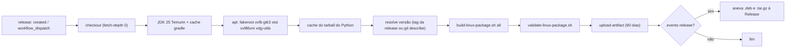

# CI Pipeline — 261102-linux-package

Arquivo: `.github/workflows/build-linux-package.yml`.

Caption: o job é único e linear; só o evento `release` anexa assets.

| Item | Decisão |
|---|---|
| Runner | `ubuntu-22.04` (glibc 2.35, ADR-3) |
| Gatilhos | `release: created` e `workflow_dispatch` (este só gera artifact) |
| Permissões | `contents: write` (anexar à Release) |
| Cache | `build/python-linux-download` com chave no hash do script de setup e de `requirements.txt`; cache do Gradle pelo `setup-java` |
| Portões | build falha se o checksum do Python não confere, se o launcher/Python faltam no app-image, ou se a validação falha |
| Segredos | nenhum; a tag da release entra por `env`, não interpolada no shell |
| Rollback | apagar os assets da Release e rodar `workflow_dispatch` para regenerar |
| Ação externa de Release | `softprops/action-gh-release@v2` |

Não executado no GitHub ainda: a primeira execução real exige criar uma Release ou disparar o workflow manualmente, o que só será feito com o sim do dono.

Teste do artifact em containers Ubuntu 22.04 e 24.04: `scripts/test-linux-package-containers.sh <pasta com os pacotes>` (precisa de docker). Primeira execução real: todos os testes passaram nas duas versões (instalar, atualizar, remover, `.tar.gz`).
