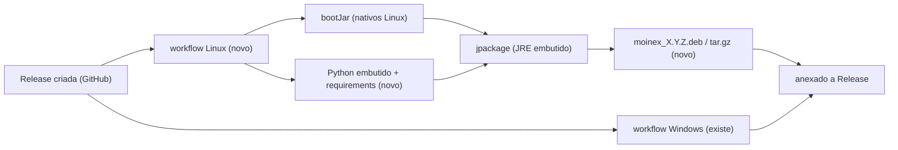
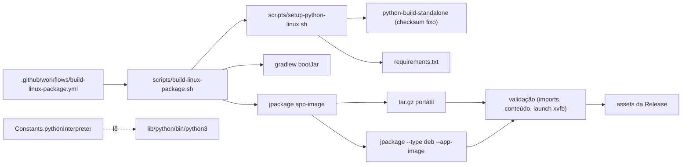
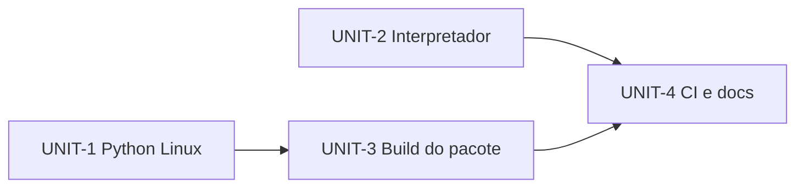
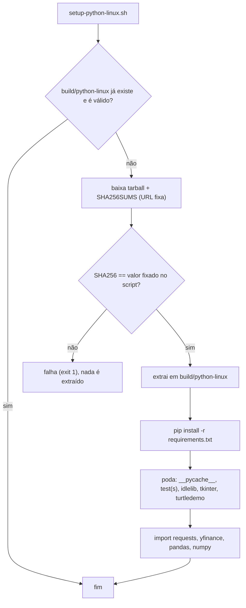
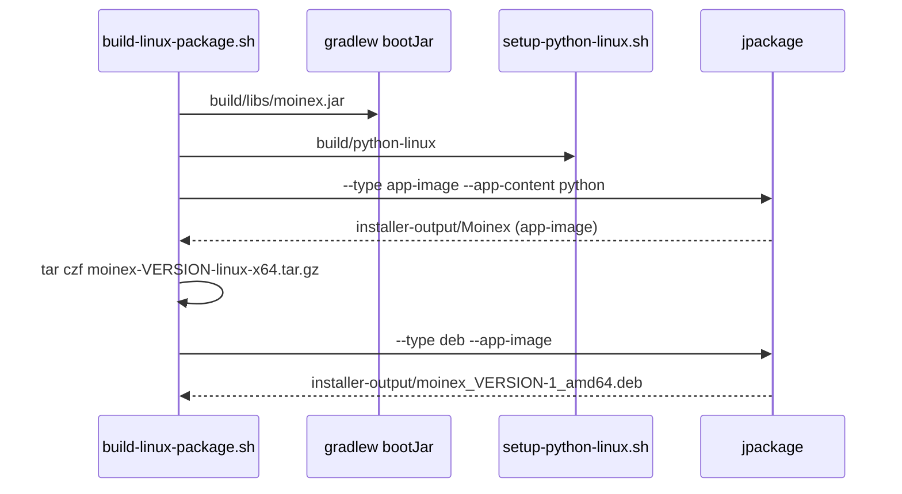

# Design — 261102-linux-package

## 2.1 Codebase analysis
Resumo focado no empacotamento (codekb em `.aidlc/codekb/MOINEX/`, de 95b19ba7; os commits seguintes só tocam notificações e não afetam este intent). Baseline: `./gradlew test` passa sem display (1576 testes, 0 falhas, 46 s) em efc08298.

- **Instalação Linux hoje:** `make install` → `scripts/install.sh` faz checkout da tag escolhida, `pip install --break-system-packages -r requirements.txt` no Python do sistema, `./gradlew clean build -x test`, copia `moinex.jar` para `~/.moinex/bin`, `run.sh` para `~/.moinex/`, ícones para `~/.local/share/icons` e `docs/moinex.desktop` para `~/.local/share/applications`. `run.sh` exige Java 25 do sistema. [src: scripts/install.sh, scripts/run.sh, docs/moinex.desktop]
- **Instalador Windows:** `scripts/build-windows-installer.bat` roda `gradlew clean build -x test`, copia só `moinex.jar` para `build\jpackage-input` e chama `jpackage --type exe --main-class org.springframework.boot.loader.launch.JarLauncher --app-content build\python-embedded --java-options -Xmx1g`. O Python embutido vem de `setup-python-embedded.bat` (Python 3.12.8 embeddable + `get-pip` + `pip install -r requirements.txt`). O workflow `build-windows-installer.yml` roda em `windows-latest`, no evento `release: created` ou `workflow_dispatch`, e anexa o `.exe` à release com `softprops/action-gh-release`. [src: scripts/*.bat, .github/workflows/build-windows-installer.yml]
- **Escolha do interpretador:** `Constants.pythonInterpreter`. No Windows, com a propriedade `jpackage.app-path`, usa `<pasta do launcher>\python-embedded\python.exe`; senão `python`. No resto, fixo `/usr/bin/python3`. [src: common/constant/Constants.kt:228]
- **Execução dos scripts:** `APIUtils.runPythonScript` copia o script do JAR para um temporário e roda `<interpretador> <script> <args>`; os scripts Python vão dentro do JAR. Dependências em `requirements.txt` (`requests`, `yfinance`, `pandas`, `numpy`, versões fixas). [src: common/util/APIUtils.kt:152, requirements.txt]
- **JAR e JavaFX:** `bootJar` gera `build/libs/moinex.jar` (`mainClass org.moinex.app.AppKt`); o plugin `org.openjfx.javafxplugin` com `controls`, `fxml` e `web` resolve os nativos do SO que está compilando, então o JAR do Linux precisa ser compilado em Linux. [src: build.gradle.kts]
- **Dados do usuário:** `~/.moinex/data/moinex.db` (e preferência `db.directory`); fora do diretório de instalação, então atualizar ou desinstalar o pacote não toca nos dados. [src: SpringApp.kt, CLAUDE.md]
- **Ícones:** PNG 32/64/128/192/256 em `docs/img/icons/`; o `.ico` do Windows é gerado no CI. [src: docs/img/icons]
- **Ambiente de build local:** Ubuntu com glibc 2.43, `jpackage` 25.0.2 e `dpkg-deb` presentes; `rpmbuild` ausente. O runner `ubuntu-latest` do GitHub tem glibc mais antiga, o que define a compatibilidade mínima do pacote.

Caption: o pipeline Windows existente e o pipeline Linux a criar, com a mesma Release como destino.

### Assumptions & open questions
- A1 (spike, 2026-11-02): `jpackage --type app-image --app-content <dir python>` no Linux gera `bin/Moinex`, `lib/app/moinex.jar`, `lib/runtime` e `lib/python/` (Python em `lib/python/bin/python3`). Que `jpackage.app-path` aponta para `bin/Moinex` em tempo de execução ainda será confirmado na Construction.
- A2: o runner `ubuntu-latest` tem JDK 25 via `actions/setup-java` e `fakeroot`/`dpkg` para o `.deb` (a conferir no CI).
## 2.6 Domain & components
Spike (2026-11-02, fora do repositório): Python 3.12.16 standalone (`install_only_stripped`, 35 MB, SHA256 conferido contra o `SHA256SUMS` da release `20261026`) + `pip install -r requirements.txt` = 327 MB em disco, imports ok; app-image do jpackage com JAR de 142 MB, JRE de 128 MB e esse Python = 592 MB em disco (o `.deb`/`tar.gz` comprimidos serão bem menores; a medir).

### Components

Caption: scripts e workflow novos (sólidos) e a seleção do interpretador na app (tracejado).

- `scripts/setup-python-linux.sh`: baixa o Python standalone com versão e SHA256 **fixados no próprio script**, confere o checksum (falha se diferente), extrai em `build/python-linux/`, roda `pip install -r requirements.txt` com o `pip` do próprio Python, remove `__pycache__`, `test`/`tests`, `idle`, `tkinter` e caches e verifica os imports.
- `scripts/build-linux-package.sh [app-image|tar|deb|all]`: roda `bootJar`, prepara `build/jpackage-input/moinex.jar`, chama `setup-python-linux.sh` se preciso, gera o app-image (`--app-content build/python-linux`, `--java-options -Xmx1g`, ícone PNG 256) e a partir dele o `tar.gz` e o `.deb` (`jpackage --type deb --app-image`, `--install-dir /opt`, atalho no menu, categoria Office/Finance, mantenedor). Saída em `installer-output/`.
- `Constants.pythonInterpreter`: nova função pura `resolveEmbeddedPython(os, appPath, exists)`; no Linux, com `jpackage.app-path`, devolve `<pasta do launcher>/../lib/python/bin/python3` se existir; senão `/usr/bin/python3`. A lógica atual do Windows e do fallback permanece.
- `.github/workflows/build-linux-package.yml`: `ubuntu-22.04`, `actions/setup-java` Temurin 25, instala `fakeroot` e `xvfb`, executa o build, valida os pacotes e anexa a `release` com `softprops/action-gh-release`.
- Docs: seção de instalação no `README.md`.

### Decisions
#### ADR-1 Python standalone (python-build-standalone) em vez de venv do sistema  — Status: accepted
Context: venv aponta para o Python do sistema e não é relocável. Decision: usar o `install_only_stripped` do python-build-standalone, relocável e com versão fixa. Alternatives: venv do sistema (quebra ao mover e depende da distro); compilar Python (lento). Consequences: pacote maior; independência da distro. Related: FR-3, NFR-3.
#### ADR-2 Um app-image gera `.deb` e `tar.gz`  — Status: accepted
Decision: gerar o app-image uma vez e derivar o `tar.gz` (tar do diretório) e o `.deb` (`jpackage --app-image`). Consequences: os dois formatos têm conteúdo idêntico; uma só validação do Python. Related: FR-1, FR-2.
#### ADR-3 Build em `ubuntu-22.04`  — Status: accepted
Context: a glibc do runner define a compatibilidade mínima do pacote. Decision: `ubuntu-22.04` (glibc 2.35) em vez de `ubuntu-latest`. Consequences: roda em Ubuntu 22.04+ e distros equivalentes; o runner 22.04 pode ser aposentado pelo GitHub, e a troca fica registrada como manutenção. Related: NFR-1.
#### ADR-4 Versão e checksum do Python fixados no repositório  — Status: accepted
Decision: o script contém a tag da release, o nome do arquivo e o SHA256; atualizar o Python é editar esses valores. Related: NFR-3, NFR-4.
#### ADR-5 `install.sh` permanece  — Status: accepted
Decision: sem mudança em `install.sh`; a doc avisa para não misturar com o `.deb`. Related: FR-10.

### Assumptions & open questions
- A5: `jpackage --type deb --app-image` aceita o app-image gerado no mesmo job; a confirmar na Construction.

## 2.7 Units of work
### UNIT-1 Python embutido para Linux
- Purpose: obter, verificar e preparar o Python com as dependências. Covers: FR-3, NFR-3, NFR-4. Scope in: `scripts/setup-python-linux.sh`, poda, verificação dos imports. Out: jpackage.
- Definition of Done: o script roda do zero e termina com imports ok; checksum errado faz falhar (testado); tamanho medido.
### UNIT-2 Seleção do interpretador na app
- Purpose: usar o Python do pacote. Covers: FR-4, NFR-5. Scope in: `Constants.pythonInterpreter` refatorado com função testável e testes (Linux com e sem pacote, Windows inalterado). Out: build.
- Definition of Done: comando de verificação passa sem display; testes cobrem os 4 caminhos.
### UNIT-3 Build do pacote
- Purpose: gerar app-image, `tar.gz` e `.deb` localmente. Covers: FR-1, FR-2, FR-5, FR-6, FR-7, NFR-2, NFR-6. Depends on: UNIT-1. Scope in: `scripts/build-linux-package.sh`. Out: workflow.
- Definition of Done: `build-linux-package.sh all` gera os dois arquivos; `dpkg-deb -c/-I` mostram `/opt/moinex`, `.desktop` e ícone; instalar/atualizar/remover o `.deb` num ambiente de teste preserva `~/.moinex` (FR-6/7); tamanhos registrados.
### UNIT-4 CI e documentação
- Purpose: automatizar e documentar. Covers: FR-8, FR-9, FR-10, NFR-1. Depends on: UNIT-2, UNIT-3. Scope in: workflow, validações (imports, conteúdo do `.deb`, launch sob xvfb por 30 s sem queda), README.
- Definition of Done: workflow passa em `workflow_dispatch` com artifacts (execução real no GitHub só com autorização do dono); README descreve os três caminhos.

### Dependency order

Caption: UNIT-1 e UNIT-2 são independentes; UNIT-4 fecha. Ordem: 1, 2, 3, 4.

### Story → Unit map
Sem histórias (2.4 ignorada); cobertura por requisito:

| Requisito | Unit |
|---|---|
| FR-3, NFR-3, NFR-4 | UNIT-1 |
| FR-4, NFR-5 | UNIT-2 |
| FR-1, FR-2, FR-5, FR-6, FR-7, NFR-2, NFR-6 | UNIT-3 |
| FR-8, FR-9, FR-10, NFR-1 | UNIT-4 |

## 3.1 Functional design (nota curta por Unit)
### UNIT-1 — Functional design

Caption: o checksum é o do valor **fixado no script**; o `SHA256SUMS` baixado serve só para conferência extra. Reuso do cache só quando o import passa.
- Variáveis: `PYTHON_RELEASE_TAG`, `PYTHON_ARCHIVE`, `PYTHON_SHA256`, `OUTPUT_DIR` (padrão `build/python-linux`); `set -euo pipefail`; todos os caminhos entre aspas.
### UNIT-2 — Functional design
Função pura `resolveEmbeddedPython(osName, appPath, exists): String?` (em `Constants`):
- Windows com `appPath`: `<dir do launcher>\python-embedded\python.exe` se existir (comportamento atual).
- Linux com `appPath`: `<dir do launcher>/../lib/python/bin/python3` se existir.
- Caso contrário `null`, e o getter cai em `python` (Windows) ou `/usr/bin/python3` (demais).
### UNIT-3 — Functional design

Caption: um app-image alimenta os dois formatos. A versão vem do argumento `--version`, da tag git (sem o `v`) ou de `build.gradle.kts`, nessa ordem.
### UNIT-4 — Functional design
Workflow em passos: checkout → JDK 25 → `apt install fakeroot xvfb` → `build-linux-package.sh all` → validações → `upload-artifact` → (só no evento `release`) anexo à Release. A validação roda `python -I` do pacote, `dpkg-deb -c` procurando `/opt/moinex/bin/Moinex` e `.desktop`, e launch sob `xvfb-run` por 30 s.

## 3.4 Infrastructure design (nota)
- Runner: `ubuntu-22.04` (ADR-3); JDK 25 Temurin; `fakeroot` e `dpkg-dev` para o `.deb`; `xvfb` para o smoke. Cache: `gradle` do `setup-java` e cache de `build/python-linux` com chave no hash de `requirements.txt` e do script de setup.
- Permissões do workflow: `contents: write` só para anexar à Release. Segredos: nenhum.
- Gatilhos: `release: created` e `workflow_dispatch` (este só publica artifact, sem anexar).
- Custo/tempo esperado: dezenas de minutos por release (download do Python e `pip`); sem custo extra de infraestrutura.
- Rollback: pacote errado = apagar o asset da Release e reexecutar o workflow por `workflow_dispatch`.

### 3.2–3.3
Ignorados: NFRs cobertos por NFR-1..6 e pelos DoD das Units.
