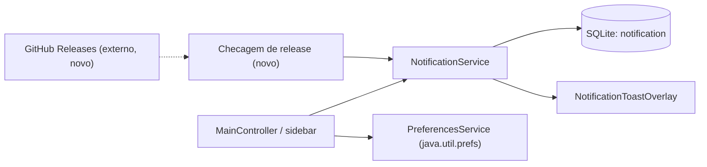
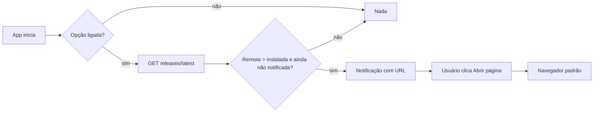
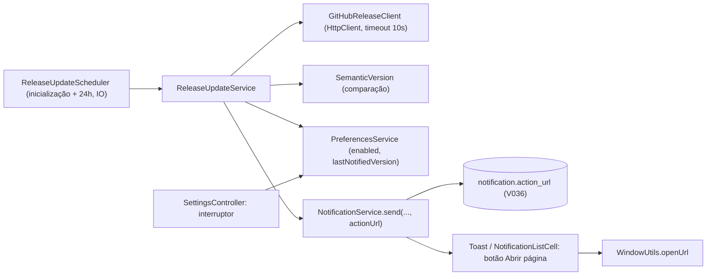
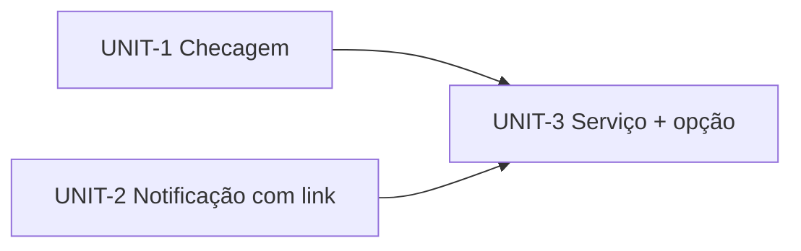
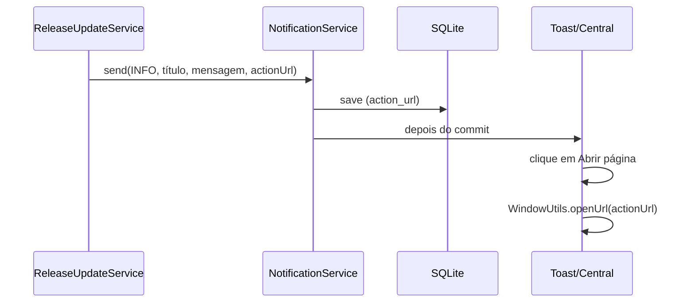
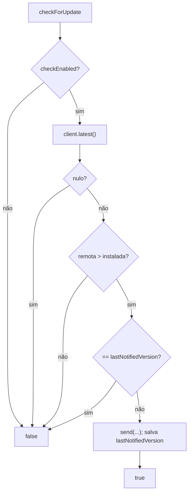

# Design — 261102-release-update-notification

## 2.1 Codebase analysis
Resumo (detalhes em `.aidlc/codekb/MOINEX/`; codekb em 95b19ba7, delta até 42d751b4 só mexe em TransactionController/transaction.fxml, irrelevante aqui). Baseline de testes: não executado neste estágio (será rodado no 3.6 e na aprovação do comando de verificação).

- **Versão atual**: `build.gradle.kts` (`version = "2.21.0"`) é filtrada para `version.properties` (`app.version=${appVersion}`); `MainController.loadAppVersion()` lê o valor e mostra `v<versão>` na barra lateral. [src: src/main/resources/version.properties, MainController.kt:147]
- **Notificações**: `NotificationService.send(type, title, message, relatedEntityId)` persiste a entidade `Notification` (tabela `notification`; `type` INFO/SUCCESS/WARNING/ERROR; `title` ≤100; `message` ≤500; sem campo de URL/ação) e dispara um toast via `uiListeners` (`NotificationToastOverlay`); a lista fica no painel `NotificationCenterController` com `NotificationListCell`. [src: NotificationService.kt, Notification.kt, MainController.kt:236]
- **Preferências**: `PreferencesService` usa `java.util.prefs` (nó `org.moinex`) com chaves como `ui.theme`; local natural para "verificar atualizações" e "última versão notificada". [src: PreferencesService.kt]
- **HTTP**: já existe uso de `java.net.http.HttpClient` (provedores de IA). Chamadas externas de dados financeiros são feitas por scripts Python via `APIUtils`. [src: ai/provider/OpenRouterProvider.kt]
- **Distribuição**: Windows = instalador `.exe` gerado por jpackage (JRE embutido) e anexado à GitHub Release por `build-windows-installer.yml`; Linux = `make install`/`scripts/install.sh`, que lista as tags git e compila a partir do código. Não há mecanismo de atualização hoje. [src: scripts/build-windows-installer.bat, scripts/install.sh, CLAUDE.md]
- **Releases**: tags anotadas `vX.Y.Z` na `main`; o instalador só é anexado quando existe uma GitHub Release. [src: CLAUDE.md § Releasing]

Caption: o que existe (sólido) e onde a checagem de release se encaixa (tracejado).

### Assumptions & open questions
- A1: o repositório é público; `GET api.github.com/repos/luk3rr/MOINEX/releases/latest` respondeu 200 sem token (verificado em 2026-11-02).
## 2.2 Team practices
Práticas herdadas de `.aidlc/memory/project.md` e do `CLAUDE.md`, sem novas perguntas:

- Trabalho que toca várias telas vai em branch tipada (`feat/*`) e merge na `main`. [mem: M-002]
- UI validada rodando a app (`make demo` / `scripts/capture-screens.sh`, home temporário), com checklist de telas nos dois temas; imagens em `construction/screenshots/`, nunca commitadas. [mem: M-003, M-006, M-009]
- Não commitar antes de o dono ver o diff; push e CI/instalador só com sim explícito. [mem: M-004, M-005]
- Identidade visual (Dracula, botões pílula, verde da sidebar) e tokens `theme-*`; ícones via `common/ui/Icons.kt`. [mem: M-001, CLAUDE.md]
- `<Título>: <valor>` usa `TitledValue`; arquivos novos levam o header padrão; sem comentários `//` explicativos; i18n só com acréscimo de chaves em `messages_en.properties` e `messages_pt_BR.properties`. [mem: M-010, M-012; CLAUDE.md]
- Sem dados pessoais em arquivos versionados. [mem: M-011]
- Testes: Kotest BehaviorSpec + MockK, fixtures em `src/test/kotlin/org/moinex/factory/`; ktlint e spotless. [src: CLAUDE.md]

### Assumptions & open questions
- Nenhuma.

## 2.5 Refined mockups
Mockup HTML com a paleta Dracula e o verde da sidebar: `mockups/update-notification.html` [mem: M-007]. Layout único (não há alternativa a comparar [mem: M-008]).

- Central de notificações: a célula da notificação de atualização ganha um botão pílula "Abrir página" abaixo da mensagem (só quando a notificação tem URL).
- Toast: mesmo texto; clicar no botão do toast não é obrigatório, o botão só aparece na central. A decidir na construção se o toast também leva o botão (padrão: sim, se o componente comportar).
- Configurações: nova linha "Verificar atualizações automaticamente" com interruptor, ligada por padrão.

Caption: fluxo do usuário e da checagem.

### Assumptions & open questions
- Textos finais pt-BR/en definidos na construção.

## 2.6 Domain & components
### Components (responsabilidade, interfaces, dados)

Caption: componentes novos (Sched, Svc, Cli, Ver) e pontos tocados nos existentes.

- `SemanticVersion` (`model` ou `common`): parse de `vX.Y.Z`/`X.Y.Z`, comparável; entrada inválida devolve nulo.
- `GitHubReleaseClient`: `latest(): LatestRelease?` (`tagName`, `htmlUrl`) via `GET https://api.github.com/repos/luk3rr/MOINEX/releases/latest` (cabeçalho `Accept: application/vnd.github+json`, `User-Agent: MOINEX`), timeout 10 s; `HttpClient` injetável; nulo em qualquer falha.
- `ReleaseUpdateService` (`service/`): `checkForUpdate()` aplica FR-3/FR-6/FR-7/NFR-3 e chama `NotificationService.send`; versão instalada lida de `version.properties` (extraída de `MainController.loadAppVersion` para reuso).
- `ReleaseUpdateScheduler`: dispara `checkForUpdate()` na inicialização (após a janela principal) e a cada 24 h com coroutine em `AppDispatchers.IO`.
- `NotificationService.send` ganha o parâmetro opcional `actionUrl: String? = null`; `Notification.actionUrl` (coluna `action_url TEXT NULL`).
- `PreferencesService`: chaves `updates.checkEnabled` (padrão true) e `updates.lastNotifiedVersion`.

### Decisions
#### ADR-1 Link persistido em coluna própria  — Status: accepted
Context: `Notification` não tem campo de link. Decision: migration `V036__add_notification_action_url.sql` (`ALTER TABLE notification ADD COLUMN action_url TEXT`) e campo nullable na entidade. Alternatives: URL no texto da mensagem (não clicável de forma limpa); canal só em memória (perde o link após reinício). Consequences: reaproveitável por futuras notificações com ação. Related: FR-5, NFR-4.
#### ADR-2 `java.net.http.HttpClient` direto, sem script Python  — Status: accepted
Context: dados financeiros usam scripts Python; aqui é uma chamada JSON simples. Decision: HttpClient da JDK, já usado em `ai/provider`. Alternatives: `APIUtils`/Python (depende de interpretador e é mais lento). Consequences: sem dependência nova. Related: NFR-1, NFR-2.
#### ADR-3 Validação do host da URL  — Status: accepted
Context: a URL vem de resposta externa e será aberta no navegador. Decision: só aceitar `html_url` que comece com `https://github.com/luk3rr/MOINEX/`; senão ignorar a release. Related: NFR-3.

### Assumptions & open questions
- A3: `Notification.message` (≤500) e `title` (≤100) comportam os textos.

## 2.7 Units of work
### UNIT-1 Checagem de release
- Purpose: obter e comparar a versão remota. Covers: FR-1, FR-3, FR-8, NFR-2, NFR-3, NFR-5. Scope in: `SemanticVersion`, `GitHubReleaseClient`, extração da leitura da versão instalada. Out: notificação, UI.
- Definition of Done: comando de verificação passa; testes cobrem versões iguais/menores/maiores/inválidas, JSON inválido, host não permitido, timeout configurado.
### UNIT-2 Notificação com link
- Purpose: persistir e exibir link em notificações. Covers: FR-5, FR-9 (textos do botão), NFR-4. Scope in: V036, `Notification.actionUrl`, `NotificationService.send(actionUrl)`, botão "Abrir página" em `NotificationListCell` e toast. Out: lógica de release.
- Definition of Done: comando passa; migration roda sobre o schema existente (`validate` ok); validação visual da central e do toast nos dois temas via `make demo`/`capture-screens.sh` [mem: M-003, M-006].
### UNIT-3 Serviço, agendador e opção
- Purpose: orquestrar e controlar. Covers: FR-2, FR-4, FR-6, FR-7, FR-9, NFR-1. Depends on: UNIT-1, UNIT-2. Scope in: `ReleaseUpdateService`, `ReleaseUpdateScheduler`, chaves em `PreferencesService`, interruptor em Configurações (FXML + i18n pt-BR/en).
- Definition of Done: comando passa; testes do serviço (uma vez por versão, opt-out sem requisição, falha silenciosa); checklist visual de Configurações.

### Dependency order

Caption: UNIT-1 e UNIT-2 são independentes; UNIT-3 depende de ambas. Ordem: 1, 2, 3.

### Story → Unit map

| Story | Unit |
|---|---|
| US-1 | UNIT-3 (usa UNIT-1, UNIT-2) |
| US-2 | UNIT-2 |
| US-3 | UNIT-3 |

Cobertura de FR: FR-1,3,8 → U1; FR-5 → U2; FR-2,4,6,7 → U3; FR-9 → U2+U3. NFR-1 → U3; NFR-2,3,5 → U1; NFR-4 → U2.

## 2.8 Contracts
- **GitHub API**: `GET /repos/luk3rr/MOINEX/releases/latest` → usa `tag_name` (string `vX.Y.Z`) e `html_url`. Erros: qualquer status ≠ 200, corpo inválido ou campo ausente → resultado nulo (log DEBUG).
- **Kotlin**: `GitHubReleaseClient.latest(): LatestRelease?`; `data class LatestRelease(tagName, htmlUrl)`; `SemanticVersion.parse(String): SemanticVersion?`; `ReleaseUpdateService.checkForUpdate(): Boolean` (true se notificou); `NotificationService.send(type, title, message, relatedEntityId = null, actionUrl = null)`.
- **Banco**: `notification.action_url TEXT NULL`; migration `V036__add_notification_action_url.sql`.
- **Preferences**: `updates.checkEnabled` (boolean, padrão true); `updates.lastNotifiedVersion` (string).
- **i18n** (acréscimo de chaves, sem reescrever o arquivo [mem/CLAUDE.md]): título e mensagem da notificação, rótulo "Abrir página", rótulo do interruptor.

## 3.1 Functional design (nota curta por Unit)
### UNIT-1 — Functional design
- `SemanticVersion.parse` remove o prefixo `v`, exige `X.Y.Z` numérico (sufixos como `-rc1` são rejeitados) e implementa `Comparable`.
- `GitHubReleaseClient.latest()` devolve `LatestRelease(tagName, htmlUrl)` só se: status 200, JSON com os dois campos e `htmlUrl` iniciando em `https://github.com/luk3rr/MOINEX/`; qualquer exceção ou desvio devolve nulo com log DEBUG.
- `AppVersion.installed()` lê `version.properties`; `MainController` passa a usá-lo.
### UNIT-2 — Functional design

Caption: caminho do link da notificação até o navegador.
- Botão só aparece quando `actionUrl != null`; no toast e na célula da central.
### UNIT-3 — Functional design

Caption: regras do serviço. `lastNotifiedVersion` só é gravada depois do envio.
- Agendador: primeira checagem após a janela principal abrir, depois a cada 24 h; erros capturados para não matar o laço.

### 3.2–3.4
Ignorados: NFRs cobertos pelas NFR-1..5 e pelos DoD das Units; app desktop sem infraestrutura.
