# Design — ai-agent-evolution

## 2.1 Codebase analysis
Delta do codekb (HEAD edee9038): nova área `.aidlc/codekb/MOINEX/areas/ai-agent.md` (human-reviewed em 2026-11-04). Resumo:

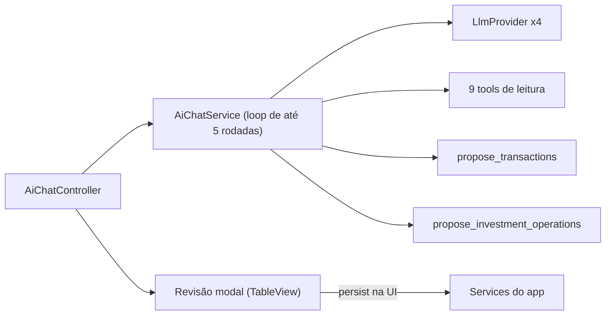
O diagrama mostra o estado atual: a gravação das propostas acontece no controller de revisão.

- A gravação (`persist`) vive na camada de UI; o framework de operações (C1) precisa movê-la para serviços.
- A correlação depende do LLM e só cobre pendentes de carteira; `possibleDuplicate` é só um realce na tela.
- Diálogos do app gravam ao salvar e não têm pré-preenchimento genérico (A2 exige um).
- Provedor usado pelo dono: OpenRouter com modelos variados (testes e prompts agnósticos ao modelo).
- Baseline de testes: `ktlintCheck spotlessCheck test` passou no commit `edee9038` (1584 testes, 0 falhas).

### Assumptions & open questions
- Q6: limite de contexto dos modelos via OpenRouter (afeta C5 e o tamanho do catálogo de tools).

## 1.6 Rough Mockups
Mockups HTML comparativos (dados fictícios, paleta real do app, M-007/M-008): `mockups/review-layouts.html` (abas 1, 2 e 3).

| Layout | Ideia | Prós | Contras |
|---|---|---|---|
| 1 Cartões inline no chat | Cartões de proposta na própria conversa, com barra de aprovação em lote | Contexto sempre visível; sem janela extra | Listas longas alongam o chat |
| 2 Painel lateral | Painel de revisão à direita do chat, com filtro por selo | Escala para listas longas; chat e revisão lado a lado | Ocupa largura; novo componente no layout do chat |
| 3 Janela em cartões | Evolução do diálogo atual com cartões em vez de tabela | Menor mudança | Bloqueia o chat; modal sobre modal ao editar |

Elementos comuns: selos (Nova, Casa com #id, Possível duplicata, Baixa confiança, Já registrada), motivo da decisão, ações Aprovar / Rejeitar / Editar / Ver existente / Criar mesmo assim, e **Editar abre a tela real do app pré-preenchida**.

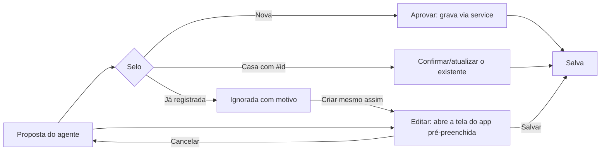
O diagrama mostra o caminho de cada proposta até "Salva"; Editar e "Criar mesmo assim" passam pela tela real do app.

### Assumptions & open questions
- Q5: layout escolhido pelo dono no gate 1.6: **2 · Painel lateral** (refinado em 2.5). — confirmed: yes

## 2.2 Práticas do time
Levantadas da evidência do repositório e da memória aprovada (`.aidlc/memory/project.md`); só as afirmadas pelo dono viram memória nova.

| Prática | Evidência |
|---|---|
| Commits convencionais (`feat:`, `fix:`, `chore:`), mensagem em inglês; `Co-Authored-By` permitido, sem link de sessão | git log; CLAUDE.md; [mem: M-004] |
| Branch ou `main` decidido por intent (aqui: `main`); não commitar antes de o dono ver o diff | [mem: M-014] [mem: M-004] |
| Pré-commit roda `ktlintCheck` + `test`; verificação padrão `ktlintCheck spotlessCheck test` | `.githooks/`, CLAUDE.md |
| Testes: Kotest BehaviorSpec + MockK; fábricas em `src/test/.../factory`; testes que passam por `FxUtils.launchOnFxThread` stubam o `FxUtils` | CLAUDE.md; [mem: M-013] |
| i18n: acrescentar chaves em `messages_en`/`messages_pt_BR`, nunca reescrever o arquivo; UTF-8 direto | CLAUDE.md |
| Cabeçalho padrão em todo `.kt`/`.py` novo; sem comentários `//` explicativos (KDoc ok) | [mem: M-012]; memória do usuário |
| UI validada com `make demo`/`capture-screens.sh`, dados fictícios, capturas em `construction/screenshots/` (ignoradas pelo git) | [mem: M-003, M-006, M-009] |
| Mockups HTML em `mockups/`; comparar layouts antes de decidir | [mem: M-007, M-008] |
| Nada de dado pessoal do dono em arquivos/commits/testes | [mem: M-011] |
| Textos "Título: valor" usam `TitledValue`; cores só por tokens `theme-*`; ícones por `Icons.kt` | [mem: M-010]; CLAUDE.md |
| Script novo: `git update-index --chmod=+x` | [mem: M-015] |

### Práticas específicas deste intent (propostas)
- P-A: toda mudança de contrato de tool ou de prompt vem com caso na suíte de avaliação (D2), agnóstica ao modelo (OpenRouter variando).
- P-B: lógica de gravação das propostas fica em serviços, nunca em controllers de UI.

### Assumptions & open questions
- A8: as práticas P-A e P-B valem a partir deste intent. — confirmed: no

## 2.5 Mockups refinados
Arquivo: `mockups/review-panel-refined.html` (dados fictícios, paleta real do app; complementa `review-layouts.html`).

### Especificação de interação
| Elemento | Comportamento |
|---|---|
| Painel | Aparece ao lado direito do chat quando há propostas; oculto sem pendências, com botão "Revisão (N)" para reabrir; em janela estreita vai para baixo do chat e é recolhível (FR-1, FR-7) |
| Contadores | Pendentes, aprovadas, rejeitadas e com erro, atualizados a cada ação (FR-7) |
| Cartão | Título, valor, data, carteira/cartão, categoria, selo, motivo, impacto (saldo/fatura/posição) e ações (FR-2, FR-26) |
| Seleção | Caixa por cartão; marcados por padrão os sem selo de baixa confiança ou duplicata; "Aprovar selecionadas" no rodapé (FR-4) |
| Selos | Nova, Casa com #id (com "trocar" quando há outro candidato), Possível duplicata, Baixa confiança, Editada, Aprovada, Rejeitada, Erro |
| Casou com confirmado | Não vira cartão; a resposta do chat lista id e motivo; chips "Criar mesmo assim", "Ver #id" (FR-13, FR-14, FR-9) |
| Editar | Abre a tela real em rascunho; o botão principal vira "Salvar rascunho"; campo alterado destacado; cartão passa a "Editada" (FR-5) |
| Dependências | Categoria/carteira novas são cartões próprios aprovados antes dos que dependem delas (FR-24) |
| Erro | Cartão mostra a mensagem do service e "Tentar de novo"; os demais seguem (FR-6) |
| Rejeitar | Cartão fica esmaecido com "Desfazer rejeição" até fechar a revisão |

### Estados e tipos de cartão (ver mockup, seções 2 e 3)
Pendente, Editada, Aprovada, Rejeitada, Erro; tipos: lançamento, transferência, dívida de cartão (parcelada), pagamento de fatura, compra/venda/dividendo de ativo, atualização de preço e histórico, categoria, meta/plano/wishlist.

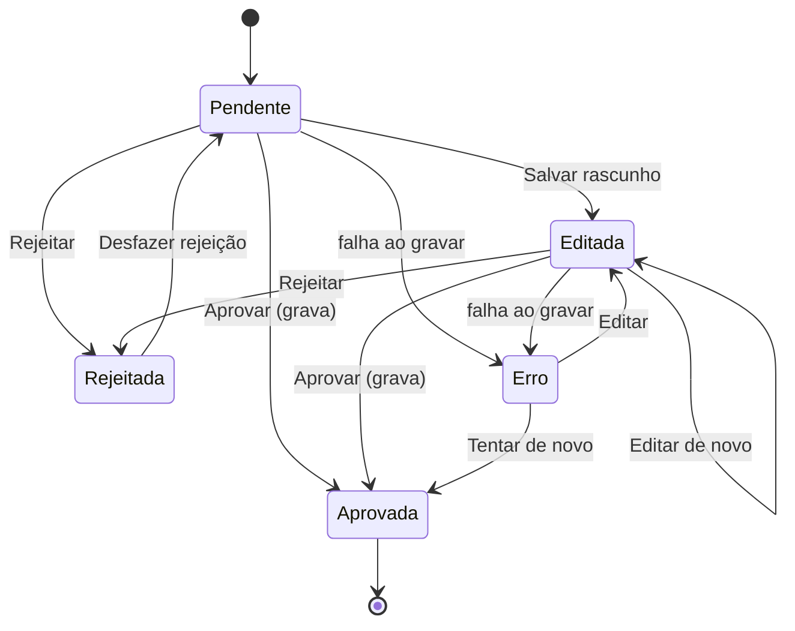
O diagrama mostra o ciclo de vida de um cartão; só `Aprovada` grava no banco.

### Acessibilidade e tema
- Selos e estados não dependem só de cor (texto e ícone); contraste pelos tokens `theme-*` nos dois temas; navegação por teclado entre cartões e ações (Tab, Espaço marca, Enter aprova o cartão focado); `accessibleText` nos botões de ícone.
- Sem cores literais: tokens do tema, `ThemeColors.kt` e `Icons.kt` (NFR-6).

### Assumptions & open questions
- A15: a ação "Atualizar dados" de um ativo (FR-22) é um cartão de manutenção que mostra as duas variantes (Atualizar dados e Resetar e buscar novamente), reaproveitando o serviço do intent anterior. — confirmed: no
- A16: "Desfazer rejeição" vale só enquanto a revisão está aberta; não confundir com o desfazer de gravações (E1, fora de escopo). — confirmed: no

## 2.6 Domínio e componentes

Fato que molda o desenho: existem cerca de **43 diálogos Add/Edit** no app (lançamentos, cartão, investimentos, categorias, metas, planos, wishlist) e a gravação das propostas hoje vive na UI (§2.1).

### Componentes
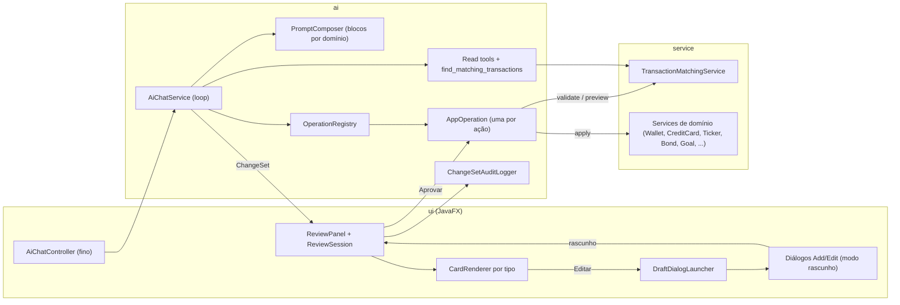
O diagrama mostra o novo fluxo: o LLM só produz o conjunto de mudanças; o painel aprova; a operação aplica via service e o resultado é auditado.

| Componente | Responsabilidade | Interfaces | Dados |
|---|---|---|---|
| `AppOperation` | Uma ação do app: `name`, `domain`, `jsonSchema`, `parse`, `validate`, `preview`, `toDraft`/`fromDraft`, `apply` (via service). Sem exclusões. | `OperationRegistry` | DTO tipado por operação |
| `OperationRegistry` | Registra operações (Spring), expõe por domínio, gera as definições de tool para os provedores | `AiChatService`, `PromptComposer` | nenhum |
| `ChangeSet` / `ProposedChange` | Lista de operações propostas num turno, com selo, motivo, confiança e dependências | `ChatTurnResult` | em memória |
| `TransactionMatchingService` | Correlação determinística (valor exato, data ±3 dias, mesma carteira/cartão; descrição só desempata) sobre lançamentos pendentes/confirmados, dívidas/parcelas de cartão e transferências | read tool `find_matching_transactions`, validação das operações | leitura de repositórios |
| `PromptComposer` | Monta o prompt a partir de blocos de recurso por domínio e locale | `AiChatService` | arquivos `ai/prompts/<locale>/<bloco>.md` |
| `ReviewSession` / `ReviewPanel` | Estado observável dos cartões (Pendente, Editada, Aprovada, Rejeitada, Erro), seleção, aprovação em lote, dependências | `AiChatController` | em memória |
| `CardRenderer` | Renderiza o cartão de cada tipo; um genérico serve de padrão | `ReviewPanel` | — |
| `DraftDialogLauncher` | Abre o diálogo real de uma operação em modo rascunho e devolve o rascunho | `ReviewPanel`, diálogos | DTO de rascunho |
| `ChangeSetAuditLogger` | Uma linha estruturada de log por operação aprovada (id do conjunto, operação, resultado) | `ReviewSession` | log do app |

### Decisões (ADRs)
#### ADR-1 · Framework de operações em vez de mais tools `propose_*` — Status: accepted
Context: cobertura total pede dezenas de ações; hoje cada família tem tool, DTO, controller e botão próprios. Decision: `AppOperation` + `OperationRegistry`; o LLM chama uma tool genérica `propose_changes` (ou uma por domínio) cujos itens são operações tipadas. Alternatives: manter tools ad hoc (custo linear em código de UI); gerar tools por reflexão dos services (acopla o LLM à assinatura dos services). Consequences: migração das duas tools atuais para operações (estrangulamento gradual); UI genérica. Related: FR-18, FR-19, NFR-9.

#### ADR-2 · A gravação sai da UI e vive em `AppOperation.apply` — Status: accepted
Context: `persist` está no controller de revisão. Decision: `apply` chama os services de domínio; a UI só dispara. Consequences: testável sem JavaFX; remove lógica duplicada. Related: FR-6, FR-27, P-B.

#### ADR-3 · Correlação em serviço de domínio, usada pela tool de leitura e pela validação — Status: accepted
Context: hoje depende do LLM e só cobre pendentes. Decision: `TransactionMatchingService` com pontuação explicável (critérios e motivo textual); a validação das propostas converte automaticamente em "casa com #id" (pendente) ou em "ignorada" (confirmado). Alternatives: só prompt; embeddings (custo e opacidade). Consequences: resultado determinístico e testável; falsos positivos mitigados por motivo visível e "criar mesmo assim". Related: FR-10..FR-16, NFR-2.

#### ADR-4 · Modo rascunho nos diálogos por contrato único — Status: accepted
Context: Editar deve usar a tela real e devolver rascunho (decisão B); ~43 diálogos. Decision: interface `DraftCapable<D>` (`applyDraft(d)`, `onDraftSaved(callback)`); no `handleSave`, se houver callback de rascunho, valida como sempre e devolve os valores em vez de gravar. Adaptação por diálogo é incremental, na Unit do domínio; operações cujo diálogo ainda não é rascunhável usam um editor mínimo do cartão como reserva. Alternatives: editar só no cartão (rejeitado pelo dono); diálogo grava na hora (opção A, rejeitada). Consequences: toca telas estáveis; checklist visual por diálogo (M-003). Related: FR-5, R-3, A10.

#### ADR-5 · Painel de revisão como componente com estado observável — Status: accepted
Decision: `ReviewPanel` + `ReviewSession` (observável) no pacote `ui/common/ai`, `CardRenderer` por tipo com padrão genérico; `AiChatController` apenas coordena. Consequences: reduz o controller de 710 linhas; reuso entre operações. Related: FR-1..FR-9.

#### ADR-6 · Prompt modular e roteamento por domínio — Status: accepted
Context: muitas tools degradam a escolha do LLM (R-2) e o prompt está em `application.yml`. Decision: blocos de prompt em arquivos de recurso (`ai/prompts/<locale>/<bloco>.md`); um núcleo (leitura, correlação, regras gerais) sempre presente e uma tool `use_domain(domain)` que ativa o bloco e as operações do domínio no restante da conversa (divulgação progressiva); limite de 30 definições por turno (NFR-3). Alternatives: enviar todas as tools sempre (estoura NFR-3); roteamento por palavras-chave em código (frágil, em dois idiomas). Consequences: exige subir o limite de iterações e testar o roteamento na suíte (FR-29/FR-30). Related: FR-28, FR-30, NFR-3.

#### ADR-7 · `ChatTurnResult` carrega um `ChangeSet` — Status: accepted
Decision: substituir `proposedTransactions`/`proposedInvestmentOperations` por `changeSet`; as duas famílias atuais viram operações. Consequences: remove os dois botões "Revisar (N)" e os dois controllers de revisão ao fim da migração. Related: FR-19.

#### ADR-8 · Auditoria no log do app — Status: accepted
Decision: `ChangeSetAuditLogger` escreve linhas estruturadas via SLF4J; sem tabela. Alternatives: tabela Flyway (adiada para o intent do desfazer). Related: FR-31, A11.

#### ADR-9 · Sem exclusão por construção — Status: accepted
Decision: o `OperationRegistry` não aceita operações destrutivas de exclusão; teste arquitetural verifica. Arquivar/desarquivar permitido (A9). Related: FR-17, NFR-10.

#### ADR-10 · Suíte de avaliação com provedor simulado — Status: accepted
Decision: `ScriptedLlmProvider` (respostas roteirizadas por caso) + dados fictícios + `AppOperation` reais sobre H2; os casos checam o `ChangeSet` resultante. Não depende de modelo (NFR-1). Related: FR-29.

### Estrutura de pacotes proposta
`org.moinex.ai.operation` (framework e operações por domínio), `org.moinex.ai.prompt`, `org.moinex.ai.audit`, `org.moinex.service.matching`, `org.moinex.ui.common.ai` (painel e cartões), recursos em `src/main/resources/ai/prompts/<locale>/`.

### Assumptions & open questions
- A17: a tool de proposta é única (`propose_changes`) com `operation` + `payload`, e não uma por operação, para manter o número de definições baixo; o esquema de cada payload vem do registro. — confirmed: no
- A18: o editor mínimo de reserva (ADR-4) só é usado enquanto um diálogo ainda não é rascunhável; ao fim do intent todos os diálogos do catálogo são rascunháveis. — confirmed: no
- Q7: o limite de 30 definições por turno e o limite de iterações padrão (hoje 5) são ajustáveis nas configurações do app? Decidir em 3.2.

## 2.7 Units de trabalho

Cada Unit entrega valor verificável sozinha. Ordem pedida pelo dono: base → lançamentos → cartão → investimentos → resto.

### UNIT-1 · Correlação determinística
- Propósito: parar as duplicatas já no fluxo atual. `TransactionMatchingService` (valor exato, data ±3 dias, mesma carteira/cartão; descrição só desempata) sobre pendentes e confirmados, dívidas/parcelas de cartão e transferências; tool de leitura `find_matching_transactions`; as tools de proposta atuais passam a aplicar a correlação no código, convertendo em "casa com pendente" ou "ignorada" (resposta do chat lista as ignoradas com id e motivo).
- Covers: US-4 · FR-10, FR-11, FR-13, FR-16 · NFR-2.
- Escopo dentro: serviço, tool de leitura, ajuste de `ProposeTransactionTool` e da resposta do chat; textos pt-BR/en; casos de teste com dados fictícios. Fora: painel novo, framework de operações.
- Interfaces: `TransactionMatchingService.findMatches(query): List<Match>` (id, tipo, pontuação, motivo); tool `find_matching_transactions`.
- Depends on: nenhuma.
- Definition of Done: comando de verificação passa; extrato fictício com nomes diferentes não gera duplicata; teste de desempenho de NFR-2; regressão de parcelas/fatura mantida.

### UNIT-2 · Framework de operações, prompt modular e auditoria
- Propósito: base comum. `AppOperation`, `OperationRegistry`, `ChangeSet`/`ProposedChange`, tool `propose_changes` e `use_domain`, `PromptComposer` com blocos por domínio (pt-BR/en), `ChangeSetAuditLogger`, regra de não exclusão (teste arquitetural), `ScriptedLlmProvider` + suíte de avaliação base. Migra as duas famílias atuais (lançamento de carteira, cartão, pagamento de fatura, investimentos) para operações; a gravação sai de `ui/dialog/ai` para `AppOperation.apply`.
- Covers: US-12, US-13 · FR-17, FR-18, FR-19, FR-27, FR-28, FR-29, FR-31 · NFR-1, NFR-3, NFR-8, NFR-9, NFR-10.
- Escopo dentro: pacotes `ai.operation`, `ai.prompt`, `ai.audit`; `ChatTurnResult` com `ChangeSet`; telas de revisão antigas passam a chamar `apply`. Fora: painel novo.
- Interfaces: `AppOperation`, `OperationRegistry`, `ChangeSet`.
- Depends on: nenhuma (usa UNIT-1 quando disponível na validação).
- Definition of Done: verificação passa; nenhum arquivo de `ui/dialog/ai` chama escrita de domínio; teste arquitetural de não exclusão e de "tool de IA não escreve"; suíte de avaliação roda com `ScriptedLlmProvider`; prompt migrado de `application.yml` para recursos com paridade dos casos atuais.

### UNIT-3 · Painel de revisão e rascunho
- Propósito: a nova interação. `ReviewPanel`/`ReviewSession`/`CardRenderer` (padrão genérico), cartões com selos, motivo, impacto, seleção e aprovação em lote, estados e contadores, filtro, layout responsivo; `DraftCapable` + `DraftDialogLauncher` e editor mínimo de reserva; `AiChatController` enxuto; removem-se os dois botões "Revisar (N)" e os controllers de revisão modal.
- Covers: US-1, US-2, US-3, US-11 · FR-1..FR-8, FR-26 · NFR-4, NFR-6.
- Escopo dentro: componentes de UI, CSS por tokens, capturas dos dois temas. Fora: adaptar cada diálogo ao rascunho (feito na Unit do domínio).
- Depends on: UNIT-2.
- Definition of Done: verificação passa; checklist visual nos dois temas e em janela estreita (`make demo`); o fluxo atual (lançamentos, cartão, investimentos) funciona pelo painel; rascunho funciona com o editor de reserva.

### UNIT-4 · Domínio Lançamentos
- Propósito: operações de carteira completas: despesa/receita (criar, editar), confirmar pendente (cartão "Casa com #id", trocar de alvo), "criar mesmo assim", transferência, recorrente, carteira, categoria (explícita); diálogos correspondentes em modo rascunho.
- Covers: US-5, US-6 · FR-12, FR-14, FR-15, FR-20, FR-24.
- Depends on: UNIT-1, UNIT-2, UNIT-3.
- Definition of Done: verificação passa; casos de avaliação do domínio; cada diálogo adaptado verificado no checklist; fluxos de duplicata completos (cartão, chat, "criar mesmo assim").

### UNIT-5 · Domínio Cartão
- Propósito: cartão (criar/editar), dívida à vista e parcelada, recorrente de cartão, pagar fatura, créditos/rebates; regras de parcela já existentes preservadas.
- Covers: US-7 · FR-21.
- Depends on: UNIT-2, UNIT-3.
- Definition of Done: verificação passa; casos de avaliação (parcelas, fatura paga); diálogos de cartão em modo rascunho.

### UNIT-6 · Domínio Investimentos
- Propósito: ticker, compra, venda, dividendo, câmbio de cripto, títulos e suas operações; atualizar preço e histórico (Atualizar dados / Resetar e buscar novamente).
- Covers: US-8 · FR-22.
- Depends on: UNIT-2, UNIT-3.
- Definition of Done: verificação passa; casos de avaliação; diálogos de investimento em modo rascunho.

### UNIT-7 · Cadastros e planejamento
- Propósito: metas, plano financeiro (e grupos de orçamento), wishlist e preferências comuns.
- Covers: US-9 · FR-23.
- Depends on: UNIT-2, UNIT-3.
- Definition of Done: verificação passa; casos de avaliação; diálogos em modo rascunho.

### UNIT-8 · Leitura ampliada e experiência do chat
- Propósito: busca de lançamentos e listagens com paginação, ações rápidas, indicador do que o agente consulta, links para telas, limites de iteração/paralelismo/contexto.
- Covers: US-10 · FR-9, FR-25, FR-30.
- Depends on: UNIT-2.
- Definition of Done: verificação passa; casos de avaliação de busca; checklist visual dos chips e do indicador.

### Ordem de dependência
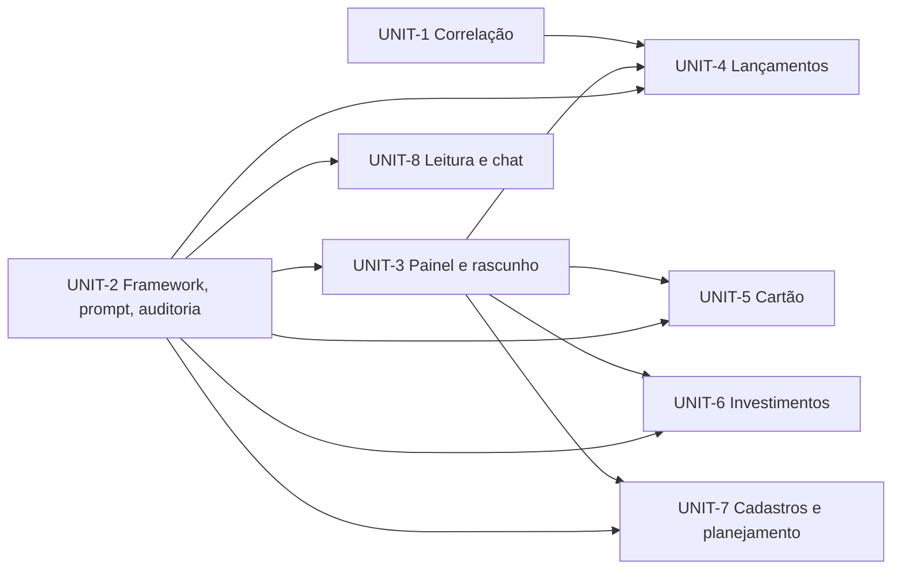
O grafo é acíclico; ordem topológica: UNIT-1, UNIT-2, UNIT-3, UNIT-4, UNIT-5, UNIT-6, UNIT-7, UNIT-8 (UNIT-1 e UNIT-2 podem andar em paralelo; UNIT-8 pode ser antecipada depois de UNIT-2).

### Mapa história → Unit
| História | Unit |
|---|---|
| US-1, US-2, US-3, US-11 | UNIT-3 |
| US-4 | UNIT-1 |
| US-5, US-6 | UNIT-4 |
| US-7 | UNIT-5 |
| US-8 | UNIT-6 |
| US-9 | UNIT-7 |
| US-10 | UNIT-8 |
| US-12, US-13 | UNIT-2 |

### Mapa FR → Unit (dono único)
UNIT-1: 10, 11, 13, 16 · UNIT-2: 17, 18, 19, 27, 28, 29, 31 · UNIT-3: 1–8, 26 · UNIT-4: 12, 14, 15, 20, 24 · UNIT-5: 21 · UNIT-6: 22 · UNIT-7: 23 · UNIT-8: 9, 25, 30. (31 de 31 cobertos.)

### Reatribuição (gate 3.1 da UNIT-2, 2026-11-05)
`ChangeSet` no `ChatTurnResult`, `propose_changes`, `use_domain` e o roteamento por domínio (NFR-3) passam da UNIT-2 para a UNIT-3 (tasks T-3.11..T-3.13). A UNIT-2 mantém FR-17, FR-18, FR-27, FR-28 (blocos de prompt), FR-29 e FR-31; **FR-19** passa a ser da UNIT-3.

### Assumptions & open questions
- A19: o MVP interno (base + lançamentos) é o conjunto UNIT-1..UNIT-4; as demais Units entram na sequência. — confirmed: no
- A20: o editor de reserva da UNIT-3 existe só até cada diálogo do domínio ficar rascunhável; ao final de UNIT-7 é removido. — confirmed: no

## 2.8 Contratos

Contratos entre Units (UNIT-1/2 produzem; UNIT-3..8 consomem). Assinaturas em Kotlin de referência; os nomes finais podem mudar na Construction sem mudar o significado.

### C-A · Correlação (UNIT-1 → UNIT-2/4)
```kotlin
data class MatchQuery(
    val amount: BigDecimal,          // sempre positivo
    val date: LocalDate,
    val walletId: Int? = null,
    val creditCardId: Int? = null,
    val description: String? = null, // só desempata
)

enum class MatchTargetType { WALLET_TRANSACTION, CREDIT_CARD_DEBT, CREDIT_CARD_INSTALLMENT, TRANSFER }
enum class MatchStatus { PENDING, CONFIRMED }

data class Match(
    val targetType: MatchTargetType,
    val targetId: Int,
    val status: MatchStatus,
    val score: Double,               // 0.0..1.0
    val reasons: List<String>,       // chaves i18n resolvidas: "valor exato", "data +1 dia", "mesma carteira"
    val existingDescription: String,
)

interface TransactionMatchingService { fun findMatches(query: MatchQuery): List<Match> } // ordenado por score desc
```
Regras: casa se valor igual (comparação exata), `|data - data alvo| ≤ 3 dias` e mesma carteira ou cartão; a descrição normalizada (minúsculas, sem acentos e ruído como "PIX", "COMPRA") só ordena empates. Sem match = lista vazia. Resposta da tool de leitura `find_matching_transactions`: `{"matches":[{targetType,targetId,status,score,reasons[],existingDescription}]}`.

### C-B · Operações e conjunto de mudanças (UNIT-2 → UNIT-3..8)
```kotlin
enum class OperationDomain { TRANSACTIONS, CREDIT_CARD, INVESTMENTS, PLANNING, MAINTENANCE }
enum class OperationRisk { LOW, MEDIUM }        // não existe nível para exclusão (ADR-9)

interface AppOperation<P : Any> {
    val name: String                              // "create_expense", "pay_invoice", ...
    val domain: OperationDomain
    val risk: OperationRisk
    fun payloadSchema(): String                   // JSON Schema do payload
    fun parse(payloadJson: String): P
    fun validate(payload: P): ValidationResult    // erros de campo e avisos; usa matching quando couber
    fun preview(payload: P): Preview?             // "saldo após", "total da fatura", ...
    fun toDraft(payload: P): DraftValues          // para a tela real
    fun fromDraft(draft: DraftValues): P
    fun apply(payload: P): ApplyResult            // grava via services; transacional
}

sealed interface ApplyResult { data class Success(val ids: List<Int>, val summary: String): ApplyResult
                               data class Failure(val message: String): ApplyResult }

enum class ChangeBadge { NEW, MATCHES_EXISTING, POSSIBLE_DUPLICATE, LOW_CONFIDENCE }
enum class ChangeState { PENDING, EDITED, APPROVED, REJECTED, ERROR }

data class ProposedChange(
    val id: String,                    // uuid do cartão
    val operationName: String,
    val payloadJson: String,
    val badge: ChangeBadge,
    val reasons: List<String>,
    val confidence: Double,
    val dependsOn: List<String> = emptyList(),   // ids de outros cartões
    val matchCandidates: List<Match> = emptyList(),
    val state: ChangeState = ChangeState.PENDING,
)
data class ChangeSet(val id: String, val changes: List<ProposedChange>, val ignored: List<IgnoredLine>)
data class IgnoredLine(val summary: String, val matchedTargetId: Int, val reasons: List<String>)
```
`ChatTurnResult.Success` passa a carregar `changeSet: ChangeSet?` (ADR-7).

### C-C · Tools expostas ao LLM (UNIT-2, UNIT-8)
| Tool | Entrada | Saída |
|---|---|---|
| `propose_changes` | `{"changes":[{"operation":"create_expense","payload":{...},"confidence":0.9}]}` | `{"accepted":[{"id","operation","badge","reasons"}],"ignored":[{"summary","matchedTargetId","reasons"}],"errors":[{"index","message"}]}`; **nunca grava** |
| `use_domain` | `{"domain":"CREDIT_CARD"}` | ativa o bloco de prompt e as operações do domínio nas próximas rodadas; devolve a lista de operações com esquemas |
| `find_matching_transactions` | `MatchQuery` em JSON | `{"matches":[...]}` |
| `search_transactions` (UNIT-8) | `{"text","minAmount","maxAmount","categoryId","walletId","from","to","page","pageSize"}` | `{"items":[...],"page","pageSize","total"}` |
| `list_*` (UNIT-8) | `{"page","pageSize"}` | `{"items":[...],"total"}` para wallets, categories, creditCards, tickers, recurring, goals, plans |
| tools de leitura atuais | inalteradas | inalteradas |

Modelo de erro: erros de validação voltam ao LLM no campo `errors` para ele corrigir na rodada seguinte; falha de gravação aparece no cartão (estado `ERROR`) e nunca é reenviada ao LLM sem pedido do usuário.

### C-D · Rascunho dos diálogos (UNIT-3 → UNIT-4..7)
```kotlin
interface DraftCapable {
    fun applyDraft(values: DraftValues)                 // preenche os campos
    fun onDraftSaved(callback: (DraftValues) -> Unit)   // chamado no lugar da gravação, após validar
}
data class DraftValues(val operationName: String, val fields: Map<String, Any?>)
```
Regra: em modo rascunho `handleSave` valida como sempre e, em vez de chamar o service, invoca o callback e fecha; título e botão indicam "Rascunho" (mockup 2.5). `DraftDialogLauncher.open(operationName, values, onSaved)` resolve o diálogo pelo nome da operação.

### C-E · Auditoria (UNIT-2)
Uma linha INFO por operação decidida, no logger `org.moinex.ai.audit`: `changeSetId=<id> changeId=<id> op=<name> state=<APPROVED|REJECTED|ERROR> ids=<csv> summary="<texto curto>"`. Não inclui descrições livres do extrato além do resumo curto.

### C-F · Blocos de prompt (UNIT-2)
Arquivos `src/main/resources/ai/prompts/<locale>/<bloco>.md` com `core.md` (sempre) e um por domínio (`transactions.md`, `credit_card.md`, `investments.md`, `planning.md`, `maintenance.md`). `PromptComposer.compose(locale, activeDomains)` concatena `core` + blocos ativos + contexto (data, carteiras, categorias, cartões, ativos). Locale ausente cai para `en`. `application.yml` mantém só `attachmentInstructionTemplate` ao fim da UNIT-2.

### Versionamento e compatibilidade
Mudança de esquema de payload é aditiva (campos novos opcionais) e atualiza o caso de avaliação correspondente (P-A). Os provedores recebem os esquemas no mesmo formato JSON Schema das tools atuais (NFR-1).

### Assumptions & open questions
- A21: valor "exato" na correlação significa igualdade de `BigDecimal` com a mesma escala de 2 casas. — confirmed: no
- A22: parcelas de cartão casam pelo valor da parcela e pela data da fatura/compra dentro da janela de ±3 dias. — confirmed: no

## 3.1 Functional design

### UNIT-1 — Functional design (inclui os requisitos de desempenho, NFR-2)
Código existente reaproveitado: `WalletTransactionRepository.findTransactionsBetweenDates`, `TransferRepository`, `CreditCardDebtRepository` (dívida guarda o **total** e o nº de parcelas; a parcela = total ÷ parcelas), `ProposeTransactionTool` (hoje resolve nomes e confirma só pendentes que o LLM apontou) e o loop de `AiChatService`.

#### Regras de casamento (decisões do dono + A21/A22)
| Regra | Definição |
|---|---|
| Valor | Igualdade exata em 2 casas (`BigDecimal.setScale(2, HALF_UP)`), sempre comparando valores positivos. Para dívida de cartão compara-se a **parcela** (total ÷ parcelas, arredondada a 2 casas; tolerância de 1 centavo só nessa divisão) |
| Data | `|data da linha − data do alvo| ≤ 3 dias`, só a parte de data. Em dívida de cartão a data é a da **compra original** |
| Carteira / cartão | Informada → o alvo tem de ser dela (transferência vale se a carteira é origem ou destino). Não informada → aceita qualquer, com pontuação menor e o motivo "carteira não informada" |
| Direção | `MatchQuery.isIncome` (novo campo opcional, aditivo ao contrato C-A): receita só casa com receita, despesa com despesa; nulo = ignora |
| Descrição | Nunca decide. Só ordena empates e soma até +0,05 na pontuação. Normalização: minúsculas, sem acentos, sem ruído (`pix`, `compra`, `debito`, `credito`, `pgto`, `pagamento`, `transf`, `ted`, `doc`, números soltos e símbolos); similaridade por tokens (Jaccard e inclusão) |
| Pontuação | Base 1,00 menos 0,05 por dia de diferença; menos 0,10 sem carteira informada; mais bônus da descrição (0..0,05); limitada a 0..1 |
| Ordenação | Pontuação desc → similaridade de descrição → proximidade de data → id |
| Motivos | Textos localizados (pt-BR/en): valor exato, mesma data / ±N dias, mesma carteira / carteira não informada, descrição parecida |

#### Decisão por proposta (aplicada em `ProposeTransactionTool`, kind wallet e credit_card; `credit_card_payment` fica de fora)
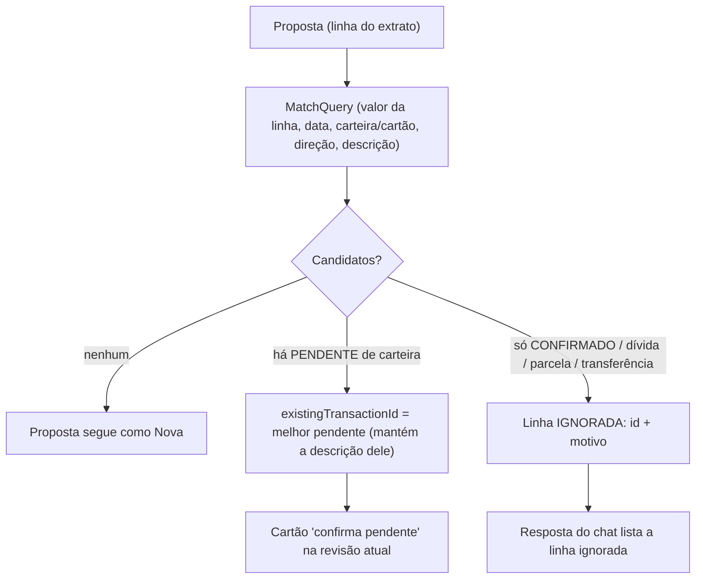
O diagrama mostra a decisão: pendente prevalece sobre confirmado; confirmado/cartão/transferência viram aviso, sem proposta.

Observações: se o LLM já enviou um `existingTransactionId` válido e pendente, ele é mantido. Em compra parcelada de cartão, a linha é comparada pela parcela impressa e pela data original da compra (regra de FR-11); isso substitui a checagem que hoje depende do LLM.

#### Fluxo da conversa
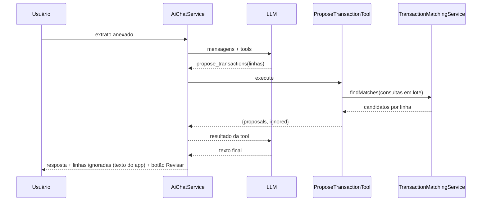
O diagrama mostra que as linhas ignoradas voltam ao LLM (que as menciona) e também chegam ao chat como texto gerado pelo app.

#### Lote e desempenho (NFR-2)
`findMatches(queries: List<MatchQuery>)` carrega **uma vez** as janelas `[menor data − 3, maior data + 3]` de lançamentos, dívidas de cartão e transferências (consultas por faixa de data, nunca a tabela inteira) e casa em memória com índice por valor. Meta: 200 linhas × 10.000 registros em memória < 1 s (teste com repositórios simulados). Consulta ao banco proporcional à janela do extrato.

#### Contratos tocados
- `MatchQuery` ganha `isIncome: Boolean?` (aditivo); `Match` como em C-A.
- Resultado de `propose_transactions` passa de array para objeto `{"proposals":[...],"ignored":[{"summary","matchedTargetId","targetType","status","reasons"}]}`; `parseResultJson` devolve `ProposalResult(proposals, ignored)`.
- `ChatTurnResult.Success` ganha `ignoredLines: List<IgnoredLine>`; o controller do chat mostra um aviso (texto do app) logo após a resposta.
- Tool de leitura `find_matching_transactions` (entrada: valor, data, `walletName`/`creditCardName`, `movementType`, `description`; saída: lista de candidatos com motivos) entra no conjunto de tools de `AiChatService`.
- Novo método de repositório: `CreditCardDebtRepository.findByDateBetween(start, end)`; `TransferRepository.findBetweenDates(start, end)`.

#### Prompt (T-1.8)
No prompt atual: remover a instrução de checar pendentes e parcelas "no olho"; dizer que o app confere duplicatas, que linhas ignoradas voltam em `ignored` e que o modelo deve apenas citá-las brevemente, e que `find_matching_transactions` serve para perguntas do usuário ("já lancei isso?").

### Not in UNIT-1
Painel novo, `propose_changes`, "criar mesmo assim" (UNIT-4: por ora o usuário pode pedir ao agente, que inclui a linha com `allowDuplicate=true` no `propose_transactions` — **campo opcional adicionado já aqui** para não deixar o usuário sem saída).

### Assumptions & open questions
- A23: o campo `allowDuplicate` (default false) em `propose_transactions` já na UNIT-1 evita deixar o usuário sem como lançar de propósito uma linha ignorada; a UNIT-4 o substitui pelo selo "Possível duplicata". — confirmed: no
- A24: o aviso das linhas ignoradas é um texto do app (i18n), mostrado como notice do chat sob a resposta, e não parte do histórico enviado ao LLM. — confirmed: no
- NFR (3.2/3.3): sem requisitos adicionais além de NFR-2 e NFR-7 nesta Unit.

### UNIT-2 — Functional design (framework de operações, prompt modular e auditoria)

#### Achado que muda o plano (precisa do seu OK)
Ao ler o código para desenhar esta Unit, vi que a única forma de **usar** um `ChangeSet` e a tool `propose_changes` é o painel da UNIT-3. Se eu trocasse o contrato do LLM já na UNIT-2, teria de escrever (e jogar fora na UNIT-3) um adaptador `ChangeSet → DTOs` para os diálogos antigos, e arriscaria piorar a extração de extratos sem poder testar com a UI final. Por isso proponho:

| | Plano original (§2.7/tasks) | **Proposta (recomendada)** |
|---|---|---|
| UNIT-2 | framework + `ChangeSet` em `ChatTurnResult` + `propose_changes` + `use_domain` + migração das tools + prompt + auditoria + avaliação | framework + **operações com `apply`** para as 5 famílias atuais (a gravação sai da UI, FR-27) + auditoria + prompt modular (blocos, sem roteamento) + testes arquiteturais + suíte de avaliação sobre as **tools atuais** |
| UNIT-3 | painel + rascunho | painel + rascunho + **`ChangeSet` no `ChatTurnResult`, `propose_changes`, `use_domain` e roteamento por domínio** (T-2.3, T-2.4, T-2.5 passam para cá) |
| Efeito | contrato do LLM muda cedo, adaptador descartável | contrato do LLM muda **uma vez**, junto com a UI que o consome; a UNIT-2 é segura (sem mudança de comportamento visível) |

Reatribuição de requisitos: FR-18 (framework) e FR-27, FR-28 (prompt em blocos), FR-29, FR-31, FR-17 ficam na UNIT-2; **FR-19** (conjunto de mudanças por turno) e a parte de roteamento por domínio de FR-28/NFR-3 passam para a UNIT-3. A garantia "nenhuma tool de IA escreve" (teste arquitetural) continua na UNIT-2.

#### O que a UNIT-2 entrega (sem mudar o que o usuário vê)
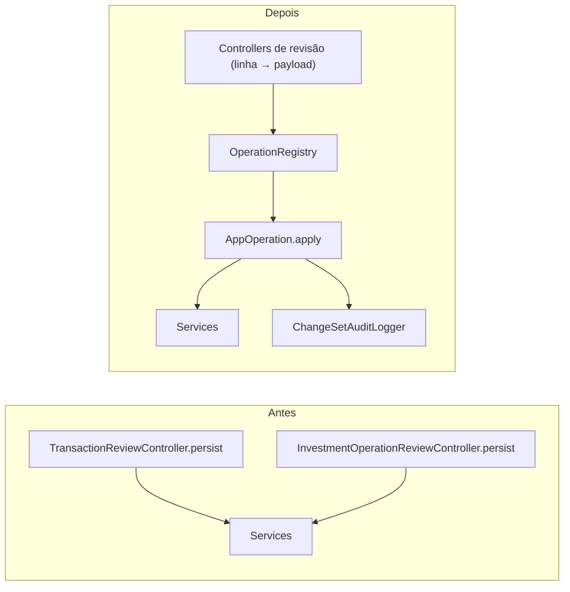
O diagrama mostra que a gravação passa a existir só dentro das operações; os controllers antigos apenas montam o payload da linha revisada e chamam `apply`.

#### Operações desta Unit (payloads com ids, nunca rótulos)
| Operação | Domínio | Payload | `apply` (lift do `persist` atual) |
|---|---|---|---|
| `create_wallet_transaction` | TRANSACTIONS | data, descrição, valor, `movementType`, `walletId`, `categoryName`, `existingTransactionId?` | categoria por nome (cria se faltar, como hoje); status CONFIRMED; atualiza se há pendente, senão cria com notificação |
| `create_credit_card_debt` | CREDIT_CARD | data, descrição, valor total, parcelas, nº da parcela, `creditCardId`, `categoryName` | mês da fatura: fatura corrente se parcela > 1, senão pela data da compra; `createDebt` |
| `pay_credit_card_invoice` | CREDIT_CARD | `creditCardId`, mês da fatura, valor, data | usa a carteira de cobrança padrão do cartão (erro claro se faltar); `payInvoice` |
| `record_stock_purchase` / `record_stock_sale` | INVESTMENTS | data, descrição, `tickerId`, quantidade, preço, `walletId`, `categoryName` | `createTickerPurchase` / `createTickerSale` (custo médio do ativo) |
| `record_dividend` | INVESTMENTS | data, descrição, `tickerId`, valor, `walletId`, `categoryName` | `createDividend` |
| `apply_to_bond` / `redeem_bond` | INVESTMENTS | data, descrição, `bondId`, quantidade, preço, taxas, impostos, `walletId`, `categoryName` | `createBondOperation` BUY / SELL (lucro líquido = (preço − médio) × qtd − taxas − impostos) |

Todas devolvem `ApplyResult.Success(ids, summary)` ou `Failure(message)` (a exceção do service vira mensagem). Não há operação de exclusão (ADR-9).

#### Interfaces
```kotlin
interface AppOperation<P : Any> {
    val name: String
    val domain: OperationDomain
    val risk: OperationRisk
    fun payloadSchema(): String
    fun parse(payloadJson: String): P
    fun validate(payload: P): ValidationResult
    fun apply(payload: P): ApplyResult
}
```
`preview`, `toDraft` e `fromDraft` (C-B) entram como métodos com implementação padrão vazia e são preenchidos na UNIT-3/domínios, quando o painel existir. `OperationRegistry` coleta os beans, expõe `byName`, `byDomain` e recusa nomes duplicados e nomes que comecem por `delete`/`remove`.

#### Auditoria
`ChangeSetAuditLogger.record(changeSetId, changeId, operationName, state, ids, summary)` escreve a linha C-E no logger `org.moinex.ai.audit`. Os controllers de revisão atuais geram um `changeSetId` por janela e registram cada linha aprovada (`APPROVED`) ou com erro (`ERROR`); rejeições ficam para o painel (UNIT-3).

#### Prompt em blocos
`PromptComposer.compose(locale, activeDomains)` lê `ai/prompts/<locale>/core.md`, `transactions.md`, `credit_card.md` e `investments.md` do classpath (locale `pt-br` ou `en`, caindo para `en`). **Nesta Unit todos os blocos ficam sempre ativos** (o roteamento por domínio chega com `use_domain` na UNIT-3). O conteúdo é o prompt atual dividido por tema, sem mudar o sentido (pt-BR e en). `AiChatService` passa a usar o compositor; `application.yml` mantém só `attachment-instruction-template`.

#### Testes
- Um teste por operação com o service simulado (cria, atualiza pendente, parcela > 1, pagamento sem carteira de cobrança, etc.).
- `OperationRegistryTest`: duplicado e nome proibido falham.
- `PromptComposerTest`: paridade — o prompt composto contém as frases-chave do atual (regras de parcela, de investimentos, de pendente, de ignoradas), em pt-br e en; fallback para `en`.
- `AiArchitectureTest` (varredura de código-fonte): nenhuma `LlmTool` chama método de escrita de service; `ui/dialog/ai` não chama escrita de domínio; nenhuma operação tem nome de exclusão.
- `AgentEvaluationSuite` + `ScriptedLlmProvider` (em `src/test`): roda `AiChatService` real com as tools reais e repositórios simulados; casos: nome diferente (confirmado → ignorada), pendente confirmada, parcela de cartão já registrada, pagamento de fatura, "criar mesmo assim", pedido de exclusão sem tool de exclusão disponível.
- Codecs dos 4 provedores: nada muda no contrato de tools nesta Unit; o teste existente continua valendo.

#### Fora desta Unit
`ChangeSet` no `ChatTurnResult`, `propose_changes`, `use_domain`, painel, rascunho (UNIT-3); operações novas e edição (UNIT-4+).

### Assumptions & open questions
- A25: reatribuir T-2.3, T-2.4 e T-2.5 (e FR-19/roteamento de FR-28/NFR-3) para a UNIT-3 é aceito. — confirmed: no
- A26: os controllers de revisão antigos continuam montando o payload a partir da linha (tabela) e chamando `apply`; não há mudança visível de comportamento. — confirmed: no

### UNIT-3 — Functional design (painel de revisão, rascunho e contrato do LLM)

Esta é a Unit mais larga e a única com muita UI sem teste automático. Pelo que li do código (`AiChatController` é um bean singleton que guarda histórico e revisões pendentes e reconstrói o chat ao reabrir a tela; as duas revisões modais somam ~1.200 linhas), proponho **dividi-la em duas entregas verificáveis**, para que o contrato do LLM e a lógica do painel (testáveis) fiquem prontos antes da parte visual.

| Entrega | Conteúdo | Como é verificada |
|---|---|---|
| **UNIT-3a · Núcleo do conjunto de mudanças** | `ChangeSet`, `ProposedChange`, selos/estados; tool `propose_changes` (substitui `propose_transactions` e `propose_investment_operations`, mantendo o mesmo vocabulário por nomes); `use_domain` e roteamento dos blocos de prompt; `ReviewSession` (estado, seleção, aprovação em lote em ordem de dependência, falha isolada, auditoria); mapeamento de rascunho (`toDraft`/`fromDraft`) das operações atuais | testes automáticos + suíte de avaliação; a UI antiga continua funcionando alimentada por um adaptador mínimo `ProposedChange → linha antiga` **ou** fica sem revisão até a 3b (ver pergunta abaixo) |
| **UNIT-3b · Painel e rascunho (UI)** | `ReviewPanel` + `CardRenderer` (cartões, selos, motivo, impacto, filtro, contadores, responsivo), `DraftDialogLauncher` com editor de reserva, `AiChatController` enxuto, remoção dos dois diálogos modais, CSS por tokens, textos pt-BR/en | `make demo`/capturas nos dois temas e em janela estreita + seu checklist (M-003) |

#### Contrato do LLM em `propose_changes` (decisão importante)
O modelo continua falando em **nomes** (carteira, cartão, categoria, ticker, título), como hoje, e o app os resolve para ids antes de montar o payload. Isso mantém a robustez da extração (o LLM não precisa decorar ids) e limita o risco de regressão.
```json
{"changes":[
  {"operation":"create_wallet_transaction","walletName":"Bank","categoryName":"Groceries",
   "date":"2026-10-10","description":"PIX ACADEMIA FIT","amount":99.90,"movementType":"expense",
   "existingTransactionId":null,"allowDuplicate":false,"confidence":0.9}
]}
```
Cada `AppOperation` ganha `fromModelArguments(json, lookup): P` (nomes → ids, defaults como hoje: parcelas, valor total do cartão, mês da fatura) e `matchQuery(payload): MatchQuery?` (para a correlação da UNIT-1). O esquema que o modelo vê vem de `AppOperation.modelSchema()` e reaproveita as descrições longas atuais (parcelas, fatura, pendente), movidas das tools antigas para as operações. `allowDuplicate`, `existingTransactionId` e `confidence` são campos comuns a toda mudança.

#### Fluxo do turno (3a)
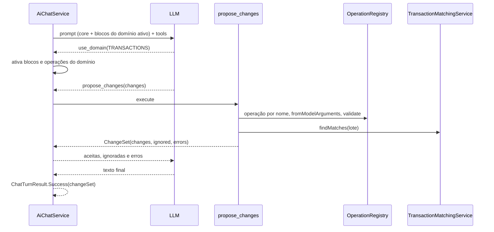
O diagrama mostra que o LLM só devolve intenções; selo, motivo, correlação e validação são decididos pelo app, e erros de validação voltam ao modelo para corrigir na rodada seguinte.

#### `use_domain` e limites
A conversa começa com o núcleo, a leitura e `find_matching_transactions`. `use_domain(domain)` ativa o bloco de prompt e as operações do domínio para o resto da conversa. Para não quebrar o comportamento atual quando o modelo ignora a tool, **as operações dos domínios existentes (TRANSACTIONS, CREDIT_CARD, INVESTMENTS) ficam disponíveis desde o início**; o roteamento só passa a restringir quando houver domínios novos (UNIT-4 em diante). Máximo de 30 definições por turno (NFR-3), com teste de contagem. `MAX_TOOL_ITERATIONS` sobe de 5 para 8 já nesta Unit (configurável na UNIT-8).

#### `ReviewSession` (3a, sem JavaFX Toolkit)
Lista observável de `ProposedChange` com estado (`PENDING`, `EDITED`, `APPROVED`, `REJECTED`, `ERROR`), seleção por cartão, contadores, filtro, `approve(ids)` em ordem de dependência (uma categoria nova antes das operações que a usam), `reject`, `undoReject`, `applyDraft(id, DraftValues)` e `retry`. Cada decisão chama `ChangeSetAuditLogger`. Padrões de seleção: marcados os sem selo de baixa confiança ou duplicata (FR-4).

#### Painel e rascunho (3b)
`ReviewPanel` fica à direita do chat (abaixo em janela estreita, recolhível), com `CardRenderer` genérico (título, valor, data, conta, categoria, selo, motivo, impacto) e ações Aprovar/Rejeitar/Editar/Ver existente. O estado vive no `ReviewSession` guardado no controller singleton e é redesenhado quando a tela do chat é reaberta. **Editor de reserva (ADR-4):** um diálogo simples gerado a partir de `DraftValues.fields` (data, descrição, valor, categoria, carteira/cartão, parcelas, ativo), usado enquanto o diálogo real do domínio não for rascunhável; `DraftDialogLauncher.open(operation, values)` escolhe o real quando existe e a reserva quando não. Remove-se `TransactionReviewController`, `InvestmentOperationReviewController`, seus FXML/CSS, `ExtractedTransactionDTO` e `ExtractedInvestmentOperationDTO`.

#### Migração dos testes
`ProposeTransactionToolTest` e `ProposeInvestmentOperationToolTest` são reescritos como testes de `fromModelArguments` das operações e de `propose_changes`; a `AgentEvaluationSuite` troca o nome da tool nos casos; `AiChatServiceTest` troca `proposedTransactions` por `changeSet`. O comportamento coberto (casos 1–9) permanece igual.

### Assumptions & open questions
- A27: dividir a UNIT-3 em 3a (núcleo) e 3b (UI) mantém o plano de FRs: 3a cobre FR-19, FR-28 (roteamento), FR-6 (aprovação em lote, parte lógica), FR-4 (seleção) e NFR-3; 3b cobre FR-1, FR-2, FR-3, FR-5, FR-7, FR-8, FR-26 e NFR-4/NFR-6. — confirmed: no
- A28: entre 3a e 3b o app **não terá revisão de propostas** se removermos as tools antigas na 3a. Alternativa: 3a mantém as tools antigas registradas em paralelo e só a 3b troca tudo; custo é duplicação temporária. — confirmed: no (pergunta ao dono)
- A29: o modelo continua usando nomes, não ids (menor risco de regressão). — confirmed: no

### UNIT-4 — Functional design (domínio Lançamentos)

**Divisão (decisão do dono, 2026-11-05):** 4a duplicata e correlação no painel (T-4.1, T-4.2); 4b operações novas (T-4.3 a T-4.7); 4c rascunho nos diálogos reais e avaliação (T-4.8 a T-4.10). Cada parte é verificada com o comando aprovado antes da seguinte; sem uso intermediário.

**Ponto de partida (verificado no código):** `CreateWalletTransactionOperation` já faz criar e confirmar pendente (`existingTransactionId`, `confirmingPending`); `ProposeChangesTool` já aceita `allowDuplicate` e emite o selo `POSSIBLE_DUPLICATE`; `ProposedChange.matchCandidates` já carrega todos os candidatos. Logo, T-4.2 é sobretudo teste e prompt, e T-4.1 é a UI de troca de alvo.

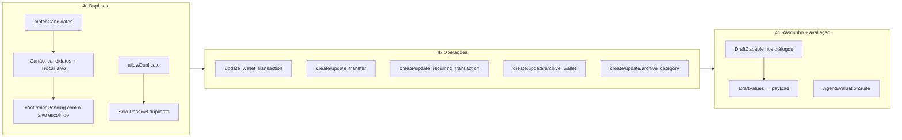

#### 4a — Duplicata e correlação
- **Troca de alvo (FR-15):** o cartão "Casa com #id" lista os `matchCandidates` com pontuação e motivo; escolher outro candidato recalcula o payload com `confirmingPending(payload, novoId)`. Se devolver null (alvo não é mais PENDING), o cartão mostra erro de validação e mantém o alvo anterior. Só candidatos `PENDING` são oferecidos como alvo; os `CONFIRMED` aparecem como informação.
- **"Ver existente":** abre a tela do registro casado (lançamento na tela da carteira; parcela na tela do cartão) via navegação existente; só leitura.
- **Criar mesmo assim (FR-14):** sem botão (A12). O usuário pede no chat, o modelo reenvia a linha com `allowDuplicate=true` e o cartão sai com selo `POSSIBLE_DUPLICATE`, não selecionado por padrão. Trabalho: teste `DuplicateOverrideTest` e linha no bloco `transactions.md` do prompt.
- **Regra:** trocar o alvo só altera o payload do cartão; nada grava até Aprovar.

#### 4b — Operações (todas `OperationDomain.TRANSACTIONS`, `risk` conforme tabela; nenhuma exclusão)

| Operação | Serviço | Campos (por nome) | Risco |
|---|---|---|---|
| `update_wallet_transaction` | `WalletService.updateWalletTransaction` | id do lançamento, e os campos a mudar (data, descrição, valor, tipo, carteira, categoria) | MEDIUM |
| `create_transfer` / `update_transfer` | `createTransfer` / `updateTransfer` | carteira de origem, de destino, data, valor, descrição, categoria | LOW / MEDIUM |
| `create_recurring_transaction` / `update_recurring_transaction` | `RecurringTransactionService` | início, fim, frequência, tipo, valor, carteira, categoria, descrição, incluir no patrimônio | LOW / MEDIUM |
| `create_wallet` / `update_wallet` / `archive_wallet` / `unarchive_wallet` | `WalletService.createWallet/renameWallet/changeWalletType/archiveWallet/unarchiveWallet` | nome, tipo, saldo inicial | LOW / MEDIUM |
| `create_category` / `update_category` / `archive_category` | `CategoryService` | nome, arquivada | LOW / MEDIUM |

- **Edição:** o modelo informa o id (vindo de `get_transactions_in_period`/`find_matching_transactions`) e só os campos a mudar; `fromModelArguments` carrega o registro e monta o payload completo, então o cartão e o rascunho sempre mostram o estado final. Id inexistente → erro de validação. O cartão mostra "antes → depois" via `preview` (esta é a primeira operação a usar `preview`).
- **Confirmar pendente** continua em `create_wallet_transaction` + `existingTransactionId` (FR-12), sem operação nova; `update_wallet_transaction` não muda status.
- **Arquivar carteira:** só `risk=MEDIUM`, validação reaproveita as regras do `WalletService` (erro devolvido no cartão). **Alterar saldo** fica fora (a tela existe, mas é correção contábil sensível) — anotado como pergunta aberta.
- **Roteamento:** esta é a primeira Unit de domínio novo, então T-3.13 (`use_domain`, limite de 30 definições por turno) **entra aqui**, junto de `transactions.md` ampliado no prompt. Domínio ativo por conversa; `TRANSACTIONS` ativo por padrão.

#### Categoria nova (FR-24, decisão do dono)
Proposta com categoria inexistente gera um cartão `create_category` e o lançamento ganha `dependsOn` apontando para ele. `ReviewSession` já aplica por dependência: aprovar o lançamento sem o cartão da categoria devolve erro "falta a categoria X" e não cria nada; rejeitar a categoria impede o lançamento dependente. `CategoryResolver.resolveOrCreate` deixa de criar em silêncio no caminho do chat (continua criando nos diálogos antigos, fora do agente).

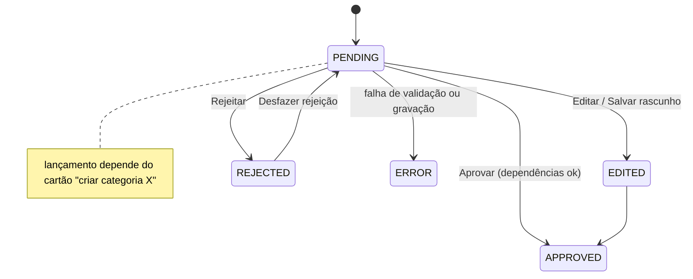

#### 4c — Rascunho nos diálogos reais (FR-5)
Implementa `DraftCapable` (contrato C-D) em: `AddExpense`, `AddIncome`, `EditTransaction`, `AddTransfer`, `EditTransfer`, `AddRecurringTransaction`, `EditRecurringTransaction`, `AddWallet`, e em `AddCategory`/`EditCategory`. `handleSave` em modo rascunho valida como sempre, chama o callback e fecha; título e botão dizem "Rascunho". `DraftDialogLauncher.open(operationName, values, onSaved)` resolve o diálogo pelo nome da operação; sem diálogo rascunhável, cai para o `DraftEditorDialog` de reserva já existente. Mapeamento `DraftValues ↔ payload` testado em `DraftValuesMappingTest`.

#### Casos de avaliação (FR-29, T-4.10)
Nome diferente no extrato, janela de data (±3 dias), duplicata forçada, categoria nova (gera 2 cartões com dependência), editar lançamento por id, transferência entre duas carteiras, recorrente mensal.

#### Regras e erros
- O modelo nunca grava; erros de validação voltam ao modelo em `errors`; falha de gravação vira estado `ERROR` no cartão (modelo de erro da seção 2.8).
- Todo texto novo em pt-BR e en (somente chaves acrescentadas, nada de reescrever o `.properties`; se a edição falhar, peço a você as chaves).
- Sem comentários `//` no código; KDoc nas classes e funções; cabeçalho de arquivo nos novos.

#### Assumptions & open questions
- A24: `ReviewSession` aplica a dependência categoria → lançamento sem mudança de contrato (`dependsOn` já existe). — confirmed: no
- A25: alterar saldo de carteira, mudar o tipo da carteira e vincular carteira virtual ficam **fora** do agente nesta Unit. — confirmed: no
- A26: "Ver existente" usa a navegação já disponível entre telas, sem tela nova. — confirmed: no
- A27: T-3.13 (`use_domain`) entra na 4b por ser a primeira Unit com domínio novo. — confirmed: no
