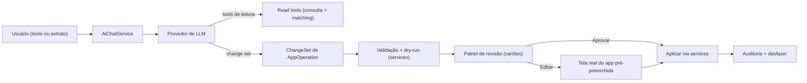
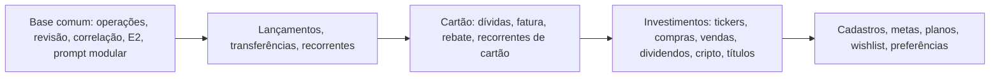

# Requirements — ai-agent-evolution

## Original request
O agente ainda é muito limitado e a interação com ele é dificil, por exemplo, para revisar as sugestões de transações que ele cria. Além disso, precisamos melhorar o prompt para que, além do que já foi dito que precisa melhorar, ele saiba identificar mais corretamente e correlacionar transações existentes e não sugerir criação de novas se o que diferenciar for apenas o nome, por exemplo. Gostaria de discutir ideias de como podemos melhorar tanto a interação com o agente bem como as capacidades dele através da melhoria do prompt, novas tools/melhorias das existentes etc. A ideia seja que o agente tenha total capacidade sobre as operações da app que o usuário usualmente faria manualmente.

## 1.1 Intent & stakeholders

### Intenção em termos de negócio
Hoje o assistente de IA do MOINEX consulta dados (9 tools de leitura) e propõe lançamentos e operações de investimento (2 tools de proposta); nada grava sem revisão manual. O dono quer que ele passe a ser um **operador completo do app**: fazer, por conversa, o que o usuário faria manualmente, com revisão humana em lote e sem criar duplicatas. [src: Original request, Q-Autonomia, Q-Cobertura]

### Problemas observados
| ID | Problema | Fonte |
|---|---|---|
| P-1 | A tela de revisão das propostas é difícil de usar e de editar: tabela editável dentro do diálogo, simplista, com menos opções que as telas de criação/edição do app. O dono sugere simplificar: revisar e, para editar, abrir a tela de edição do próprio app. | [src: Q-Dores] |
| P-2 | O agente sugere criar lançamentos que já existem quando só o nome/descrição difere; o casamento atual vale apenas para pendentes de carteira (`existingTransactionId`), não para confirmados nem para cartão. | [src: Q-Dores; src: ai/tools/ProposeTransactionTool.kt] |
| P-3 | Capacidade limitada: só consulta e propõe lançamento/investimento; não edita, exclui, transfere nem opera cadastros, metas, planejamento etc. | [src: Q-Dores] |

### Metas (critérios de sucesso, a refinar em 2.3)
- G-1: dado um extrato com lançamentos já registrados (inclusive confirmados e de cartão, com descrição diferente), nenhuma duplicata é proposta; os casados aparecem como "já registrado" com o motivo. Medição: conjunto de casos de teste de correlação (com dados fictícios).
- G-2: qualquer proposta pode ser revisada e editada com as mesmas opções das telas de criação/edição do app (sem perda de campos).
- G-3: o agente cobre as operações manuais do app, por domínio, via tools; toda escrita passa por revisão em lote do dono.
- G-4: a revisão de N propostas é feita em uma tela só, com aprovar/rejeitar/editar por item.

### Partes interessadas
| Papel | Quem | Interesse |
|---|---|---|
| Decisor / usuário | Dono do projeto (Lucas Araújo) | Define escopo, aprova gates, valida UX |
| Afetados | Dados financeiros do usuário (lançamentos, cartões, investimentos) | Integridade: sem duplicatas nem escritas não revisadas |
| Consultados | Provedores de LLM configurados (Anthropic, OpenAI, Gemini, OpenRouter) | Limites de contexto, custo e formato de tool-calling |

### Restrições conhecidas
- Modelo de autonomia: o agente **propõe e o usuário aprova em lote**; nenhuma escrita direta. [src: Q-Autonomia]
- Cobertura **total desde o início**, não faseada por domínio. [src: Q-Cobertura] (risco de escopo a tratar em 1.3/1.4)
- Dados reais do dono nunca entram em arquivos do AI-DLC nem em testes; usar dados fictícios (M-006, M-011).
- Sem release por ora; trabalho direto na `main` (M-014).
- Mockups HTML comparativos antes de decidir layout (M-007, M-008).

### Não-metas (provisório)
- Sem escrita sem aprovação humana; sem agente autônomo em segundo plano.
- Sem troca de provedor ou de arquitetura de LLM como objetivo em si.

### Como conduzir a discussão
Catálogo de ideias (interação, prompt, tools, arquitetura) com mockups HTML comparativos em `mockups/`, priorizado pelo dono em 1.4. [src: Q-Discussão]

### Assumptions & open questions
- A1: "cobertura total" significa todas as operações de escrita das telas do app (carteiras, categorias, lançamentos, cartões, investimentos, metas, planejamento, wishlist, configurações), não só de lançamentos. — confirmed: no
- A2: a revisão em lote continua dentro do chat (painel ou janela), não uma tela separada do menu. — confirmed: no
- A3: o limite de 5 iterações de tool por turno é um ponto a rever, pois cobertura total e correlação exigem mais consultas. — confirmed: no
- Q1: quais operações o dono mais faz manualmente (para ordenar a entrega dentro de uma cobertura total)? Tratar em 1.4.

## 1.2 Catálogo de ideias (adaptação do estágio Market Research)
Sem pesquisa externa (o dono escolheu o catálogo com mockups, e não houve OK para WebSearch). Base: leitura do código atual do agente (`ai/chat/AiChatService`, `ai/tools/*`, `ui/dialog/ai/*`, prompt em `application.yml`) e dos métodos de escrita dos services. Build-vs-buy não se aplica: o agente é interno e já tem 4 provedores de LLM.

### Estado atual (fatos)
- 9 tools de leitura (`QueryFinanceTool`) + `propose_transactions` + `propose_investment_operations`; `MAX_TOOL_ITERATIONS = 5`.
- Casamento com lançamento existente só por `existingTransactionId`, e só para PENDENTES de carteira; a decisão é do LLM (via prompt). `possibleDuplicate` é calculado na tela de revisão por janela de 3 dias.
- Revisão: diálogo modal com `TableView` editável (abas carteira / cartão; ~600 linhas por controller), sem todas as opções das telas de criação/edição do app.
- Escritas existentes nos services que o agente poderia expor: carteiras, transferências, lançamentos, recorrentes, categorias, cartões/dívidas/pagamento de fatura/rebate, tickers/compras/vendas/dividendos/câmbio de cripto, títulos e operações, metas, planos, wishlist.

### Ideias por tema
**A. Interação e revisão (P-1)**
| ID | Ideia | Efeito |
|---|---|---|
| A1 | Revisão por **cartões** (não tabela): cada proposta mostra selo (Nova / Casa com #id / Possível duplicata / Baixa confiança), o motivo e ações Aprovar, Rejeitar, Editar. | Legibilidade e transparência |
| A2 | **Editar abre a tela real do app** (criar/editar lançamento, dívida, compra etc.) pré-preenchida pela proposta; ao salvar, o cartão vira "Salvo". | Paridade total de campos; menos código de edição próprio (sugestão do dono) |
| A3 | Cartões **dentro da conversa** (inline) ou em painel lateral, em vez de diálogo modal; barra "Aprovar todas as de alta confiança". | Revisão em lote sem perder o contexto do chat |
| A4 | **Conjunto de mudanças persistente**: propostas sobrevivem a fechar o chat e ficam numa fila de revisão. | Revisão em várias sessões |
| A5 | Ações rápidas (chips), indicador do que o agente está consultando, respostas com links para as telas do app. | Conversa mais fluida |

**B. Correlação e duplicatas (P-2)**
| ID | Ideia | Efeito |
|---|---|---|
| B1 | **Casamento determinístico em código** (serviço de matching): valor + janela de data + carteira/cartão, e similaridade de descrição normalizada só como desempate; o nome nunca é chave de identidade. Exposto como tool `find_matching_transactions` e aplicado como pré-passo/validação nas propostas. | Reduz dependência do LLM e erros por nome diferente |
| B2 | Casar também com **lançamentos confirmados** e com **dívidas de cartão**; resultado "já registrado" (sem ação) ou "atualizar campos" (ex. categoria), com motivo. | Remove duplicatas fora de pendentes |
| B3 | Regra no prompt: descrição não identifica lançamento; consultar candidatos antes de propor; explicar o casamento ao usuário. | Complementa B1 |
| B4 | **Aliases aprendidos** (estabelecimento → descrição/categoria) confirmados pelo usuário. | Melhora categorização e casamento ao longo do tempo |

**C. Capacidades e tools (P-3)**
| ID | Ideia | Efeito |
|---|---|---|
| C1 | **Framework de operações**: cada ação do app é uma `AppOperation` (nome, JSON Schema, validação, pré-visualização/dry-run, aplicação via service existente). O agente devolve um *change set* de operações tipadas; a UI de revisão é genérica (um renderizador por tipo). Substitui as tools `propose_*` ad hoc. | Cobertura total com custo marginal por operação |
| C2 | Catálogo de operações a partir dos services (lista acima) + operações de manutenção (ex. atualizar preços/histórico de um ativo, recém-criado). | Cobre "tudo que o usuário faz manualmente" |
| C3 | Mais tools de **leitura**: busca de lançamentos (texto, valor, categoria, carteira), listar carteiras/categorias/cartões/ativos/recorrentes/planos, com paginação. | Contexto para decisões e correlação |
| C4 | **Pré-visualização de impacto** (saldo após, total da fatura, meta afetada) em cada cartão. | Revisão informada |
| C5 | Rever limites: iterações de tool por turno, chamadas paralelas, compactação de contexto. | Viabiliza tarefas longas |

**D. Prompt e qualidade**
| ID | Ideia | Efeito |
|---|---|---|
| D1 | Prompt **modular** em arquivos de recurso (hoje em `application.yml`), com blocos por domínio incluídos conforme o contexto/tools. | Manutenção e menos tokens |
| D2 | **Suíte de avaliação** com LLM simulado/gravado e dados fictícios: casos de correlação, parcelas, fatura, investimento. | Regressão de prompt/tools mensurável |

**E. Segurança e controle**
| ID | Ideia | Efeito |
|---|---|---|
| E1 | Registro (auditoria) de cada change set aprovado, com **desfazer**. | Confiança em escritas em lote |
| E2 | Limites e avisos para operações destrutivas (exclusões em massa); nível de risco por operação (base para futura autonomia). | Segurança |

### Fluxo alvo (ideia C1 + A1/A2)

O diagrama mostra que o LLM nunca grava: ele só produz o change set; a gravação acontece após aprovação (ou edição na tela do app) e fica registrada.

### Assumptions & open questions
- A4: C1 (framework de operações) é a base para atender "cobertura total" sem escrever uma tool nova por tela. — confirmed: no
- A5: a UI de revisão genérica reaproveita as telas existentes via pré-preenchimento (A2) e só cria cartões novos para exibir/aprovar. — confirmed: no
- Q2: quais ideias entram no escopo? (decidido em 1.4, com mockups em 1.6)
- Q3: o desfazer (E1) é desejado já na primeira entrega?

## 1.3 Viabilidade, restrições e RAID

### Avaliação de viabilidade

| Tema | Evidência no código | Veredito |
|---|---|---|
| Framework de operações (C1) sobre os services existentes | Os services já expõem criar/editar/excluir por domínio (carteiras, transferências, lançamentos, cartão, tickers, títulos, metas, planos, wishlist, categorias); as tools de proposta atuais mostram o padrão JSON Schema → DTO → revisão → aplicação. | Viável; esforço grande e repetitivo, bom candidato a Units por domínio sobre uma base comum |
| Editar na tela real do app (A2) | Os diálogos "Add*" gravam direto ao salvar (`walletService.createWalletTransaction`) e avisam por callback (`setOnTransactionCreatedCallback`); já existem hooks de preenchimento (`fillFieldsWithTransaction`, `setWalletComboBox`) nas bases de carteira/transferência e controllers de cartão com setters. Falta um mecanismo único de pré-preenchimento por diálogo. | Viável com ressalva: um "prefill" por diálogo (~20+), mais retorno do resultado ao cartão de revisão; alternativa para casos sem diálogo é cartão com edição mínima |
| Correlação determinística (B1/B2) | Dados necessários (valor, data, carteira/cartão, descrição) estão nos repositórios; `get_transactions_in_period` já devolve lançamentos e dívidas de cartão. | Viável e de baixo risco; testável com dados fictícios |
| Cobertura total desde o início | ~60 operações de escrita em 9 domínios. | Viável tecnicamente; risco de prazo e de qualidade do prompt (muitas tools aumentam erros de escolha) |
| Revisão em lote inline (A3) | Chat em `AiChatController` (710 linhas) abre revisão em diálogo modal; UI JavaFX permite nós customizados no chat. | Viável |
| Qualidade do LLM com muitas tools | Provedores suportam tool calling, mas a precisão cai com dezenas de tools e o limite atual é 5 iterações. | Risco médio; mitigar com roteamento por domínio, prompts modulares (D1) e suíte de avaliação (D2) |

### Registro de restrições
| ID | Restrição | Origem |
|---|---|---|
| C-1 | Toda escrita exige aprovação humana; o LLM nunca grava. | Q-Autonomia |
| C-2 | Reaproveitar services e telas existentes; sem lógica de negócio duplicada no agente. | convenção do projeto |
| C-3 | 4 provedores de LLM (Anthropic, OpenAI, Gemini, OpenRouter) com formatos de tool distintos; qualquer mudança de contrato de tool passa por todos. | código `ai/provider/*` |
| C-4 | Dados reais do dono não entram em testes, mocks nem docs. | M-006, M-011 |
| C-5 | Textos novos em pt-BR e en, só acrescentando chaves; prompt também nos dois idiomas. | CLAUDE.md |
| C-6 | Cabeçalho padrão em todo `.kt` novo. | M-012 |
| C-7 | Sem testes de UI; validação visual com `make demo` e checklist. | M-003, M-006 |
| C-8 | Sem release neste intent por ora. | decisão do dono em 2026-11-04 |

### RAID
| ID | Tipo | Item | Mitigação / dono |
|---|---|---|---|
| R-1 | Risco | Escopo "cobertura total" grande demais para uma entrega só; qualidade irregular entre domínios. | Entregar em Units por domínio sobre base comum; Definition of Done por domínio; priorização em 1.4 |
| R-2 | Risco | Muitas tools degradam a escolha do LLM e aumentam custo/tokens. | Roteamento por domínio, prompt modular, suíte de avaliação (D1, D2) |
| R-3 | Risco | Pré-preencher ~20 diálogos reabre telas estáveis e pode causar regressões visuais. | Mudança mínima (um método de prefill por diálogo), checklist manual (M-003) |
| R-4 | Risco | Operações destrutivas em lote (excluir/editar) por engano do LLM. | Aprovação por item, limites e avisos (E2), desfazer (E1) |
| R-5 | Risco | Casamento por heurística gera falsos positivos (descarta lançamento legítimo). | Mostrar sempre o motivo e permitir "criar mesmo assim"; casos de teste de borda |
| R-6 | Risco | Mudança do contrato das tools quebra algum dos 4 provedores. | Testes por provedor com respostas gravadas |
| A-1 | Premissa | Desfazer (E1) pode ficar fora da primeira entrega. | A confirmar em 1.4 (Q3) |
| A-2 | Premissa | Mockups HTML bastam para decidir o layout da revisão (A1–A3). | M-007/M-008 |
| I-1 | Issue | A edição da revisão não tem paridade de campos com as telas do app (P-1). | Tratada por A2 |
| D-1 | Dependência | Chave/credenciais de provedor de LLM do dono para validar de ponta a ponta. | Validação manual do dono; automação com LLM simulado |

### Recomendação (go / no-go)
**Go**, em entrega faseada interna: base comum (framework de operações + painel de revisão + correlação) primeiro, depois os domínios, mesmo com a meta de cobertura total. A decisão de ordem e de corte fica para 1.4.

### Assumptions & open questions
- A6: aceita-se uma entrega com a base comum antes de qualquer domínio novo, ainda que o escopo final seja total. — confirmed: no
- Q4: o dono quer o desfazer (E1) já na primeira versão ou depois?

## 1.4 Escopo

### Dentro do escopo
| Tema | Itens | Prioridade |
|---|---|---|
| A Revisão e interação | A1 cartões de revisão com selos e motivo; A2 Editar abre a tela real do app pré-preenchida; A3 painel/inline no chat com aprovação em lote; A5 ações rápidas, indicador de consulta, links para telas | Must (A1–A3), Should (A5) |
| B Correlação | B1 matching determinístico em código; B2 contra confirmados e dívidas de cartão, com "já registrado"/"atualizar campos" e motivo; B3 regra no prompt; tool `find_matching_transactions` | Must |
| C Capacidades | C1 framework de operações (`AppOperation`, change set, validação/dry-run, aplicação via services); C2 catálogo de todas as escritas dos services; C3 tools de leitura (busca de lançamentos e listagens com paginação); C4 pré-visualização de impacto; C5 revisão de limites (iterações, chamadas paralelas, contexto) | Must (C1, C2, C3), Should (C4, C5) |
| D Qualidade | D1 prompt modular em arquivos de recurso, por domínio, pt-BR e en; D2 suíte de avaliação com LLM simulado e dados fictícios | Must (D1, D2 para correlação e lançamentos), Should (D2 para demais domínios) |
| E Segurança | E2 proteções: aprovação por item, avisos e limite para exclusões em massa, nível de risco por operação; registro (auditoria) simples dos change sets aprovados | Must |

### Fora do escopo (agora)
- E1 **Desfazer** de change sets: fica para um intent seguinte (decisão do dono). [src: Q-Desfazer]
- B4 aliases aprendidos (estabelecimento → descrição/categoria).
- A4 fila persistente de propostas entre sessões (Could, só se sobrar folga).
- Autonomia sem aprovação humana.
- Troca de provedor de LLM; novos provedores.
- Release/versão (C-8).

### Fronteira do MVP interno (primeira entrega utilizável)
Base comum (C1 + painel de revisão A1–A3 + correlação B1–B3 + E2 + D1) com o domínio **lançamentos** (criar/editar/excluir/confirmar, transferências, recorrentes) ponta a ponta; depois os demais domínios em ordem. [src: Q-Ordem]

### Ordem de entrega dos domínios (cobertura total)

O diagrama mostra a dependência de cada domínio da base comum e a ordem pedida pelo dono.

### Backlog priorizado (intents futuros / sobras)
1. E1 desfazer · 2. B4 aliases · 3. A4 fila persistente · 4. novos provedores.

### Assumptions & open questions
- A1 (de 1.1) confirmado pelo escopo: "cobertura total" = todas as escritas dos services listados em 1.2. — confirmed: yes (Q-Escopo "Tudo")
- A7: preferências do app (idioma, tema etc.) entram na cobertura como o último grupo, só as que o usuário altera por telas de configuração comuns. — confirmed: no

## 1.7 Resumo da iniciativa (Initiative brief)

**Iniciativa:** transformar o agente de IA do MOINEX em operador completo do app, com revisão humana em lote.

| Item | Decisão |
|---|---|
| Problema | Revisão difícil e sem paridade de campos (P-1); duplicatas por diferença de nome (P-2); capacidade limitada (P-3) |
| Autonomia | O agente propõe; o usuário aprova em lote; nunca grava sozinho |
| Escopo | A revisão em cartões, B correlação determinística, C framework de operações com todas as escritas, D prompt modular e avaliação, E2 proteções e auditoria simples |
| Fora | Desfazer (E1), aliases (B4), fila persistente (A4), autonomia sem aprovação, novos provedores, release |
| Layout da revisão | Painel lateral ao lado do chat (gate 1.6); Editar abre a tela real do app pré-preenchida |
| Entrega | Base comum + lançamentos primeiro; depois cartão, investimentos e o restante |
| Viabilidade | GO, faseado; riscos R-1..R-6 com mitigação |
| Fluxo de trabalho | Direto na `main`; sem release por ora |

### Registro de decisões (Ideação)
| Gate | Decisão |
|---|---|
| 1.1 | Autonomia = propõe e aprova em lote; cobertura total desde o início; discussão por catálogo e mockups |
| 1.2 | Catálogo de ideias A–E aprovado como base |
| 1.3 | GO faseado; restrições C-1..C-8; riscos R-1..R-6 |
| 1.4 | Escopo A, B, C, D, E2; desfazer depois; ordem lançamentos → cartão → investimentos → resto |
| 1.5 | Pulado (projeto individual) |
| 1.6 | Layout 2, painel lateral |

### Assumptions & open questions
- Todas as premissas A1..A7 e perguntas Q1..Q5 acima ficam para confirmação nos gates de 2.3 e 2.7, exceto as marcadas como confirmadas.

## 2.3 Requirements

Decisões do dono nesta etapa [src: Q-2.3]: casamento por valor exato + data ±3 dias + mesma carteira/cartão; linha que casa com lançamento confirmado vira apenas aviso no chat; o agente não tem nenhuma operação de exclusão; auditoria só no log do app; Editar abre a tela real em **modo rascunho** (devolve os valores ao cartão, a gravação só ocorre ao Aprovar).

### Functional
| ID | Requirement | Acceptance criteria | Priority | Source |
|---|---|---|---|---|
| FR-1 | O chat tem um **painel lateral de revisão** com as propostas do agente como cartões. | Given propostas num turno, When o agente responde, Then o painel abre ao lado do chat listando um cartão por proposta, e o chat continua utilizável. | Must | [src: G-4, 1.6] |
| FR-2 | Cada cartão mostra tipo, campos principais, **selo** (Nova, Casa com #id, Possível duplicata, Baixa confiança), **motivo** e confiança. | Given uma proposta que casa com #214, Then o cartão mostra "Casa com #214" e o motivo (valor, data, carteira). | Must | [src: P-1, P-2] |
| FR-3 | Cada cartão tem as ações Aprovar, Rejeitar e Editar; propostas que casam também têm Ver existente. | Given um cartão, When clico Rejeitar, Then ele sai da fila sem gravar nada. | Must | [src: G-4] |
| FR-4 | Aprovação em lote: seleção por cartão e "Aprovar selecionadas"; por padrão ficam selecionados só os cartões sem selo de baixa confiança ou duplicata. | Given 5 cartões sendo 1 de baixa confiança, Then 4 vêm marcados e a aprovação em lote não grava o de baixa confiança sem marcação explícita. | Must | [src: G-4] |
| FR-5 | **Editar** abre a tela real do app (a mesma de criar/editar a operação) pré-preenchida, em modo rascunho. | Given Editar num cartão de despesa, Then abre "Adicionar despesa" com todos os campos preenchidos; Salvar na tela atualiza o cartão sem gravar no banco; Cancelar não altera o cartão. | Must | [src: P-1, Q-2.3] |
| FR-6 | **Aprovar** grava via os services do app; o resultado aparece no cartão (Aprovada ou Erro com mensagem) e uma falha não impede os demais cartões do lote. | Given 3 aprovações em lote e a 2ª inválida, Then a 1ª e a 3ª gravam e a 2ª mostra o erro. | Must | [src: G-3] |
| FR-7 | Com várias operações na mesma resposta, o painel as agrupa e mostra o progresso (pendentes, aprovadas, rejeitadas, com erro). | Given 10 propostas, Then o painel mostra os contadores e atualiza a cada ação. | Should | [src: A3] |
| FR-8 | Filtro do painel por selo e por tipo de operação. | Given propostas mistas, When filtro "Casadas", Then só esses cartões aparecem. | Should | [src: 1.6] |
| FR-9 | Ações rápidas (chips) nas respostas, indicador do que o agente está consultando e links para as telas do app. | Given uma consulta de leitura, Then o indicador mostra o nome humano da consulta em curso. | Should | [src: A5] |
| FR-10 | Um **serviço de correlação** em código casa uma proposta com registros existentes: valor exato, data ±3 dias e mesma carteira/cartão; a descrição só desempata. | Given "PIX ACADEMIA FIT 99,90 em 10/10" e um lançamento "Academia 99,90 em 11/10" na mesma carteira, Then casa, ignorando a diferença de nome. | Must | [src: P-2, Q-2.3] |
| FR-11 | A correlação cobre lançamentos de carteira **pendentes e confirmados**, dívidas e parcelas de cartão, e transferências. | Given um débito de cartão parcelado já registrado, Then a parcela do extrato casa e não vira proposta nova. | Must | [src: B2] |
| FR-12 | Linha que casa com **pendente** vira cartão "Casa com #id": Aprovar confirma o pendente, mantendo sua descrição. | Given match com pendente #214, When Aprovar, Then #214 é confirmado e nenhum lançamento novo é criado. | Must | [src: B1, comportamento atual] |
| FR-13 | Linha que casa com lançamento **confirmado** não gera cartão; o assistente a lista no chat com o motivo ("ignorada: já registrada #id"). | Given 5 linhas e 2 casadas com confirmados, Then o painel tem 3 cartões e a resposta lista as 2 ignoradas com motivo. | Must | [src: Q-2.3] |
| FR-14 | O usuário pode pedir no chat para criar mesmo assim uma linha ignorada; o agente então propõe com a marca de duplicata permitida. | Given "crie a academia mesmo assim", Then aparece um cartão com selo "Possível duplicata" e a descrição do motivo. | Must | [src: FR-13] |
| FR-15 | Com mais de um candidato, o cartão mostra o melhor e os demais com a pontuação e o motivo; o usuário troca o alvo. | Given dois lançamentos de mesmo valor e data, Then o cartão lista ambos e permite escolher qual casar. | Should | [src: R-5] |
| FR-16 | Tool de leitura `find_matching_transactions` (valor, data, carteira/cartão, descrição) devolve candidatos com pontuação e motivo; as tools de proposta aplicam a mesma correlação no código, sem depender do LLM. | Given uma proposta cujo match forte o LLM ignorou, Then a tool de proposta a converte em "casa com #id" ou "ignorada". | Must | [src: B1] |
| FR-17 | O agente **só cria, edita, confirma, paga e arquiva/desarquiva**; não existe nenhuma operação de excluir exposta ao agente. | Given qualquer pedido de exclusão, Then o agente responde que não pode excluir e indica a tela do app; o catálogo de operações não contém exclusões. | Must | [src: Q-2.3] |
| FR-18 | Um **framework de operações** (`AppOperation`): nome, JSON Schema, validação, pré-visualização, aplicação via service, mapeamento para o rascunho da tela real. Novas operações são registradas sem mudar o `AiChatService`. | Given uma nova operação registrada, Then o LLM a vê, o painel a renderiza com o renderizador genérico e a aplicação usa o service. | Must | [src: C1] |
| FR-19 | O agente devolve um **conjunto de mudanças** (lista de operações tipadas) por turno; nada grava antes da aprovação. | Given um turno com 3 operações, Then nenhuma grava até Aprovar; teste garante que nenhuma tool de IA chama métodos de escrita. | Must | [src: C-1] |
| FR-20 | Domínio **Lançamentos**: criar despesa/receita, editar lançamento, confirmar pendente, transferência (criar/editar), recorrente (criar/editar), carteira (criar/editar/arquivar), categoria (criar/editar/arquivar). | Para cada operação: proposta → cartão → Aprovar grava; Editar abre a tela correspondente em rascunho. | Must | [src: C2, ordem do dono] |
| FR-21 | Domínio **Cartão**: criar/editar cartão; dívida (à vista e parcelada) e recorrente; pagar fatura; créditos/rebates. | Idem FR-20. | Must | [src: C2] |
| FR-22 | Domínio **Investimentos**: ticker (criar/editar), compra, venda, dividendo, câmbio de cripto, título e suas operações, atualizar preço e histórico de um ativo. | Idem FR-20. | Must | [src: C2] |
| FR-23 | Domínio **Cadastros e planejamento**: meta, plano financeiro, wishlist e preferências comuns de configuração. | Idem FR-20. | Must | [src: C2, A7] |
| FR-24 | A categoria nova hoje criada em silêncio na aprovação passa a ser uma operação explícita e visível no cartão ("criar categoria X"). | Given proposta com categoria inexistente, Then o cartão mostra a criação da categoria como item a aprovar. | Should | [src: persist atual] |
| FR-25 | Tools de leitura ampliadas: busca de lançamentos (texto, valor, categoria, carteira, período) e listagens (carteiras, categorias, cartões, ativos, recorrentes, metas, planos), com paginação. | Given 500 lançamentos no período, Then a busca devolve páginas com total. | Must | [src: C3] |
| FR-26 | Pré-visualização de impacto no cartão (saldo após, total da fatura, meta afetada). | Given despesa de 187,40, Then o cartão mostra o saldo da carteira depois. | Should | [src: C4] |
| FR-27 | A lógica de gravação das propostas sai dos controllers de UI e passa a serviços reutilizáveis. | Given o código final, Then `ui/dialog/ai` não chama métodos de escrita de services de domínio. | Must | [src: fatos 2.1, P-B] |
| FR-28 | O prompt do sistema é **modular**, em arquivos de recurso por domínio, em pt-BR e en; só os blocos dos domínios relevantes entram no turno. | Given um turno só de consulta, Then o prompt não inclui o bloco de investimentos. | Must | [src: D1] |
| FR-29 | **Suíte de avaliação** com LLM simulado e dados fictícios: correlação (nome diferente, janela de data, parcelas, fatura), propostas por domínio e recusa de exclusão. | `./gradlew test` executa a suíte e cada caso tem resultado esperado fixo. | Must (correlação e lançamentos), Should (demais) | [src: D2] |
| FR-30 | Limites revistos: iterações de tool por turno configuráveis, chamadas paralelas de tools tratadas e contexto compactado quando longo. | Given tarefa com 8 consultas, Then conclui sem estourar o limite padrão revisto. | Should | [src: C5] |
| FR-31 | **Auditoria**: cada conjunto aprovado gera uma linha estruturada no log do app (id do conjunto, operações, resultado de cada uma). | Given aprovação de 3 cartões, Then o log tem entradas com o resultado de cada um. | Must | [src: Q-2.3] |

### Non-functional
| ID | Category | Measurable target | Verification | Source |
|---|---|---|---|---|
| NFR-1 | Agnosticismo de modelo | O fluxo funciona com os 4 provedores; os esquemas de tool seguem o formato aceito por todos (testes de codec por provedor) e a suíte de avaliação não depende de um modelo específico. | testes de codec + suíte de avaliação | [src: OpenRouter variando] |
| NFR-2 | Desempenho da correlação | 200 linhas de extrato contra 10.000 lançamentos armazenados em menos de 1 s. | teste de desempenho com dados fictícios | [src: C5] |
| NFR-3 | Tamanho do contexto | O conjunto de tools enviado por turno tem no máximo 30 definições (roteamento por domínio). | teste de contagem | [src: R-2] |
| NFR-4 | Responsividade | Nenhuma chamada de rede ou de banco na thread de UI do painel. | revisão de código | [src: convenção] |
| NFR-5 | i18n | Todo texto novo (UI e prompt) em pt-BR e en; só chaves acrescentadas. | revisão + teste de chaves existentes | [src: CLAUDE.md] |
| NFR-6 | Tema | Painel e cartões usam só tokens `theme-*`, `Icons.kt` e `ThemeColors.kt`; legíveis nos dois temas. | captura de telas nos dois temas | [src: M-001, CLAUDE.md] |
| NFR-7 | Privacidade | Nenhum dado real do dono em testes, mocks e docs; nenhum dado novo enviado ao LLM além do que as tools já expõem. | revisão | [src: M-011] |
| NFR-8 | Não regressão | Importação de extrato, parcelas, pagamento de fatura e propostas de investimento atuais continuam funcionando. | casos de regressão na suíte | [src: comportamento atual] |
| NFR-9 | Extensibilidade | Adicionar uma operação nova exige uma classe de operação + registro, sem editar o serviço de chat nem o painel. | revisão de uma operação de exemplo | [src: C1] |
| NFR-10 | Segurança de escrita | Teste garante que nenhuma `LlmTool` chama método de escrita de service de domínio. | teste arquitetural | [src: C-1] |

### Constraints · Out of scope · Glossary
- **Restrições:** C-1..C-8 de 1.3 e P-A/P-B de 2.2.
- **Fora do escopo:** desfazer (E1), aliases aprendidos (B4), fila persistente (A4), qualquer exclusão pelo agente, autonomia sem aprovação, novos provedores, release.
- **Glossário:** *Cartão* = item do painel de revisão para uma operação proposta; *Conjunto de mudanças* = lista de operações propostas num turno; *Rascunho* = modo da tela real do app que devolve valores sem gravar; *Casar* = reconhecer que uma proposta é um registro existente; *Selo* = classificação visual do cartão.

### Assumptions & open questions
- A9: arquivar/desarquivar não é exclusão e entra no catálogo do agente com aprovação normal. — confirmed: no
- A10: o **modo rascunho** (decisão B) exige adaptar cerca de 20 telas; a adaptação é um ponto de entrada (callback de rascunho) que substitui a gravação, sem alterar validações. Eleva o risco R-3 (RAID) e o esforço do domínio de cada Unit. — confirmed: no
- A11: auditoria só no log do app (sem migração); o futuro desfazer (E1) precisará de uma tabela própria. — confirmed: yes (Q-2.3)
- A12: "criar mesmo assim" (FR-14) é pedido pelo chat; não há botão no cartão de linhas ignoradas, já que elas não geram cartão (FR-13). O mockup 1.6 previa o botão; ele fica só nos cartões "Casa com" para trocar de alvo. — confirmed: no
- A13: cartões "Casa com pendente" continuam com a ação "Criar mesmo assim" (força proposta nova). — confirmed: no

## 2.4 User stories

### Personas
- **Dono** (Lucas): usa o MOINEX no dia a dia, lança manualmente e por extrato, revisa tudo antes de gravar; usa o agente via OpenRouter com modelos variados.
- **Mantenedor** (o mesmo, no papel de desenvolvedor): evolui prompt, tools e operações.

### Histórias
| ID | História | FRs | Persona |
|---|---|---|---|
| US-1 | Como Dono, quero ver as propostas do agente como cartões num painel ao lado do chat, para revisar com contexto, selos e motivos. | FR-1, FR-2, FR-3, FR-7, FR-8 | Dono |
| US-2 | Como Dono, quero aprovar várias propostas de uma vez sem gravar as de baixa confiança por engano, para ganhar tempo com segurança. | FR-4, FR-6 | Dono |
| US-3 | Como Dono, quero editar uma proposta na mesma tela que uso fora do chat, com todas as opções, para corrigir qualquer campo antes de gravar. | FR-5 | Dono |
| US-4 | Como Dono, quero que o agente reconheça que uma linha do extrato já está registrada mesmo com nome diferente, para não criar duplicatas. | FR-10, FR-11, FR-13, FR-14, FR-16 | Dono |
| US-5 | Como Dono, quero que uma linha que casa com um lançamento pendente apareça como "Casa com #id" e confirme o pendente, e quando houver mais de um candidato poder escolher o alvo. | FR-12, FR-15 | Dono |
| US-6 | Como Dono, quero pedir lançamentos, transferências, recorrentes, carteiras e categorias por texto ou extrato e revisá-los em cartões, para fazer pelo chat o que faço manualmente. | FR-18, FR-19, FR-20, FR-24 | Dono |
| US-7 | Como Dono, quero operar cartões de crédito pelo chat (dívidas parceladas ou não, recorrentes, pagamento de fatura, créditos), para não abrir cada tela. | FR-21 | Dono |
| US-8 | Como Dono, quero registrar compras, vendas, dividendos, títulos e cripto e atualizar preço e histórico de um ativo pelo chat. | FR-22 | Dono |
| US-9 | Como Dono, quero gerir metas, plano financeiro, wishlist e preferências comuns pelo chat. | FR-23 | Dono |
| US-10 | Como Dono, quero consultar e buscar meus dados com amplitude (lançamentos por texto/valor/categoria e listagens), com ações rápidas e indicação do que o agente está fazendo, para tirar dúvidas e instruir o agente com precisão. | FR-9, FR-25, FR-30 | Dono |
| US-11 | Como Dono, quero ver o impacto de cada proposta (saldo, fatura, meta) antes de aprovar. | FR-26 | Dono |
| US-12 | Como Dono, quero a garantia de que o agente nunca grava sozinho nem exclui nada, e que cada aprovação fica registrada no log, para confiar em operações em lote. | FR-17, FR-19, FR-31 | Dono |
| US-13 | Como Mantenedor, quero prompts modulares, serviços de gravação fora da UI e uma suíte de avaliação, para evoluir o agente sem regressões. | FR-27, FR-28, FR-29 | Mantenedor |

### Critérios de aceitação (resumo; os detalhados estão nos FRs)
- US-1: Given 5 propostas, When o agente responde, Then o painel mostra 5 cartões com selo e motivo, e o chat continua digitável.
- US-2: Given 1 cartão de baixa confiança entre 5, When "Aprovar selecionadas" com os padrões, Then 4 gravam e o de baixa confiança permanece pendente.
- US-3: Given Editar num cartão, When salvo na tela, Then o cartão reflete os novos valores e nada foi gravado até Aprovar.
- US-4: Given extrato com 2 linhas já registradas com nomes diferentes, Then o painel não as mostra e o chat as lista com motivo.
- US-5: Given 2 candidatos para uma linha, Then o cartão permite escolher o alvo; Aprovar confirma o escolhido.
- US-6..US-9: Given um pedido do domínio, Then aparece um cartão da operação correta e Aprovar grava via o service do domínio.
- US-10: Given busca por texto e período com muitos resultados, Then a resposta usa páginas e o indicador mostra a consulta em curso.
- US-11: Given despesa proposta, Then o cartão mostra o saldo após.
- US-12: Given pedido de excluir, Then o agente recusa e aponta a tela do app; Given aprovação em lote, Then o log tem uma entrada por operação.
- US-13: Given nova operação registrada, Then a suíte de avaliação a cobre e nenhum controller de `ui/dialog/ai` chama escrita de domínio.

### Cobertura FR ↔ US
Todos os FR-1..FR-31 aparecem em ao menos uma história (ver coluna FRs); toda história liga a ao menos um FR.

### Assumptions & open questions
- A14: um único persona principal (Dono) basta; não há multiusuário. — confirmed: no
