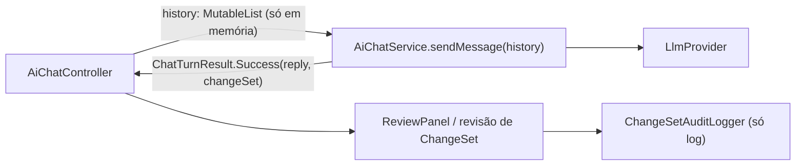
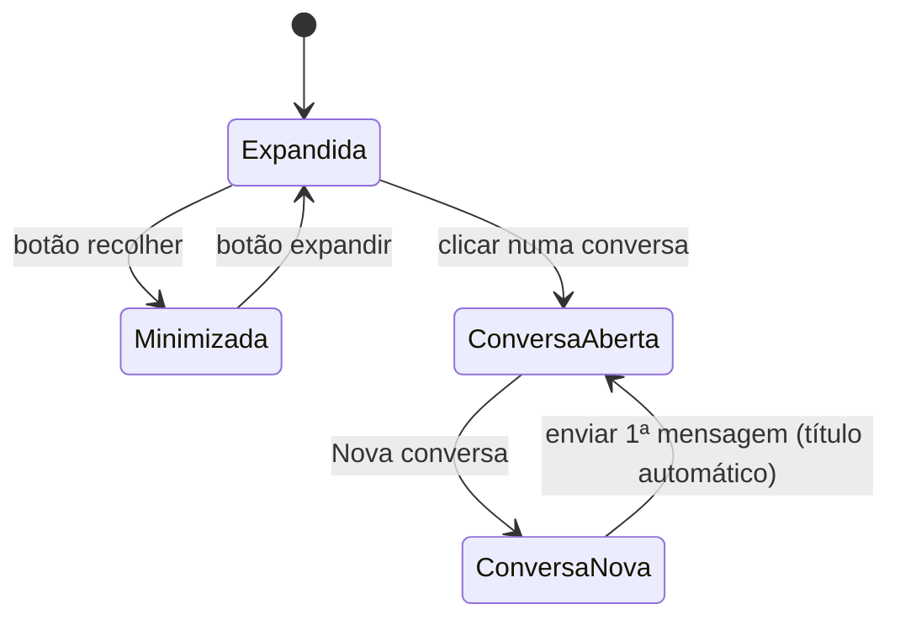
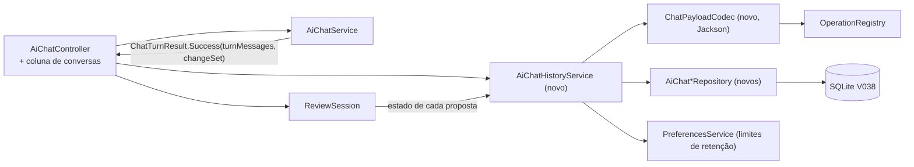
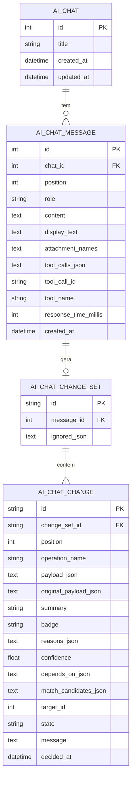
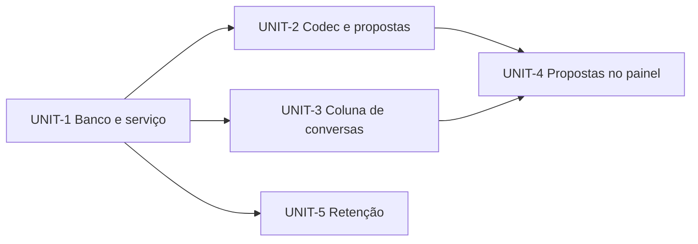
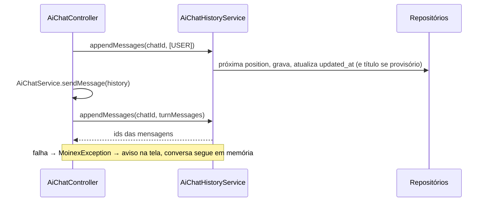
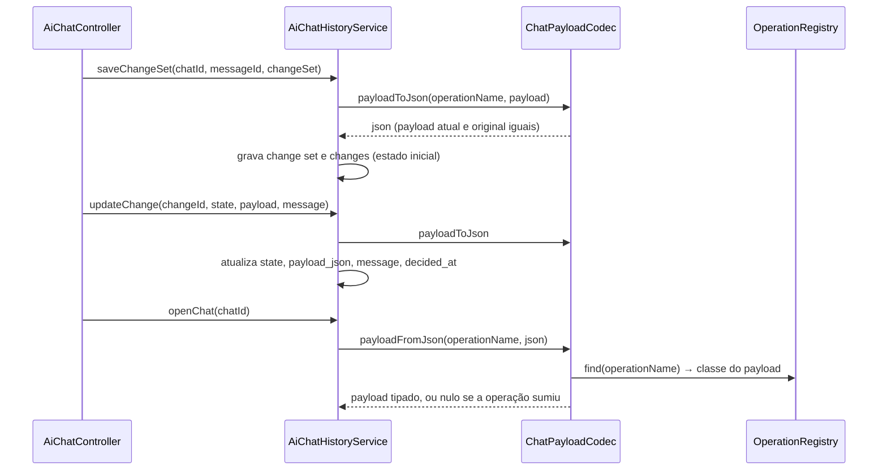
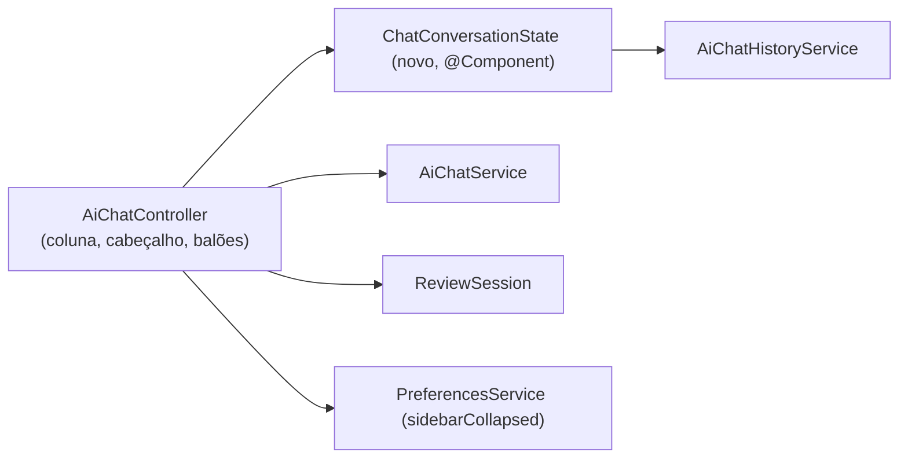

# Design — ai-chat-history

## 2.1 Codebase analysis

Delta leve sobre a área `ai-agent` do codekb (revisada em 2026-11-04, commit edee9038); commits de IA posteriores (eb5482a1, 46ae205e, 944a6239) já estão refletidos no código lido. [src: .aidlc/codekb/MOINEX/areas/ai-agent.md]


O histórico vive apenas no controller; nada é persistido.

### Fatos relevantes
1. `AiChatController` mantém `private val history = mutableListOf<ChatMessage>()`; ao reabrir a tela os balões são redesenhados dela, mas ao fechar o app tudo se perde. [src: ui/main/AiChatController.kt:117,178]
2. `ChatMessage` (role, content, displayText, toolCalls, toolCallId, toolName, responseTimeMillis) é o formato enviado ao provedor; mensagens TOOL e ASSISTANT com `toolCalls` fazem parte do histórico enviado. O histórico da tela hoje guarda só USER e ASSISTANT finais. [src: ai/chat/ChatModels.kt; AiChatController.kt:205,353]
3. `ChatTurnResult.Success` traz `changeSet` (propostas) que aparece no `ReviewPanel`; as propostas pendentes não sobrevivem ao fechamento. [src: ai/chat/ChatModels.kt:57-60]
4. Auditoria atual é só log (`org.moinex.ai.audit`), não consultável na UI. [src: ai/audit/ChangeSetAuditLogger.kt]
5. Não há tabela, entidade ou repositório de chat; última migração é V037. Padrão de persistência: Flyway + JPA + `@Service` por domínio; testes em Kotest BehaviorSpec com fixtures em `src/test/kotlin/org/moinex/factory/`. [src: db/migration; CLAUDE.md]
6. Anexos (CSV/PDF) viram texto dentro de `content`, com `displayText` mostrando só o nome do arquivo; o conteúdo pode ser grande e sensível (extratos). [src: AiChatController.kt:205; ChatModels.kt:22-27]

### Baseline de testes
A rodar no início da Construction (`./gradlew test`); codekb registra 1553 testes, 0 falhas em 2026-11-01.

### Assumptions & open questions
- A1: o dado de chat é financeiro e sensível; fica só no banco local do usuário, como o resto dos dados. (confirmar em 2.3)

## 2.2 Team practices

Nenhuma prática nova a perguntar: valem as regras já aprovadas em `.aidlc/memory/project.md` e o `CLAUDE.md`.

| Prática | Origem |
|---|---|
| Kotlin + Spring Data JPA + Flyway (`ddl-auto: validate`), serviço por domínio, sem lógica de negócio na UI | CLAUDE.md |
| Testes Kotest BehaviorSpec + MockK; testes que usam `FxUtils.launchOnFxThread` stubam o `FxUtils` | CLAUDE.md, [mem: M-013] |
| Header padrão em todo arquivo novo; sem comentários `//` inline (KDoc ok) | [mem: M-012] |
| Textos novos em `messages_pt_BR.properties` e `messages_en.properties`, só acrescentando chaves | CLAUDE.md |
| Validar telas com `make demo` / `capture-screens.sh`, nunca no banco real; capturas em `construction/screenshots/` | [mem: M-003, M-006, M-009] |
| Nenhum dado pessoal em arquivos versionados ou `.aidlc/` | [mem: M-011] |
| Não commitar antes de o dono ver o diff; push/CI só com sim explícito | [mem: M-004, M-005] |
| Trabalho direto na `main` neste intent | [mem: M-014] |
| `ktlintCheck` + `spotlessCheck` + `test` antes de concluir | CLAUDE.md |

### Assumptions & open questions
Nenhuma.

## 2.5 Refined mockups

Mockups comparativos em `mockups/conversation-list-layouts.html`. Decisão: **opção A, coluna lateral de conversas minimizável**. [src: Q-layout] [user]


Estados da coluna e da conversa; a coluna minimizada deixa só um botão de expandir e o atalho "Nova conversa".

### Tela do chat
- Coluna esquerda (≈230 px): botão "Nova conversa", campo de busca, lista (título + data da última atividade, mais recente primeiro), botão para minimizar. Minimizada, a coluna vira uma faixa estreita com os botões expandir e nova conversa.
- Cabeçalho da conversa: título com ações Renomear e Apagar (confirmação).
- Busca: filtra a lista por título e por texto das mensagens; o resultado mostra um trecho; clicar abre a conversa na mensagem encontrada.
- Painel de revisão (existente): um grupo por resposta da IA ("Resposta N") com contadores por estado. Reaberta, a conversa se comporta como se nunca tivesse sido fechada: pendentes acionáveis (aceitar, rejeitar, editar), rejeitadas com "desfazer rejeição" como ao vivo, aprovadas sem ação (só consulta); só propostas que não podem mais ser reconstruídas ficam somente leitura.
- Preferências, seção IA: dois campos opcionais, "Máximo de conversas" e "Máximo de dias"; vazio = sem limite. [src: Q-retenção]
- Tema claro e escuro via tokens `theme-*`; ícones de `Icons.kt`; texto "Título: valor" com `TitledValue` quando couber. [mem: M-010]

### Assumptions & open questions
- A4: o estado minimizada/expandida da coluna é lembrado entre execuções (preferência de UI do usuário). — confirmed: não
- A5: o clique em um resultado de busca abre a conversa e rola até a mensagem; se isso custar caro na Construction, abre a conversa no fim e destaca o termo. — confirmed: não

## 2.6 Domain & components


Componentes novos em volta do chat existente; `AiChatService` continua sem acesso ao banco.


Quatro tabelas novas. `payload_json` é o payload atual (com edições do usuário); `original_payload_json` o que a IA propôs.

### Components

| Componente | Responsabilidade | Dados que possui |
|---|---|---|
| `AiChat`, `AiChatMessage`, `AiChatChangeSet`, `AiChatChange` (entidades JPA, `model/ai`) | Mapear as 4 tabelas | tabelas `ai_chat*` |
| `AiChatRepository` etc. (`repository/ai`) | Acesso JPA; busca por `LIKE` em título e conteúdo | |
| `AiChatHistoryService` (`service/ai`) | Criar, listar, abrir, renomear, apagar, buscar conversas; gravar mensagens e lotes; atualizar estado de proposta; aplicar retenção | única porta para as tabelas |
| `ChatPayloadCodec` (`ai/history`) | Payload, `Match` e tool calls ↔ JSON; descobre a classe do payload pelo nome da operação | nada |
| `AiChatService` (alterado) | `Success` passa a devolver `turnMessages`: tudo que o turno acrescentou (assistant com tool calls, resultados TOOL, resposta final) | nada |
| `ReviewSession` (alterado) | `load(changes)` repõe itens com estado; avisa o histórico a cada aprovação, rejeição, edição e erro | itens em memória |
| `ReviewPanel` (alterado) | Agrupa por `changeSetId` ("Resposta N"), mostra aprovadas e rejeitadas em modo consulta | |
| `AiChatController` (alterado) | Coluna de conversas, conversa ativa, nova conversa, busca; usa o serviço de histórico | `history` vira a conversa ativa |
| `PreferencesService` / tela de preferências (alterados) | Chaves `ai.history.maxChats` e `ai.history.maxDays` | preferências |

### Decisions

- **ADR-1 Persistir em tabelas relacionais, só no SQLite local** (NFR-1) (não um blob por conversa): permite listar, buscar e apagar sem carregar tudo. Preço: 4 tabelas e uma migração V038, aditiva. [src: NFR-2, NFR-3]
- **ADR-2 Jackson (módulo Kotlin e jsr310) para os payloads** [user]: alternativas (reflect próprio, regravar dos argumentos do LLM) recusadas pelo dono. Sem anotações nos payloads; a classe do payload é descoberta pelos tipos genéricos de `BaseOperation<P>`; um teste percorre o `OperationRegistry` e faz ida e volta de um payload de cada operação. Versão vem do BOM do Spring Boot (confirmar na Construction).
- **ADR-3 Busca com `LIKE`**, não FTS5: 5.000 mensagens em SQLite cabem em 1 s (NFR-4) e evita extensão e triggers. Reavaliar se o volume crescer. [src: NFR-4]
- **ADR-4 O histórico passa a incluir mensagens TOOL**, na conversa ao vivo e na restaurada, para as duas se comportarem igual (FR-5, FR-6). O `AiChatService` já corta resultados antigos em 2000 caracteres (`compactOldResults`), o que limita o crescimento. [src: AiChatService.kt]
- **ADR-5 Gravação fora da thread JavaFX**, via `AppDispatchers` (IO), com aviso na tela e log em caso de falha, e o chat segue em memória (NFR-5). [src: CLAUDE.md]
- **ADR-6 Texto do anexo fica em `content`** (já é assim hoje, e `display_text` mostra só o nome); `attachment_names` guarda os nomes para listar e buscar. Não há tabela de anexos. [src: Q-conteúdo, FR-7]
- **ADR-7 Retenção** roda ao iniciar o app e depois de criar uma conversa; apaga as mais antigas que excedem o máximo de conversas ou de dias, com cascata. Sem limite, nada é apagado. [src: FR-12, FR-13]

### Assumptions & open questions
- A6: restaurar mensagens TOOL aumenta o tamanho da requisição ao LLM em conversas longas; aceito (A3). — confirmed: não
- A7: ao apagar uma conversa, as propostas já aprovadas continuam valendo (os lançamentos criados não são tocados). — confirmed: não

## 2.7 Units of work

| Unit | Conteúdo | Dono de |
|---|---|---|
| UNIT-1 Banco e serviço de conversas | Migração V038 (4 tabelas), entidades, repositórios, `AiChatHistoryService` (criar, listar, abrir, renomear, apagar, apagar tudo, buscar, gravar mensagens, título automático, retenção); `AiChatService` devolve `turnMessages`. | FR-1 (serviço), FR-2, FR-3 (serviço), FR-6, FR-7, FR-8 (serviço), FR-9 (serviço), NFR-2, NFR-3, NFR-4, NFR-5, NFR-7 |
| UNIT-2 Codec e persistência das propostas | Dependência Jackson, `ChatPayloadCodec`, gravar `ChangeSet` e atualizar estado/payload de cada proposta no `AiChatHistoryService`, teste de ida e volta de todas as operações do registro. | FR-10 |
| UNIT-3 Coluna de conversas e gravação automática | Coluna minimizável (Nova conversa, busca, lista), cabeçalho com renomear e apagar, o controller grava cada turno e abre a conversa mais recente, textos i18n, temas claro e escuro. | FR-1, FR-2, FR-3, FR-4, FR-5, FR-8, FR-9, FR-14, NFR-6, NFR-8, A4, A5 |
| UNIT-4 Propostas guardadas no painel de revisão | `ReviewSession.load`, ganchos de estado que gravam via serviço, `ReviewPanel` agrupado por resposta e com modo consulta, reabrir restaura pendentes e histórico. | FR-11 |
| UNIT-5 Retenção em Preferências | Chaves `ai.history.maxChats`/`maxDays`, campos em Preferências > IA, retenção ao iniciar e ao criar conversa. | FR-12, FR-13 |

### Dependency order


Ordem topológica: UNIT-1, UNIT-2, UNIT-3, UNIT-4, UNIT-5 (UNIT-5 pode ir antes de UNIT-4 se preferir fechar o que depende só de UNIT-1).

### Story → Unit map

| História | Units |
|---|---|
| US-1 salvar sozinho | UNIT-1, UNIT-3 |
| US-2 nova conversa | UNIT-1, UNIT-3 |
| US-3 lista e renomear | UNIT-1, UNIT-3 |
| US-4 continuar com contexto | UNIT-1, UNIT-3 |
| US-5 buscar | UNIT-1, UNIT-3 |
| US-6 sugestões salvas e reexibidas | UNIT-2, UNIT-4 |
| US-7 apagar e limitar | UNIT-1, UNIT-3, UNIT-5 |

Cada FR e NFR tem um dono na tabela de Units; as histórias atravessam Units (backend + UI), por isso aparecem em mais de uma.

### Assumptions & open questions
Nenhuma nova.

## 2.8 Contracts

### Banco (V038, aditiva)

Datas como `VARCHAR(255)` no formato ISO, como as demais tabelas (conversor `LocalDateTimeStringConverter`). O JDBC do app não liga `PRAGMA foreign_keys`, então `ON DELETE CASCADE` não é confiável: o serviço apaga filhos explicitamente, numa transação (veja Erros).

| Tabela | Colunas |
|---|---|
| `ai_chat` | `id` INTEGER PK AUTOINCREMENT · `title` VARCHAR(200) NOT NULL · `created_at` · `updated_at` (VARCHAR NOT NULL) |
| `ai_chat_message` | `id` PK · `chat_id` NOT NULL REFERENCES `ai_chat` · `position` INTEGER NOT NULL · `role` VARCHAR(20) · `content` TEXT NOT NULL · `display_text` TEXT · `attachment_names` TEXT (JSON array) · `tool_calls_json` TEXT · `tool_call_id` VARCHAR(100) · `tool_name` VARCHAR(100) · `response_time_millis` INTEGER · `created_at` · UNIQUE (`chat_id`, `position`) |
| `ai_chat_change_set` | `id` VARCHAR(64) PK (o id do `ChangeSet`) · `message_id` NOT NULL REFERENCES `ai_chat_message` · `ignored_json` TEXT |
| `ai_chat_change` | `id` VARCHAR(64) PK · `change_set_id` NOT NULL REFERENCES `ai_chat_change_set` · `position` INTEGER · `operation_name` VARCHAR(100) · `payload_json` TEXT NOT NULL · `original_payload_json` TEXT NOT NULL · `summary` VARCHAR(500) · `badge` VARCHAR(30) · `reasons_json` TEXT · `confidence` NUMERIC · `depends_on_json` TEXT · `match_candidates_json` TEXT · `target_id` INTEGER · `state` VARCHAR(20) NOT NULL · `message` TEXT · `decided_at` VARCHAR |

Índices: `ai_chat(updated_at)`, `ai_chat_message(chat_id, position)` (pelo UNIQUE), `ai_chat_change(change_set_id)`.

### `AiChatHistoryService` (`service/ai`)

```kotlin
data class ChatSummary(val id: Int, val title: String, val updatedAt: LocalDateTime, val messageCount: Int, val pendingProposals: Int)
data class StoredConversation(val chat: ChatSummary, val messages: List<ChatMessage>, val changeSets: List<StoredChangeSet>)
data class StoredChangeSet(val messageIndex: Int, val changeSet: ChangeSet, val states: Map<String, StoredChangeState>)
data class StoredChangeState(val state: ChangeState, val payload: Any, val message: String?, val decidedAt: LocalDateTime?)
data class SearchHit(val chatId: Int, val chatTitle: String, val messageId: Int, val position: Int, val snippet: String)

interface-like methods:
fun createChat(): Int                                        // título provisório "Nova conversa" (i18n)
fun listChats(): List<ChatSummary>                           // updated_at desc
fun openChat(chatId: Int): StoredConversation
fun latestChatId(): Int?
fun appendMessages(chatId: Int, messages: List<ChatMessage>, attachmentNames: List<String> = emptyList()): List<Int>   // devolve os ids; define o título pela 1ª mensagem USER se ainda for o provisório (máx. 60 caracteres)
fun saveChangeSet(chatId: Int, messageId: Int, changeSet: ChangeSet)
fun updateChange(changeId: String, state: ChangeState, payload: Any, message: String?)   // grava decided_at em APPROVED, REJECTED e ERROR
fun renameChat(chatId: Int, title: String)                   // título vazio é recusado
fun deleteChat(chatId: Int)
fun deleteAllChats()
fun search(text: String, limit: Int = 50): List<SearchHit>   // LIKE, sem diferenciar maiúsculas, em título, content e display_text
fun applyRetention(): Int                                    // devolve quantas conversas apagou
```

Erros: falhas de banco viram `MoinexException` (já usada no projeto) com chave i18n; o controller mostra aviso e segue em memória. `deleteChat`, `deleteAllChats` e `applyRetention` apagam changes → change sets → mensagens → conversa em uma transação. Retry via `RetryConfig` não é usado nas gravações.

### Mudança em `ChatTurnResult.Success`

`Success(reply, changeSet, turnMessages: List<ChatMessage>)`: `turnMessages` são, em ordem, as mensagens acrescentadas no turno (ASSISTANT com `toolCalls`, TOOL, ASSISTANT final com `responseTimeMillis`). Compatível: `turnMessages` tem padrão vazio; o controller anexa à conversa ativa e grava. O balão exibe apenas USER e ASSISTANT com texto não vazio.

### `ChatPayloadCodec` (`ai/history`)

```kotlin
fun payloadToJson(operationName: String, payload: Any): String
fun payloadFromJson(operationName: String, json: String): Any     // classe de payload pelo tipo genérico da operação
fun matchesToJson(matches: List<Match>): String
fun matchesFromJson(json: String): List<Match>
fun toolCallsToJson(calls: List<ToolCall>): String
fun toolCallsFromJson(json: String): List<ToolCall>
```
JSON: datas ISO-8601, `BigDecimal` como número, enums por nome, campos desconhecidos ignorados e ausentes com padrão (compatibilidade entre versões). Operação desconhecida ao ler (por exemplo, removida numa versão futura): a proposta volta como ERROR somente leitura, com `payload_json` bruto exibido, sem derrubar a abertura da conversa.

### `ReviewSession`

```kotlin
fun load(stored: List<StoredChangeSet>)      // repõe ReviewItem com o estado guardado, sem rodar a regra de "já aberto"
var onItemChanged: ((ReviewItem) -> Unit)?   // chamado após APPROVED, REJECTED, EDITED, ERROR e edição de payload
```
`ReviewItem.isOpen` não muda (PENDING, EDITED, ERROR); aprovadas e rejeitadas aparecem no painel em modo consulta.

### Preferências

`ai.history.maxChats` (inteiro > 0, vazio = sem limite) · `ai.history.maxDays` (inteiro > 0, vazio = sem limite) · `ai.chat.sidebarCollapsed` (boolean, padrão false).

### Chaves i18n novas (prefixo `AI_HISTORY_`)

Nova conversa, buscar, título provisório, renomear, apagar (confirmação), apagar todas, resultado vazio, erro ao gravar, "Resposta N", estados das propostas, rótulos das preferências. Lista final saída da Construction; só se acrescentam chaves nos dois `.properties`.

### Assumptions & open questions
- A8: o JDBC do app não liga `foreign_keys`; mantemos a exclusão explícita em transação em vez de ligar o pragma (mudança global fora do escopo). — confirmed: não

## 3.x Per-Unit design

### UNIT-1 — Functional design / NFR / Infrastructure (nota única, 3.1–3.4 dobrados)

O desenho de componentes, dados e contratos já está em §2.6 e §2.8; aqui só o que a UNIT-1 acrescenta.


Gravação de um turno (a ligação ao controller é da UNIT-3).

**Funcional**
- Título automático: primeira linha do `displayText ?: content` da primeira mensagem USER, sem espaços sobrando, até 60 caracteres (corta e acrescenta "…"); só se o título ainda for o provisório. O provisório vem de i18n (`AI_HISTORY_DEFAULT_TITLE`) e é gravado no `createChat`.
- `position` começa em 0 e cresce sem buracos; `appendMessages` calcula `max(position)+1` dentro da transação.
- `appendMessages` atualiza `updated_at` da conversa. `attachmentNames` vai na primeira mensagem USER da lista (JSON array).
- Busca: `LIKE` sem diferenciar maiúsculas com `%`, `_` e `\` escapados; casa título, `content`, `display_text`; devolve um trecho de ~80 caracteres em volta do termo; termo em branco devolve lista vazia; mensagens TOOL ficam fora da busca.
- `renameChat` recusa título em branco e corta em 200.
- `applyRetention(maxChats: Int?, maxDays: Int?, now)`: apaga conversas com `updated_at` mais velho que `maxDays` e, depois, as mais antigas além de `maxChats`; devolve quantas apagou. A UNIT-5 liga isto às preferências.
- `tool_calls_json` usa `org.json` nesta Unit (array de `{id, toolName, argumentsJson}`); a UNIT-2 migra para o codec.
- `ChatSummary.pendingProposals` vale 0 até a UNIT-2 gravar propostas.

**NFR**: gravação e leitura rodam no chamador (quem chama usa `AppDispatchers` IO, ADR-5); o serviço é `@Transactional`; nada de conteúdo em log INFO (só ids e contagens, NFR-7); índices de §2.8 cobrem a listagem e a abertura (NFR-3); busca por LIKE em 5.000 mensagens validada por teste (NFR-4).

**Infra**: `V038__create_ai_chat_history.sql` com as 4 tabelas (as de propostas já nascem, para a UNIT-2 não precisar de outra migração) e `CREATE INDEX IF NOT EXISTS`; entidades em `model/ai`, repositórios em `repository/ai`, serviço em `service/ai`, erro novo `MoinexException.AiChatHistoryException`.

### Assumptions & open questions
- A10: as quatro tabelas saem numa única V038 mesmo que as de proposta só sejam usadas na UNIT-2. — confirmed: não

### UNIT-2 — Functional design / NFR / Infrastructure (nota única)


Gravar, atualizar e reabrir as propostas; o controller só chama a UNIT-4.

**Funcional**
- `saveChangeSet(chatId, messageId, changeSet)`: grava o lote ligado à mensagem; cada `ProposedChange` vira uma linha com `state` PENDING, `payload_json = original_payload_json` e `position` pela ordem. `ignored` (linhas já registradas) vai em `ignored_json` como array de `{...}` dos campos do `IgnoredLine`. Lote vazio não grava. `messageId` precisa pertencer à conversa `chatId`, senão `AiChatHistoryException`.
- `updateChange(changeId, state, payload, message)`: atualiza estado, payload atual e mensagem; `decided_at` recebe o agora em APPROVED, REJECTED e ERROR, e fica nulo em PENDING e EDITED.
- `openChat` passa a devolver `changeSets: List<StoredChangeSet>` (padrão vazio): para cada lote, `messageIndex` (posição da mensagem na lista devolvida), o `ChangeSet` reconstruído com o payload original e um mapa `states[changeId] → StoredChangeState(state, payload atual, message, decidedAt)`.
- `ChatSummary.pendingProposals` passa a contar changes em PENDING, EDITED e ERROR (os que ainda se podem decidir) da conversa.
- Operação desconhecida na leitura (removida numa versão futura): a proposta volta com `state = ERROR`, `message` explicando e o payload como `RawPayload(json)` (texto bruto, somente consulta), sem derrubar `openChat`. Payload ilegível de operação conhecida recebe o mesmo tratamento.
- Tool calls passam a usar o codec (`toolCallsToJson/FromJson`), no lugar do `org.json` da UNIT-1; o formato JSON é o mesmo, então conversas já gravadas continuam legíveis.

**Codec**: `ObjectMapper` do Jackson 2 com `KotlinModule` e `JavaTimeModule`; datas em ISO-8601 (`WRITE_DATES_AS_TIMESTAMPS` desligado), `BigDecimal` por número simples (`USE_BIG_DECIMAL_FOR_FLOATS` ligado na leitura), campos desconhecidos ignorados, enums por nome. A classe do payload vem de `ResolvableType.forClass(operation.javaClass).`as`(AppOperation::class.java).getGeneric(0)`, guardada em cache por nome. `Match` e `ToolCall` são data classes serializadas pelo mesmo mapper.

**NFR**: nenhum payload ou conteúdo em log INFO (NFR-7); gravação e leitura continuam transacionais; falhas viram `AiChatHistoryException` como na UNIT-1 (NFR-5); o teste de ida e volta percorre **todas** as operações do `OperationRegistry` com um payload de amostra gerado por reflexão, para que uma operação nova sem suporte falhe no CI.

**Infra**: dependências `jackson-databind`, `jackson-module-kotlin`, `jackson-datatype-jsr310`, versão 2.21.7 no version catalog (a mesma do `databind` que já chega transitivamente pelo Flyway), sem anotações nos payloads (ADR-2). Nenhuma migração nova: as tabelas já existem (A10).

### Assumptions & open questions
- A11: o `ignored_json` guarda só o necessário para redesenhar a lista de linhas ignoradas; o campo exato sai de `IgnoredLine` na implementação. — confirmed: não

### UNIT-3 — Functional design / NFR / Infrastructure (nota única)


O estado da conversa ativa sai do controller e vai para um componente sem JavaFX, que decide o que gravar e quando; o controller só desenha.

**Funcional**
- `ChatConversationState` (`ai/chat`, singleton, sem JavaFX) guarda `chatId` (nulo = conversa nova ainda não gravada) e as mensagens em memória. Métodos: `reset()`, `load(StoredConversation)`, `startTurn(message, attachmentNames)`, `finishTurn(turnMessages, changeSet, elapsedMillis)`, `messages()`. Todos `@Synchronized`.
- A conversa só vira linha no banco no primeiro envio (`createChat` no `startTurn`), então "Nova conversa" não deixa conversas vazias. O título vem da primeira mensagem (UNIT-1).
- Persistência fora da thread FX: `startTurn` e `finishTurn` rodam dentro do bloco de fundo de `handleSend`, ao lado da chamada ao LLM. Cada um devolve `PersistOutcome` (`Saved` ou `Failed(mensagem traduzida)`); em falha o controller mostra um aviso e a conversa segue em memória; no próximo turno o estado tenta gravar de novo tudo que ficou sem gravar (`persistedCount`).
- `finishTurn` grava `turnMessages` (a resposta final recebe `responseTimeMillis`) e, se houver propostas, `saveChangeSet` ligado ao id da última mensagem. Isto antecipa T-4.2 para esta Unit, porque nasce no mesmo ponto do código; UNIT-4 fica com `load`, ganchos de estado e painel.
- Erro do LLM, "sem provedor" e avisos não são gravados; a mensagem do usuário já foi gravada em `startTurn` e fica na conversa.
- Ao entrar na tela: se não há conversa ativa em memória, abre a mais recente (`latestChatId`); sem nenhuma, tela vazia. Abrir outra conversa, "Nova conversa" e apagar limpam o `ReviewSession` (as propostas guardadas voltam na UNIT-4).
- Bloqueio: com o LLM respondendo (`busy`), a coluna e os botões de trocar, renomear e apagar ficam desabilitados.
- Balões ao abrir: USER e ASSISTANT com texto; ASSISTANT só com tool calls e TOOL não aparecem; o aviso de linhas ignoradas reaparece depois da resposta que o gerou (`ignored` do `StoredChangeSet`).
- Coluna (FXML): cabeçalho "Conversas" com botão recolher; botão "Nova conversa"; campo de busca; `ListView` de linhas (título, data da última atividade, N propostas pendentes quando houver); rodapé "Apagar todas". Recolhida: faixa de ~44 px com expandir e nova conversa. Estado em `PreferencesService.aiChatSidebarCollapsed` (java.util.prefs, como as outras preferências de UI).
- Busca: a cada alteração do texto (espera 300 ms sem digitar) chama `search` em segundo plano; a lista passa a mostrar resultados (título da conversa + trecho); texto vazio volta à lista normal. Clicar abre a conversa e rola até a mensagem (`position`); se o balão não for encontrado, rola ao fim (plano B de A5).
- Cabeçalho da conversa: título (rótulo), botões renomear (diálogo de texto) e apagar (`WindowUtils.showConfirmationDialog`).

**NFR**: abrir e listar usam o serviço em segundo plano e só depois desenham (NFR-3); nenhum texto de conversa em log INFO (NFR-7); chaves `aihistory.*` em pt-BR e en (NFR-6); cores só de tokens `theme-*`, ícones de `Icons.kt` (NFR-8).

**Infra**: sem migração nova; arquivos novos `ChatConversationState.kt`, ajustes em `ai_chat.fxml`, `ai_chat.css`, `AiChatController.kt`, `PreferencesService.kt`, `Icons.kt` (ícones novos se faltarem), `TranslationKeys` e os dois `.properties`. Teste unitário de `ChatConversationState` (mockk do serviço); a tela é validada por capturas nos dois temas e checklist manual (M-003).

### Assumptions & open questions
- A12: criar a linha da conversa só no primeiro envio muda um pouco o FR-2 (a conversa nova não aparece na lista até a primeira mensagem); evita lista cheia de conversas vazias. — confirmed: não
- A13: o `CapturePlan` ganha uma captura "chat com conversas" com dados fictícios para validar a coluna (sem tocar no banco real, M-006). — confirmed: não

## Notas pós-construção (2026-11-07)

Correções aos textos acima, para quem ler o design depois da construção:
- `ChatConversationState` ficou em `service/ai` (não em `ai/chat`, §2.6), porque o `AiArchitectureTest` proíbe `*Service.create/save` em `ai/chat`.
- O Jackson (§2.8 e §3.x UNIT-2) usa a versão gerenciada pelo BOM do Spring Boot (2.21.x), sem versão no catálogo.
- FR-11 e US-6 mudaram duas vezes: a conversa reaberta se comporta como se nunca tivesse sido fechada (rejeitada mantém "Desfazer rejeição"; ver §2.5, já corrigido).
- A gravação da decisão de cada proposta roda na thread FX, como a aprovação (ADR-5 valeu para as mensagens).
- Depois do intent foram feitas, fora do escopo, correções em `propose_changes` (schema plano, exemplo por operação), no prompt (`core.md`), no resumo de despesa e receita, no saldo após da revisão e no realce da lista de conversas; ver `audit.md` e `areas/ai-agent.md`.

