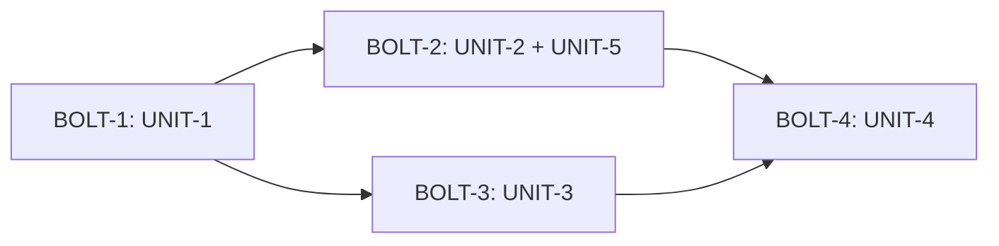

# Tasks — ai-chat-history

## 2.9 Delivery plan

**Verification command** (aprovado em 2026-11-06):
`export JAVA_HOME=/usr/lib/jvm/java-25-openjdk-amd64 && ./gradlew ktlintCheck spotlessCheck test`
Por Unit, durante o trabalho: `./gradlew test --tests "<classes da Unit>"`. Ao fechar cada Unit roda o comando completo.

**Walking skeleton:** UNIT-1 + parte de UNIT-3 (gravar o turno ao enviar e reabrir a conversa mais recente) é a menor fatia ponta a ponta; decidido: desligado (UNIT-1 completa primeiro).

Trabalho direto na `main`; nada é commitado sem o dono ver o diff ([mem: M-004, M-014]).

Sequência dos bolts; o BOLT-2 junta duas Units pequenas que só dependem da UNIT-1.

### BOLT-1 — Units: UNIT-1 — Owner: dono
Definition of Done: migração V038 aplica em banco novo e em cópia de banco existente; `AiChatHistoryService` com testes de todos os métodos; busca em 5.000 mensagens < 1 s e abertura de 200 mensagens < 500 ms em teste com dados gerados; falha de gravação testada (NFR-5); `ktlintCheck`, `spotlessCheck` e `test` passam.

### BOLT-2 — Units: UNIT-2, UNIT-5 — Owner: dono
Definition of Done: ida e volta de um payload de cada operação do registro; operação desconhecida volta como ERROR somente leitura; limites de retenção aplicados em teste (só número, só dias, ambos, nenhum); campos em Preferências > IA validados; comando de verificação passa.

### BOLT-3 — Units: UNIT-3 — Owner: dono
Definition of Done: capturas em tema claro e escuro (nova conversa, lista, busca, minimizada) em `construction/screenshots/` ([mem: M-003, M-006, M-009]); chaves i18n em pt-BR e en; teste de controller/serviço dos fluxos de gravação com `FxUtils` stubado ([mem: M-013]); comando de verificação passa.

### BOLT-4 — Units: UNIT-4 — Owner: dono
Definition of Done: reabrir conversa com propostas pendentes, aprovadas e rejeitadas mostra os três estados agrupados por resposta; só pendentes acionáveis; capturas nos dois temas; comando de verificação passa; checklist manual de telas entregue ao dono.

## Tasks

### UNIT-1 Banco e serviço de conversas   Status: verified (2026-11-06, exit 0)
- [x] T-1.1 Rodar `./gradlew test` e registrar a linha de base. (NFR-2)
- [x] T-1.2 Criar `V038__create_ai_chat_history.sql` com as 4 tabelas e índices. Teste: Flyway aplica e `ddl-auto: validate` passa. (NFR-2)
- [x] T-1.3 Criar entidades `AiChat`, `AiChatMessage`, `AiChatChangeSet`, `AiChatChange` e repositórios (com header padrão). Teste: repositório H2/SQLite. (FR-6)
- [x] T-1.4 `AiChatHistoryService`: criar, listar, abrir, renomear, título automático. Teste: Kotest BehaviorSpec. (FR-2, FR-3)
- [x] T-1.5 `appendMessages` com `attachment_names`, ordem por `position`, ida e volta de `ChatMessage` com tool calls (JSON simples via org.json, sem Jackson nesta Unit). Teste. (FR-6, FR-7)
- [x] T-1.6 `deleteChat`, `deleteAllChats` em transação, filhos explícitos. Teste: nenhum órfão. (FR-8)
- [x] T-1.7 `search` por LIKE com trecho. Teste de desempenho com 5.000 mensagens. (FR-9, NFR-4)
- [x] T-1.8 `applyRetention(maxChats, maxDays)` no serviço (os valores vêm por parâmetro; a leitura das preferências fica na UNIT-5). Teste. (FR-12, FR-13)
- [x] T-1.9 `ChatTurnResult.Success.turnMessages` em `AiChatService`. Teste em `AiChatServiceTest`. (FR-5, FR-6)
- [x] T-1.11 Teste de desempenho: abrir conversa de 200 mensagens em menos de 500 ms; gravação feita fora da thread FX (ADR-5). (NFR-3)
- [x] T-1.12 Revisão de código: nenhum cliente de rede novo e nenhum dado de conversa sai do banco local além do envio atual ao provedor de LLM. (NFR-1)
- [x] T-1.10 Tratar falha de gravação (`MoinexException`) e garantir que nada de conversa vai a log INFO. Teste. (NFR-5, NFR-7)

**Resumo da UNIT-1 (2026-11-06)**
- Arquivos novos: `V038__create_ai_chat_history.sql`; `model/ai/{AiChat,AiChatMessage,AiChatChangeSet,AiChatChange}.kt`; `repository/ai/{AiChatRepository,AiChatMessageRepository,AiChatChangeSetRepository,AiChatChangeRepository}.kt`; `service/ai/{AiChatHistoryService,AiChatHistoryModels}.kt`; testes `AiChatHistoryServiceTest` (28), `AiChatHistoryMigrationTest` (7).
- Alterados: `AiChatService` e `ChatModels` (`turnMessages`), `MoinexException.AiChatHistoryException`, `TranslationKeys` e os dois `.properties` (4 chaves `aihistory.*`, só acrescentadas), `AiChatServiceTest` (+2 verificações).
- Como rodar: `export JAVA_HOME=/usr/lib/jvm/java-25-openjdk-amd64 && ./gradlew ktlintCheck spotlessCheck test` → BUILD SUCCESSFUL, exit 0.
- Linha de base T-1.1: `./gradlew test` antes das mudanças, exit 0 (Gradle reaproveitou resultado em cache, sem falhas).
- Desvios: (1) busca devolve título e mensagem em consultas separadas, `SearchHit.messageId` é `Int?` (título sem mensagem); (2) o título automático vale quando a conversa não tem mensagens, não por comparar com o título provisório (evita depender do idioma); (3) `ChatSummary.messageCount` conta só mensagens visíveis (sem TOOL); (4) o smoke de inicialização do app (Hibernate `validate`) achou `response_time_millis INTEGER` contra `Long`; a V038 foi corrigida para `BIGINT` antes de qualquer release.
- Verificação extra: o app inicia com a V038 em banco novo de home temporário (`capture-screens.sh`, tela home) e o `validate` passa.

### UNIT-2 Codec e persistência das propostas   Status: verified (2026-11-07, exit 0)
- [x] T-2.1 Adicionar Jackson (módulos Kotlin e jsr310) ao version catalog e ao `build.gradle.kts`; conferir versão do BOM. (ADR-2)
- [x] T-2.2 `ChatPayloadCodec` para payloads, `Match` e tool calls. Teste: ida e volta de um payload de cada operação do `OperationRegistry`. (FR-10)
- [x] T-2.3 Operação desconhecida na leitura vira ERROR somente leitura. Teste. (FR-10)
- [x] T-2.4 `saveChangeSet` e `updateChange` no serviço; `openChat` devolve `StoredChangeSet`. Teste. (FR-10)

**Resumo da UNIT-2 (2026-11-07)**
- Arquivos novos: `ai/history/ChatPayloadCodec.kt` (com `RawPayload`), `ChatPayloadCodecTest` (44 testes, 1 por operação do registro mais os casos de borda).
- Alterados: `libs.versions.toml` e `build.gradle.kts` (Jackson databind, módulo Kotlin e jsr310), `AiChatHistoryService` (`saveChangeSet`, `updateChange`, `openChat` com `changeSets`, `pendingProposals`, tool calls e nomes de anexos pelo codec), `AiChatHistoryModels` (`StoredChangeSet`, `StoredChangeState`), `AiChatChangeRepository` (`countOpenByChat`), `AiChatHistoryServiceTest` (43 testes no total).
- Como rodar: `export JAVA_HOME=/usr/lib/jvm/java-25-openjdk-amd64 && ./gradlew ktlintCheck spotlessCheck test` → BUILD SUCCESSFUL, exit 0. O app também inicia com o codec ligado (smoke com `capture-screens.sh`).
- Desvios: (1) Jackson 2.21.7 vem do BOM do Spring Boot, sem versão no catálogo (entradas sem `version.ref`, como o `hibernate-community-dialects`); (2) o payload original e o atual são gravados iguais no `saveChangeSet`; (3) `ERROR` volta como aberta (conta como pendente) quando o payload não pode ser lido; aprovadas e rejeitadas ilegíveis mantêm o estado; (4) o teste de ida e volta descobre as operações por varredura de classpath e monta o payload de amostra por reflexão, então uma operação nova sem suporte quebra o CI.

### UNIT-3 Coluna de conversas e gravação automática   Status: verified (2026-11-07, exit 0)
- [x] T-3.1 Incluir a coluna (FXML e CSS com tokens `theme-*`): Nova conversa, busca, lista, minimizar; `common/ui/Icons.kt`. (FR-4, NFR-8)
- [x] T-3.2 `AiChatController`: conversa ativa, abrir a mais recente ao entrar, nova conversa, gravar cada turno fora da thread FX (`AppDispatchers`). (FR-1, FR-2, FR-14)
- [x] T-3.3 Cabeçalho com renomear e apagar (confirmação) e "apagar todas". (FR-3, FR-8)
- [x] T-3.4 Abrir conversa restaura mensagens e contexto do LLM (inclui TOOL); balões só USER/ASSISTANT. (FR-5)
- [x] T-3.5 Busca na coluna com trecho e rolagem até a mensagem (plano B: fim da conversa com termo destacado). (FR-9, A5)
- [x] T-3.6 Lembrar o estado minimizado em `ai.chat.sidebarCollapsed`. (A4)
- [x] T-3.7 Chaves `AI_HISTORY_*` em `messages_pt_BR.properties` e `messages_en.properties` (só acrescentar, [mem: regra i18n]) e em `TranslationKeys`. (NFR-6)
- [x] T-3.8 Capturas (claro e escuro) via `scripts/dev/capture-screens.sh` e checklist de telas. (NFR-8)

**Resumo da UNIT-3 (2026-11-07)**
- Novos: `service/ai/ChatConversationState.kt` (estado da conversa ativa e persistência por turno, sem JavaFX) e `ChatConversationStateTest` (10 testes).
- Alterados: `ai_chat.fxml` e `ai_chat.css` (coluna minimizável, cabeçalho com renomear e apagar), `AiChatController` (conversa ativa pelo estado, nova conversa, abrir, busca com 300 ms, rolagem até a mensagem com plano B, renomear, apagar, apagar todas, bloqueio enquanto o LLM responde), `PreferencesService` (`aiChatSidebarCollapsed`), `TranslationKeys` e os dois `.properties` (17 chaves `aihistory.*` acrescentadas), `scripts/data/generate_dummy_data.py` (3 conversas fictícias, uma com propostas pendente, aprovada e rejeitada).
- Como rodar: `export JAVA_HOME=/usr/lib/jvm/java-25-openjdk-amd64 && ./gradlew ktlintCheck spotlessCheck test` → BUILD SUCCESSFUL, exit 0; `make test-python` também passa (100 testes).
- Capturas (git ignora): `construction/screenshots/{light,dark}/13-ai-chat.png`, tela do chat com a coluna e a lista, nos dois temas.
- Desvios: (1) T-4.2 (gravar o change set) foi feito aqui, pois nasce no mesmo ponto do código; (2) `ChatConversationState` ficou em `service/ai`, não em `ai/chat`, porque o `AiArchitectureTest` proíbe `*Service.create/save…` em `ai/chat` (a regra vale para a escrita de dados financeiros, e o histórico é outro domínio); (3) a conversa só é gravada no primeiro envio (A12); (4) a captura da coluna recolhida e da busca não são automáticas, ficam na checklist manual.
- Checklist manual (M-003), nos dois temas: abrir o chat (abre a última conversa); trocar de conversa; "Nova conversa" e enviar uma mensagem (aparece na lista com título automático); renomear; apagar uma e apagar todas (confirmação); buscar um termo e abrir um resultado (rola até a mensagem); recolher e expandir a coluna e reabrir o app (lembra o estado); anexar um arquivo, enviar e reabrir a conversa; erro de gravação (opcional).

### UNIT-4 Propostas guardadas no painel de revisão   Status: verified (2026-11-07, exit 0)
- [x] T-4.1 `ReviewSession.load` e `onItemChanged`; o controller liga ao `AiChatHistoryService.updateChange`. Teste de `ReviewSession`. (FR-10, FR-11)
- [x] T-4.2 (feito na UNIT-3) Ao receber `changeSet`, gravar via `saveChangeSet` ligado à mensagem final. (FR-10)
- [x] T-4.3 `ReviewPanel`: grupo por `changeSetId` ("Resposta N") com contadores; aprovadas e rejeitadas em modo consulta (sem aceitar de novo). (FR-11)
- [x] T-4.4 Reabrir conversa chama `load` com todos os estados; edições de payload persistem. Teste. (FR-11)
- [x] T-4.5 Capturas nos dois temas e checklist manual. (NFR-8)

**Resumo da UNIT-4 (2026-11-07)**
- Novos: `ReviewSessionStoredTest` (11 testes).
- Alterados: `ReviewSession` (`load`, `onItemChanged`, `ReviewItem.readOnly` só para payload não reconstruível), `ReviewPanel` (grupo "Resposta N" por resposta, sem botões em itens somente leitura), `AiChatController` (liga `onItemChanged` ao `updateChange`, recarrega as propostas ao abrir a conversa, painel já aberto só se houver pendentes), `ai_chat.fxml` (botões Anexar e Enviar não encolhem com 3 colunas), `ai_chat.css`, `TranslationKeys` e os dois `.properties` (chave `aihistory.panel.group`).
- Como rodar: `export JAVA_HOME=/usr/lib/jvm/java-25-openjdk-amd64 && ./gradlew ktlintCheck spotlessCheck test` → BUILD SUCCESSFUL, exit 0.
- Capturas (git ignora): `construction/screenshots/{light,dark}/13-ai-chat.png`: conversa com uma proposta pendente (Editar, Rejeitar, Aprovar), uma aprovada e uma rejeitada somente para consulta, sob "Resposta 1".
- Desvios: (1) a gravação de cada decisão roda de forma síncrona na thread FX, como a aprovação já fazia (o `approve` grava no banco ali), e não em segundo plano como o ADR-5 pedia para mensagens; (2) pedido do dono no checkpoint: a conversa reaberta se comporta como se nunca tivesse sido fechada, então a rejeitada mantém "desfazer rejeição" depois de reabrir (muda a decisão do gate 2.4); só a aprovada fica sem ação e só o payload ilegível fica somente leitura; (3) o tamanho do painel com três colunas ficou apertado em janelas pequenas; o dono pode recolher a coluna de conversas.
- Checklist manual (M-003), nos dois temas: abrir uma conversa com propostas (painel abre se há pendentes); aprovar uma, rejeitar outra, editar a terceira; trocar de conversa e voltar (estados iguais, edição mantida, aprovada sem botões, rejeitada com "desfazer rejeição"); fechar e reabrir o app; proposta pendente numa conversa antiga ainda aceitável.

### UNIT-5 Retenção em Preferências   Status: verified (2026-11-07, exit 0)
- [x] T-5.1 Chaves `ai.history.maxChats` e `ai.history.maxDays` no `PreferencesService` com validação (inteiro > 0 ou vazio). Teste. (FR-12)
- [x] T-5.2 Campos em Preferências > IA com i18n. (FR-12, NFR-6)
- [x] T-5.3 Rodar `applyRetention` ao iniciar o app e depois de criar conversa. Teste. (FR-13)

**Resumo da UNIT-5 (2026-11-07)**
- Novos: `PreferencesServiceLimitTest` (3 grupos de verificações de `interpretLimit`).
- Alterados: `PreferencesService` (`aiHistoryMaxChats`, `aiHistoryMaxDays`, `interpretLimit`), `AiChatHistoryService.applyConfiguredRetention`, `ChatConversationState` (aplica os limites logo depois de criar uma conversa, sem deixar uma falha da retenção derrubar a gravação), `AppStartupRunner` (aplica ao iniciar o app, em segundo plano), `SettingsController` e `settings.fxml` (dois campos em Configurações > Assistente de IA), `.properties` (4 chaves `settings.ai.history.*`), testes de `AiChatHistoryServiceTest` e `ChatConversationStateTest`.
- Como rodar: `export JAVA_HOME=/usr/lib/jvm/java-25-openjdk-amd64 && ./gradlew ktlintCheck spotlessCheck test` → BUILD SUCCESSFUL, exit 0.
- Desvios: (1) as chaves de preferência ficaram `ai.history.maxChats` e `ai.history.maxDays` em `java.util.prefs`, como as demais preferências; (2) a captura automática da tela de Configurações só mostra o topo da página, então os dois campos novos (no fim do cartão do assistente) entram na checklist manual; a tela carrega e injeta os campos sem erro.
- Checklist manual: Configurações > Assistente de IA > "Conversas guardadas": digitar 2 em "Máximo de conversas", sair do campo, criar uma conversa nova e ver que sobram só as 2 mais recentes; esvaziar o campo (sem limite); digitar texto inválido (volta ao valor anterior); "Máximo de dias" ao reabrir o app.

### Assumptions & open questions
- A9: o comando de verificação não inclui `make test-python`, pois nada de Python muda neste intent. — confirmed: não
