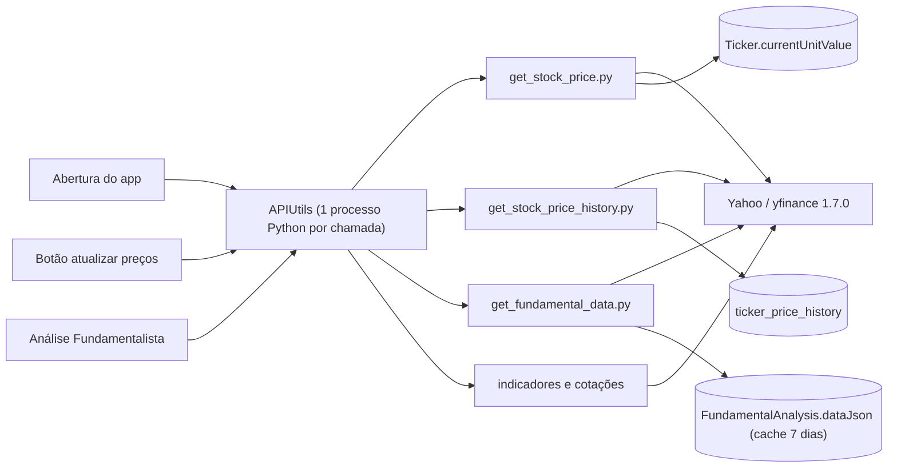
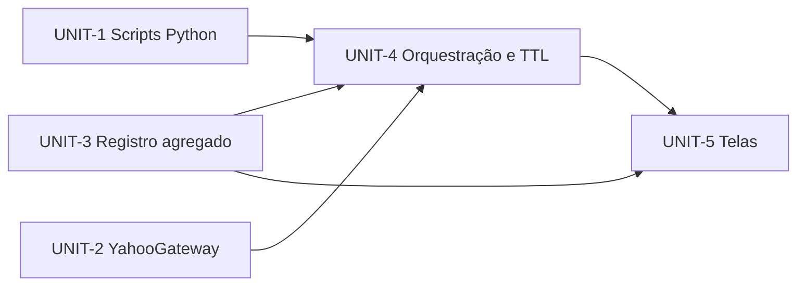

# Design — yfinance-resilience

## 2.1 Codebase analysis

Delta do codekb: área `market-data` (human-reviewed 2026-11-06), ver [areas/market-data.md](../codekb/MOINEX/areas/market-data.md). Commit analisado: cb27418a.

Caption: três armazenamentos de preço (`currentUnitValue`, `dataJson`, histórico diário) alimentados por chamadas independentes ao Yahoo.

### Achados que movem o design
- Na abertura, ~100–150 requisições ao Yahoo para 30 tickers, em paralelo, sem TTL. [inferred] [src: AppStartupRunner.kt:76-139]
- `ticker.info` por símbolo em `get_stock_price.py` e em cada histórico; falha assume USD e pode corromper o preço. [src: get_stock_price.py:fetch_symbol_info]
- Histórico: 1 processo por ticker, até 4 `history` em cascata (até `period=max`), sem pausa. [src: get_stock_price_history.py:154-215]
- Retry duplicado por script; sem cooldown, cache de moeda/site nem circuit breaker. [src: scripts/*.py]
- `dataJson` da análise fundamentalista guarda um preço próprio (cache 7 dias), divergente de `currentUnitValue`. [src: FundamentalAnalysisService.kt:37,63]
- Já existe e deve ser preservado: falha de preço mantém o valor antigo; `rebuildPriceHistory` restaura linhas em falha. [src: TickerPriceHistoryService.kt:98-120]

### Decisões do dono
- D1 [user]: Análise Fundamentalista mostra sempre `Ticker.currentUnitValue`.
- D2 [user]: refresh na abertura só para dado velho (TTL); botão manual força.

### Baseline de testes
Não executado neste estágio (precisa de OK; o codekb registra 1553 testes, 0 falhas em 2026-11-01). Será rodado em 2.9/3.6.

### Assumptions & open questions
- A3: o TTL do startup (~15 min) é uma sugestão; valor final decidido em 2.3.
## 2.7 Units of work

### Decisões

#### ADR-1 Registro agregado em coluna JSON do ticker — Status: accepted (revisado em 2026-11-06)
- Context: preço, moeda, site e datas hoje vivem em colunas, no `dataJson` da análise e no histórico; o dono quer um registro agregado e extensível (FR-2). [user]
- Decision: coluna `ticker.market_data` (TEXT, JSON) com `schema_version`, `price`, `currency`, `website`, `updated_at` e blocos futuros. `currentUnitValue` e `lastUpdate` permanecem como colunas espelhadas, escritas junto com o JSON na mesma transação, para ordenação/soma em SQL. [user]
- Alternatives: tabela 1:1 (JOIN extra em toda leitura); só JSON (SQL dependeria de `json_extract`).
- Consequences: migration `V037` simples (`ADD COLUMN`); leitura tolerante a campos ausentes (FR-2); um único escritor (`TickerMarketDataService`) evita divergência.
- Related: FR-1, FR-2, FR-3, FR-5, NFR-3

#### ADR-2 Limitador e cooldown no Kotlin, resiliência de retry no Python — Status: accepted
- Context: os processos Python não compartilham estado; a cota do Yahoo é global. [src: APIUtils.kt, scripts/*.py]
- Decision: `YahooGateway` (Kotlin) concentra semáforo de concorrência, cooldown após rate limit e log por chamada; os scripts usam um módulo único `yf_resilience.py` para retry/backoff/classificação de erro e devolvem `error_kind: "rate_limit"` no JSON, que o gateway usa para abrir o cooldown.
- Alternatives: cooldown em arquivo compartilhado entre processos (frágil, I/O); só no Python (sem visão global).
- Consequences: um ponto de entrada para trocar o provedor no intent futuro (R8).
- Related: FR-7, FR-8, FR-9, NFR-4

### Units

Caption: UNIT-1, UNIT-2 e UNIT-3 são independentes; UNIT-4 integra os três; UNIT-5 troca as telas.

Ordem topológica: UNIT-3, UNIT-2, UNIT-1, UNIT-4, UNIT-5 (UNIT-3 primeiro porque é a fatia mínima ponta a ponta: migration, escrita única e leitura).

#### UNIT-3 Registro agregado de dados de mercado
- Purpose: coluna `market_data`, `TickerMarketData` (DTO/parser tolerante), `TickerMarketDataService` como único escritor de preço/moeda/site/data, backfill da moeda/datas a partir dos dados existentes.
- Covers: FR-1 (modelo), FR-2, FR-3 (dado), FR-5 (moeda guardada), NFR-2, NFR-3
- Scope in: migration V037, entidade, serviço, testes de JSON antigo/incompleto. Out: telas, chamadas ao Yahoo.
- Interfaces: `TickerMarketDataService.record(ticker, price, currency, website, at)`, `read(ticker)`.
- Depends on: none
- DoD: migration aplica em banco existente; `validate` passa; testes de leitura de JSON legado; ktlint/spotless/test verdes.

#### UNIT-2 YahooGateway (concorrência, cooldown, log)
- Purpose: ponto único das chamadas ao Yahoo em `APIUtils`: semáforo, cooldown crescente (inicial 5 min) após `error_kind=rate_limit`, log por chamada, evento para notificação.
- Covers: FR-8, FR-9 (sinal), NFR-4
- Scope in: gateway, política de cooldown testável com `ClockProvider`, testes. Out: texto/UI da notificação final (UNIT-4).
- Interfaces: `YahooGateway.call(script, args)` devolvendo resultado ou `CooldownActive(until)`.
- Depends on: none
- DoD: durante cooldown nenhuma chamada sai; testes de concorrência e crescimento do cooldown.

#### UNIT-1 Scripts Python
- Purpose: módulo `yf_resilience.py` compartilhado; `get_stock_price.py` sem `ticker.info` (moeda recebida como argumento; sem fallback USD; vazio != rate limit); `get_stock_price_history.py` em lote, sem cascata até `max`; `error_kind` no JSON.
- Covers: FR-5, FR-6, FR-7, NFR-1 (parte), NFR-2
- Scope in: os 6 scripts passam a importar o módulo (header M-012), testes `unittest` em `src/test/python/`. Out: lado Kotlin.
- Interfaces: contratos JSON em §2.8 (não gerado: ver nota abaixo).
- Depends on: none
- DoD: `/usr/bin/python3 -m unittest discover -s src/test/python` verde, incluindo 429, vazio, símbolo inválido, lote.

#### UNIT-4 Orquestração, TTL e aviso
- Purpose: serviços e `AppStartupRunner` usam gateway + scripts novos + registro agregado; TTL de 60 min no startup (botão manual força); aviso ao usuário com hora da próxima tentativa; moeda desconhecida resolvida uma vez.
- Covers: FR-4, FR-5, FR-6, FR-9, NFR-1, NFR-2
- Scope in: `TickerService`, `TickerPriceHistoryService`, `MarketService`, `BenchmarkService`, `MarketIndicatorService`, `AppStartupRunner`, chaves i18n (só acrescentar). Out: telas.
- Depends on: UNIT-1, UNIT-2, UNIT-3
- DoD: testes contam chamadas (frescos 0; velhos de 30 tickers ≤ 15); falhas mantêm dado antigo.

#### UNIT-5 Telas
- Purpose: Análise Fundamentalista mostra `currentUnitValue`; coluna/campo "Última atualização" (data e hora) nas tabelas de tickers e no detalhe, com `TitledValue`.
- Covers: FR-1, FR-3, NFR-5
- Scope in: `FundamentalAnalysisController`, `SavingsStocksFundsController`, `TickerDetailController`, chaves i18n pt-BR/en (somente acréscimo). Out: lógica de dados.
- Depends on: UNIT-3, UNIT-4
- DoD: capturas com `capture-screens.sh` (M-006/M-009) nos dois temas; checklist de telas (M-003).

### Story → Unit map
Sem user stories nesta rota; mapa FR/NFR → Unit:

| Requisito | Unit |
|---|---|
| FR-1 | UNIT-3, UNIT-5 |
| FR-2 | UNIT-3 |
| FR-3 | UNIT-3, UNIT-5 |
| FR-4 | UNIT-4 |
| FR-5 | UNIT-1, UNIT-3, UNIT-4 |
| FR-6 | UNIT-1, UNIT-4 |
| FR-7 | UNIT-1 |
| FR-8 | UNIT-2 |
| FR-9 | UNIT-2, UNIT-4 |
| NFR-1 | UNIT-1, UNIT-4 |
| NFR-2 | UNIT-1, UNIT-3, UNIT-4 |
| NFR-3 | UNIT-3 |
| NFR-4 | UNIT-2 |
| NFR-5 | UNIT-5 (e todas) |

Nota sobre 2.8: o contrato JSON dos scripts (campos `error_kind`, lote de símbolos, moedas por argumento) não está na rota; cada Unit o define em seu design (3.1) e UNIT-1 e UNIT-4 o acordam antes de codar.

### Assumptions & open questions
- A7: o tamanho do lote do histórico será definido na UNIT-1 (sugestão 8, como no preço). Confirmado pelo dono: não.

## 3.1 UNIT-1 — Contratos dos scripts (para a UNIT-4)

### get_stock_price.py
- Entrada: `SIMBOLO[:MOEDA] ...`. Com moeda, o script não chama `ticker.info`; sem moeda, lê moeda e site de `info` uma vez.
- Saída por símbolo: `{"price": <em BRL>, "currency": <moeda da cotação>, "website"?: <só quando leu info>}` ou `{"error", "error_kind"}`.
- `error_kind`: `rate_limit` | `invalid_symbol` | `currency_unknown` | `error`. Sem preço quando a moeda é desconhecida ou o câmbio falha (nunca assume USD nem 1.0).
- Após um rate limit nenhum outro lote é pedido; os símbolos restantes voltam com `rate_limit`.

### get_stock_price_history.py
- Símbolo único (legado, inalterado na forma): `<symbol> <start> [end] [dates_json]` → `{"symbol","currency","conversion_rate","prices":[{"date","price","is_month_end"}]}`; em falha `{"error","error_kind"}` com exit 1 e linha `[ERROR] error_kind=<kind>: <msg>` no stderr.
- Lote: `--batch '[{"symbol","start","end","currency"?,"dates"?}]'` → `{"results": {symbol: <objeto acima> | {"error","error_kind"}}}`, exit 0. Um download por 8 símbolos; falha de um símbolo não esconde os outros.
- Sem cascata: no máximo um request extra de `period=15d` quando o fim do intervalo está a ≤ 5 dias de hoje e veio vazio. Nenhum `period=max`/`365d`.
- Moeda ausente → lida de `info`; falha → `currency_unknown` (nunca BRL por padrão).

### Todos os scripts
- Rate limit sempre aparece como `error_kind: "rate_limit"` (ou na mensagem de stderr), que o `YahooGateway` usa para abrir o cooldown.
- O módulo `yf_resilience.py` é copiado para junto do script por `APIUtils.prepareScriptDirectory`.

### Revisão do ADR-1 (2026-11-06, pedido do dono)
- Decision revisada: a coluna se chama `ticker.metadata` e guarda **somente o que não tem coluna** (`currency`, `history_updated_at`, `schema_version` e chaves futuras). O preço, o momento e o site ficam só nas colunas `current_unit_value`, `last_update` e `domain`; o JSON não os repete. [user]
- Motivo: a primeira versão duplicava preço, site e data nas colunas e no JSON; a edição manual, a criação e a IA gravam as colunas direto, e o JSON ficava defasado.
- Consequência: a migration `V037` cria direto a coluna `metadata` (a V037 original, com `market_data`, ainda não tinha sido aplicada, então foi reaproveitada e não existe V038); `TickerMetadata` substitui `TickerMarketData`; o TTL de preços passa a usar `Ticker.lastUpdate`. FR-2 vale para `metadata`.
