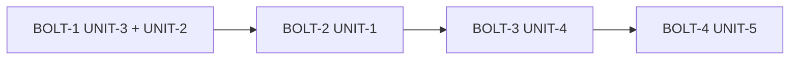

# Tasks — yfinance-resilience

## 2.9 Delivery plan

- **Verification command:** `export JAVA_HOME=/usr/lib/jvm/java-25-openjdk-amd64 && ./gradlew ktlintCheck spotlessCheck test && /usr/bin/python3 -m unittest discover -s src/test/python` (proposto; aguarda aprovação do dono)
- Branch: `main` direto (M-014). Sem commit antes de o dono ver o diff (M-004).
- Walking skeleton: UNIT-3 (migration, escrita única e leitura do registro agregado) é a primeira fatia ponta a ponta.
- Ordem segue o DAG de `design.md §2.7`: UNIT-3, UNIT-2, UNIT-1, UNIT-4, UNIT-5.

Caption: quatro bolts em série; a verificação roda ao fim de cada Unit.

### BOLT-1 — Units: UNIT-3, UNIT-2
- Goal: base de dados e de controle de chamadas, sem mudar comportamento visível.
- DoD: migration V037 aplica; registro agregado lido com tolerância; gateway bloqueia durante cooldown; verificação verde.
- Confidence hypothesis: alta; sem dependência externa.

### BOLT-2 — Units: UNIT-1
- Goal: scripts consomem o módulo de resiliência, sem `ticker.info` por símbolo e com histórico em lote.
- DoD: testes Python verdes cobrindo 429, vazio, inválido e lote; contratos JSON registrados em design.md.
- Risk: comportamento real do yfinance só é visível em execução manual (sem internet nos testes).

### BOLT-3 — Units: UNIT-4
- Goal: o app usa gateway, scripts novos e registro agregado; TTL e aviso funcionando.
- DoD: testes de contagem de chamadas (frescos 0; 30 velhos ≤ 15); falhas preservam dado antigo.
- Risk: maior área de mudança (6 serviços e o startup); testes com `FxUtils` precisam de stub (M-013).

### BOLT-4 — Units: UNIT-5
- Goal: preço único e "Última atualização" nas telas.
- DoD: capturas em `.aidlc/261106-yfinance-resilience/construction/screenshots/` nos dois temas (M-009); checklist de telas (M-003).

## Tasks

### UNIT-3 Registro agregado
- [x] T-1.1 Migration `V037__ticker_market_data.sql` (`ALTER TABLE ticker ADD COLUMN market_data TEXT`) e backfill de `price`, `updated_at` a partir de `current_unit_value`/`last_update`. Serve: FR-2, NFR-3. Teste: migration sobre banco com tickers existentes.
- [x] T-1.2 `TickerMarketData` (DTO) e parser tolerante a campos ausentes/versão antiga. Serve: FR-2. Teste: JSON legado, vazio e com campo desconhecido.
- [x] T-1.3 Campo `marketData` na entidade `Ticker` e `TickerMarketDataService.record/read`, escrevendo JSON + `currentUnitValue` + `lastUpdate` na mesma transação. Serve: FR-1, FR-3, FR-5. Teste: gravar atualiza as três coisas; falha não grava nada.
- [x] T-1.4 Docs: atualizar `codekb/data-model.md` com a coluna. Serve: NFR-3.

> **UNIT-3 verificada em 2026-11-06.** Arquivos: `V037__add_ticker_market_data.sql`, `model/dto/TickerMarketData.kt`, `model/investment/Ticker.kt` (coluna `marketData`), `service/investment/TickerMarketDataService.kt`, testes `TickerMarketDataTest`, `TickerMarketDataServiceTest`, `TickerMarketDataMigrationTest`. Verificação: `ktlintCheck spotlessCheck test` exit 0 (1841 testes Kotlin, 0 falhas) e 36 testes Python OK; boot com banco fictício validou 37 migrations e o Hibernate `validate`. Desvio: nenhum.

### UNIT-2 YahooGateway
- [x] T-2.1 `YahooGateway` com semáforo de concorrência configurável. Serve: FR-8. Teste: nunca mais que N chamadas simultâneas.
- [x] T-2.2 Cooldown crescente (5 min inicial) aberto por `error_kind=rate_limit`, usando `ClockProvider`. Serve: FR-8. Teste: durante o cooldown devolve `CooldownActive(until)` sem chamar o script; cresce se repetir; zera após sucesso.
- [x] T-2.3 Log por chamada (script, nº de símbolos, duração, resultado). Serve: NFR-4. Teste: log capturado.
- [x] T-2.4 `APIUtils.fetch*` passam pelo gateway. Serve: FR-8. Teste: chamada de cada fetch passa pelo gateway.

> **UNIT-2 verificada em 2026-11-06.** Arquivos: `common/util/YahooGateway.kt`, `common/util/APIUtils.kt` (as 3 buscas que usam yfinance passam pelo gateway), `exception/MoinexException.kt` (`YahooCooldownException`), testes `YahooGatewayTest` e `APIUtilsYahooGatewayTest`. Verificação: `ktlintCheck spotlessCheck test` exit 0 (1854 testes Kotlin, 0 falhas) e 36 testes Python OK. Desvios: (1) só `fetchStockPrices`, `fetchStockPriceHistory` e `fetchFundamentalAnalysis` passam pelo gateway; os indicadores BACEN e os logos não usam yfinance e ficam fora (teste cobre). (2) Limite de concorrência padrão 2, constante `DEFAULT_MAX_CONCURRENT_CALLS`. (3) O gateway detecta rate limit por `error_kind == "rate_limit"` no JSON (também em objetos aninhados por símbolo) ou por 429/"rate limit"/"too many requests" na mensagem da exceção; os scripts passam a emitir `error_kind` na UNIT-1.

### UNIT-1 Scripts Python
- [x] T-3.1 (atenção: `APIUtils.runPythonScript` copia cada script para um arquivo temporário isolado, então o módulo compartilhado precisa ser copiado junto, no mesmo diretório temporário, ou os scripts não o encontram no `import`) `yf_resilience.py` (retry com backoff e jitter, classificação `rate_limit`/`invalid_symbol`/`error`, `error_kind` no JSON). Serve: FR-7. Teste: `unittest` para 429, texto "too many requests", símbolo inválido sem retry.
- [x] T-3.2 `get_stock_price.py`: moeda recebida por argumento, sem `ticker.info`, sem fallback USD, vazio não é rate limit. Serve: FR-5, NFR-2. Teste: moeda desconhecida devolve erro para o símbolo e não preço.
- [x] T-3.3 `get_stock_price_history.py`: vários símbolos por execução (`yf.download`), só o intervalo pedido, sem cascata até `period=max` salvo backfill inicial explícito. Serve: FR-6. Teste: lote com um símbolo vazio não derruba os demais.
- [x] T-3.4 Demais scripts (`get_fundamental_data`, indicadores, logo) usam `yf_resilience.py` e removem suas cópias de `retry_call`. Serve: FR-7. Teste: suíte Python existente continua verde.
- [x] T-3.5 Registrar os contratos JSON dos scripts em `design.md` (3.1 de UNIT-1/UNIT-4). Serve: FR-5, FR-6.

> **UNIT-1 verificada em 2026-11-06.** Arquivos: `scripts/yf_resilience.py` (novo), `get_stock_price.py`, `get_stock_price_history.py` (reescritos), `get_fundamental_data.py`, `get_market_indicator_history.py`, `get_brazilian_market_indicators.py`, `get_stock_logo.py` (usam o módulo, sem cópias de `retry_call`/DNS), `APIUtils.prepareScriptDirectory` + `Scripts.RESILIENCE_MODULE`, `YahooGateway` (marcadores `ratelimit`/`rate_limit`), `CLAUDE.md`. Testes: `test_yf_resilience.py`, `test_get_stock_price.py`, `test_get_stock_price_history.py`, `test_scripts_isolated.py`, `APIUtilsScriptDirectoryTest`. Verificação: `ktlintCheck spotlessCheck test` exit 0 (1857 testes Kotlin, 0 falhas) e 100 testes Python OK; checagem manual contra o yfinance real (tickers genéricos) confirmou formato, `error_kind` e ausência de `info` com moeda conhecida. Desvios: (1) retry interno cai de 3/5 para 2 tentativas nos scripts do Yahoo (insistir após 429 só aumenta a carga; o cooldown agora é do gateway); BACEN e logos mantêm 3. (2) no yfinance 1.7.0 `yf.download` não levanta nem preenche `yf.shared._ERRORS`: o rate limit é lido das mensagens do logger `yfinance` (descoberto pelos testes). (3) O contrato de lote do histórico (`--batch`) existe, mas o Kotlin ainda não o usa: a UNIT-4 passa a usá-lo. (4) Fundamental: não reduz chamadas por ticker (continua com cache de 7 dias), só unifica o retry e marca `error_kind`.

### UNIT-4 Orquestração, TTL e aviso
- [x] T-4.1 `TickerService.updateTickersPriceFromApi` usa gateway, envia moedas conhecidas, grava via `TickerMarketDataService`, mantém preço antigo em falha. Serve: FR-5, FR-9. Teste: moeda desconhecida resolvida uma vez e guardada; falha preserva valor.
- [x] T-4.2 TTL de 60 min em `updateAllNonArchivedTickersPrices` (parâmetro `force` para o botão manual). Serve: FR-4. Teste: frescos → 0 chamadas; um velho → só ele.
- [x] T-4.3 `TickerPriceHistoryService.syncDailyPriceHistory` em lote, só tickers com histórico defasado. Serve: FR-6, NFR-1. Teste: 30 tickers → ≤ ceil(30/lote) chamadas.
- [x] T-4.4 `MarketService`, `MarketIndicatorService`, `BenchmarkService` respeitam TTL e gateway. Serve: FR-4, FR-8. Teste: dados frescos → 0 chamadas.
- [x] T-4.5 Aviso de rate limit com hora da próxima tentativa (`NotificationService`, chaves i18n só acrescentadas). Serve: FR-9. Teste: notificação enviada uma vez por cooldown.
- [x] T-4.6 `AppStartupRunner` ajustado ao novo fluxo (sem paralelismo que fure o limitador). Serve: FR-4, NFR-1. Teste: total de chamadas do startup com 30 tickers velhos ≤ 15, frescos 0.

> **UNIT-4 verificada em 2026-11-06.** Arquivos: `service/investment/MarketDataFreshness.kt`, `TickerMarketDataService.kt` (`recordHistorySync`), `TickerService.kt` (moeda por símbolo, gravação pelo serviço de escrita única, TTL, `force`), `TickerPriceHistoryService.kt` (`syncDailyPriceHistory` em lote com TTL e `force`), `MarketService.kt` (`...IfStale`, moedas fixas dos 10 símbolos), `YahooCooldownNotifier.kt` (aviso), `APIUtils.fetchStockPriceHistoryBatch`, `StockHistoryRequest`, `TickerMarketData.historyUpdatedAt`, `AppStartupRunner.kt`, `SavingsStocksFundsController.kt` (força o refresh e traduz a mensagem de cooldown), chaves i18n `yahoo.cooldown.*` (apenas acrescentadas). Testes: `YahooRequestVolumeTest`, `MarketDataFreshnessTest`, `YahooCooldownNotifierTest` e ampliações de `TickerService...UpdatePricesTest`, `TickerPriceHistoryService...DailySyncTest`, `MarketServiceTest`, `YahooGatewayTest`, `TickerMarketData...Test`. Verificação: `ktlintCheck spotlessCheck test` exit 0 (1889 testes Kotlin, 0 falhas) e 100 testes Python OK; boot com banco fictício sem erro de beans. **NFR-1 medida no teste:** 30 tickers velhos com moeda conhecida + cotações velhas = 10 requisições (preços 4, histórico 4, cotações 2; limite 15); tudo fresco = 0; 30 tickers sem moeda guardada pagam 30 consultas `info` uma única vez e na vez seguinte 0. Desvios: (1) o startup agora roda a atualização de preços antes do histórico, para o histórico já usar a moeda aprendida; (2) as moedas dos 10 símbolos de mercado ficaram fixas em `MarketService`, conferidas ao vivo hoje, para não pagar 10 `info` por refresh; (3) `BenchmarkService` (Ibovespa, já limitado por `STALE_AFTER_DAYS = 3`) e `MarketIndicatorService` (BACEN, não usa Yahoo) não mudaram; as cotações e os indicadores BR do `MarketService` ganharam TTL; (4) backfill inicial e `syncDaily(ticker)` do refresh de um ticker só continuam em chamada única por ticker (raros, passam pelo gateway); (5) o `YahooGateway` passou a ignorar um segundo rate limit que chega com cooldown já aberto (não dobra nem avisa de novo); (6) o botão "Atualizar preços" ignora o TTL (de preços e de histórico) e, em cooldown, mostra a mensagem traduzida com a hora.

### UNIT-5 Telas
- [x] T-5.1 `FundamentalAnalysisController` exibe `currentUnitValue` como preço atual e deixa de ler o preço do `dataJson`. Serve: FR-1. Teste: unidade no mapeamento; checagem visual.
- [x] T-5.2 Tabela de tickers (`SavingsStocksFundsController`) com coluna "Última atualização" (data e hora). Serve: FR-3. Teste: formatação por idioma.
- [x] T-5.3 `TickerDetailController` mostra "Última atualização" com `TitledValue`. Serve: FR-3, NFR-5.
- [x] T-5.4 Chaves i18n pt-BR/en acrescentadas (sem reescrever o arquivo). Serve: NFR-5.
- [x] T-5.5 Capturas nos dois temas e checklist de telas para o dono. Serve: NFR-5 (M-003, M-009).

> **UNIT-5 verificada em 2026-11-06.** Arquivos: `service/investment/FundamentalPriceOverlay.kt` (novo), `ui/dialog/investment/view/FundamentalAnalysisController.kt`, `ui/common/FundamentalMetricPaneController.kt` (data e hora quando o valor carrega hora), `ui/main/SavingsStocksFundsController.kt` (coluna "Última atualização", a última da tabela a pedido do dono), `ui/dialog/investment/view/TickerDetailController.kt` e `resources/ui/dialog/investment/view/ticker_detail.fxml` (linha "Última atualização" com `TitledValue`), chaves i18n `savings.stocksFunds.table.header.lastUpdate` e `tickerDetail.lastUpdate` (apenas acrescentadas), teste `FundamentalPriceOverlayTest`. Verificação: `ktlintCheck spotlessCheck test` exit 0 (1893 testes Kotlin, 0 falhas) e 100 testes Python OK. Capturas nos dois temas, pt-BR, em `.aidlc/261106-yfinance-resilience/construction/screenshots/` (ignorada pelo git): carteira, detalhe do ticker e análise fundamentalista. Desvios: (1) a Análise Fundamentalista não muda o `dataJson` guardado: o preço atual (aba Valuation, aba Desempenho de preço e o veredito de valuation) é substituído em memória pelo `Ticker.currentUnitValue` antes de exibir e pontuar; os demais indicadores (P/L, valor justo etc.) continuam os do momento da análise, cada um com a sua data de referência; (2) o campo no detalhe ficou em linha própria, porque o quarto campo na mesma linha espremia quantidade, preço médio e retorno; (3) a coluna nova tomou largura da tabela: os cabeçalhos "Preço U..." e "Valor T..." continuam abreviados, como já eram antes em parte.

### Assumptions & open questions
- A8: o tamanho do lote e o limite de concorrência saem de constantes nomeadas, ajustáveis depois. Confirmado pelo dono: não.

> **Revisão pós-UNIT-5 (2026-11-06, pedido do dono):** `ticker.market_data` virou `ticker.metadata` e deixou de repetir o que tem coluna (ver revisão do ADR-1 em `design.md`). Arquivos: `V037__add_ticker_metadata.sql` (V037 reaproveitada, sem V038), `TickerMetadata.kt` (substitui `TickerMarketData.kt`), `TickerMarketDataService.kt`, `Ticker.kt`, `TickerService.kt`; testes `TickerMetadataTest`, `TickerMarketDataServiceTest`, `TickerMetadataMigrationTest` (V037 em SQLite), `TickerServiceUpdatePricesTest`, `TickerPriceHistoryServiceDailySyncTest`, `YahooRequestVolumeTest`. Verificação: `ktlintCheck spotlessCheck test` exit 0 (1896 testes Kotlin, 0 falhas), 100 testes Python OK, boot com banco fictício sem erro (37 migrations).

