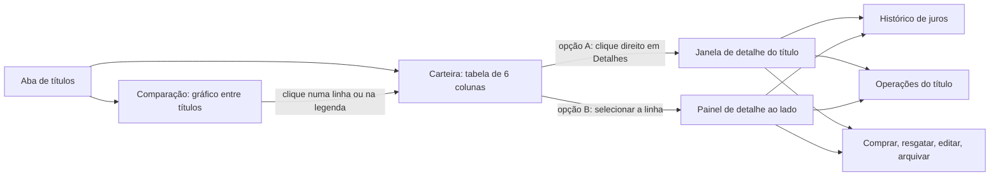
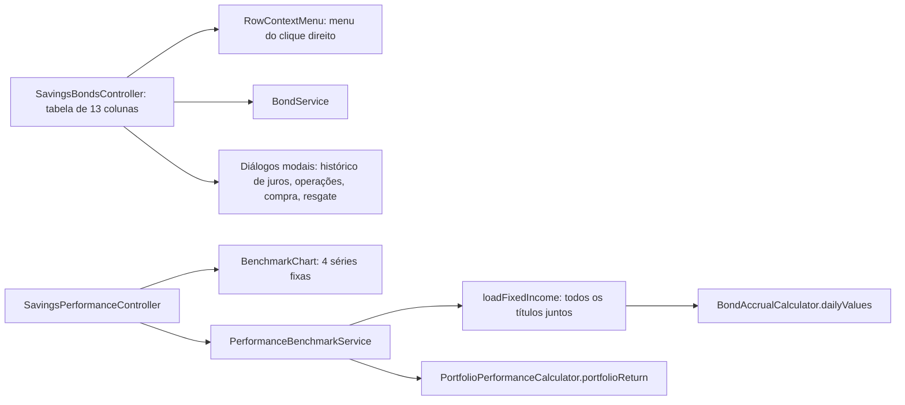
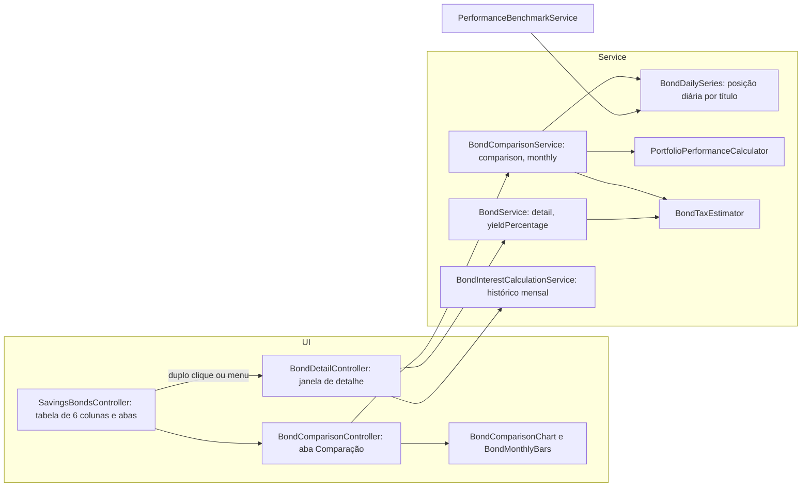
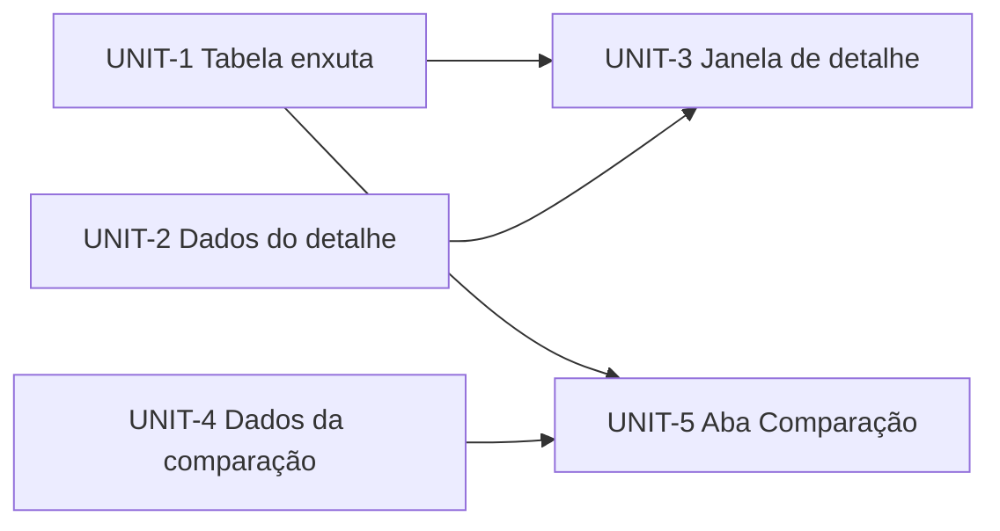
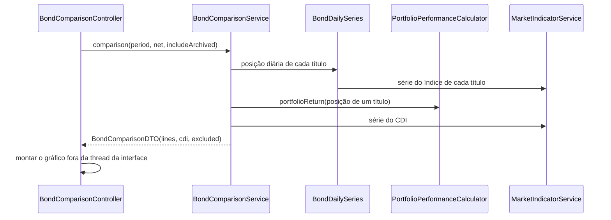

# Design — bond-detail-comparison

## 1.6 Rough mockups

**Mockups HTML (principais):** `.aidlc/261107-bond-detail-comparison/mockups/layouts.html`, com a paleta real do app nos temas escuro e claro e valores fictícios. Cinco vistas: A (janela aberta pelo clique direito, com o menu e a janela), B (painel ao lado da tabela), C (comparação em rendimento acumulado em % com o CDI, bruto ou líquido, períodos) e D (comparação em rendimento mensal em R$). Abra no navegador; `#a-modal`, `#b`, `#c`, `#d` e o sufixo `-light` na URL abrem direto numa vista. [mem: M-007, M-008]

Os wireframes de texto abaixo só complementam. A primeira versão deste estágio trazia só texto e foi corrigida a pedido do dono ("mockups sempre em HTML").

**Hoje:** a aba de títulos tem quatro cartões (total investido, valor atual, lucro e juros recebidos) e uma tabela de 13 colunas. O clique direito numa linha já abre um menu com editar, apagar, comprar, resgatar e histórico de juros; os botões de registrar título, arquivados e operações ficam no menu de ações da tela. [src: SavingsBondsController.kt]

### Fluxo



### W1 Carteira, com o detalhe numa janela (opção A)

```text
+--------------------------------------------------------------------------+
| Total investido | Valor atual | Lucro/Prejuízo | Juros recebidos           |
+--------------------------------------------------------------------------+
| [ Carteira ] [ Comparação ]                    Tipo [Todos v]  [Buscar..]|
|--------------------------------------------------------------------------|
| Nome            | Tipo | Investido | Atual    | Rendimento | Vencimento   |
|-----------------|------|-----------|----------|------------|--------------|
| CDB Banco A     | CDB  | 4.000,00  | 4.150,20 | +150,20    | 21/10/2028   |
| LCI Banco B     | LCI  | 2.000,00  | 2.031,10 | +31,10     | 16/10/2029   |
| Tesouro Selic   | TD   | 2.500,00  | 2.560,00 | +60,00     | 16/10/2029   |
+--------------------------------------------------------------------------+
   clique direito na linha:  +-------------------+
                             | Detalhes          |  abre a janela do título
                             | Comprar           |
                             | Resgatar          |
                             | Editar            |
                             | Apagar            |
                             +-------------------+
```

### W2 Carteira, com o detalhe num painel lateral (opção B)

```text
+--------------------------------------------------------------------------+
| Total investido | Valor atual | Lucro/Prejuízo | Juros recebidos           |
+--------------------------------------------------------------------------+
| [ Carteira ] [ Comparação ]                                              |
|--------------------------------------+-----------------------------------|
| Nome         | Tipo | Atual | Rend.  |  CDB Banco A                      |
|--------------|------|-------|--------|  Tipo: CDB    Emissor: Banco A    |
| > CDB Banco A| CDB  |4.150  | +150   |  Taxa: 120% do CDI  Venc.: 2028   |
|   LCI Banco B| LCI  |2.031  | +31    |  Investido: 4.000   Atual: 4.150  |
|   Tesouro .. | TD   |2.560  | +60    |  Rendimento: +150,20 (mês +21,30) |
|                                      |  Juro líquido estimado: 118,00    |
|                                      |  [Histórico] [Operações]          |
|                                      |  [Comprar] [Resgatar] [Editar]    |
+--------------------------------------+-----------------------------------+
```

### W3 Detalhe do título (igual na janela e no painel, muda o espaço)

```text
+--------------------------------------------------------------+
| CDB Banco A  (CDB-A-001)                          [Arquivar] |
| Tipo: CDB      Emissor: Banco A     Vencimento: 21/10/2028   |
| Taxa: 120% do CDI                                            |
|--------------------------------------------------------------|
| Investido  | Valor atual | Rendimento    | Rend. do mês | IR  |
| 4.000,00   | 4.150,20    | +150,20       | +21,30       | est.|
|--------------------------------------------------------------|
| Saldo ao longo do tempo        (linha pequena, 12 meses)     |
|--------------------------------------------------------------|
| [ Histórico de juros ] [ Operações ]                         |
|  Mês     | Investido | Rend. mês | Acumulado | Final | Status|
|  2026-10 | 4.000,00  |  21,30    | 150,20    | 4.150 | Auto  |
|  ...                              [Recalcular histórico]     |
|--------------------------------------------------------------|
|   [Comprar]   [Resgatar]   [Editar]                          |
+--------------------------------------------------------------+
```

### W4 Comparação entre títulos

```text
+--------------------------------------------------------------------------+
| Comparação      [3M][6M][12M][Tudo]   ( ) Bruto (x) Líquido est.         |
|                 Ver: (x) Rendimento acumulado %   ( ) Rendimento mensal R$|
|--------------------------------------------------------------------------|
|  %                                                                       |
| 15 |                                              ___ CDB Banco A        |
| 10 |                                  ___----                            |
|  5 |                      ___---                      ---- CDI (referência)|
|  0 |__---                                            ---- LCI Banco B     |
|    +------------------------------------------------------------ tempo   |
|--------------------------------------------------------------------------|
| Legenda:  [x] CDB Banco A +14,8%   [x] LCI Banco B +11,2%   [x] CDI +14,1%|
| Fora do gráfico: 1 título sem histórico do índice                        |
+--------------------------------------------------------------------------+
```

### Estados

- **Sem títulos:** a tabela mostra o texto de vazio; a aba Comparação mostra "Cadastre um título para comparar".
- **Um só título:** o gráfico mostra o título e o CDI.
- **Título sem histórico do índice:** fora do gráfico, com o aviso na legenda.
- **Sem seleção (painel):** o painel pede para selecionar uma linha.

### Assumptions & open questions

- A6: a comparação vive numa segunda aba dentro do cartão do portfólio, ao lado de "Carteira". — confirmed: yes (2026-11-07T18:59:33-03:00, gate 1.6)
- A7: na tabela do painel lateral podem ficar menos colunas que as 6 da janela, porque o painel ocupa espaço. — confirmed: yes (2026-11-07T18:59:33-03:00, gate 1.6)
- Q2: o botão de arquivar fica no detalhe ou continua no menu de ações da tela? (decidir com os mockups refinados)

## 2.1 Codebase analysis

Resumo do delta. Evidências em `.aidlc/codekb/MOINEX/areas/bond-screens.md` (draft) e, para os cálculos, `areas/financial-calculations.md`. Baseline: 2114 testes Kotlin e 118 Python, 0 falhas, no HEAD 55d07233.



| Peça | Situação | Implicação |
|---|---|---|
| Tabela e menu de clique direito | existem, por extrator de coluna | enxugar colunas e acrescentar "Detalhes" é pequeno |
| Janela modal por título | padrão estabelecido | a opção A (janela) segue o padrão |
| Painel de detalhe ao lado da tabela | nenhuma tela faz isso | a opção B é um padrão novo, com mais trabalho de layout |
| `BenchmarkChart` | 4 séries fixas, cores fixas | a comparação precisa de componente novo ou generalização |
| Retorno por título | só existe agregado (`loadFixedIncome`) | extrair uma função por título |
| Operações por título | só a lista de todos os títulos | filtrar por título no detalhe |
| Linha do CDI e período | existem (`SegmentedFilter`, `cumulativeFromDailyRates`) | reaproveitar |

Padrões a seguir na Construction: `TitledValue` em "Título: valor" (M-010); tokens `theme-*` e `ThemeColors` para cores de linha (M-001); `Icons` para ícones; textos pelos dois `.properties` (só chaves novas ao fim); dinheiro em `BigDecimal` (M-017); validar telas com `capture-screens.sh` e dados fictícios (M-006).

## 2.2 Team practices

Práticas observadas, com a evidência. As marcadas como memória já foram aprovadas pelo dono; as outras vêm do repositório.

| Prática | Evidência | Estado |
|---|---|---|
| Branch e commit: trabalho direto na `main` ou em branch tipada, a decisão é do dono a cada intent; commit só quando o dono pede | `git log`, `.githooks/` | memória M-004, M-014 |
| Mensagens de commit no estilo `tipo(escopo): resumo`, com o trailer `Co-Authored-By`; nunca link de sessão | `git log`, `CLAUDE.md` | memória; `CLAUDE.md` |
| Hook de pré-commit roda `ktlintCheck`, os testes Kotlin e os testes Python | `.githooks/pre-commit`, `Makefile` | repositório |
| Testes: Kotest BehaviorSpec e MockK, fábricas em `src/test/kotlin/org/moinex/factory/`, fórmulas de dinheiro com valor de referência calculado à parte | `src/test` | `CLAUDE.md`; memória M-017 |
| Estilo: ktlint e spotless, sem comentário `//` explicativo (KDoc só em classes e funções), cabeçalho padrão em todo arquivo novo | `CLAUDE.md`, memória | memória M-012; feedback salvo |
| Interface: tokens `theme-*` e `ThemeColors`, ícones de `Icons.kt`, `TitledValue` em "Título: valor", identidade visual Dracula e botões em pílula | `CLAUDE.md`, memória | memória M-001, M-010 |
| i18n: chaves novas só ao fim dos dois `.properties`, sem reescrever o arquivo; se falhar, pedir ao dono | `CLAUDE.md` | feedback salvo |
| Validação de tela: `scripts/dev/capture-screens.sh` com dados fictícios, imagens em `.aidlc/<intent>/construction/screenshots/` (ignorada pelo git) | `scripts/dev`, `CLAUDE.md` | memória M-006, M-009 |
| Mockups em HTML na pasta `mockups/` do intent, com a paleta real; wireframes de texto só complementam; vários layouts possíveis viram mockups comparativos antes da decisão | `.aidlc/261101-*/mockups` | memória M-007, M-008 |
| Nenhum dado pessoal do dono em arquivos ou commits | memória | M-011 |
| Dinheiro em `BigDecimal`, nunca `Double` | memória | M-017 |

### Assumptions & open questions

- A8: o painel lateral (opção B), se escolhido, não tem precedente de padrão e seguirá os mesmos tokens e componentes. — confirmed: yes (2026-11-07T19:07:45-03:00, gate 2.2)

## 2.5 Refined mockups

**Decisão do dono (gate 2.5): A, janela aberta pelo clique direito e pelo duplo clique. O painel lateral (B) não será construído.**

**Arquivo:** `.aidlc/261107-bond-detail-comparison/mockups/refined.html` (HTML com a paleta real, dois temas, valores fictícios). Seis vistas: **A** janela aberta pelo clique direito, **B** painel ao lado, **C** comparação em acumulado %, **D** comparação mensal em R$, **E** estados vazios. O `layouts.html` é a versão rústica do 1.6. [mem: M-007]

### Janela contra painel, lado a lado

| Critério | A · Janela | B · Painel ao lado |
|---|---|---|
| Colunas da tabela | 6, como o FR-1 pede | 4, porque o painel divide a largura; contradiz o FR-1 e o SM-1 |
| Espaço para o histórico de juros e as operações | folgado (janela de 860 px) | apertado, só poucas linhas e sem a tabela completa |
| Interações para abrir | 2 (clique direito e "Detalhes"); também dá para abrir com duplo clique | 1 (selecionar a linha) |
| Padrão no app | igual ao histórico de juros, operações e arquivados | novo; nenhuma tela divide a área com um painel de linha |
| Trabalho de construção | menor (reaproveita `openModalWindow` e os diálogos) | maior (layout dividido, estados de seleção, foco) |
| Comparar dois títulos em seguida | abre e fecha a janela | basta trocar a linha |
| Risco | esconde a tabela atrás do modal | tabela e detalhe disputam espaço em telas pequenas |

**Recomendação:** A. Respeita as 6 colunas, segue o padrão do app e custa menos. O ponto fraco de A, comparar dois títulos em seguida, é justamente o que a aba "Comparação" resolve.

### Especificação de interação

- **Tabela:** seleção por clique; duplo clique ou "Detalhes" no menu do clique direito abre o detalhe; o menu mantém comprar, resgatar, editar e apagar (a opção "Histórico de juros" passa a viver no detalhe). Rendimento em verde ou vermelho, com R$ e %.
- **Comparação:** período em 12M ao abrir; a chave bruto e líquido vale para o acumulado e para o mensal; legenda clicável liga e desliga a linha; o cursor mostra o valor de cada série no dia; o aviso "N títulos fora do gráfico" fica abaixo da legenda; "Incluir arquivados" começa desligado.
- **Estados (vista E):** sem títulos (com botão para registrar), todos fora do gráfico, um só título, painel sem seleção.
- **Carregamento:** o gráfico é montado fora da thread da interface e mostra o texto de carregamento enquanto isso (NFR-1).

### Acessibilidade e temas

- Cada série tem cor dos tokens `theme-chart-series-*` e rótulo de texto na legenda com o resultado do período; o CDI usa traço tracejado além da cor (NFR-3).
- Escuro (Dracula) e claro conferidos nos mockups; cores de ganho e perda das variáveis `--pos` e `--neg`, que vêm dos tokens `theme-positive` e `theme-negative` do app.
- O foco do teclado percorre tabela, controles e legenda na ordem visual.

### Assumptions & open questions

- A13: a decisão janela ou painel sai deste gate; a outra forma não será construída. — confirmed: yes (2026-11-07T19:20:07-03:00, gate 2.5)
- A14: o botão "Arquivar" fica no detalhe (e sai do menu de ações da tela só se o dono pedir). — confirmed: yes (2026-11-07T19:20:07-03:00, gate 2.5)

## 2.6 Domain & components

### Componentes



| Componente | Responsabilidade | Dono dos dados |
|---|---|---|
| `SavingsBondsController` (existente) | tabela de 6 colunas, abas Carteira e Comparação, abrir o detalhe | nenhum |
| `BondDetailController` (novo, modal) | mostrar dados, posição, saldo, histórico de juros e operações do título; ações | nenhum |
| `BondComparisonController` (novo) | controles (período, bruto ou líquido, vista, arquivados), estados vazios, aviso de fora do gráfico | nenhum |
| `BondComparisonChart`, `BondMonthlyBars` (novos, `ui/common`) | desenhar N linhas com legenda clicável e cursor; barras agrupadas por mês | nenhum |
| `BondComparisonService` (novo) | montar as séries de comparação e as barras mensais, bruto ou líquido | nenhum (lê) |
| `BondDailySeries` (novo, extraído de `PerformanceBenchmarkService.loadFixedIncome`) | posição diária de um título (valores e fluxos) para o retorno por título e para o agregado | nenhum |
| `BondService` (existente) | acrescenta `detail(bond)` e `yieldPercentage(bond)` | operações de título |
| `BondTaxEstimator` (existente) | acrescenta a alíquota efetiva usada no líquido mensal | nenhum |

### Regras de domínio

- **Retorno por título:** `portfolioReturn` com um só `FixedIncomePosition` (valores diários e fluxos de compra e resgate); começa em 0% na primeira data do período com saldo (FR-11, FR-12).
- **Líquido acumulado:** valor líquido do dia = valor − IR estimado sobre o juro retido naquele dia, com a idade de cada lote; o retorno é recalculado sobre esses valores (FR-14).
- **Líquido mensal:** rendimento do mês × (1 − alíquota efetiva do título no fim do mês), alíquota efetiva = IR estimado ÷ juro retido (A9).
- **Fora do gráfico:** título sem taxa, tipo ou série do índice (R-1, FR-13).
- **Período "Tudo":** da primeira compra entre os títulos incluídos até hoje (A11).

### Assumptions & open questions

- A15: o saldo de 12 meses do detalhe usa o valor final do histórico mensal gravado, não a série diária. — confirmed: yes (2026-11-07T19:21:02-03:00, gate 2.6 a 2.8)
- A16: o retorno por título reaproveita `portfolioReturn` sem mudar a sua fórmula. — confirmed: yes (2026-11-07T19:21:02-03:00, gate 2.6 a 2.8)

## 2.7 Units of work

Cinco Units. O primeiro é a fatia mínima ponta a ponta (walking skeleton): serviço, tabela e captura.

### UNIT-1 Tabela enxuta  (skeleton)
FR-1, FR-2, FR-20 (parte). `BondService.yieldPercentage`; a tabela passa a 6 colunas com o rendimento em R$ e % colorido; o menu do clique direito perde "Histórico de juros" apenas quando o detalhe existir (UNIT-3). Arquivos principais: `service/investment/BondService.kt`, `ui/main/SavingsBondsController.kt`, `savings_bonds.fxml`, `.properties`.

### UNIT-2 Dados do detalhe
FR-4, FR-5, FR-9 (dados), NFR-7. `BondService.detail(bond)` devolve `BondDetailDTO` com posição, juro líquido estimado e saldo mensal. Arquivos: `BondService.kt`, `model/dto/BondDetailDTO.kt`.

### UNIT-3 Janela de detalhe
FR-3, FR-4 a FR-9, FR-20 (parte). `BondDetailController` e `bond_detail.fxml`; duplo clique e "Detalhes" no menu; histórico de juros e operações do título em abas; gráfico de saldo; ações. Arquivos: `ui/dialog/investment/view/BondDetailController.kt`, `resources/ui/dialog/investment/view/bond_detail.fxml`, `SavingsBondsController.kt`, `Files.kt`, `.properties`. Depende dos UNIT-1 e UNIT-2.

### UNIT-4 Dados da comparação
FR-10 a FR-15 e FR-17 (dados), FR-13, NFR-1, NFR-2. `BondDailySeries`, `BondComparisonService`, alíquota efetiva no `BondTaxEstimator`, DTOs. Arquivos: `service/investment/BondDailySeries.kt`, `BondComparisonService.kt`, `PerformanceBenchmarkService.kt` (usa o extraído), `BondTaxEstimator.kt`, `model/dto/BondComparisonDTO.kt`.

### UNIT-5 Aba Comparação
FR-10 a FR-19, FR-20. Aba na tela de títulos, `BondComparisonController`, `BondComparisonChart`, `BondMonthlyBars`, legenda clicável, cursor, estados, temas e idiomas. Arquivos: `ui/main/BondComparisonController.kt`, `ui/common/BondComparisonChart.kt`, `BondMonthlyBars.kt`, `savings_bonds.fxml`, `css/component/*.css`, `.properties`. Depende dos UNIT-1 e UNIT-4.

### Dependency order



Ordem topológica: UNIT-1, UNIT-2, UNIT-3, UNIT-4, UNIT-5.

### Story → Unit map

| História | Unit |
|---|---|
| US-1 | UNIT-1 |
| US-2, US-3, US-4, US-5 | UNIT-2 (dados) e UNIT-3 (tela) |
| US-6, US-7, US-8, US-9 | UNIT-4 (dados) e UNIT-5 (tela) |
| US-10 | UNIT-3 e UNIT-5 (Definition of Done: idiomas e temas) |
| US-11 | todas (Definition of Done: não regressão) |

| Requisito | Unit dono |
|---|---|
| FR-1, FR-2 | UNIT-1 |
| FR-4, FR-5, FR-9 | UNIT-2 |
| FR-3, FR-6, FR-7, FR-8 | UNIT-3 |
| FR-10, FR-11, FR-12, FR-13, FR-14, FR-15, FR-17 | UNIT-4 |
| FR-16, FR-18, FR-19 | UNIT-5 |
| FR-20 | UNIT-5 (verificação final); cada Unit roda a verificação completa na sua Definition of Done |
| NFR-1, NFR-2 | UNIT-4 |
| NFR-3, NFR-5 | UNIT-3 e UNIT-5 |
| NFR-4, NFR-6, NFR-7 | todas |

Cada FR tem um único Unit dono. Onde o dado e a tela são Units diferentes, o dono é o Unit do dado (UNIT-2 e UNIT-4) e o Unit da tela (UNIT-3 e UNIT-5) consome e exibe o resultado.

## 2.8 Contracts

Contratos internos entre serviço e tela (não há API externa).

```kotlin
data class BondDetailDTO(
    val bond: Bond,
    val invested: BigDecimal,
    val currentValue: BigDecimal,
    val accumulatedInterest: BigDecimal,
    val monthInterest: BigDecimal,
    val netInterest: BondRedemptionEstimateDTO,
    val monthlyBalance: List<MonthBalanceDTO>,
)

data class MonthBalanceDTO(val month: YearMonth, val value: BigDecimal)

enum class ComparisonPeriod(val months: Int?) { M3(3), M6(6), M12(12), ALL(null) }

data class BondComparisonRequest(
    val period: ComparisonPeriod,
    val net: Boolean,
    val includeArchived: Boolean,
)

data class BondLineDTO(val bond: Bond, val points: List<SeriesPointDTO>, val resultPct: BigDecimal)

data class BondComparisonDTO(
    val lines: List<BondLineDTO>,
    val cdi: List<SeriesPointDTO>,
    val excluded: List<Bond>,
)

data class BondMonthlySeriesDTO(val bond: Bond, val values: Map<YearMonth, BigDecimal>)

data class BondMonthlyDTO(
    val months: List<YearMonth>,
    val series: List<BondMonthlySeriesDTO>,
    val excluded: List<Bond>,
)
```

| Chamada | Entrada | Saída | Erros e vazios |
|---|---|---|---|
| `BondService.detail(bond)` | título | `BondDetailDTO` | título sem operações: valores zero e saldo vazio |
| `BondService.yieldPercentage(bond)` | título | percentual sobre o investido (ou nulo se investido zero) | investido zero devolve nulo |
| `BondComparisonService.comparison(request)` | `BondComparisonRequest` | `BondComparisonDTO` | sem títulos: listas vazias; títulos sem série do índice vão em `excluded` |
| `BondComparisonService.monthly(request)` | `BondComparisonRequest` | `BondMonthlyDTO` | meses sem histórico valem zero |



### Assumptions & open questions

- A17: os DTOs ficam em `model/dto`, como os demais. — confirmed: yes (2026-11-07T19:21:02-03:00, gate 2.6 a 2.8)

