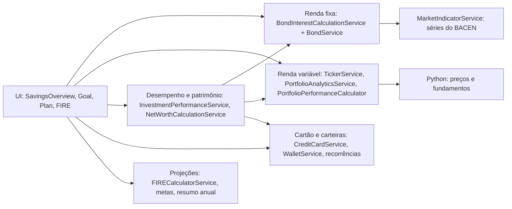
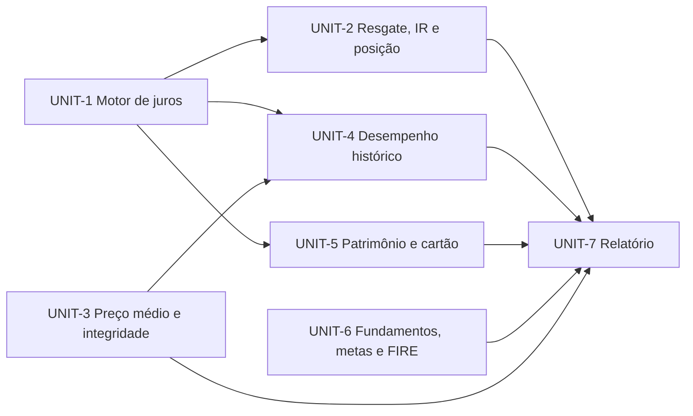

# Design — financial-calculations-review

## 2.1 Codebase analysis

Resumo do delta feito neste intent. Detalhes e evidências em `.aidlc/codekb/MOINEX/areas/financial-calculations.md` (status draft, HEAD 6c94ec03). Baseline de testes (2026-11-07, HEAD 6c94ec03): `ktlintCheck`, `spotlessCheck` e `test` com saída 0; o Gradle reaproveitou o resultado da última execução porque nada mudou (todas as tarefas `UP-TO-DATE`), e esse resultado registra 2041 testes, 0 falhas, 0 erros. Python: 109 testes, OK. Nenhuma falha pré-existente.

Domínios de cálculo e leitura feita:

| Domínio | Situação | Achados prováveis (a confirmar no 2.3) |
|---|---|---|
| Renda fixa: juros | lido por completo | 8 (taxa do título ignorada, spread somado, dia contado duas vezes, sem capitalização, `ZERO_COUPON` sem juro, sem imposto) |
| Renda fixa: posição | lido | média sem escala (exceção), juro acumulado não baixa em venda |
| Renda variável | lido em parte | contagem da média nunca diminui em venda; média a 2 casas |
| Desempenho histórico | lido | ganho realizado contado duas vezes, quantidade do fim do período, acumulado de renda fixa por `maxBy` |
| Patrimônio | lido | histórico com preço atual, recorrência possivelmente contada duas vezes |
| Cartão | lido em parte | distribuição de pagamento parcial por fração com 2 casas |
| FIRE | lido | fórmula correta; premissas (sem inflação) a documentar |
| Metas, resumo anual, planejamento | lidos nos pontos numéricos | progresso em passos de 1 ponto percentual |
| Fundamentos | lido (fórmulas principais) | Y fixo de 10%, crescimento de receita no lugar de lucro, CAGR trimestral |
| Saldo de carteira | lido | sem achado |
| Dívida recorrente de cartão | não lido | entra no Unit de patrimônio e cartão |

Decisões do dono já registradas (gate 2.1): renda fixa flutuante aceita os dois modelos (percentual do índice e índice mais taxa); capitalizar juros e mostrar também o valor líquido (IR regressivo).

Padrões a seguir na Construction: `BigDecimal` com `MathContext` ou escala explícita, testes Kotest BehaviorSpec com fórmula de referência calculada à parte, nenhuma migração de dados sem decisão do dono.

## 2.6 Domain & components
## 2.7 Units of work

Sete Units, um por domínio de cálculo, mais o relatório. Cada Unit é verificável sozinho (testes e a verificação do 2.9) e toca um conjunto de arquivos disjunto dos outros, exceto onde o DAG indica dependência.

### UNIT-1 Motor de juros da renda fixa
FR-2, FR-3, FR-4, FR-5, FR-8; NFR-1, NFR-4, NFR-5. Reescreve `BondInterestCalculationService` com saldo capitalizado, os dois modelos de taxa, contagem de dias úteis `(início, fim]` e `ZERO_COUPON`. Migração Flyway com o modelo da taxa no título. Tela de cadastro ganha o seletor do modelo. Entrega a fórmula de referência (função pura, em `BigDecimal`) usada pelos testes de todos os Units de renda fixa.
Arquivos principais: `service/investment/BondInterestCalculationService.kt`, `common/extension/InvestmentExtensions.kt`, `model/investment/Bond.kt`, nova migração `db/migration/V039__*.sql`, dialog de cadastro de título.

### UNIT-2 Resgate, imposto e posição da renda fixa
FR-6, FR-7, FR-9, FR-10; NFR-1. Resgate proporcional com lucro realizado sugerido, IR regressivo estimado (bruto e líquido), preço médio sem exceção e o botão de recalcular histórico com antes e depois. Depende do motor do UNIT-1.
Arquivos principais: `service/investment/BondService.kt`, dialogs de venda e de histórico de juros de título, `ui/main/SavingsOverviewController.kt` (valores bruto e líquido).

### UNIT-3 Preço médio e integridade da renda variável
FR-11, FR-12; NFR-1. Preço médio ponderado pela custódia, com precisão interna de 6 casas, e a verificação de integridade das quantidades (somente leitura). Independente dos demais.
Arquivos principais: `service/investment/TickerService.kt`, `model/investment/Ticker.kt`, `Asset.kt`, serviço novo de verificação e a ação na tela de configurações ou investimentos.

### UNIT-4 Desempenho histórico
FR-13, FR-14, FR-15, FR-16, FR-17. Ganho mensal sem duplicidade, quantidade do início do período, acumulado consistente, custo vigente na data, rótulos das métricas e retorno total opcional no gráfico. Depende do UNIT-1 (juro vem da variação do saldo) e do UNIT-3 (custo vigente).
Arquivos principais: `service/investment/InvestmentPerformanceService.kt`, `PortfolioPerformanceCalculator.kt`, `PerformanceBenchmarkService.kt`, `BenchmarkChart.kt`, `SavingsOverviewController.kt`.

### UNIT-5 Patrimônio e cartão
FR-18, FR-19, FR-20, FR-21. Recorrências sem contagem dupla, preço histórico no patrimônio, pagamento parcial de fatura com precisão total, auditoria da dívida recorrente de cartão. Depende do UNIT-1 (valor da renda fixa no patrimônio).
Arquivos principais: `service/networth/NetWorthCalculationService.kt`, `service/creditcard/CreditCardService.kt`, `RecurringCreditCardDebtService.kt`.

### UNIT-6 Fundamentos, metas e FIRE
FR-22 a FR-26. Rendimento de referência do Graham, crescimento do lucro, CAGR por anos reais, precisão do progresso das metas, premissas e idade do FIRE. Independente dos demais.
Arquivos principais: `scripts/get_fundamental_data.py`, `service/investment/FundamentalScoringService.kt`, `ui/main/GoalController.kt`, `ui/common/GoalPaneController.kt`, `service/financialplanning/FIRECalculatorService.kt` e a tela do FIRE.

### UNIT-7 Relatório de auditoria
FR-1. Consolida o veredito de cada cálculo com a fórmula de referência, o código e a decisão do dono. Depende de todos os outros Units, e o resultado de cada Unit alimenta o relatório.
Arquivo: `.aidlc/261107-financial-calculations-review/construction/audit-report.md`.

### Dependency order

Ordem topológica proposta: UNIT-3, UNIT-1, UNIT-2, UNIT-4, UNIT-5, UNIT-6, UNIT-7. O UNIT-3 vai primeiro por ser o menor e não ter dependências; ele estabelece o padrão de teste com fórmula de referência (walking skeleton).

### Requirement → Unit map

| Requirement | Unit |
|---|---|
| FR-1 | UNIT-7 |
| FR-2, FR-3, FR-4, FR-5, FR-8 | UNIT-1 |
| FR-6, FR-7, FR-9, FR-10 | UNIT-2 |
| FR-11, FR-12 | UNIT-3 |
| FR-13, FR-14, FR-15, FR-16, FR-17 | UNIT-4 |
| FR-18, FR-19, FR-20, FR-21 | UNIT-5 |
| FR-22, FR-23, FR-24, FR-25, FR-26 | UNIT-6 |
| NFR-1 | UNIT-1, UNIT-2, UNIT-3 (Definition of Done) |
| NFR-2, NFR-3, NFR-6 | todos (Definition of Done) |
| NFR-4, NFR-5 | UNIT-1 |

## 2.8 Contracts
