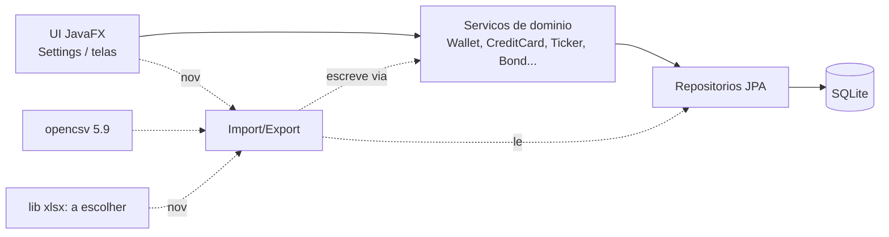
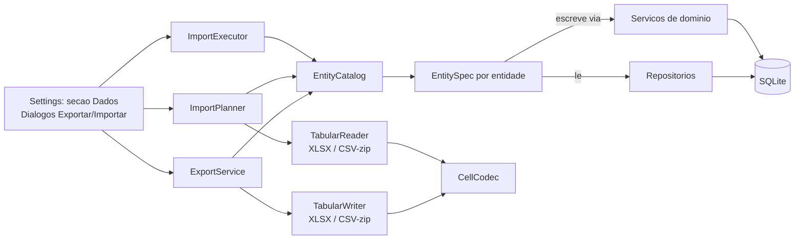
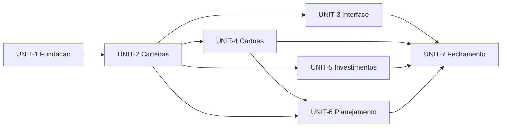
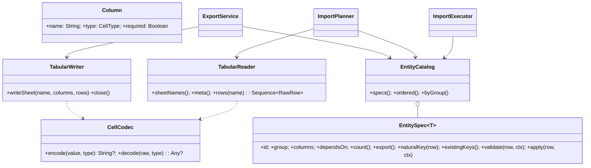
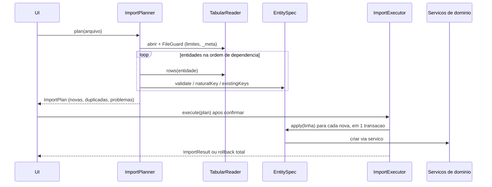
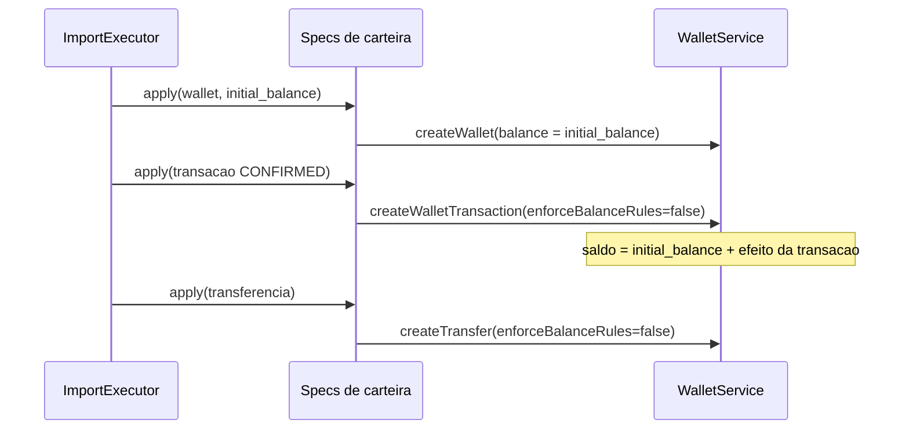

# Design — import-export-data

## 2.1 Reverse Engineering (delta sobre o codekb)

Codekb reutilizado: `.aidlc/codekb/MOINEX/` (commit aefe5133). HEAD atual: 8c32f394, 8 commits depois, sem mudança de schema ou de camada relevante para import/export. [src: git log aefe5133..HEAD] Baseline de testes: 2144 Kotlin + 118 Python, 0 falhas (2026-11-07). [src: quality-and-risks.md]

### O que já existe e interessa
- **opencsv 5.9** já é dependência; só `ai/ingest/CsvStatementParser.kt` a usa (lê CSV para texto que vai ao LLM). Nenhuma lib de xlsx (Apache POI, fastexcel) no projeto. [src: gradle/libs.versions.toml] [src: build.gradle.kts:58]
- **Seletor de arquivos**: só `AiChatController` usa `FileChooser`; `SettingsController` usa `DirectoryChooser` (pasta do banco). [src: ui/main/AiChatController.kt:336] [src: ui/main/SettingsController.kt]
- **Entidades de usuário** (alvo do import/export): Wallet/WalletType/WalletTransaction/Transfer/RecurringTransaction/Category; CreditCard/CreditCardOperator/CreditCardDebt/CreditCardPayment/CreditCardCredit/RecurringCreditCardDebt; FinancialPlan/BudgetGroup/Goal/WishlistItem(+Link); Ticker/TickerPurchase/TickerSale/Dividend/Bond/BondOperation/CryptoExchange/InvestmentTarget. [src: data-model.md] [src: docs/database-erd.md]
- **Dados derivados/cache** (não são alvo): InvestmentPerformanceSnapshot, NetWorthSnapshot, TickerPriceHistory, BenchmarkPrice, MarketIndicator*, FundamentalAnalysis, Notification, AiChat*.
- **Escrita passa pelos serviços**: `WalletService.createWalletTransaction`/`createTransfer`/`updateWalletBalance` mantêm o saldo da carteira; `CreditCardService`, `TickerService`, `BondService` fazem o mesmo para seus domínios. Gravar direto nos repositórios quebraria saldos e invariantes. [src: service/wallet/WalletService.kt:234,336]
- **Banco**: SQLite, pool de 1 conexão, FKs não impostas pelo JDBC; exclusões em cascata são do código. Datas em texto ISO, valores `numeric`. [src: data-model.md]
- **Padrões a seguir**: header de arquivo (M-012), BigDecimal nos cálculos de dinheiro (M-017), sem comentários `//` no Kotlin, i18n só por chaves acrescentadas (nunca reescrever o .properties), validação visual com `make demo` (M-006), sem dados pessoais nos arquivos (M-011).



### Assumptions & open questions
- A1 (2.1): o codekb de aefe5133 continua válido para as áreas tocadas por este intent. — confirmed: no

## 2.5 Refined Mockups

Mockups HTML com a paleta real: `mockups/refined.html` (vistas A–G, tema escuro e claro). [mem: M-007]

**Decisão do dono:** a pré-visualização do import usa o layout **D2**: tabela de entidades à esquerda (novas, duplicadas, estado) e, à direita, o detalhe da entidade selecionada com abas Problemas / Novas / Duplicadas. [src: gate 2.5]

### Especificação de interação
- **A · Configurações**: nova seção "Dados" (card) com três botões em pílula: Exportar dados…, Importar dados…, Baixar modelo vazio (Could, FR-15). Rótulos "<Título>: <valor>" usam `TitledValue`. [mem: M-010]
- **B · Exportar** (diálogo modal): formato (XLSX | CSV .zip), 4 grupos com checkbox de grupo e checkbox por entidade com contagem de linhas; rodapé com resumo "Selecionado: N grupos, M linhas" e botão Exportar… desabilitado quando nada marcado; ao Exportar abre o seletor de arquivo (nome padrão `moinex-export-AAAA-MM-DD`). Grupo sem dados aparece vazio e desmarcado.
- **C · Importar, passo 1**: escolher arquivo (.xlsx ou .zip); reconhece pelo conteúdo; o texto explica "só adiciona, ignora duplicatas, nada grava antes de confirmar".
- **D2 · Passo 2, pré-visualização**: lista de entidades (Novas / Dup. / estado ✔ ou "N erros") | detalhe com abas Problemas, Novas, Duplicadas; faixa de erro vermelha enquanto houver erro; botão "Importar N registros" desabilitado com erros; Voltar volta ao passo 1.
- **E · Progresso**: barra e entidade atual; Cancelar ativo até a gravação começar.
- **F · Resultado, passo 3**: faixa verde com totais e tabela por entidade (adicionadas / ignoradas); Fechar.
- **G · Erros do passo 1**: não é exportação do MOINEX; layout desconhecido; arquivo acima do limite. Todos com mensagem e "Escolher outro arquivo".
- **Acessibilidade/tema**: só tokens `theme-*`; foco por teclado em checkboxes e botões; textos por chaves i18n pt-BR e en. [mem: NFR-7]

### Assumptions & open questions
- A7 (2.5): limite de tamanho de arquivo de 50 MB (G). — confirmed: no

## 2.6 Domain & Components

### Princípios
- Um **catálogo de entidades** descreve cada tabela exportável (nome da aba/arquivo, colunas e tipos, chave natural, dependências); o leitor/escritor de CSV e XLSX é genérico e não conhece entidades. [src: NFR-8]
- **Leitura** para export vai direto nos repositórios (somente leitura). **Escrita** do import vai sempre pelos serviços de domínio, que mantêm saldos e invariantes. [src: FR-10] [src: WalletService.kt:234]
- Pré-visualização é pura: lê o arquivo, valida e **planeja** (lista de operações) sem gravar; só o passo de confirmar executa o plano numa transação única. [src: FR-7, FR-8]

### Componentes (pacote `org.moinex.dataexchange`)
| Componente | Responsabilidade | Interfaces |
|---|---|---|
| `EntityCatalog` + `EntitySpec<T>` | Registro das entidades exportáveis por grupo; cada spec define colunas, chave natural, ordem de dependência, `export(): Sequence<Row>`, `parse`/`validate`/`apply` | `specs(group)`, `ordered()` |
| `TabularWriter` / `TabularReader` | Abstração de arquivo tabular; implementações `XlsxWriter/Reader` e `CsvZipWriter/Reader` (opencsv) | `writeSheet(name, header, rows)`, `readSheets(): Map<name, Sequence<RawRow>>` |
| `CellCodec` | Converte valor↔célula no formato fixo (data ISO, BigDecimal, enum por nome, boolean) e neutraliza fórmulas (`=+-@`) | `encode(v)`, `decode(raw, type)` |
| `ExportService` | Orquestra o export: seleção → specs → writer; contagens e progresso | `export(selection, format, target, progress)`, `counts()` |
| `ImportPlanner` | Lê arquivo, valida layout/versão/limites, resolve referências por chave natural (arquivo + banco), detecta duplicatas, produz `ImportPlan` (novas, duplicadas, problemas por entidade/linha/coluna) | `plan(file, progress): ImportPlan` |
| `ImportExecutor` | Executa o `ImportPlan` em ordem de dependência dentro de uma transação, chamando os serviços de domínio; tudo-ou-nada | `execute(plan, progress): ImportResult` |
| `DataExchangeController` / diálogos | Seção "Dados" nas Configurações, diálogos Exportar e Importar (3 passos, layout D2); coroutines + `FxUtils` | — |



### Catálogo de entidades (grupos e chaves naturais, rascunho para 2.8)
| Grupo | Entidade (aba/arquivo) | Chave natural | Referencia |
|---|---|---|---|
| Carteiras | wallet_types | name | — |
| Carteiras | categories | name | — |
| Carteiras | wallets | name | wallet_type, master_wallet (por name) |
| Carteiras | wallet_transactions | wallet + date + type + amount + description (+ ocorrência n em linhas idênticas) | wallet, category; `ref` local para vínculos |
| Carteiras | transfers | sender + receiver + date + amount + description | wallets, category |
| Carteiras | recurring_transactions | wallet + start_date + frequency + amount + description | wallet, category |
| Cartões | credit_card_operators | name | — |
| Cartões | credit_cards | name | operator, default_billing_wallet |
| Cartões | credit_card_debts (+ payments) | cartão + data + valor total + descrição; parcelas pela ordem `installment` | credit_card, category; `ref` local |
| Cartões | credit_card_credits | cartão + data + tipo + valor | credit_card |
| Cartões | recurring_credit_card_debts | cartão + start_date + frequency + amount + description | credit_card, category |
| Investimentos | crypto_exchanges, tickers | name; symbol | — |
| Investimentos | ticker_purchases, ticker_sales, dividends | ticker + data + quantidade + preço (dividendo: ticker + data + valor) | ticker, wallet/transaction (opcional) |
| Investimentos | bonds, bond_operations | bond name+symbol; bond + data + tipo + quantidade + preço | bond, wallet transaction (opcional) |
| Investimentos | investment_targets | asset_type | — |
| Planejamento | financial_plans, budget_groups (+ categorias) | plan name; plan + group name | categories por name |
| Planejamento | goals, wishlist_items (+ links) | goal name; título + criado em | wallet/debt via `ref` (opcional) |

(Gabarito completo de colunas e tipos vai para 2.8; esta tabela fixa o desenho.)

### ADRs
**ADR-1 · Biblioteca de XLSX.** Contexto: sem lib hoje; precisa ler e escrever com tipos de célula e volume até ~50 mil linhas (NFR-4). Decisão: **fastexcel + fastexcel-reader** (escrita e leitura em streaming, MIT/Apache, poucas dependências transitivas). Alternativas: Apache POI (SXSSF + eventmodel) completo, porém pesado (dezenas de MB, muitas dependências, empacotamento jpackage maior); gravar XLSX à mão com zip+XML (sem dependência, mas risco e manutenção). Consequência: dependência nova no `libs.versions.toml`; se a versão não resolver offline/no JDK 25 ou faltar tipo de célula, cai para POI sem mudar `TabularWriter/Reader`. [src: FR-1, NFR-4, NFR-6]

**ADR-2 · Escrever via serviços, nunca via repositório.** Contexto: saldos, parcelas e preço médio são mantidos pelos serviços. Decisão: `EntitySpec.apply` chama `WalletService`/`CreditCardService`/`TickerService`/`BondService`. Alternativa: gravar entidades direto e recalcular saldos no fim (mais rápido, duplica regra). Consequência: import mais lento em lotes grandes e serviços podem exigir ajuste para aceitar data/status passados (a investigar no 3.1). [src: FR-10, NFR-4]

**ADR-3 · Referência por chave natural + `ref` local.** Contexto: FR-5 proíbe id interno. Decisão: nomes/símbolos como chave; para entidades sem nome único que são referenciadas (transação, dívida) a coluna `ref` é um rótulo válido só dentro do arquivo (ex.: `wt-17`); duplicata é decidida pela chave natural composta, e `ref` não é gravado. Alternativa: expor o id. Consequência: nomes duplicados no banco viram erro de ambiguidade; linhas idênticas legítimas contam por ocorrência (A2). [src: FR-5, FR-9, A2]

**ADR-4 · Plano imutável entre pré-visualização e gravação.** Decisão: `ImportPlanner` gera `ImportPlan` em memória; `ImportExecutor` o aplica numa `TransactionTemplate` única; se o banco mudar entre os passos, a gravação revalida e aborta. Alternativa: reler o arquivo ao confirmar. Consequência: memória proporcional ao arquivo (limite 50 MB, NFR-4). [src: FR-7, FR-8]

**ADR-5 · Neutralização de fórmulas reversível.** Decisão: no export, texto que começa com `=`, `+`, `-` (exceto número) ou `@` recebe prefixo `'` somente em CSV; no XLSX vira célula de texto explícita. No import o prefixo é removido e nada é avaliado. [src: NFR-3]

**ADR-6 · Assíncrono com coroutines.** Decisão: planejar, exportar e executar rodam em `AppDispatchers.io`, atualizando a UI por `FxUtils`; testes que passam por `launchOnFxThread` stubam `FxUtils`. [src: FR-14] [mem: M-013]

### Assumptions & open questions
- A8 (2.6): arquivadas/inativas são exportadas com coluna `archived`. — confirmed: no
- A9 (2.6): ADR-1 será revalidado no início da Construction (resolução offline da lib e tamanho do pacote). — confirmed: no

## 2.7 Units of Work

Regra de posse: cada FR/US tem um Unit dono. FR-3, FR-5 e FR-10 são mecanismos transversais; o dono implementa o mecanismo e os Units de domínio (U4–U6) os estendem às suas entidades, com isso na Definition of Done deles.

| Unit | Propósito | Donos de | Depende de |
|---|---|---|---|
| UNIT-1 Fundação | Dependência xlsx, `CellCodec`, `TabularWriter/Reader` (XLSX e CSV-zip), `EntityCatalog/EntitySpec`, `ExportService`, `ImportPlanner`, `ImportExecutor`, limites e segurança | FR-1, FR-3, FR-4, FR-5, FR-6, FR-7, FR-8, FR-9, FR-11; NFR-1, NFR-2, NFR-3, NFR-6, NFR-8, NFR-9 | — |
| UNIT-2 Carteiras (fatia ponta a ponta de dados) | Specs de wallet_types, categories, wallets, wallet_transactions, transfers, recurring_transactions via `WalletService`/`CategoryService` | FR-10; US-4, US-7 | UNIT-1 |
| UNIT-3 Interface | Seção Dados nas Configurações, diálogo Exportar, assistente de Importar (layout D2), progresso, resultado, estados de erro, i18n | FR-2, FR-12, FR-13, FR-14; US-1, US-2, US-3, US-5, US-6, US-9; NFR-7 | UNIT-2 |
| UNIT-4 Cartões | Specs de operadoras, cartões, dívidas+parcelas, pagamentos, créditos, recorrências de cartão via `CreditCardService` | (estende FR-3/5/10) | UNIT-2 |
| UNIT-5 Investimentos | Specs de criptoexchanges, ativos, compras, vendas, dividendos, títulos, operações de título e metas de alocação via `TickerService`/`BondService`/`InvestmentTargetService` | (estende FR-3/5/10) | UNIT-2 |
| UNIT-6 Planejamento | Specs de planos, grupos de orçamento, metas e wishlist (+ links) | (estende FR-3/5/10) | UNIT-2, UNIT-4 |
| UNIT-7 Fechamento | Modelo vazio, teste de round-trip de todas as entidades, desempenho com 50 mil linhas, revisão de segurança do arquivo | FR-15; US-8, US-10; NFR-4, NFR-5 | UNIT-3, UNIT-4, UNIT-5, UNIT-6 |



Ordem topológica: U1, U2, U3, U4, U5, U6, U7. A fatia ponta a ponta (U1+U2+U3) entrega export/import de carteiras com a UI inteira; U4–U6 só acrescentam specs, que aparecem sozinhas nos grupos da UI. O grafo é acíclico.

Cobertura FR/US → Unit: FR-1,3,4,5,6,7,8,9,11 U1 · FR-10 U2 · FR-2,12,13,14 U3 · FR-15 U7 · US-4,7 U2 · US-1,2,3,5,6,9 U3 · US-8,10 U7. NFR: 1,2,3,6,8,9 U1 · 7 U3 · 4,5 U7.

### Assumptions & open questions
- A10 (2.7): US-1/US-2 (exportar XLSX/CSV) são aceitas em U3 com dados de carteiras; os demais domínios herdam o mesmo mecanismo. — confirmed: no

## 2.8 Contract Design

### Contrato do arquivo, layout v1
**Pacote.** XLSX: um arquivo, uma aba por entidade, mais a aba `_meta`. CSV: um `.zip` com um `<entidade>.csv` por entidade e `_meta.csv`. Nome da aba/arquivo = identificador da entidade (tabela do catálogo, minúsculo com `_`).

**`_meta`** (chave, valor): `app=moinex`, `layout_version=1`, `exported_at` (ISO UTC), `app_version`, `entities` (lista separada por vírgula). Sem `app=moinex` ou com `layout_version` diferente de 1: o arquivo é rejeitado antes de ler dados (erros E01/E02).

**Regras de célula (`CellCodec`).**

| Tipo | Escrita | Leitura aceita |
|---|---|---|
| texto | como está; começa com `=`,`+`,`-`,`@` → CSV: prefixo `'`; XLSX: célula de texto | idem, sem avaliar fórmula (célula de fórmula é erro E07) |
| inteiro / boolean | `123`; `true`/`false` | `true/false`, `1/0` |
| decimal (BigDecimal) | `1234.50`, ponto, sem milhar, escala preservada; XLSX: célula numérica com o valor exato em texto no CSV | ponto decimal; vírgula é erro (E05) |
| data / data-hora | `2026-11-12` / `2026-11-12T14:30:00` (sem fuso) | ISO; XLSX aceita célula de data |
| enum | nome interno (`INCOME`, `CDB`) | nome exato, case-insensitive |
| vazio | célula/campo vazio = nulo | idem |

CSV: UTF-8 com BOM, separador `,`, aspas duplas, `\n` nas quebras. Cabeçalhos em inglês, `snake_case`, estáveis; colunas extras desconhecidas são avisadas (W02) e ignoradas; colunas obrigatórias ausentes são erro (E03).

### Layout das entidades do UNIT-2 (Carteiras)
Todas com colunas na ordem abaixo; `*` = obrigatória.

| Entidade | Colunas |
|---|---|
| `wallet_types` | `name*`, `icon` |
| `categories` | `name*`, `archived` |
| `wallets` | `name*`, `type*` (nome do wallet_type), `balance*`, `archived`, `master_wallet` (nome) |
| `wallet_transactions` | `ref`, `wallet*`, `category*`, `type*` (INCOME/EXPENSE), `status*` (PENDING/CONFIRMED), `date*`, `amount*`, `description`, `include_in_analysis` |
| `transfers` | `ref`, `sender_wallet*`, `receiver_wallet*`, `date*`, `amount*`, `description`, `category` |
| `recurring_transactions` | `wallet*`, `category*`, `type*`, `amount*`, `description`, `include_in_analysis`, `start_date*`, `end_date`, `next_due_date*`, `frequency*`, `status*`, `include_in_net_worth` |

Regra do `balance` de carteira: é o **saldo inicial** da carteira ao criar; o saldo final vem das transações importadas (mesma conta que `WalletService.createWallet` + operações). A definição exata (saldo inicial versus saldo atual na exportação) é fechada no 3.1 do UNIT-2 contra o comportamento real do `WalletService`. [src: WalletService.kt:50] Layout dos demais grupos: derivado dos campos das entidades JPA, fixado no 3.1 do respectivo Unit e registrado em `design.md § 3.1 UNIT-n`; a convenção acima (nomes, tipos, referência por nome, `ref`) vale para todos.

### Contrato Kotlin (interfaces públicas)
```kotlin
enum class ExportFormat { XLSX, CSV_ZIP }
data class EntityGroup(val id: String, val entities: List<EntitySpec<*>>)

interface EntitySpec<T> {
    val id: String
    val group: String
    val columns: List<Column>
    val dependsOn: List<String>
    fun count(): Long
    fun export(): Sequence<Map<String, Any?>>
    fun naturalKey(row: Map<String, Any?>): String
    fun existingKeys(): Set<String>
    fun validate(row: ParsedRow, ctx: ResolveContext): List<Problem>
    fun apply(row: ParsedRow, ctx: ApplyContext)
}

interface ExportService {
    fun counts(): Map<String, Long>
    suspend fun export(selection: Set<String>, format: ExportFormat, target: Path, progress: ProgressSink)
}

interface ImportPlanner { suspend fun plan(file: Path, progress: ProgressSink): ImportPlan }
interface ImportExecutor { suspend fun execute(plan: ImportPlan, progress: ProgressSink): ImportResult }

data class ImportPlan(val layoutVersion: Int, val entities: List<EntityPlan>, val hasErrors: Boolean)
data class EntityPlan(val id: String, val total: Int, val toAdd: Int, val duplicates: Int, val problems: List<Problem>)
data class Problem(val entity: String, val row: Int, val column: String?, val code: String, val severity: Severity, val message: String)
data class ImportResult(val added: Map<String, Int>, val ignored: Map<String, Int>)
```
Mensagens de `Problem` usam chaves de i18n (`code` aponta a chave); o log guarda só `entity`, `code` e contagens (NFR-1).

### Modelo de erros
| Código | Severidade | Quando |
|---|---|---|
| E01 | erro de arquivo | não é exportação do MOINEX (`_meta` ausente/`app` ≠ moinex) |
| E02 | erro de arquivo | `layout_version` desconhecida |
| E03 | erro de arquivo | aba/arquivo ou coluna obrigatória ausente |
| E04 | erro de arquivo | acima do limite (50 MB; zip com razão de compressão suspeita ou mais de 200 entradas) |
| E05 | erro de linha | valor inválido para o tipo (número, data, enum) |
| E06 | erro de linha | referência por nome inexistente (arquivo e banco) ou ambígua |
| E07 | erro de linha | célula de fórmula |
| E08 | erro de linha | violação de regra de domínio devolvida pelo serviço na validação (ex.: transferência para a mesma carteira) |
| W01 | aviso | dado aceito com ajuste (ex.: data futura vira PENDING) |
| W02 | aviso | coluna desconhecida ignorada |
Falha na gravação (exceção do serviço/banco): `ImportExecutor` desfaz a transação inteira e devolve erro de execução, sem estado parcial. [src: FR-8]

### Versionamento
`layout_version` inteiro; mudar nome/tipo/obrigatoriedade de coluna exige nova versão e um leitor para a anterior ou aviso E02. Adicionar entidade ou coluna opcional não muda a versão.

### Assumptions & open questions
- A11 (2.8): 200 entradas por zip e 50 MB são limites iniciais, ajustáveis em constantes. — confirmed: no
- A12 (2.8): `balance` na exportação de carteiras será o saldo inicial recalculado, e não o saldo atual, para que o import reproduza o saldo final; confirmar no 3.1 do UNIT-2. — confirmed: no

## 3.1 Functional Design

### UNIT-1 — Fundação

**Escopo.** Tudo que não depende de uma entidade concreta: dependência xlsx, `CellCodec`, leitura/escrita CSV-zip e XLSX, guardas de arquivo, catálogo de specs, `ExportService`, `ImportPlanner`, `ImportExecutor`. Pacote `org.moinex.dataexchange` (subpacotes `codec`, `tabular`, `spec`, `export`, `imports`). Nenhuma UI e nenhuma spec real (U2); os testes usam specs falsas. [src: 2.6, 2.8]

**Dependência (T-1.1).** `org.dhatim:fastexcel:0.20.2` e `org.dhatim:fastexcel-reader:0.20.2` (disponíveis no Maven Central; o reader traz aalto-xml e commons-compress). Se não rodar no JDK 25 ou faltar tipo de célula, cai para Apache POI atrás da mesma interface (ADR-1).

**Tipos centrais.**



`CellType`: TEXT, INT, BOOLEAN, DECIMAL, DATE, DATETIME, ENUM(klass). `RawRow(number: Int, cells: Map<String, String?>)` guarda o texto cru (célula numérica do XLSX chega como texto exato); a conversão para tipo é só do `CellCodec.decode`, que devolve `Result` com o código de erro. `ParsedRow(number, values: Map<String, Any?>)`. `ResolveContext` consulta o que existe no banco e o que o arquivo declara (por nome) e devolve referência resolvida ou E06. `ApplyContext` guarda o mapa `ref -> entidade criada` para os vínculos de uma rodada.

**Regras de negócio e comportamento.**

| # | Regra | Origem |
|---|---|---|
| R1 | `encode` nunca usa Double: DECIMAL sai com `toPlainString()`, escala preservada; `decode` aceita só `-?\d+(\.\d+)?`; vírgula, milhar e notação científica são E05 | FR-4, NFR-2 |
| R2 | Data `yyyy-MM-dd`, data-hora `yyyy-MM-dd'T'HH:mm:ss` sem fuso; no XLSX, célula de data vira o mesmo texto ISO antes de ir ao `decode` | FR-4 |
| R3 | Enum: nome exato do enum, comparação sem caixa; desconhecido é E05 | FR-4 |
| R4 | Texto que comece com `=`, `+`, `-` ou `@` e não seja número: CSV recebe prefixo `'`; XLSX grava célula de texto; o decode de CSV remove um `'` inicial só quando o resto começaria com esses caracteres | NFR-3, ADR-5 |
| R5 | XLSX: célula de fórmula na leitura é E07; valores vêm do cache de texto, nada é avaliado | NFR-3 |
| R6 | CSV-zip: UTF-8 com BOM, `,`, aspas duplas, `\n`; nomes de entrada sem `/`, `..` ou caminho absoluto (zip slip), no máximo 200 entradas, 50 MB descompactados, razão de compressão máxima 100:1 | NFR-3, NFR-6 |
| R7 | `_meta` obrigatório com `app=moinex`, `layout_version=1`; falta é E01, versão outra é E02; aba/arquivo de entidade pedida ausente é E03 só se a entidade está listada em `entities` e tem linhas; coluna obrigatória ausente E03; extra W02 | 2.8 |
| R8 | Planner: ordena entidades por `dependsOn`; para cada linha: decode das colunas, `validate` da spec, resolução de referências por nome (arquivo primeiro, depois banco); chave natural já no banco ou já vista com mesma ocorrência = duplicata | FR-5, FR-9, FR-11 |
| R9 | Ocorrência: linhas com a mesma chave natural dentro do arquivo recebem sufixo `#n`; a n-ésima ocorrência é duplicata se o banco já tem pelo menos n com aquela chave | A2 |
| R10 | `hasErrors` = existe Problem de severidade ERROR (arquivo ou linha); aviso nunca bloqueia | FR-7, FR-8 |
| R11 | Executor: recusa plano com erro; revalida contagem de chaves existentes (se mudou, aborta com erro de execução); aplica entidades em ordem, linhas na ordem do arquivo, em `TransactionTemplate` único; qualquer exceção desfaz tudo | FR-8, ADR-4 |
| R12 | Export: lê as specs selecionadas em ordem, escreve uma aba por spec com todas as colunas na ordem do catálogo, nunca inclui coluna de id; `_meta` com `entities` | FR-1, FR-3, FR-5 |
| R13 | Progresso: `ProgressSink.report(entityId, done, total)`; cancelamento cooperativo por `Job` da coroutine, honrado entre linhas; depois que o executor abre a transação não há cancelamento | FR-14 |
| R14 | Nada de rede e nenhum dado de linha no log: só entidade, código, contagens | NFR-1 |

**Fluxos.**



**Casos de erro.** Arquivo ilegível/zip corrompido → E01 com mensagem; limite → E04; qualquer exceção inesperada na leitura vira Problem de arquivo (sem stack para o usuário, stack só no log DEBUG).

**Critérios de aceite do Unit (mapa FR→comportamento→teste).**
- FR-1/FR-3/FR-4: R1–R3, R12 → `CellCodecTest`, `CsvZipRoundTripTest`, `XlsxRoundTripTest`, `ExportServiceTest`.
- FR-5/FR-9/FR-11: R8, R9 → `ImportPlannerTest`.
- FR-6: R6, R7 → `FileGuardTest`.
- FR-7/FR-8: R10, R11 → `ImportPlannerTest`, `ImportExecutorTest`.
- NFR-1/2/3/6/8/9: R14, R1, R4–R6, `EntityCatalog` genérico, testes só com H2/specs falsas → `NoNetworkTest`, `CellCodecFormulaTest`, `FileGuardTest`, `EntityCatalogTest`.

### Assumptions & open questions
- A14 (3.1/U1): `ParsedRow` carrega valores já tipados e as specs trabalham sobre ele; o `CellCodec` não conhece entidades. — confirmed: no
- A15 (3.1/U1): a verificação de "banco mudou entre os passos" (R11) compara a contagem de chaves existentes por entidade. — confirmed: no

### UNIT-2 — Carteiras

**Escopo.** Specs em `org.moinex.dataexchange.wallet`: `wallet_types`, `categories`, `wallets`, `wallet_transactions`, `transfers`, `recurring_transactions` (grupo `wallets`). Leitura por repositório; escrita por `WalletService`, `CategoryService` e `RecurringTransactionService`. [src: 2.6 ADR-2]

**O que o código atual faz (verificado).**
- `Wallet.balance` é o saldo **atual**; `createWallet` só salva a carteira com o saldo recebido. `createWalletTransaction` soma/subtrai o saldo só quando `status = CONFIRMED`. `createTransfer` debita o remetente e credita o destinatário. [src: WalletService.kt:50,234,336]
- Carteira virtual (`master_wallet` preenchido) move também o saldo da carteira mestre; virtual não pode ficar negativa e a mestre não pode cair abaixo do saldo não alocado. `createTransfer` exige saldo do remetente ≥ valor. [src: WalletService.kt:336-348,587-625]
- `createWallet`, `createCategory`, `createRecurringTransaction` e `createTransfer` enviam uma notificação a cada chamada; `createWalletTransaction` só se pedido. [src: WalletService.kt:50, CategoryService.kt:35, RecurringTransactionService.kt:47]

**Problema de round-trip.** Se o import criar a carteira com o saldo atual e depois aplicar as transações, o saldo é contado duas vezes. E aplicar as linhas fora da ordem em que aconteceram pode violar as regras acima no meio do caminho (ex.: transferência que deixa o saldo momentaneamente negativo), mesmo que o estado final do arquivo seja válido.

**Decisão de desenho (A12 fechada).**

| # | Regra |
|---|---|
| W1 | `wallets` exporta duas colunas de saldo: `initial_balance*` (saldo da carteira antes de qualquer transação e transferência confirmadas) e `balance` (saldo atual, só informativo para análise). O import usa só `initial_balance` e ignora `balance` sem aviso |
| W2 | `initial_balance` = `balance` atual − efeito líquido das transações CONFIRMED e das transferências da carteira; para carteira mestre, também menos o efeito das carteiras virtuais ligadas a ela. Cálculo em BigDecimal, em memória, a partir de `findAll` (M-017) |
| W3 | Ordem de aplicação: `wallet_types`, `categories`, `wallets` (mestras antes das virtuais), `wallet_transactions` por data crescente, `transfers` por data crescente, `recurring_transactions` |
| W4 | Chaves naturais: tipo e categoria = `name`; carteira = `name`; transação = `wallet` + `date` + `type` + `amount` + `description`; transferência = `sender_wallet` + `receiver_wallet` + `date` + `amount` + `description`; recorrência = `wallet` + `start_date` + `frequency` + `amount` + `description` |
| W5 | Referências por nome: transação/transferência/recorrência referenciam carteira e categoria por `name`; tipo e mestra por `name`. Nome ausente no arquivo e no banco = E06 na pré-visualização |
| W6 | Validações de pré-visualização (E08): transferência com remetente = destinatário; valor ≤ 0; carteira virtual cuja mestra é virtual; `end_date` antes de `start_date` |
| W7 | Carteiras e categorias arquivadas: `archived` aplicado depois da criação (e fora do cálculo de duplicata) |
| W8 | `ref` em `wallet_transactions` é gerado no export (`wt-<n>`); no import é guardado em `ApplyContext` para vínculos dos Units seguintes. Linhas duplicadas não têm entidade nova: Units seguintes resolvem o vínculo pela chave natural da transação no banco |

**Mudanças em código existente (precisam da sua aprovação, são fora do pacote novo).**
1. `NotificationService`: escopo `withoutNotifications { }` (flag em ThreadLocal; `send` retorna sem fazer nada dentro dele). O `ImportExecutor` embrulha a execução; vale para todos os domínios futuros. Sem isso, importar 200 itens geraria 200 notificações.
2. `WalletService.createWalletTransaction` e `createTransfer` ganham o parâmetro `enforceBalanceRules: Boolean = true`. O import passa `false`: pula só as checagens de saldo (virtual negativa, mestra abaixo do alocado, saldo do remetente). O estado final do arquivo já veio de um banco que cumpria as regras. Chamadas existentes não mudam de comportamento.



**Critérios de aceite (FR/US → comportamento → teste).**
- FR-10 / US-7: saldo final de cada carteira (mestra e virtual) igual ao do banco de origem → `WalletBalanceExportTest` (W2 com referência calculada à parte), `WalletsRoundTripTest`.
- FR-5 / US-4: importar em banco vazio recria tipos, categorias, carteiras, transações, transferências e recorrências → `WalletsRoundTripTest` (CSV e XLSX).
- FR-9: segunda importação não cria nada → `WalletsRoundTripTest`.
- FR-11: referência faltante vira E06 → `WalletTransactionSpecTest`.

### Assumptions & open questions
- A16 (3.1/U2): `balance` na exportação é informativo e não é lido no import. — confirmed: no
- A17 (3.1/U2): nenhuma notificação é criada durante o import (o resultado aparece no diálogo, FR-13). — confirmed: no

### UNIT-3 — Interface (registro do design adotado)
- Seção "Dados" nas Configurações (`settings.fxml`, `SettingsController`): Exportar, Importar, Baixar modelo vazio. Diálogos construídos em Kotlin (sem FXML) em `dataexchange/ui`: `ExportDialog`, `ImportDialog` (assistente em 3 passos, layout D2 aprovado), `DataExchangeDialogs` (Stage modal, FileChooser, coroutines em `AppDispatchers.IO`, atualização por `Platform.runLater`).
- A lógica de tela está em `ExportViewModel` e `ImportViewModel` (sem JavaFX, testados); as views só desenham. Textos por `DataExchangeText` (chaves `dataexchange.*` acrescentadas às duas .properties; rótulo ausente cai para o id).
- `ImportPlan` passou a guardar por entidade as linhas novas, as duplicadas e um rótulo legível por linha para as abas Novas/Duplicadas.

### UNIT-4 — Cartões (registro do design adotado)
- Pagamento de fatura e estorno mexem direto no saldo da carteira (sem transação de carteira) e no `available_rebate` do cartão. Por isso o import **restaura estado**: o `initial_balance` das carteiras (U2) já absorve esses efeitos e as specs de cartão gravam sem tocar em saldo. `credit_cards` define `available_rebate` e `archived` depois do `createCreditCard`; `credit_card_credits` e `recurring_credit_card_debts` são gravados por repositório (o serviço duplicaria o rebate e recalcularia `next_invoice_month`).
- `credit_card_debts` usa `CreditCardService.createDebt` (gera as parcelas) com o novo parâmetro `enforceCreditLimit = false`; `credit_card_payments` localiza a parcela gerada (cartão + dados da dívida + parcela) e restaura valor, pago, rebate, carteira, estorno e data. A coluna `recurring_source` leva a chave da recorrência com separador imprimível (`NaturalKeys.toCell`), pois caractere de controle não cabe em XML.

### UNIT-5 — Investimentos (registro do design adotado)
- Compras, vendas, dividendos e operações de título já têm uma transação de carteira própria, exportada em `wallet_transactions`. Elas apontam para ela pela identidade (`wallet`, `date`, `transaction_amount`, `description`), sem `ref`; `TransactionLinker` escolhe a n-ésima transação de mesma chave. As specs gravam por repositório, sem recalcular posição; a posição do ativo (quantidade, preço médio, preço atual) vem das colunas de `tickers`. Nenhuma spec chama o Yahoo (M-016). Câmbio de cripto também por repositório. Quantidades entram na chave com precisão exata (`InvestmentEntities.exact`).
- Os cálculos de juros de títulos (`bond_interest_calculation`) são cache derivado e não são exportados.

### UNIT-6 — Planejamento (registro do design adotado)
- Metas (`Goal`) são carteiras: viram linhas de `wallets` com `kind = GOAL` e colunas `goal_initial_balance`, `target_balance`, `target_date`, `completion_date`, `motivation` (não passam por `GoalService.createGoal`, que exige data futura).
- Um plano só existe com seus grupos somando 100%: `budget_groups` não grava nada sozinha; `FinancialPlanSpec.prepare` (novo gancho `EntitySpec.prepare`) recebe as linhas de grupos e o plano é salvo por repositório com todos os grupos (o serviço arquivaria o plano anterior). Grupo novo de plano que já existe é E08. Categorias de um grupo vão em `categories` separadas por `;`.
- Itens da wishlist ligam a transação de carteira e a dívida de cartão por identidade (`tx_*`, `debt_*`); links em `wishlist_item_links` apontam o item por título e `created_at`.

### UNIT-7 — Fechamento (registro)
- `ExportService.exportTemplate` e o botão "Baixar modelo vazio"; `CatalogCompletenessTest` (24 entidades, 4 grupos, dependências consistentes, modelo vazio importa como nada a adicionar); `LargeFileBenchmarkTest` (50 mil linhas em XLSX e CSV com folga sobre 30 s); `ArchiveSecurityTest` (entidade externa XML não é resolvida).
