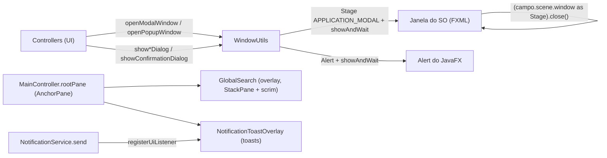
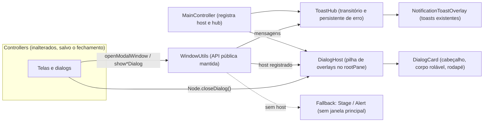
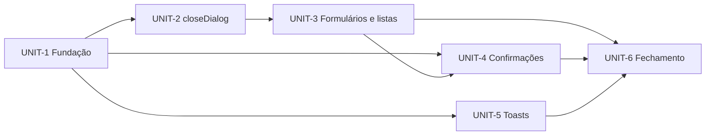

# Design — dialogs-overlay

## 2.1 Codebase analysis

Delta sobre o codekb (defasado; só as áreas tocadas foram relidas no HEAD `e7b2e56e`). [src: src/main/kotlin/org/moinex/common/util/WindowUtils.kt]

### Como os dialogs funcionam hoje

Tudo passa por `WindowUtils` (object). Há dois mecanismos, ambos **janelas do sistema** (`Stage`/`Alert`) com `showAndWait()` **síncrono**: a chamada só retorna quando a janela fecha, e o chamador usa isso (recarrega a tela, lê o `Boolean` da confirmação).



Overlays na janela principal (padrão a seguir): `GlobalSearch` (scrim + painel, `rootPane.children.add`, Z-order por `toFront`) e `NotificationToastOverlay` (pilha no canto inferior direito). O `rootPane` é um `AnchorPane`. [src: ui/common/search/GlobalSearch.kt, ui/main/MainController.kt:227-243]

### Mapa dos dialogs (inventário)

| Tipo | API atual | Chamadas | Arquivos | Observação |
|---|---|---|---|---|
| Janela FXML modal (formulário/lista) | `WindowUtils.openModalWindow` | 87 | 26 | 64 FXML distintos: 13 `create`, 15 `update`, 12 `view`, 4 `dialog`, 11 `creditcard`, 4 `financialplanning`, 2 `goal`, 3 `wishlist`, 1 `ai` (parte em `ui/dialog/**`) |
| Janela FXML não modal ("popup") | `WindowUtils.openPopupWindow` | 14 | 10 | só `CALCULATOR_FXML` (12) e `CALENDAR_FXML` (1); chamam `showAndWait` mesmo assim |
| Erro | `showErrorDialog` | 140 | 73 | `Alert(ERROR)` |
| Informação | `showInformationDialog` | 107 | 46 | quase todos são **avisos de validação**, não sucessos: "nada selecionado" (~60), "sem alterações", campos inválidos/obrigatórios, "já arquivado/comprado" |
| Confirmação | `showConfirmationDialog` | 44 | 24 | retorna `Boolean`; botões Não/Sim |
| Sucesso | `showSuccessDialog` | 5 | 3 | ícone verde 48 px |
| Detalhe | `showDetailDialog` | 1 | 1 | `Alert` com `Node` de conteúdo |
| Fora do `WindowUtils` | `DataExchangeDialogs.newStage` (modal), `DraftEditorDialog` (`Dialog<DraftValues?>`) | 2 | 2 | mesmo comportamento, código próprio |
| Fora do escopo | `FileChooser`/`DirectoryChooser` (nativos, 5), `Popup` de sugestões (`SuggestionsHandlerHelper`), `Popup` do tooltip e do `UIUtils.showTemporaryNotification`, `ContextMenu`, splash/janela principal (`JavaFXApp`), `ScreenshotRunner` | | | não são dialogs do app |

[src: grep em src/main/kotlin; contagens de 2026-11-13]

### Fatos que pesam no desenho

- **Fechamento acoplado ao `Stage`**: 81 arquivos fecham o dialog com `(campo.scene.window as Stage).close()` / `window.hide()`; o ESC está em `WindowUtils` (e duplicado em `DataExchangeDialogs`). Mover para overlay exige uma abstração de "fechar este dialog" no lugar disso. [src: grep]
- **Síncrono**: os chamadores contam com `showAndWait`. Um overlay precisa manter essa semântica (por exemplo `Platform.enterNestedEventLoop`) ou os chamadores viram assíncronos (callback/coroutine); a primeira opção preserva as 87+ chamadas.
- **Tamanho**: cada FXML hoje define seu próprio tamanho de janela; no overlay passam a ser cartões dentro do `rootPane`. Dialogs altos (ex.: transações de investimento, rebalanceamento) precisam de rolagem ou de modo "quase tela cheia".
- **Notificações**: `NotificationService.send` grava a notificação no banco (aparece no centro de notificações) e dispara o toast; `withoutNotifications` as silencia (import). Já existe também `UIUtils.showTemporaryNotification` (toast transitório, `Popup`, sem persistência). [src: service/NotificationService.kt, common/util/UIUtils.kt:136]
- **Testes**: nenhum teste exercita `WindowUtils.show*Dialog`; M-013 vale para qualquer teste que passe por `FxUtils`.
- **Fora do `rootPane`**: `CALCULATOR_FXML` e `CALENDAR_FXML` são janelas independentes pensadas para ficar abertas ao lado da app.

### Linha de base

Baseline de testes não executado nesta etapa (a mudança é de UI, o comando de verificação será proposto em 2.9; a execução da linha de base entra no início da Construction).

### Assumptions & open questions
- A1 (2.1): o inventário por contagem de chamadas é suficiente para o mapa; a lista nominal por tela vem do mockup/Unit em 2.5/2.7 — confirmed: no
## 2.5 Refined mockups

HTML com a paleta real (dark e light): `mockups/refined.html`. [mem: M-007, M-008]

| Tela | Conteúdo | Estado |
|---|---|---|
| 1 | Formulário, opção A (cabeçalho e rodapé com divisor) x opção B (sem divisores) | A recomendada: cabeçalho/rodapé fixos com corpo rolando (FR-13) |
| 2 | Confirmação normal e destrutiva (botão de perigo, foco em Não) | FR-8 |
| 3 | Pilha: lista, edição sobre a lista, confirmação sobre a edição | FR-4 |
| 4 | Dialog alto com rolagem | FR-13 |
| 5 | Toasts: erro (permanente, com ✕), aviso agrupado (×N), sucesso | FR-9, FR-10, FR-11 |

Especificação:
- Scrim `rgba(0,0,0,0.45)` (o mesmo da busca) no primeiro nível, mais leve nos níveis acima; cartão `theme-bg-card`, borda `theme-border`, raio 12, sombra da busca; botões pílula (raio 20, borda 2px).
- Cartão: cabeçalho (título + ✕ nos formulários/listas; só título nas confirmações), corpo com rolagem, rodapé com ordem relativa fixa: Cancelar/Fechar/Não/Voltar à esquerda dos botões de ação Salvar/Sim/Confirmar/Editar/Excluir (FR-17). O alinhamento do grupo no cartão é livre por tipo de dialog: os botões ficam sempre juntos (gap 8 px), nunca separados nas pontas; padrão centralizado. Estilos: primário (roxo preenchido), secundário (contornado), perigo (vermelho) para Excluir/Descartar.
- Larguras: 340 (confirmação), 420 (formulário), 560 (lista); altura máxima = área útil do `rootPane`.
- Teclado: foco inicial no primeiro campo ou em "Não"; Tab preso ao dialog do topo; ESC fecha o topo e devolve `false` à confirmação.
- Toasts: o toast escuro atual, barra colorida por tipo; transitórios ~4 s sem ✕; erro com ✕ e sem tempo; mesmo texto em sequência vira contador ×N.

### Assumptions & open questions
- A7 (2.5): opção A de cabeçalho (com divisores) — confirmed: yes (gate 2.5)
- A8 (2.5): confirmações sem ✕ no cabeçalho — confirmed: yes (gate 2.5)
## 2.6 Domain & components

### Componentes



Fluxo do dialog síncrono (ADR-1):

```mermaid
sequenceDiagram
  participant Ctl as Controller
  participant WU as WindowUtils
  participant DH as DialogHost
  Ctl->>WU: openModalWindow(fxml, title, ...)
  WU->>DH: show(card)
  DH->>DH: scrim + foco + enterNestedEventLoop
  Note over DH: a UI continua viva; o resto da tela fica bloqueado
  Ctl->>DH: closeDialog() ou ESC
  DH->>DH: remove card, devolve foco, exitNestedEventLoop
  DH-->>WU: retorno
  WU-->>Ctl: retorna (chamador recarrega a tela)
```

| Componente | Responsabilidade | Interface | Dono dos dados |
|---|---|---|---|
| `DialogHost` | Pilha de dialogs sobre o `rootPane`: scrim por nível, foco, ESC no topo, Tab preso, laço de eventos aninhado, resultado | `show(card): Unit` (bloqueia até fechar), `close(card)`, `Node.closeDialog()`, `isOpen` | pilha em memória |
| `DialogCard` | Cartão padrão: título, ✕ opcional, corpo (nó do FXML) em `ScrollPane`, rodapé opcional, largura (`SMALL/DEFAULT/WIDE`) | construtor `(title, content, size, closable)` | nenhum |
| `ConfirmationCard` | Cartão de confirmação: ícone, mensagem, secundário/primário, estilo perigo | `ask(header, message, danger): Boolean` | nenhum |
| `ToastHub` | Fila e agrupamento de toasts não persistentes: aviso/sucesso (~4 s) e erro (até fechar); contador ×N | `show(type, title, message, sticky)` | só memória (não grava no banco) |
| `WindowUtils` | Mesma API pública; delega ao host/hub; sem host cai no `Stage`/`Alert` | inalterada, mais `showToast` | nenhum |
| `MainController` | Cria e registra `DialogHost` e `ToastHub` sobre o `rootPane` (Z-order: dialogs abaixo dos toasts) | | |

### Decisões

#### ADR-1 Dialog como overlay síncrono com laço de eventos aninhado  — Status: accepted
- Context: 87 aberturas de FXML e 44 confirmações dependem de a chamada bloquear até fechar e de devolver valor (FR-5, NFR-1).
- Decision: `DialogHost.show` usa `Platform.enterNestedEventLoop(key)` e `exitNestedEventLoop` ao fechar, o mesmo mecanismo do `showAndWait`. O chamador não muda.
- Alternatives: (a) callbacks/coroutines: reescreve 130 chamadores e seus recarregamentos; (b) manter `Stage` e só estilizar: não atende o pedido.
- Consequences: não pode abrir dialog fora da thread de UI; um laço aninhado por nível da pilha, e fechar fora de ordem exige o `exit` do topo primeiro (o host fecha em ordem). Testes do host usam a pilha pura (NFR-4) com a parte de JavaFX atrás de uma interface.
- Related: FR-4, FR-5, NFR-1, NFR-4.

#### ADR-2 Fechar por `Node.closeDialog()` em vez do cast para `Stage`  — Status: accepted
- Context: 81 arquivos fazem `(campo.scene.window as Stage).close()`; fora disso só `stage.close()` e `window.hide()`.
- Decision: extensão `Node.closeDialog()` sobe a árvore até o `DialogCard` e fecha-o; substituição mecânica em todos os controllers. Se o nó não estiver em um dialog, o fallback fecha o `Stage` (compatibilidade com janelas separadas: calculadora, calendário, fallback).
- Alternatives: manter `scene.window` com um `Window` falso (frágil); passar um handle a cada controller (mais mudança).
- Consequences: nenhum controller de dialog importa `Stage`. Ver FR-6.
- Related: FR-6, NFR-6.

#### ADR-3 Mensagens viram toast pelo `ToastHub`, sem passar pelo `NotificationService`  — Status: accepted
- Context: avisos de validação não devem entrar no centro de notificações (Q1); erros precisam ficar até serem fechados (Q2).
- Decision: `show*Dialog` de informação/sucesso/erro delegam ao `ToastHub`, que reusa a pilha de `NotificationToastOverlay` (estende-a com toast sem persistência, `sticky` e contador). Sem hub registrado (inicialização, testes, capturas): cai no `Alert` atual.
- Alternatives: `NotificationService.send` (persiste e polui o histórico); novo overlay duplicado (duas pilhas de toast disputando o canto).
- Consequences: o toast de erro precisa mostrar mensagens longas (quebra de linha, altura máxima com rolagem) e permitir copiar o texto; `withoutNotifications` não afeta o hub.
- Related: FR-9, FR-10, FR-11.

#### ADR-4 Mesma API pública em `WindowUtils`  — Status: accepted
- Context: ~370 chamadas dependem de `WindowUtils`.
- Decision: manter assinaturas e semântica; trocar só a implementação. `showInformationDialog` e `showSuccessDialog` continuam existindo com retorno `Unit` (viram toast). Para chamadas que merecem outro tipo (ex.: aviso x sucesso), `showInformationDialog` usa o tipo aviso e `showSuccessDialog` o tipo sucesso.
- Consequences: a migração das chamadas é só a troca do fechamento (ADR-2); o `openPopupWindow` fica como está (calculadora e calendário).
- Related: FR-5, FR-14, NFR-6.

### Assumptions & open questions
- A9 (2.6): o `Platform.enterNestedEventLoop` com vários níveis aninhados funciona com o foco e a entrada de teclado em JavaFX 27; validar em protótipo no início da Construction (Unit 1) — confirmed: yes (gate 2.6)
- A10 (2.6): `showInformationDialog` vira toast do tipo aviso (âmbar) e `showSuccessDialog` do tipo sucesso (verde) — confirmed: yes (gate 2.6)
## 2.7 Units of work

Ordem pensada para a app compilar e rodar a cada Unit: o `closeDialog()` (UNIT-2) funciona com janela do SO e com overlay, então a troca de `openModalWindow` (UNIT-3) só acontece depois que todo controller já fecha pelo novo caminho. Sem isso, o cast `scene.window as Stage` fecharia a janela principal.

### UNIT-1 Fundação do overlay (esqueleto)
- Purpose: `DialogHost`, `DialogCard`, `Node.closeDialog()` (com fallback para `Stage`), CSS no tema, registro no `MainController`, protótipo do laço aninhado (A9).
- Covers: US-1 (parte), FR-2, FR-3, FR-4, FR-7, FR-13, FR-15, FR-17 (estilos), NFR-2, NFR-4
- Scope in: componentes novos, CSS/tokens, chaves i18n do cartão, testes unitários da pilha. Scope out: nenhuma tela migrada.
- Interfaces: `DialogHost.show/close`, `Node.closeDialog()`, `DialogFooter(start, end, alignment)` e classes de botão primário/secundário/perigo (FR-17).
- Depends on: none
- Definition of Done: verification command passa; pilha de 3 níveis testada (abrir, ESC, fechar fora de ordem); protótipo abre um cartão sobre o `rootPane` na captura de tela, nos dois temas.

### UNIT-2 Fechamento por `closeDialog()`
- Purpose: trocar `(x.scene.window as Stage).close()`, `stage.close()` e `window.hide()` dos controllers de dialog por `closeDialog()`.
- Covers: US-2 (parte), FR-6, NFR-6
- Scope in: ~81 arquivos de `ui/**`, `dataexchange/ui/**`, `common/ui/**`. Scope out: `JavaFXApp`, calculadora/calendário (continuam com `Stage`), `ScreenshotRunner`.
- Depends on: UNIT-1
- Definition of Done: verification command passa; `grep` não acha cast para `Stage` nos controllers de dialog; a app abre e fecha uma amostra de dialogs como antes (ainda janelas do SO).

### UNIT-3 Formulários, listas e detalhe em overlay
- Purpose: `openModalWindow` passa a usar o `DialogHost`; ajustes de FXML (largura, altura, rolagem); `showDetailDialog`, `DataExchangeDialogs` e `DraftEditorDialog` migram; `openPopupWindow` fica.
- Covers: US-1, US-2, US-6, US-7 (parte), FR-1, FR-5, FR-12, FR-14, NFR-1, NFR-3
- Scope in: `WindowUtils`, os 64 FXML (inclui mover os botões de cada rodapé para o padrão: sair à esquerda de ação, estilos primário/secundário/perigo), `DataExchangeDialogs`, `DraftEditorDialog`. Scope out: confirmações e mensagens.
- Depends on: UNIT-2
- Definition of Done: verification command passa; nenhum `Stage` é criado por dialog (exceto calculadora/calendário); checklist de telas nos dois temas feita.

### UNIT-4 Confirmações
- Purpose: `ConfirmationCard`; `showConfirmationDialog` usa o host e devolve `Boolean`; estilo de perigo para exclusões.
- Covers: US-3, FR-8
- Scope in: `WindowUtils.showConfirmationDialog`, chaves i18n; marcação de ação destrutiva nos 44 chamadores (parâmetro opcional). Scope out: toasts.
- Depends on: UNIT-1 (e UNIT-3 para empilhar sobre formulários)
- Definition of Done: verification command passa; confirmação sobre formulário aberto devolve `true`/`false` e mantém o estado do formulário.

### UNIT-5 Toasts: avisos, sucesso e erro
- Purpose: `ToastHub`; `showInformationDialog`, `showSuccessDialog` e `showErrorDialog` viram toast; fallback para `Alert` sem host.
- Covers: US-4, US-5, FR-9, FR-10, FR-11, NFR-5
- Scope in: `NotificationToastOverlay` (toast sem persistência, `sticky`, ×N), `WindowUtils`, CSS. Scope out: `NotificationService` e centro de notificações.
- Depends on: UNIT-1
- Definition of Done: verification command passa; teste do agrupamento ×N e do limite de itens; erro permanece até fechar.

### UNIT-6 Fechamento do intent
- Purpose: capturas (`CapturePlan`), limpeza do código antigo (`Stage` por dialog), atualização do `CLAUDE.md` e do codekb, revisão geral.
- Covers: US-7, FR-16
- Depends on: UNIT-3, UNIT-4, UNIT-5
- Definition of Done: verification command passa; imagens do formulário, confirmação e toasts nos dois temas em `construction/screenshots/` (git ignora).

### Dependency order



Ordem topológica: UNIT-1, UNIT-2, UNIT-3, UNIT-4, UNIT-5, UNIT-6 (UNIT-5 pode ir antes de UNIT-3, não há dependência).

### Story → Unit map

| Story | Unit(s) |
|---|---|
| US-1 | UNIT-1, UNIT-3 |
| US-2 | UNIT-2, UNIT-3 |
| US-3 | UNIT-4 |
| US-4, US-5 | UNIT-5 |
| US-6 | UNIT-3 |
| US-7 | UNIT-3, UNIT-6 |

### FR → Unit (dono único)

| FR | Unit |
|---|---|
| FR-2, FR-3, FR-4, FR-7, FR-13, FR-15 | UNIT-1 |
| FR-17 | UNIT-1 (estilos e `DialogFooter`), UNIT-3 e UNIT-4 (aplicação nos FXML e confirmações) |
| FR-6 | UNIT-2 |
| FR-1, FR-5, FR-12, FR-14 | UNIT-3 |
| FR-8 | UNIT-4 |
| FR-9, FR-10, FR-11 | UNIT-5 |
| FR-16 | UNIT-6 |

NFR-1 e NFR-3 nos DoD de UNIT-3; NFR-2 e NFR-4 em UNIT-1; NFR-5 em UNIT-5; NFR-6 em UNIT-2.

### Assumptions & open questions
- A11 (2.7): seis Units em ordem serial (`unit-major`), sem paralelismo — confirmed: yes (gate 2.7)
## 2.8 Contracts

Contratos internos (Kotlin), sem API externa nem mudança de banco. Nomes finais saem do 3.1.

### API pública que não muda (`WindowUtils`)

| Função | Assinatura | Nova semântica |
|---|---|---|
| `openModalWindow` | `(fxml, title, springContext, controllerSetup, onHiddenActions, resources)` | overlay; retorna ao fechar; `title` vai ao cabeçalho; `onHiddenActions` rodam ao fechar |
| `openPopupWindow` | igual | sem mudança (janela separada) |
| `showConfirmationDialog` | `(header, message, resources?): Boolean` | cartão de confirmação; ESC = `false`; ganha `danger: Boolean = false` opcional |
| `showInformationDialog` | `(header, message, resources?)` | toast de aviso transitório |
| `showSuccessDialog` | `(header, message, resources?)` | toast de sucesso transitório |
| `showErrorDialog` | `(header, message, resources?)` | toast de erro persistente |
| `showDetailDialog` | `(header, content: Node, resources?)` | cartão largo com o nó, botão Fechar |

### Novos tipos

```kotlin
enum class DialogSize { SMALL, DEFAULT, WIDE }                  // 340, 420, 560

class DialogHost(rootPane: AnchorPane) {
    fun show(card: DialogCard)             // bloqueia (laço aninhado) até fechar
    fun close(card: DialogCard)
    val depth: Int
}

fun Node.closeDialog()                     // fecha o DialogCard que contém o nó; sem card, fecha o Stage

class ToastHub(overlay: NotificationToastOverlay) {
    fun show(type: NotificationType, title: String, message: String, sticky: Boolean)
}
```

Regras:
- `DialogHost.show` só roda na thread de UI; chamada de outra thread usa `FxUtils` (já é o padrão dos chamadores).
- `closeDialog()` é idempotente; fechar um card que não é o topo fecha também os de cima, do topo para baixo.
- Resultado da confirmação: `true` só por clique em Sim/Confirmar (ou Enter com o botão primário focado); ESC e fechar = `false`.
- `ToastHub`: mesmo `(type, title, message)` em até 4 s renova o toast existente e incrementa ×N; máximo de 5 toasts visíveis (os transitórios mais antigos saem primeiro, erros não são removidos pelo limite).
- Sem `DialogHost`/`ToastHub` registrados (splash, testes, falha de inicialização): `WindowUtils` usa o `Alert`/`Stage` atuais.

### Estilo (CSS e tokens)

| Classe | Papel |
|---|---|
| `dialog-scrim` | fundo `rgba(0,0,0,0.45)` do primeiro nível; `dialog-scrim-stacked` mais leve para os seguintes |
| `dialog-card`, `dialog-header`, `dialog-title`, `dialog-close`, `dialog-body`, `dialog-footer` | cartão padrão (cores só por tokens `theme-*`) |
| `dialog-size-small / default / wide` | larguras |
| `dialog-footer-start`, `dialog-footer-end` | grupos do rodapé: sair antes (à esquerda), ações depois (à direita); o alinhamento do conjunto é livre |
| `button-primary`, `button-secondary`, `button-danger` | estilos de botão do mockup (pílula, raio 20, borda 2px); perigo para ação destrutiva |
| `dialog-confirm-icon` | ícone da confirmação |
| `toast-count` | contador ×N |

### i18n (chaves novas, só acrescentar nos dois bundles)
`DIALOG_CLOSE` (rótulo do ✕ para leitores de tela e tooltip) e `TOAST_REPEAT_COUNT` (formato do ×N). Os títulos e botões atuais (`DIALOG_BUTTON_YES/NO`, `DIALOG_*_TITLE`) são reaproveitados. Se a edição do `.properties` falhar, pedir ao dono que adicione (CLAUDE.md).

### Modelo de erros
- FXML que falha ao carregar: como hoje, logado em `logger.error` e o dialog não abre; o host não deixa scrim órfão.
- Exceção no `controllerSetup`: o card não é adicionado, o erro é logado e vira toast de erro.

### Assumptions & open questions
- A12 (2.8): o contador ×N e o limite de 5 toasts bastam; refinar no mockup se algo incomodar na validação — confirmed: yes (gate 2.8)

## 3.1 Functional design

### UNIT-1 — Functional design
- `DialogHost.show` bloqueia com `Platform.enterNestedEventLoop`; `present` não bloqueia. Cada dialog ganha um scrim (o de baixo mais escuro) em um `StackPane` ancorado ao `rootPane`; os nós registrados em `keepOnTop` (toasts) voltam ao topo.
- Fechar: `Node.closeDialog()` sobe até o nó que publica `DIALOG_CLOSE_KEY` e roda a ação; fora de um card fecha o `Stage`. `close(card)` remove o card e os de cima, devolve o foco ao controle anterior e libera os laços aninhados um por vez, do mais interno ao mais externo.
- Teclado: ESC fecha só o topo; Tab circula entre os controles focáveis do card do topo.
- Estilo: `.dialog-*` em `dialog.css`; botão primário = `accent` existente; perigo = `.button.danger` (token `theme-on-negative`).
- Limite conhecido: não abrir dialog durante animação ou layout (igual ao `showAndWait` de hoje).
