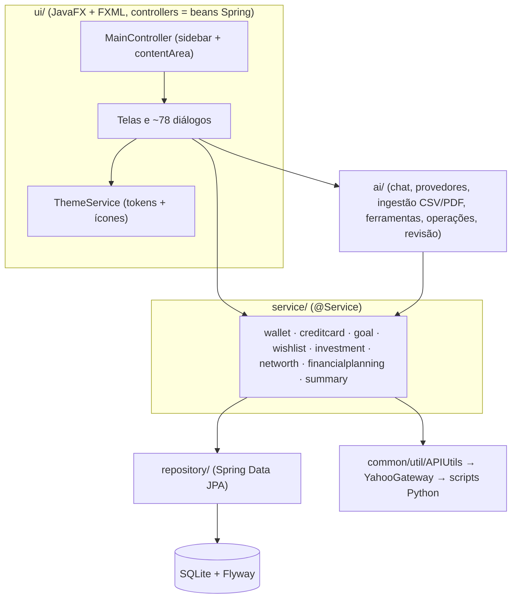

# Architecture — MOINEX

Status: human-reviewed (2026-11-07) · Confidence: medium-high

## Estilo
Monólito em camadas, processo único: JavaFX na frente, Spring (injeção + JPA) por baixo, SQLite local. [src: CLAUDE.md]

## Componentes

Caption: a UI só fala com services; services falam com repositórios e Python. [src: src/main/kotlin/org/moinex/]

## Como o JavaFX encontra o Spring
- `main()` chama `Application.launch(JavaFXApp)`; `init()` sobe o contexto Spring; `start()` mostra uma splash, carrega `main.fxml` em background e depois a janela principal. [src: app/App.kt:12] [src: app/JavaFXApp.kt:44-110]
- Todo `FXMLLoader` usa `setControllerFactory { springContext.getBean(it) }`, então controllers são beans Spring. [src: common/util/WindowUtils.kt:150] [src: ui/main/MainController.kt:281]

## Regras de dependência
- `ui → service → repository`. Só `CalculatorService` e `ThemeService` importam JavaFX dentro de `service/`. [src: grep "javafx" em service/ → 2 arquivos]
- `AppStartupRunner` roda processamentos recorrentes e atualização de mercado em coroutines na inicialização. [src: app/AppStartupRunner.kt:42-120]

## Transversais
- **Tema:** `ThemeService.install()` define o user-agent stylesheet do AtlantaFX (`Dracula` ou `PrimerLight`) e registra um listener em `Window.getWindows()`, então toda janela nova ou já aberta (diálogos e `Alert` inclusos) recebe `tokens.{dark,light}.css` + `base.css` na posição 0 dos stylesheets. Cores de CSS/FXML só vêm de tokens `theme-*`; cores desenhadas em código vêm de `common/ui/ThemeColors.kt`; ícones são `FontIcon` Ikonli de `common/ui/Icons.kt`. [src: service/ThemeService.kt] [src: common/ui/ThemeColors.kt] [src: common/ui/Icons.kt]
- **Diálogos modais:** `WindowUtils.openModalWindow/openPopupWindow` criam `Stage` + `Scene`, aplicam tokens e `common-styles.css`. [src: common/util/WindowUtils.kt:140-230]
- **Alertas nativos** (`Alert`) passam a receber o tema pelo listener de janelas do `ThemeService`. [src: service/ThemeService.kt] [inferred]
- **Ordem de inicialização do banco:** Flyway (bean manual) → `data.sql` → Hibernate valida o schema; no Spring Boot 4 isso é garantido por uma dependência explícita do `entityManagerFactory` no bean `flyway`. [src: config/FlywayConfig.kt]
- **i18n:** `ResourceBundle` via `PreferencesService.bundle`; chaves em `TranslationKeys.kt`. [src: common/constant/TranslationKeys.kt]
- **Assíncrono:** `FxUtils.launchOnBackground/launchBackgroundThenUI`, `AppDispatchers`. [src: common/util/FxUtils.kt] [src: config/AppDispatchers.kt]

## Decisões e motivos
- Python para cotações em vez de cliente Kotlin: motivo desconhecido. [inferred: yfinance só existe em Python]
- Pool HikariCP de 1 conexão: restrição do SQLite. [src: CLAUDE.md]

## Atualização 2026-11-01: infraestrutura de UI (`common/ui/`)
`SegmentedFilter<T>` (filtro em botões), `TableColumns.centerIdHeaders`, `RowContextMenu.install` + `RowAction` (ações no botão direito da linha), `ScreenActionProvider` (cada tela expõe suas ações ao rodapé "+" e à busca global), `DialogForm` (Enter salva) e `FieldValidation` (validação inline). Busca global: `ui/common/search/{GlobalSearch,SearchActionCatalog,SearchMatcher,ScreenActionEntries,SearchModel}`, atalho Ctrl+S em `MainController`. [src: common/ui/] [src: ui/common/search/] [src: ui/main/MainController.kt:357]

## Atualização 2026-11-07 (v2.21.0 → v2.25.0)
- **Acesso ao Yahoo:** toda chamada passa por `YahooGateway` (máx. 2 simultâneas; após `rate_limit`, cooldown de 5 min dobrando até 60 min, zerado pela primeira chamada sem rate limit; chamada recusada lança `MoinexException.YahooCooldownException`). Atualização manual de uma coisa só roda em `APIUtils.withoutYahooCooldown { }`; só a atualização automática de abertura e o botão "atualizar todos os preços" respeitam o cooldown. Preço, momento e site de um ticker são gravados só por `TickerMarketDataService`. [src: CLAUDE.md "Python Script Integration"] [src: common/util/YahooGateway.kt] [src: areas/market-data.md]
- **Assistente de IA:** o modelo não grava nada. `ProposeChangesTool` devolve um `ChangeSet` de `AppOperation`s (registro em `OperationRegistry`, um pacote por domínio), mostrado ao usuário em um painel de revisão (`ReviewSession`); aplicar passa pelos services e é registrado por `ChangeSetAuditLogger`; ferramentas de leitura (`ReadTools`, `FindMatchingTransactionsTool`) ampliam o contexto. As ferramentas antigas `ProposeTransactionTool`/`ProposeInvestmentOperationTool` foram removidas. Conversas e propostas são persistidas (`AiChatHistoryService`, V038). [src: ai/operation/] [src: ai/tools/] [src: areas/ai-agent.md] [src: areas/ai-chat-history.md]
- **Aviso de release:** `ReleaseUpdateScheduler` consulta o GitHub (`GitHubReleaseClient`) e cria uma `Notification` com `action_url` (V036). [src: service/release/]
- **Distribuição:** além do Windows, pacotes Linux com JRE e Python embutidos; `EmbeddedPython` localiza o interpretador empacotado. [src: common/util/EmbeddedPython.kt]
