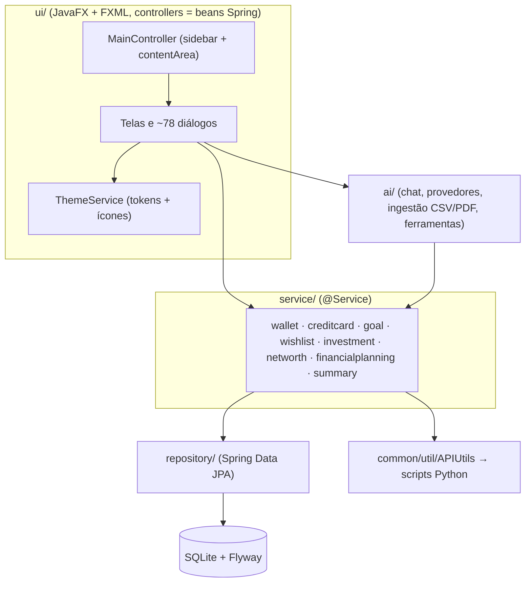

# Architecture — MOINEX

Status: human-reviewed (2026-10-29) · Confidence: medium-high

## Estilo
Monólito em camadas, processo único: JavaFX na frente, Spring (injeção + JPA) por baixo, SQLite local. [src: CLAUDE.md]

## Componentes

Caption: a UI só fala com services; services falam com repositórios e Python. [src: src/main/kotlin/org/moinex/]

## Como o JavaFX encontra o Spring
- `main()` chama `Application.launch(JavaFXApp)`; `init()` sobe o contexto Spring; `start()` mostra uma splash, carrega `main.fxml` em background e depois a janela principal. [src: app/App.kt:12] [src: app/JavaFXApp.kt:44-110]
- Todo `FXMLLoader` usa `setControllerFactory { springContext.getBean(it) }`, então controllers são beans Spring. [src: common/util/WindowUtils.kt:150] [src: ui/main/MainController.kt:281]

## Regras de dependência
- `ui → service → repository`. Só `CalculatorService` e `ThemeService` importam JavaFX dentro de `service/`. [src: grep "javafx" em service/ → 2 arquivos]
- `AppStartupRunner` roda processamentos recorrentes e atualização de mercado em coroutines na inicialização. [src: app/AppStartupRunner.kt:42-120]

## Transversais
- **Tema:** `ThemeService` troca uma folha de tokens (`tokens.light.css`/`tokens.dark.css`) no `rootPane` e em cada Scene/janela aberta, e aplica `ColorAdjust` nos `ImageView` para ícones no escuro. [src: service/ThemeService.kt:20-80] [src: common/extension/JavaFxUtils.kt:8-10]
- **Diálogos modais:** `WindowUtils.openModalWindow/openPopupWindow` criam `Stage` + `Scene`, aplicam tokens e `common-styles.css`. [src: common/util/WindowUtils.kt:140-230]
- **Alertas nativos** (`Alert`) em `WindowUtils.show*Dialog` não passam por `ThemeService`: ficam com o estilo padrão do JavaFX. [src: common/util/WindowUtils.kt:60-130]
- **i18n:** `ResourceBundle` via `PreferencesService.bundle`; chaves em `TranslationKeys.kt`. [src: common/constant/TranslationKeys.kt]
- **Assíncrono:** `FxUtils.launchOnBackground/launchBackgroundThenUI`, `AppDispatchers`. [src: common/util/FxUtils.kt] [src: config/AppDispatchers.kt]

## Decisões e motivos
- Python para cotações em vez de cliente Kotlin: motivo desconhecido. [inferred: yfinance só existe em Python]
- Pool HikariCP de 1 conexão: restrição do SQLite. [src: CLAUDE.md]
