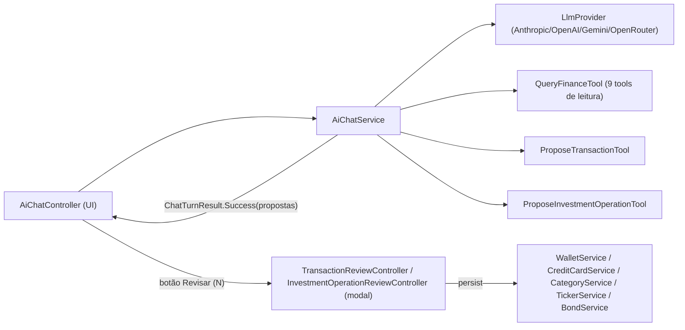

# Área: agente de IA (chat, tools, revisão)

Status: human-reviewed (2026-11-04)   Confiança: alta (código lido), média (comportamento do LLM)   Commit analisado: edee9038

## Visão geral
O chat de IA responde perguntas sobre as finanças do usuário e propõe lançamentos e operações de investimento. Nada é gravado sem o usuário revisar e confirmar. [src: config/AiPromptProperties.kt] [src: application.yml:40-81] [user]

O diagrama mostra que o loop de tools fica no serviço, e que a gravação acontece no controller de revisão (camada de UI).

## Componentes
| Componente | Responsabilidade | Evidência |
|---|---|---|
| `AiChatController` (710 linhas) | Histórico, anexos, indicador "pensando", botões "Revisar (N)" por turno; abre a revisão em janela modal | [src: ui/main/AiChatController.kt] |
| `AiChatService` | Monta o prompt (texto do `application.yml` por locale + data + contexto de carteiras/categorias/cartões/ativos), roda o loop de tools (`MAX_TOOL_ITERATIONS = 5`), coleta propostas | [src: ai/chat/AiChatService.kt:34-119] |
| `LlmProvider` + 4 implementações | `chat(messages, tools)` e `testConnection`; HTTP via `java.net.http`, sem streaming | [src: ai/provider/LlmProvider.kt] |
| `LlmTool` | Interface: `name`, `description`, `jsonSchema`, `execute(argumentsJson): String` | [src: ai/tools/LlmTool.kt] |
| `QueryFinanceTool` | 9 tools de leitura: patrimônio, gastos por categoria, lançamentos no período, status de pagamento de fatura, receita x despesa, comparar períodos, metas, orçado x realizado, carteira de investimentos | [src: ai/tools/QueryFinanceTool.kt:37-47] |
| `ProposeTransactionTool` | `propose_transactions`: kinds `wallet`, `credit_card`, `credit_card_payment`; parcelas; `existingTransactionId` (só pendentes de carteira); sugestão de carteira, cartão e categoria; confiança | [src: ai/tools/ProposeTransactionTool.kt] |
| `ProposeInvestmentOperationTool` | `propose_investment_operations`: compra/venda de ações, dividendo, aplicação/resgate de CDB | [src: model/dto/ai/ExtractedInvestmentOperationDTO.kt:12-17] |
| Revisão de lançamentos | Diálogo modal com `TableView` editável (abas carteira e cartão); realça duplicata (janela de 3 dias) e baixa confiança (< 0,6); `persist` cria/atualiza lançamento, cria dívida de cartão, paga fatura, cria categoria nova pelo nome | [src: ui/dialog/ai/TransactionReviewController.kt] |
| Ingestão | CSV e PDF (com senha) viram texto anexado à mensagem | [src: ai/ingest/*] |

## Fatos relevantes para a evolução
1. **A lógica de gravação está na UI**: `persist` dentro do controller de revisão. Qualquer framework de operações precisa extrair isso para uma camada de serviço. [src: TransactionReviewController.kt:503-583]
2. **Correlação depende do LLM**: o prompt manda checar pendentes com `get_transactions_in_period` e preencher `existingTransactionId`; não há matching em código. `possibleDuplicate` é calculado só na tela de revisão (janela de 3 dias) e é apenas um realce. [src: application.yml:59-65] [src: TransactionReviewController.kt:104-105]
3. **Contexto pequeno do prompt**: o contexto injetado traz listas (carteiras, categorias, cartões, ativos), não transações. [src: AiChatService.kt:128-135]
4. **Uma tool de proposta por família**; cada uma com seu DTO, seu controller de revisão e seu botão no chat; o histórico guarda as propostas pendentes por índice. [src: AiChatController.kt:340-440]
5. **Testes existentes**: `AiChatServiceTest`, codecs dos 4 provedores, `LlmProviderFactoryTest`, `LlmHttpClientTest`, `AiCredentialStoreTest`, renderizadores. Não há testes de prompt/correlação. [src: src/test/kotlin/org/moinex/ai/]
6. **Diálogos do app gravam ao salvar** e avisam por callback (`setOnTransactionCreatedCallback`); não têm pré-preenchimento genérico. [src: ui/dialog/wallettransaction/create/AddExpenseController.kt:47-84]

## Do usuário
- Provedor/modelo no dia a dia: **OpenRouter, variando o modelo** [user] → testes e prompts devem ser agnósticos ao modelo; formatos de tool-calling via OpenRouter seguem o estilo OpenAI.
- Caso de duplicata mais frequente: **extrato vs lançamento manual já confirmado**, só com nome diferente [user] → hoje não coberto pelo casamento (só pendentes).

### Open questions
- Qual o limite de contexto/modelos usados via OpenRouter? (afeta C5 e o tamanho do catálogo de tools)
