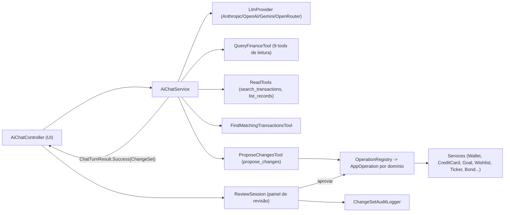

# Área: agente de IA (chat, tools, revisão)

Status: human-reviewed (2026-11-07) (reescrita, HEAD aefe5133)   Confiança: alta (código lido), média (comportamento do LLM)

## Visão geral
O chat de IA responde perguntas sobre as finanças do usuário e propõe operações (lançamentos, transferências, cartões, metas, wishlist, investimentos, renda fixa). Nada é gravado sem o usuário revisar e confirmar. [src: config/AiPromptProperties.kt] [user]

O loop de tools fica em `AiChatService`; as operações aprovadas passam pelos services, e a decisão sobre cada proposta é gravada pelo histórico. Ver `areas/ai-chat-history.md`.

## Componentes
| Componente | Responsabilidade | Evidência |
|---|---|---|
| `AiChatController` | Histórico, anexos, indicador "pensando", painel de revisão por turno | [src: ui/main/AiChatController.kt] |
| `AiChatService` | Monta o prompt (`PromptComposer`, textos por locale em `resources/ai/prompts`), roda o loop de tools e devolve `ChatTurnResult.Success` com `turnMessages` e o `ChangeSet` | [src: ai/chat/AiChatService.kt] [src: ai/prompt/PromptComposer.kt] |
| `LlmProvider` + 4 implementações | `chat(messages, tools)` e `testConnection`; HTTP via `java.net.http` (`LlmHttpClient`), sem streaming | [src: ai/provider/] |
| `LlmTool` | Interface: `name`, `description`, `jsonSchema`, `execute(argumentsJson)` | [src: ai/tools/LlmTool.kt] |
| `QueryFinanceTool` | 9 tools de leitura: patrimônio, gastos por categoria, lançamentos no período, status de pagamento de fatura, receita x despesa, comparar períodos, metas, orçado x realizado, carteira | [src: ai/tools/QueryFinanceTool.kt] |
| `ReadTools` | `search_transactions` e `list_records` (paginação, página padrão 20, máx. 50) | [src: ai/tools/ReadTools.kt:39-42] |
| `FindMatchingTransactionsTool` + `service/matching` | Casamento determinístico de lançamentos do extrato com os existentes (similaridade de descrição), em código e não mais só pelo LLM | [src: ai/tools/FindMatchingTransactionsTool.kt] [src: service/matching/] |
| `ProposeChangesTool` | `propose_changes`: lista de itens `{operation, ...}`; schema plano; erro de item sem campos devolve um exemplo | [src: ai/tools/ProposeChangesTool.kt] |
| `ai/operation/**` | `AppOperation`/`BaseOperation`, `OperationRegistry`, `ChangeSet`, `DraftSpec`, `EntityCatalog`, `CategoryResolver`; operações em `transactions/`, `creditcard/`, `investments/` (ticker, investimento, gestão de renda fixa), `planning/` (metas, wishlist) | [src: ai/operation/] |
| `ReviewSession` | Estado do painel de revisão: itens, decisões, `onItemChanged`, itens `readOnly` | [src: ai/review/ReviewSession.kt] |
| `ChangeSetAuditLogger` | Registro de auditoria dos conjuntos aplicados | [src: ai/audit/ChangeSetAuditLogger.kt] |
| Ingestão | CSV e PDF (com senha) viram texto anexado à mensagem | [src: ai/ingest/] |

## Fatos relevantes
1. As ferramentas `propose_transactions` e `propose_investment_operations`, seus DTOs (`ExtractedTransactionDTO`, `ExtractedInvestmentOperationDTO`) e os controllers de revisão específicos foram removidos; a gravação saiu da UI e passou para as operações. [src: git log eb5482a1, 46ae205e]
2. Testes: `AiChatServiceTest`, codecs dos provedores, `LlmProviderFactoryTest`, `LlmHttpClientTest`, `AiCredentialStoreTest`, renderizadores, testes das operações e das read tools, `AiArchitectureTest` (proíbe `*Service.create/save` em `ai/chat`). Sem testes de qualidade de prompt. [src: src/test/kotlin/org/moinex/ai/]

## Do usuário
- Provedor/modelo no dia a dia: **OpenRouter, variando o modelo** [user] → testes e prompts devem ser agnósticos ao modelo; formatos de tool-calling via OpenRouter seguem o estilo OpenAI.
- Caso de duplicata mais frequente: **extrato vs lançamento manual já confirmado**, só com nome diferente [user] → hoje não coberto pelo casamento (só pendentes).

## Atualização 2026-11-07
- O histórico agora guarda as mensagens de ferramenta e as propostas (ver `areas/ai-chat-history.md`); `AiChatService.sendMessage` devolve `turnMessages` em `ChatTurnResult.Success`. [src: ai/chat/AiChatService.kt]
- `propose_changes`: o schema do item é plano (só `operation` obrigatório, sem `anyOf`); cada operação tem um exemplo completo na descrição e o erro de item sem campos devolve o exemplo (`ProposeChangesTool.exampleOf`). [src: ai/tools/ProposeChangesTool.kt]
- O `core.md` do prompt (pt-br e en) tem uma regra para pedidos de exemplo ou mock: inventar valores plausíveis, preencher todos os campos e marcar a descrição com "(mock)". Sem ela, o `deepseek-v4.1-flash` mandava os itens só com o nome da operação. [src: resources/ai/prompts/*/core.md] [user]
- Observação de diagnóstico: o mesmo modelo no OpenRouter funcionou ou falhou conforme a hospedagem (DeepInfra e DigitalOcean entregaram propostas completas; Wafer e OpenInference, na maioria, só `operation`). Amostra pequena; ainda hipótese. [inferred] [src: moinex.log]
- A proposta de despesa e de receita na carteira mostra o tipo no resumo ("Despesa: …", "Receita: …"). [src: ai/operation/transactions/CreateWalletTransactionOperation.kt]

### Open questions
- Qual o limite de contexto/modelos usados via OpenRouter? (afeta C5 e o tamanho do catálogo de tools)
