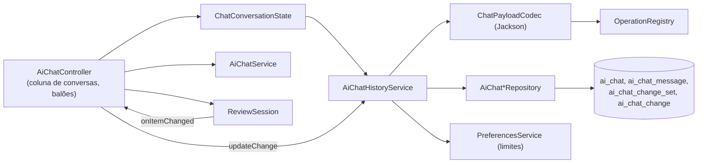

# Área: histórico de conversas com o assistente

Status: draft (2026-11-07)   Confiança: alta (código lido e testado), média (comportamento do modelo)   Commit analisado: b6296cd4 + intent 261106-ai-chat-history (ainda não commitado quando escrito)

## Visão geral
As conversas com o assistente de IA são gravadas no SQLite local, podem ser reabertas, buscadas, renomeadas e apagadas, e as propostas da IA (com o estado de cada uma) voltam ao painel de revisão como se a conversa nunca tivesse sido fechada. [src: service/ai/] [user]

`AiChatService` não acessa o banco; quem grava é o estado da conversa, chamado pelo controller.

## Componentes
| Componente | Responsabilidade | Evidência |
|---|---|---|
| `AiChatHistoryService` | Criar, listar, abrir, renomear, apagar, buscar; gravar mensagens; salvar e atualizar propostas; aplicar a retenção. Falhas viram `MoinexException.AiChatHistoryException` com texto traduzido. | [src: service/ai/AiChatHistoryService.kt] |
| `ChatConversationState` | Conversa na tela, sem JavaFX. Só grava a conversa no primeiro envio; grava cada turno; se o banco falha a tela segue e o próximo turno grava o que faltou; aplica a retenção ao criar uma conversa. Mora em `service/ai` porque o `AiArchitectureTest` proíbe `*Service.create/save` em `ai/chat`. | [src: service/ai/ChatConversationState.kt] [src: test/.../AiArchitectureTest.kt] |
| `ChatPayloadCodec` | Payload das operações, correspondências, linhas ignoradas e chamadas de ferramenta para JSON e de volta; descobre a classe do payload pelo tipo genérico da operação; devolve `RawPayload` (somente leitura) quando a operação sumiu ou o JSON não serve mais. | [src: ai/history/ChatPayloadCodec.kt] |
| `ChatTurnResult.Success.turnMessages` | As mensagens que o turno acrescentou (pedido de ferramenta, resultado, resposta final), para o histórico guardar e reenviar ao modelo. | [src: ai/chat/ChatModels.kt] |
| `ChatMessage.isShownInChat` | Regra do que a janela mostra: mensagens do usuário e respostas do assistente sem chamada de ferramenta. O texto que o modelo escreve ao pedir ferramentas e os resultados não aparecem, mas continuam gravados e vão ao modelo. | [src: ai/chat/ChatModels.kt] |
| `ReviewSession.load` e `onItemChanged` | Repõe as propostas guardadas com o estado de cada uma e avisa a cada decisão para o controller gravar. `ReviewItem.readOnly` só para payload que não dá mais para reconstruir. | [src: ai/review/ReviewSession.kt] |
| Coluna de conversas | Lista com título, data e propostas pendentes; busca com espera de 300 ms; recolher e expandir (lembrado); renomear, apagar, apagar todas. | [src: ui/main/AiChatController.kt] [src: ui/main/ai_chat.fxml] |
| Retenção | `ai.history.maxChats` e `ai.history.maxDays` em Configurações > Assistente de IA; aplicada ao iniciar o app (`AppStartupRunner`) e depois de criar uma conversa. | [src: ui/main/SettingsController.kt] [src: app/AppStartupRunner.kt] |

## Fatos que não saem do código
1. **Restaurar mensagens TOOL aumenta o contexto** enviado ao modelo em conversas longas; o `AiChatService` corta resultados antigos em 2000 caracteres. [src: ai/chat/AiChatService.kt]
2. **Reaberta = ao vivo**: a rejeitada mantém "Desfazer rejeição" e a aprovada só mostra o resultado; foi decisão do dono no checkpoint da UNIT-4 e substituiu a ideia anterior de "rejeitada só consulta". [user]
3. **A conversa só existe no banco depois da primeira mensagem**; "Nova conversa" não deixa linhas vazias. [src: service/ai/ChatConversationState.kt]
4. **Gravar a decisão de uma proposta roda na thread FX**, como já fazia a aprovação (que grava no banco ali). [src: ui/main/AiChatController.kt]

## Gotchas
- O JDBC não liga `foreign_keys`: a exclusão apaga filhos antes dos pais, em transação. [src: service/ai/AiChatHistoryService.kt]
- A coluna `response_time_millis` é `BIGINT`; com `INTEGER` o Hibernate em `validate` recusa o schema. [src: db/migration/V038__create_ai_chat_history.sql]
- Um teste varre o classpath e faz ida e volta de um payload de amostra de **toda** operação do registro; uma operação nova sem suporte no codec quebra o CI. [src: test/.../ChatPayloadCodecTest.kt]
- Células vazias de `ListView` recebem o estilo de `:hover` se o CSS não usar `:filled`. [src: css/scene/ai_chat.css]

## Testes
`AiChatHistoryServiceTest`, `AiChatHistoryMigrationTest` (SQL real no SQLite, desempenho de busca e abertura), `ChatPayloadCodecTest`, `ChatConversationStateTest`, `ReviewSessionStoredTest`, `ChatMessageVisibilityTest`, `PreferencesServiceLimitTest`. [src: src/test/kotlin/]

### Open questions
- Truncamento do contexto restaurado para janelas de modelo pequenas (fora do escopo; premissa A3 do intent).
- Gravação das decisões em segundo plano, se um dia a aprovação deixar de gravar na thread FX.
