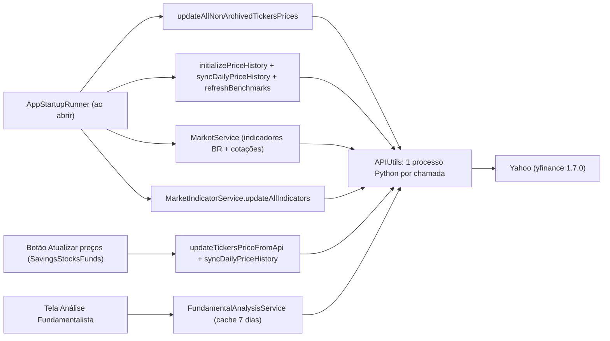

# Área: market-data (yfinance)

Status: human-reviewed (2026-11-06) · Confidence: alta no código, média nas estimativas de volume · Commit analisado: cb27418a (2026-11-06)

## Fluxo de chamadas ao Yahoo

Caption: tudo que toca o Yahoo passa por `APIUtils`, que cria um subprocesso Python por chamada. [src: APIUtils.kt:107-154] [src: AppStartupRunner.kt:76-139]

## Fatos

| # | Fato | Evidência |
|---|---|---|
| F1 | Na abertura do app, preços (passo "Updating ticker prices") e histórico diário (passo "Initializing price history") rodam em paralelo, além de indicadores e cotações de mercado | [src: AppStartupRunner.kt:76-139] |
| F2 | O botão de atualizar preços repete `updateTickersPriceFromApi` e depois `syncDailyPriceHistory` para todos os tickers da tabela, sem checar quando foi a última atualização | [src: SavingsStocksFundsController.kt:343-350] |
| F3 | `get_stock_price.py`: `yf.download` em lotes de 8 com 2 s entre lotes; depois `ticker.info` por símbolo (5 workers; 1 no Windows) só para moeda e site | [src: get_stock_price.py:fetch_prices_batch, fetch_symbol_info] |
| F4 | Se `ticker.info` falha, a moeda assumida é `"USD"` e o preço é convertido por essa moeda; ativo em BRL com falha no info vira preço multiplicado pela cotação do dólar | [src: get_stock_price.py:fetch_symbol_info] [inferred: consequência] |
| F5 | `yf.download` com DataFrame vazio é tratado como rate limit (e re-tentado), mesmo que o símbolo seja inválido | [src: get_stock_price.py:_download_chunk] |
| F6 | `get_stock_price_history.py` processa 1 ticker por processo; cada um faz até 4 `history` em cascata (datas exatas, 15d, 365d, max), mais `ticker.info` e uma chamada de câmbio | [src: get_stock_price_history.py:154-215] |
| F7 | `syncDailyPriceHistory` roda ticker a ticker, sem pausa entre processos | [src: TickerPriceHistoryService.kt:89-96] |
| F8 | Cada script tem a própria cópia de `retry_call` (3 tentativas, backoff 1–2 s); não há cooldown, cache de moeda/site nem circuit breaker compartilhado entre processos | [src: scripts/*.py] |
| F9 | `FundamentalAnalysisService` guarda o JSON inteiro do script em `dataJson` e o reutiliza por 7 dias; a tela lê `current_price` e `price_performance` desse JSON | [src: FundamentalAnalysisService.kt:37,63-66] [src: FundamentalAnalysisController.kt:172,310,408] |
| F10 | Demais telas (Carteira, Visão geral, Detalhe do ticker, analytics) leem `Ticker.currentUnitValue`, atualizado pelo botão/abertura | [src: SavingsOverviewController.kt:490; TickerDetailController.kt:159; PortfolioAnalyticsService.kt:99] |
| F11 | A variação do dia usa `currentUnitValue` contra pontos do histórico diário (`ticker_price_history`): um terceiro conjunto de preços | [src: PortfolioAnalyticsService.kt:99] |
| F12 | Falha ao atualizar preço mantém o valor antigo (não sobrescreve); `rebuildPriceHistory` restaura as linhas anteriores em falha. Boas práticas já existentes | [src: TickerService.kt:update; TickerPriceHistoryService.kt:98-120] |
| F13 | Estimativa para 30 tickers na abertura: ~4 downloads + 30 `info` (preço) + ≥30 processos de histórico (cada um com history+info+câmbio) + indicadores, cotações e Ibovespa, em paralelo: ordem de 100–150 requisições ao Yahoo | [inferred] |

## Decisões do dono [user]
- D1: a Análise Fundamentalista mostra sempre `Ticker.currentUnitValue` como preço atual (uma só fonte de verdade).
- D2: o refresh na abertura do app só busca dados velhos (TTL); o botão manual continua forçando.

## Atualização 2026-11-06 (intent yfinance-resilience, construído)
- Toda chamada ao Yahoo passa por `YahooGateway` (2 simultâneas; cooldown 5 min dobrando até 60 após `error_kind=rate_limit`; log `[yahoo]` por chamada). [src: common/util/YahooGateway.kt]
- Scripts compartilham `yf_resilience.py` (copiado junto do script em diretório temporário privado); `yf.download` 1.7.0 não levanta erro, então o rate limit é lido do logger `yfinance`. [src: resources/scripts/yf_resilience.py] [src: common/util/APIUtils.kt:prepareScriptDirectory]
- Preço: `SIMBOLO[:MOEDA]`; sem `info` quando a moeda é conhecida; sem moeda ou câmbio o símbolo falha (nunca USD). Histórico: `--batch`, um download por 8 símbolos, sem `period=max`. [src: get_stock_price.py] [src: get_stock_price_history.py]
- `ticker.metadata` (JSON) guarda só o que não tem coluna (moeda, `history_updated_at`, chaves futuras em `other`); preço, momento e site ficam em `current_unit_value`, `last_update` e `domain`. Tudo escrito só por `TickerMarketDataService`. [src: TickerMarketDataService.kt] [src: TickerMetadata.kt]
- TTL de 60 min (`MarketDataFreshness`) no startup para preços, histórico, cotações e indicadores BR; o botão Atualizar preços ignora o TTL. [src: MarketDataFreshness.kt] [src: AppStartupRunner.kt]
- A Análise Fundamentalista substitui em memória o preço do `dataJson` pelo `Ticker.currentUnitValue` (`FundamentalPriceOverlay`). [src: FundamentalPriceOverlay.kt]
- Medido em teste: 30 tickers velhos = 10 requisições; frescos = 0. [src: YahooRequestVolumeTest.kt]

