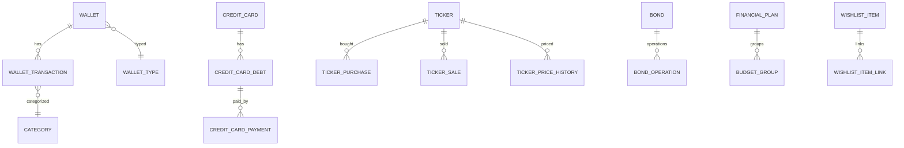

# Data model — MOINEX

Status: human-reviewed (2026-11-02, HEAD 95b19ba7) · Confidence: medium

## Armazenamento
- SQLite em `~/.moinex/data/moinex.db` (diretório configurável nas preferências, com fallback para o padrão). [src: app/SpringApp.kt:28-48] [src: CLAUDE.md]
- Pool HikariCP com 1 conexão; Hibernate 7.4 com `ddl-auto: validate` e `SQLiteDialect` do `hibernate-community-dialects`; schema só por Flyway (35 migrations, V001..V035). [src: CLAUDE.md] [src: src/main/resources/db/migration/]
- Preferências do usuário (ex.: tema, pasta do banco) em `java.util.prefs` e `PreferencesService`, fora do banco. [src: app/SpringApp.kt:31-33] [src: service/PreferencesService.kt]

## Entidades (36), por domínio
| Domínio | Entidades |
|---|---|
| Carteiras e transações | Wallet, WalletType, WalletTransaction, Transfer, RecurringTransaction, Category |
| Cartões | CreditCard, CreditCardOperator, CreditCardDebt, CreditCardPayment, CreditCardCredit, RecurringCreditCardDebt |
| Planejamento | FinancialPlan, BudgetGroup, FIRECalculatorSettings, Goal |
| Investimentos | Ticker, TickerPurchase, TickerSale, TickerPriceHistory, Dividend, Bond, BondOperation, BondInterestCalculation, FundamentalAnalysis, InvestmentTarget, InvestmentPerformanceSnapshot, CryptoExchange |
| Mercado | BrazilianMarketIndicators, MarketQuotesAndCommodities, MarketIndicatorHistory |
| Outros | NetWorthSnapshot, Notification, CalendarEvent, WishlistItem, WishlistItemLink |

[src: grep "@Entity" em model/]

## Relações (visão aproximada)

Caption: relações inferidas pelos nomes das entidades; há 35 anotações de relação JPA no total. [inferred] [src: grep em model/]

## Migrations
Sufixo `V0xx__descricao.sql`; `data.sql` semeia dados iniciais (inserção só se a tabela estiver vazia). Ordem de inicialização: o bean manual `flyway` migra e depois executa `data.sql`; o `entityManagerFactory` depende do bean `flyway`, e `spring.sql.init.mode` é `never` de propósito. [src: src/main/resources/data.sql] [src: config/FlywayConfig.kt] [src: src/main/resources/application.yml]

## PII
Dados financeiros pessoais, locais. Credenciais de IA ficam em `AiCredentialStore`; valores não são copiados aqui. [src: ai/credentials/AiCredentialStore.kt]

## Atualização 2026-11-01: investimentos
- `Asset` (@MappedSuperclass: name, symbol único, type, currentQuantity, currentUnitValue, averageUnitValue); `Ticker` acrescenta lastUpdate, isArchived, domain (site/logo). [src: model/investment/Asset.kt] [src: model/investment/Ticker.kt]
- `TickerPriceHistory(ticker, priceDate, closingPrice, isMonthEnd)`; `InvestmentPerformanceSnapshot(referenceMonth, investedValue, portfolioValue, accumulatedCapitalGains, monthlyCapitalGains)`. [src: model/investment/]
- `FundamentalAnalysis` (tabela `fundamental_analysis`, único por ticker+período, `data_json` TEXT). [src: model/investment/FundamentalAnalysis.kt]
- DTOs: `InvestmentPerformanceDTO`, `TickerPerformanceDTO`, `ProfitabilityMetricsDTO`, `AllocationDTO`. [src: model/dto/]
- `Dividend` é gerido por `TickerService`; não existe `DividendService`. [src: service/investment/TickerService.kt:333]

## Atualização 2026-11-01 (intent fundamentals-and-portfolio-views, commitado em f426f361)
- `V035__create_benchmark_price_history.sql` cria `benchmark_price_history` (entidade `BenchmarkPrice`, repositório `BenchmarkPriceRepository`): fechamento diário do Ibovespa (`^BVSP`) para a comparação de desempenho. [src: db/migration/V035__create_benchmark_price_history.sql] [src: model/investment/BenchmarkPrice.kt]
- `TickerPriceHistory` agora também guarda série diária de 12 meses (`TickerPriceHistoryService.syncDaily`), além do fim de mês. [src: service/investment/TickerPriceHistoryService.kt]
- `FundamentalAnalysis.data_json` passa ao schema v2 com `reason` por métrica (por que é N/A); lido por `FundamentalParser` em `FundamentalSnapshot`. [src: service/investment/FundamentalParser.kt] [src: model/dto/FundamentalSnapshot.kt]
- DTOs novos: `BenchmarkSeriesDTO`/`DividendPanelDTO`/`ContributionDTO`, `TickerRowDTO`/`TickerDetailDTO` (com `TickerPositionDTO` e `TickerIncomeDTO`), `RebalanceDTO`, `FundamentalScoring` (veredito e nota de qualidade). [src: model/dto/]
