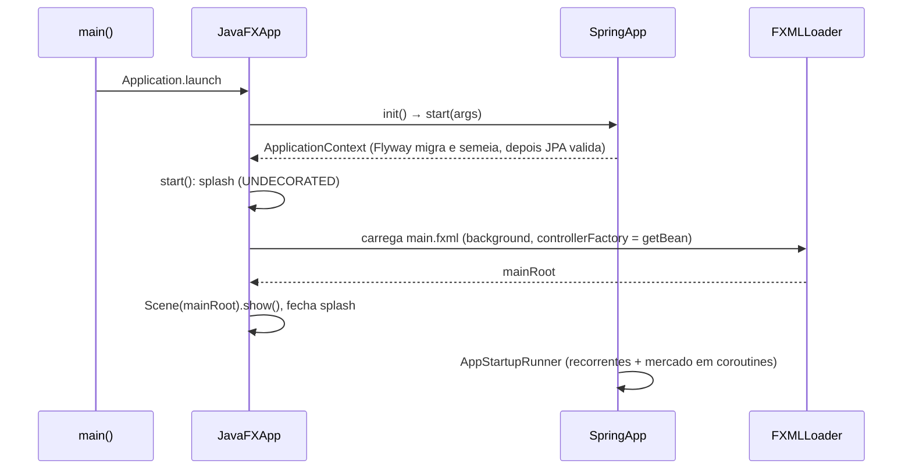
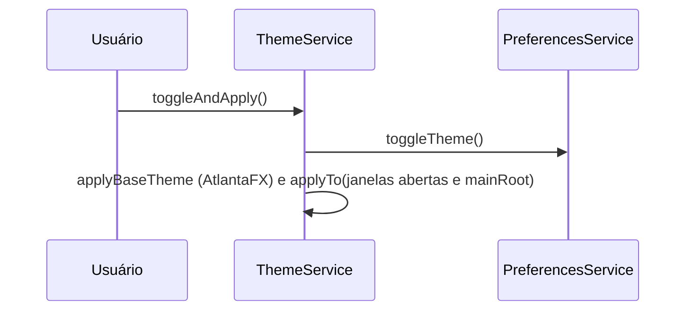
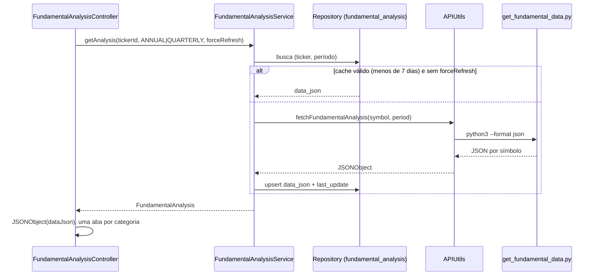

# Interactions — MOINEX

Status: human-reviewed (2026-11-01, delta pós v2.20.2) · Confidence: medium-high

## 1. Inicialização

[src: app/JavaFXApp.kt:44-110] [src: app/AppStartupRunner.kt:42-120]

## 2. Navegação entre telas
`MainController.loadContent(fxml, ...)` carrega o FXML na `contentArea`, adiciona folhas de estilo da tela e chama `themeService.applyTo(newContent)`. [src: ui/main/MainController.kt:271-295]

## 3. Troca de tema

Um listener em `Window.getWindows()` aplica o tema a janelas novas e já abertas. [src: service/ThemeService.kt]

## 4. Diálogo modal
`WindowUtils.openModalWindow(fxml, title, ctx, controllerSetup)` → `Stage` APPLICATION_MODAL → `Scene` com tokens + `common-styles.css` → `showAndWait()`. [src: common/util/WindowUtils.kt:140-185]

## 5. Cotações
`TickerService.updateAllNonArchivedTickersPrices` → `APIUtils` → script Python → JSON → persiste preço e histórico. [src: service/investment/TickerService.kt] [inferred]

## 6. Chat de IA
`AiChatService` → `LlmProvider` → resposta markdown (commonmark) renderizada em `WebView` com CSS dependente do tema. [src: ai/chat/MarkdownRenderer.kt] [src: ui/main/AiChatController.kt:549-620]

## 7. Análise fundamentalista (atualizado 2026-11-01)

Só aceita ticker não arquivado do tipo STOCK ou REIT; "error" lança `APIFetchException`; "Financial data not available" salva o `price_performance` parcial. Cache expira em 7 dias e a UI avisa a partir de 24h. Métrica ausente na chave some; valor nulo mostra `Constants.NA_DATA`. [src: service/investment/FundamentalAnalysisService.kt:44-131] [src: ui/common/FundamentalMetricPaneController.kt:108]

## 8. Busca global
Ctrl+S abre `GlobalSearch`; `SearchActionCatalog` lista telas, abas, lançamentos e as ações que cada tela expõe via `ScreenActionProvider`. [src: ui/main/MainController.kt:357] [src: ui/common/search/]

## 8. Desempenho e detalhe do ativo (2026-11-01, não commitado)
`SavingsPerformanceController` pede em segundo plano `PerformanceBenchmarkService.benchmarkSeries/contributions` e `PortfolioAnalyticsService.dividendPanel`; ao abrir a aba atualiza CDI/IPCA/Ibovespa uma vez (`refreshBenchmarks`). `TickerDetailController` chama `PortfolioAnalyticsService.tickerDetail(id, meses)` e mostra o preço (aba Preço) e os proventos do ativo (aba Renda). Respostas antigas são descartadas por um contador de carregamento. [src: ui/main/SavingsPerformanceController.kt:100] [src: ui/dialog/investment/view/TickerDetailController.kt]
