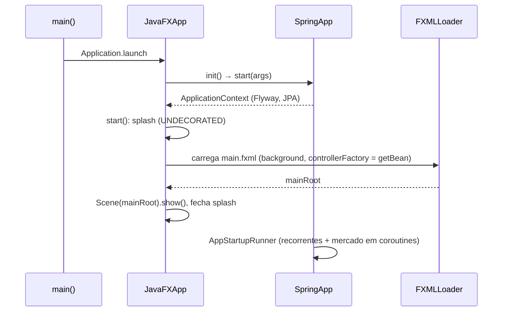
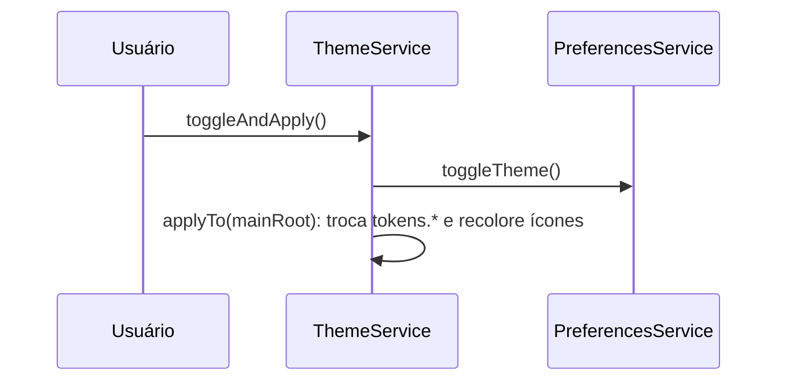

# Interactions — MOINEX

Status: human-reviewed (2026-10-29) · Confidence: medium-high

## 1. Inicialização

[src: app/JavaFXApp.kt:44-110] [src: app/AppStartupRunner.kt:42-120]

## 2. Navegação entre telas
`MainController.loadContent(fxml, ...)` carrega o FXML na `contentArea`, adiciona folhas de estilo da tela e chama `themeService.applyTo(newContent)`. [src: ui/main/MainController.kt:271-295]

## 3. Troca de tema

Janelas já abertas não são atualizadas; novas janelas recebem o tema vigente em `WindowUtils`. [src: service/ThemeService.kt:30-50] [src: common/util/WindowUtils.kt]

## 4. Diálogo modal
`WindowUtils.openModalWindow(fxml, title, ctx, controllerSetup)` → `Stage` APPLICATION_MODAL → `Scene` com tokens + `common-styles.css` → `showAndWait()`. [src: common/util/WindowUtils.kt:140-185]

## 5. Cotações
`TickerService.updateAllNonArchivedTickersPrices` → `APIUtils` → script Python → JSON → persiste preço e histórico. [src: service/investment/TickerService.kt] [inferred]

## 6. Chat de IA
`AiChatService` → `LlmProvider` → resposta markdown (commonmark) renderizada em `WebView` com CSS dependente do tema. [src: ai/chat/MarkdownRenderer.kt] [src: ui/main/AiChatController.kt:549-620]
