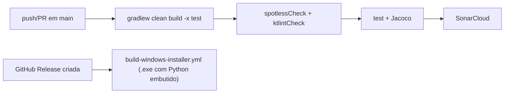

# Operations — MOINEX

Status: human-reviewed (2026-10-29, delta pós v2.19.0) · Confidence: high

## Comandos
Requer um **JDK 25 completo** (`openjdk-25-jdk`; só o JRE não tem `javac`): `export JAVA_HOME=/usr/lib/jvm/java-25-openjdk-amd64`. [src: CLAUDE.md] [src: Makefile:4]

| Ação | Comando | Fonte |
|---|---|---|
| Rodar | `./gradlew bootRun` ou `make run` | CLAUDE.md, Makefile |
| Empacotar | `./gradlew bootJar` | CLAUDE.md |
| Build completo | `./gradlew clean build jacocoTestReport` | CLAUDE.md |
| Testes | `./gradlew test` (`make test TESTS='--tests "*Foo"'`) | CLAUDE.md, Makefile |
| Lint | `./gradlew ktlintCheck spotlessCheck` | CLAUDE.md, pipeline.yml:36 |
| Formatar | `./gradlew ktlintFormat spotlessApply` | CLAUDE.md |
| Instalar/desinstalar | `make install` / `make uninstall` | Makefile |

## Configuração e segredos (locais, sem valores)
- `application.yml` (produção, INFO), `application-local.yml` (DEBUG). [src: src/main/resources/]
- Credenciais de provedores de IA: `AiCredentialStore`. [src: ai/credentials/AiCredentialStore.kt]
- Banco em `~/.moinex/data/moinex.db`. [src: CLAUDE.md]

## CI/CD

[src: .github/workflows/pipeline.yml] [src: .github/workflows/build-windows-installer.yml] `.gitlab-ci.yml` é legado. [src: CLAUDE.md]

## Release
Tag anotada `vX.Y.Z`; `scripts/install.sh` lê as tags. Windows: workflow no GitHub Release. [src: CLAUDE.md]

## Verificação proposta para o AI-DLC
`./gradlew ktlintCheck test` (mesmo conteúdo do hook de pré-commit), mais verificação visual manual com `./gradlew bootRun`, porque não há testes de UI. [src: .githooks/pre-commit] [inferred]
