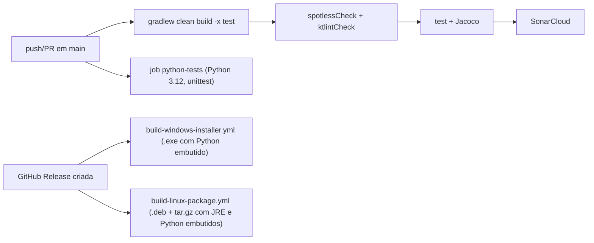

# Operations — MOINEX

Status: human-reviewed (2026-11-07) · Confidence: high

## Comandos
Requer um **JDK 25 completo** (`openjdk-25-jdk`; só o JRE não tem `javac`): `export JAVA_HOME=/usr/lib/jvm/java-25-openjdk-amd64`. [src: CLAUDE.md] [src: Makefile:4]

| Ação | Comando | Fonte |
|---|---|---|
| Rodar | `./gradlew bootRun` ou `make run` | CLAUDE.md, Makefile |
| Empacotar | `./gradlew bootJar` | CLAUDE.md |
| Build completo | `./gradlew clean build jacocoTestReport` | CLAUDE.md |
| Testes | `./gradlew test` (`make test TESTS='--tests "*Foo"'`) | CLAUDE.md, Makefile |
| Lint | `./gradlew ktlintCheck spotlessCheck` | CLAUDE.md, pipeline.yml:36 |
| Formatar | `./gradlew ktlintFormat spotlessApply` | CLAUDE.md |
| Testes Python | `make test-python` (`unittest discover -s src/test/python`) | Makefile, CLAUDE.md |
| Instalar/desinstalar | `make install` / `make uninstall` | Makefile |
| Hook de pré-commit | `make pre-commit` (lint + testes Kotlin + Python) | Makefile |
| Log do app | `make log` (`ARGS`: `-s`, `-e`, `-g regex`, `-n`, `-a`) | Makefile, scripts/dev/log.sh |
| Regenerar ER | `make erd` → `docs/database-erd.md` | Makefile |

## Configuração e segredos (locais, sem valores)
- `application.yml` (produção, INFO), `application-local.yml` (DEBUG). [src: src/main/resources/]
- Credenciais de provedores de IA: `AiCredentialStore`. [src: ai/credentials/AiCredentialStore.kt]
- Banco em `~/.moinex/data/moinex.db`. [src: CLAUDE.md]

## CI/CD

[src: .github/workflows/pipeline.yml:46-63] [src: .github/workflows/build-windows-installer.yml] [src: .github/workflows/build-linux-package.yml] `.gitlab-ci.yml` é legado. [src: CLAUDE.md]

## Release
Tag anotada `vX.Y.Z` no `main`, com `version` do `build.gradle.kts` sincronizada em commit próprio (hoje 2.25.0); `scripts/linux/install.sh` lê as tags. Windows e Linux: workflows disparados por GitHub Release ou `workflow_dispatch`. O `.deb` é publicado com nome fixo para o README instalar com um `curl`. [src: CLAUDE.md] [src: build.gradle.kts:91] [src: git log cb27418a]

## Pacote Linux
`scripts/linux/build-package.sh` gera o `.deb` e o `tar.gz` portátil (jpackage, JRE embutido, Python 3.12 independente preparado por `setup-python.sh`, checksum fixado). `validate-package.sh` confere conteúdo, imports Python, entrada `.desktop`/ícone e 30 s de execução sob Xvfb, e roda no workflow. `test-package-containers.sh` instala, atualiza, remove e executa em contêineres Ubuntu limpos (exige docker) e deve ser usado no artefato do CI antes de um release. Scripts novos precisam de `git update-index --chmod=+x`, porque `core.fileMode` é false. [src: CLAUDE.md "Linux packages"] [src: scripts/linux/] [user: intent linux-package]

## Organização de `scripts/`
`dev/` (capture-screens, demo, generate_erd, log, measure-startup), `data/` (export_tables, generate_dummy_data, sync.sql, transfer_data), `linux/`, `windows/`; `scripts/README.md` descreve cada um. [src: scripts/] [src: git log 1249649f]

## Verificação proposta para o AI-DLC
`./gradlew ktlintCheck test && make test-python` (equivale a `make pre-commit`, o hook de pré-commit), mais verificação visual manual com `./gradlew bootRun` ou `scripts/dev/capture-screens.sh`, porque não há testes de UI. [src: .githooks/pre-commit] [src: Makefile:69] [user]

## Atualização 2026-11-01
- `make demo` abre o app com dados fictícios em home temporário (`-Duser.home`), sem tocar em `~/.moinex`; `scripts/dev/capture-screens.sh <dir>` gera PNG por tela e tema (`CAPTURE_ONLY`, `CAPTURE_LANGUAGE`). [src: Makefile:31] [src: scripts/dev/demo.sh] [src: app/CapturePlan.kt]
- O banco de uso real do usuário fica fora do repositório; somente leitura para qualquer trabalho do AI-DLC. [user]
