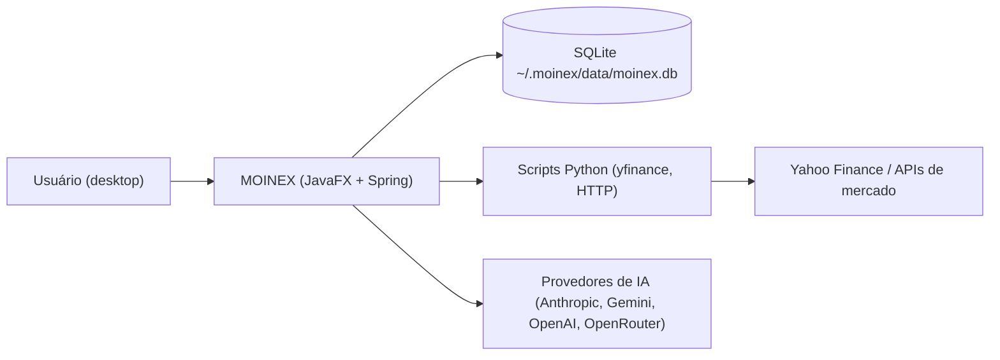

# Overview — MOINEX

Status: human-reviewed (2026-11-01, delta pós v2.20.2) · Confidence: medium

## Propósito
App desktop de finanças pessoais (carteiras, transações, cartões de crédito, metas e planejamento, investimentos, patrimônio líquido, lista de desejos) feito com Spring Boot + JavaFX, dados locais em SQLite. [src: CLAUDE.md]

## Usuários
- Uso individual, local-first, um único usuário por instalação (dono do app). [inferred]
- Foco no mercado brasileiro: indicadores do Brasil, renda fixa (bonds), tradução pt-BR padrão. [src: src/main/resources/scripts/get_brazilian_market_indicators.py] [src: src/main/resources/i18n/messages_pt_BR.properties]

## Capacidades (telas principais)
Arquivos em `src/main/kotlin/org/moinex/ui/main/`:
| Tela | Controller |
|---|---|
| Início (Home) | HomeController.kt |
| Resumo anual | AnnualSummaryController.kt |
| Chat de IA | AiChatController.kt |
| Carteiras | WalletController.kt |
| Cartões de crédito | CreditCardController.kt |
| Transações | TransactionController.kt |
| Metas e planos (metas, planos, FIRE) | GoalsPlansController.kt, GoalController.kt, PlanController.kt, FIRECalculatorController.kt |
| Poupança/Investimentos (visão geral, ações e fundos, bonds) | SavingsController.kt, SavingsOverviewController.kt, SavingsStocksFundsController.kt, SavingsBondsController.kt |
| Lista de desejos | WishlistController.kt |
| Configurações | SettingsController.kt |
| Central de notificações | NotificationCenterController.kt |
Busca global (Ctrl+S) em `ui/common/search/` (telas, abas, lançamentos, ações de cada tela). Utilitários: calculadora e calendário (`ui/common/CalculatorController.kt`, `CalendarController.kt`).

## Glossário
| Termo | Significado | Onde |
|---|---|---|
| Wallet / WalletType | Conta/carteira do usuário e seu tipo | model/wallettransaction/Wallet.kt |
| Budget group | Grupo de orçamento por categorias | model/financialplanning/BudgetGroup.kt |
| Bond | Título de renda fixa com cálculo de juros | model/investment/Bond.kt, service/investment/BondInterestCalculationService.kt |
| Ticker | Ativo de renda variável (ação, fundo, cripto) | model/investment/Ticker.kt |
| Net worth snapshot | Foto mensal do patrimônio | model/NetWorthSnapshot.kt |
| FIRE | Calculadora de independência financeira | service/financialplanning/FIRECalculatorService.kt |
| Wishlist | Itens desejados com links | model/wishlist/WishlistItem.kt |

## Contexto do sistema

Caption: o app é local; só sai para a rede em cotações/indicadores e no chat de IA. [src: CLAUDE.md] [src: src/main/kotlin/org/moinex/ai/provider/]

## Maturidade
- Versão 2.20.2 (tag `v2.20.2`), 670 commits, tags de release `vX.Y.Z`; exige Java 25. [src: build.gradle.kts:88] [src: git describe]
- Código migrado de Java para Kotlin em 2026 (cabeçalhos "Migrated to Kotlin"); ainda aparecem arquivos Java no histórico. [src: src/main/kotlin/org/moinex/app/App.kt:1-8]

## Identidade visual a preservar
Marcada pelo usuário na validação de 2026-10-29: paleta Dracula no tema escuro, botões em pílula (raio 20, borda 2px) e o verde da sidebar (`theme-bg-sidebar` #0a614e, hover #106e5b). [user] [src: css/theme/tokens.dark.css] [src: css/component/buttons.css:1-12]

## Atualização 2026-11-01
- Tema migrado para AtlantaFX (Dracula/PrimerLight) + ícones Ikonli; JFoenix removido; identidade visual (pílulas, verde da sidebar) mantida via tokens. [src: build.gradle.kts:53-55] [src: service/ThemeService.kt]
- Tela de ações e fundos: sem gráficos, só tabela de tickers e totais. Visão geral: rosca de alocação, barras empilhadas investido x ganho de capital, top performers, métricas de rentabilidade, alocação vs. meta, indicadores BR, cotações e commodities. [src: ui/main/SavingsStocksFundsController.kt] [src: ui/main/SavingsOverviewController.kt]
- O banco de uso real do usuário fica fora do repositório e é somente leitura para o AI-DLC; trabalhos usam dados fictícios ou uma cópia. [user]
