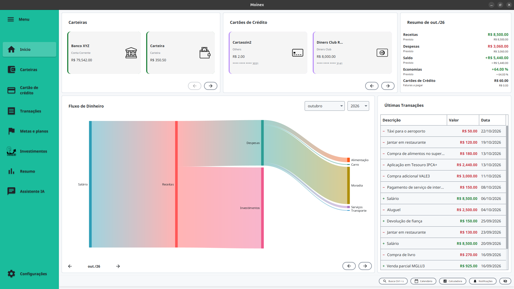

<h1 align="center">
<br>

<br>
</h1>

<p align="center">


</p>

MOINEX é uma aplicação de gestão financeira pessoal que permite aos utilizadores registar, visualizar e acompanhar as
suas transações financeiras. A aplicação possibilita a categorização de receitas e despesas, o cálculo de balanços
mensais e a exibição de gráficos, proporcionando uma visão clara da saúde financeira de forma intuitiva.

<p align="center">
<picture>
  <source media="(prefers-color-scheme: dark)" srcset="./docs/img/screenshots/home-dark.png">
  
</picture>
</p>

## Funcionalidades Principais

- **Gestão de Múltiplas Carteiras:** Controle contas correntes, poupanças, investimentos e muito mais.
- **Registo de Transações:** Adicione receitas e despesas com categorização detalhada.
- **Metas de Poupança:** Crie objetivos financeiros e acompanhe o seu progresso.
- **Relatórios e Gráficos:** Visualize a sua saúde financeira com gráficos intuitivos de balanço, despesas por categoria,
  etc.
- **Assistente de IA (BYOK):** Converse com um assistente financeiro usando a sua própria chave de API (OpenAI,
  Anthropic, Gemini ou OpenRouter). Pergunte sobre as suas finanças, lance transações por linguagem natural ou
  importe extratos (CSV/PDF) para revisão, incluindo operações de investimento (ações, dividendos, CDB).
- **Privacidade:** Os seus dados financeiros são armazenados localmente no seu computador. O assistente de IA é
  opcional - quando configurado, mensagens e arquivos anexados são enviados ao provedor de IA escolhido, mas a IA
  nunca grava nada sozinha: toda transação proposta só é salva depois da sua revisão e confirmação manual.
- **Software Livre:** Código aberto e transparente.

## Tecnologias Utilizadas

- **Linguagem:** Kotlin 2.4.21
- **Backend:** Spring Boot 4.1, Spring Data JPA
- **Interface Gráfica:** JavaFX 27 com tema AtlantaFX 3 (Dracula e PrimerLight) e ícones Ikonli (Material)
- **Base de Dados:** SQLite com Flyway para migrações
- **Build:** Gradle com Kotlin DSL
- **Testes:** Kotest

## Compatibilidade

O Moinex está disponível para **Linux** e **Windows**.

## Instalação

### Windows

1. Acesse a [página de releases](https://github.com/luk3rr/MOINEX/releases/latest)
2. Baixe o arquivo `Moinex-X.X.X.exe` da última versão
3. Execute o instalador e siga o assistente de instalação
4. Pronto! Encontre o Moinex no Menu Iniciar

**Localização dos dados:**
- Aplicação: `%USERPROFILE%\.moinex\`
- Base de dados: `%USERPROFILE%\.moinex\data\moinex.db`
- Logos de ações: `%USERPROFILE%\.moinex\logos\`
- Logs: `%LOCALAPPDATA%\moinex\state`

### Linux

#### Pacote `.deb` (Debian, Ubuntu e derivadas)

Já traz o Java e o Python com as dependências.

1. Baixe `moinex_X.X.X_amd64.deb` na [página de releases](https://github.com/luk3rr/MOINEX/releases/latest)
2. Instale:
```bash
sudo apt install ./moinex_X.X.X_amd64.deb
```
3. Abra o **Moinex** pelo menu de aplicativos.

Para atualizar, instale o `.deb` da versão nova do mesmo jeito. Seus dados em `$HOME/.moinex/` não são alterados.

#### Pacote `.tar.gz` (qualquer distribuição)

1. Baixe `moinex-X.X.X-linux-x64.tar.gz` na [página de releases](https://github.com/luk3rr/MOINEX/releases/latest)
2. Descompacte e execute, sem precisar de root:
```bash
tar -xzf moinex-X.X.X-linux-x64.tar.gz
./Moinex/bin/Moinex
```

Os pacotes são para x86_64 e exigem glibc 2.35 ou mais nova (Ubuntu 22.04 ou equivalente).

**Localização dos dados:**
- Base de dados: `$HOME/.moinex/data/moinex.db`
- Logos de ações: `$HOME/.moinex/logos/`
- Logs: `$HOME/.local/state/moinex`

#### Compilação local

<details>
<summary>Compilar e instalar a partir do código (Linux)</summary>

Compila a versão escolhida na sua máquina e usa o Python do sistema. Não misture com o `.deb`: os dois instalam em lugares diferentes e deixam dois atalhos no menu.

**Pré-requisitos:** Git, JDK 25 (o pacote completo, com `javac`) e Python 3 com pip.

```bash
git clone https://github.com/luk3rr/MOINEX.git
cd MOINEX
sh scripts/install.sh
```

Escolha a versão: **main** (desenvolvimento, pode ser instável) ou uma **tag** estável. A aplicação é instalada em `$HOME/.moinex/`.

Para desinstalar, execute `sh scripts/uninstall.sh`. Ele remove a aplicação e preserva seus dados em `$HOME/.moinex/data/`.

</details>

## Desinstalação

### Windows

1. Abra **Configurações** do Windows
2. Vá em **Aplicativos** → **Aplicativos instalados**
3. Procure por **Moinex**
4. Clique em **Desinstalar**
5. Siga o assistente de desinstalação

> [!WARNING]
> A desinstalação remove a aplicação, mas seus dados em `%USERPROFILE%\.moinex\` são preservados. Para remover completamente, delete manualmente esta pasta após desinstalar.

### Linux

- **`.deb`:** `sudo apt remove moinex`. Remove a aplicação de `/opt/moinex` e preserva os dados em `$HOME/.moinex/`.
- **`.tar.gz`:** apague a pasta `Moinex` que você descompactou.

## Licença

Este projeto está licenciado sob a licença AGPL-3.0. Veja o arquivo [LICENSE](LICENSE) para mais detalhes.
