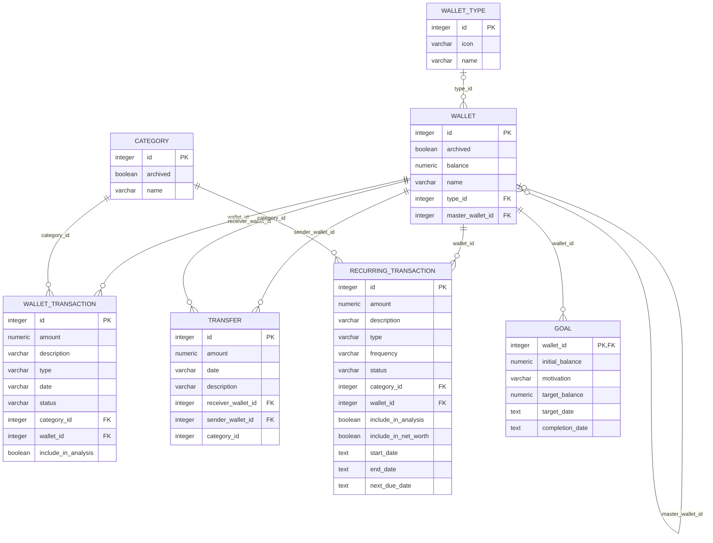
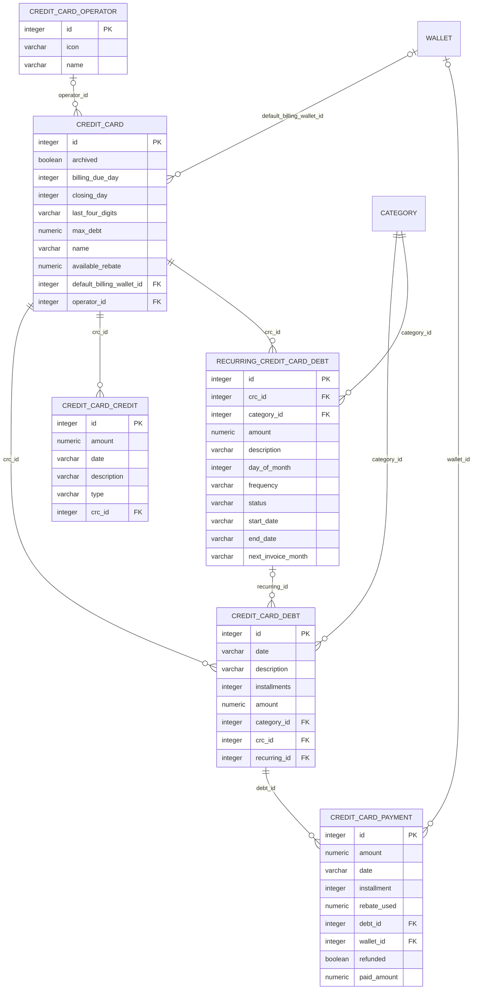
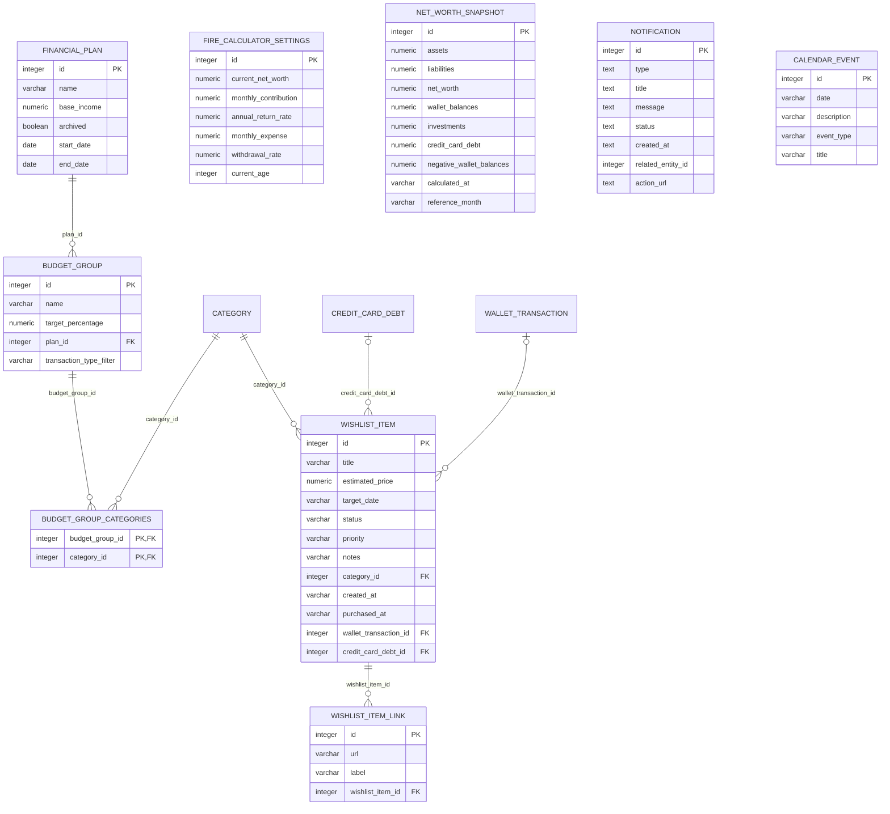
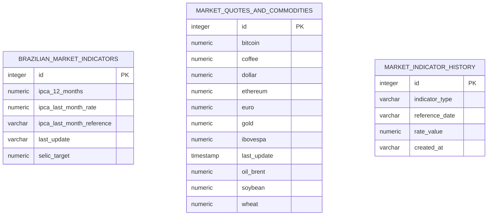
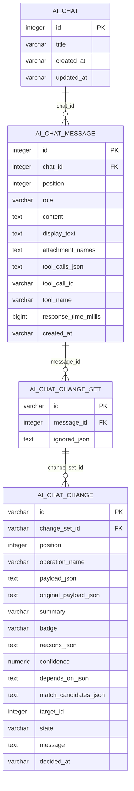

# Banco de dados: diagrama entidade-relacionamento

Gerado por `scripts/dev/generate_erd.py` a partir das migrations Flyway (`src/main/resources/db/migration/`). Não edite à mão: rode `make erd` depois de criar uma migration.

O banco tem 44 tabelas. Datas são guardadas como texto ISO, e valores monetários como `numeric`. O SQLite do app não liga `PRAGMA foreign_keys`, então as chaves estrangeiras documentam as relações, mas o banco não as impõe; exclusões em cascata são feitas pelo código.

Legenda: `PK` chave primária, `FK` chave estrangeira. `||--o{` é um para muitos; `|o--o{` quando a chave estrangeira aceita nulo; `|o--o|` é um para um.

## Visão geral das relações

```mermaid
erDiagram
  AI_CHAT_CHANGE_SET ||--o{ AI_CHAT_CHANGE : "change_set_id"
  AI_CHAT_MESSAGE ||--o{ AI_CHAT_CHANGE_SET : "message_id"
  AI_CHAT ||--o{ AI_CHAT_MESSAGE : "chat_id"
  BOND ||--o{ BOND_INTEREST_CALCULATION : "bond_id"
  WALLET_TRANSACTION |o--o{ BOND_OPERATION : "wallet_transaction_id"
  BOND ||--o{ BOND_OPERATION : "bond_id"
  FINANCIAL_PLAN ||--o{ BUDGET_GROUP : "plan_id"
  CATEGORY ||--o{ BUDGET_GROUP_CATEGORIES : "category_id"
  BUDGET_GROUP ||--o{ BUDGET_GROUP_CATEGORIES : "budget_group_id"
  CREDIT_CARD_OPERATOR |o--o{ CREDIT_CARD : "operator_id"
  WALLET |o--o{ CREDIT_CARD : "default_billing_wallet_id"
  CREDIT_CARD ||--o{ CREDIT_CARD_CREDIT : "crc_id"
  CREDIT_CARD ||--o{ CREDIT_CARD_DEBT : "crc_id"
  CATEGORY ||--o{ CREDIT_CARD_DEBT : "category_id"
  RECURRING_CREDIT_CARD_DEBT |o--o{ CREDIT_CARD_DEBT : "recurring_id"
  WALLET |o--o{ CREDIT_CARD_PAYMENT : "wallet_id"
  CREDIT_CARD_DEBT ||--o{ CREDIT_CARD_PAYMENT : "debt_id"
  TICKER ||--o{ CRYPTO_EXCHANGE : "sold_crypto_id"
  TICKER ||--o{ CRYPTO_EXCHANGE : "received_crypto_id"
  WALLET_TRANSACTION ||--o{ DIVIDEND : "wallet_transaction_id"
  TICKER ||--o{ DIVIDEND : "ticker_id"
  TICKER ||--o{ FUNDAMENTAL_ANALYSIS : "ticker_id"
  WALLET ||--o{ GOAL : "wallet_id"
  WALLET_TRANSACTION ||--o{ PURCHASE : "wallet_transaction_id"
  TICKER |o--o{ PURCHASE : "ticker_id"
  CATEGORY ||--o{ RECURRING_CREDIT_CARD_DEBT : "category_id"
  CREDIT_CARD ||--o{ RECURRING_CREDIT_CARD_DEBT : "crc_id"
  WALLET ||--o{ RECURRING_TRANSACTION : "wallet_id"
  CATEGORY ||--o{ RECURRING_TRANSACTION : "category_id"
  WALLET_TRANSACTION ||--o{ SALE : "wallet_transaction_id"
  TICKER |o--o{ SALE : "ticker_id"
  TICKER ||--o{ TICKER_PRICE_HISTORY : "ticker_id"
  TICKER |o--o{ TICKER_PURCHASE : "ticker_id"
  WALLET_TRANSACTION ||--o{ TICKER_PURCHASE : "wallet_transaction_id"
  TICKER |o--o{ TICKER_SALE : "ticker_id"
  WALLET_TRANSACTION ||--o{ TICKER_SALE : "wallet_transaction_id"
  WALLET ||--o{ TRANSFER : "sender_wallet_id"
  WALLET ||--o{ TRANSFER : "receiver_wallet_id"
  WALLET |o--o{ WALLET : "master_wallet_id"
  WALLET_TYPE |o--o{ WALLET : "type_id"
  WALLET ||--o{ WALLET_TRANSACTION : "wallet_id"
  CATEGORY ||--o{ WALLET_TRANSACTION : "category_id"
  CREDIT_CARD_DEBT |o--o{ WISHLIST_ITEM : "credit_card_debt_id"
  WALLET_TRANSACTION |o--o{ WISHLIST_ITEM : "wallet_transaction_id"
  CATEGORY ||--o{ WISHLIST_ITEM : "category_id"
  WISHLIST_ITEM ||--o{ WISHLIST_ITEM_LINK : "wishlist_item_id"
  BENCHMARK_PRICE_HISTORY {
  }
  BRAZILIAN_MARKET_INDICATORS {
  }
  CALENDAR_EVENT {
  }
  FIRE_CALCULATOR_SETTINGS {
  }
  INVESTMENT_PERFORMANCE_SNAPSHOT {
  }
  INVESTMENT_TARGET {
  }
  MARKET_INDICATOR_HISTORY {
  }
  MARKET_QUOTES_AND_COMMODITIES {
  }
  NET_WORTH_SNAPSHOT {
  }
  NOTIFICATION {
  }
```

## Carteiras e transações

## Cartões de crédito

## Investimentos

```mermaid
erDiagram
  TICKER {
    integer id PK
    numeric average_unit_value
    numeric average_unit_value_count
    numeric current_quantity
    numeric current_unit_value
    varchar name
    varchar symbol
    boolean archived
    varchar last_update
    varchar type
    varchar domain
    varchar created_at
    text metadata
  }
  TICKER_PURCHASE {
    integer id PK
    numeric quantity
    numeric unit_price
    integer wallet_transaction_id FK
    integer ticker_id FK
  }
  TICKER_SALE {
    integer id PK
    numeric quantity
    numeric unit_price
    numeric average_cost
    integer wallet_transaction_id FK
    integer ticker_id FK
  }
  PURCHASE {
    integer id PK
    numeric quantity
    numeric unit_price
    integer ticker_id FK
    integer wallet_transaction_id FK
  }
  SALE {
    integer id PK
    numeric quantity
    numeric unit_price
    numeric average_cost
    integer ticker_id FK
    integer wallet_transaction_id FK
  }
  DIVIDEND {
    integer id PK
    integer ticker_id FK
    integer wallet_transaction_id FK
  }
  CRYPTO_EXCHANGE {
    integer id PK
    varchar date
    varchar description
    numeric received_quantity
    numeric sold_quantity
    integer received_crypto_id FK
    integer sold_crypto_id FK
  }
  TICKER_PRICE_HISTORY {
    integer id PK
    integer ticker_id FK
    varchar price_date
    numeric closing_price
    boolean is_month_end
  }
  FUNDAMENTAL_ANALYSIS {
    integer id PK
    integer ticker_id FK
    varchar company_name
    varchar sector
    varchar industry
    varchar currency
    varchar period_type
    text data_json
    varchar last_update
    varchar created_at
  }
  BOND {
    integer id PK
    varchar name
    varchar symbol
    varchar type
    varchar issuer
    varchar interest_type
    varchar interest_index
    numeric interest_rate
    boolean archived
    text maturity_date
  }
  BOND_OPERATION {
    integer id PK
    integer bond_id FK
    varchar operation_type
    numeric quantity
    numeric unit_price
    numeric fees
    numeric taxes
    numeric net_profit
    integer wallet_transaction_id FK
    numeric spread
  }
  BOND_INTEREST_CALCULATION {
    integer id PK
    integer bond_id FK
    varchar reference_month
    varchar calculation_date
    numeric quantity
    numeric invested_amount
    numeric monthly_interest
    numeric accumulated_interest
    numeric final_value
    text calculation_method
    varchar created_at
    boolean manually_adjusted
    varchar calculated_until_date
  }
  INVESTMENT_TARGET {
    integer id PK
    text type
    numeric target_percentage
    boolean is_active
  }
  INVESTMENT_PERFORMANCE_SNAPSHOT {
    integer id PK
    numeric invested_value
    numeric portfolio_value
    numeric accumulated_capital_gains
    numeric monthly_capital_gains
    varchar calculated_at
    varchar reference_month
  }
  BENCHMARK_PRICE_HISTORY {
    integer id PK
    varchar symbol
    varchar price_date
    numeric closing_price
  }
  TICKER |o--o{ TICKER_PURCHASE : "ticker_id"
  WALLET_TRANSACTION ||--o{ TICKER_PURCHASE : "wallet_transaction_id"
  TICKER |o--o{ TICKER_SALE : "ticker_id"
  WALLET_TRANSACTION ||--o{ TICKER_SALE : "wallet_transaction_id"
  WALLET_TRANSACTION ||--o{ PURCHASE : "wallet_transaction_id"
  TICKER |o--o{ PURCHASE : "ticker_id"
  WALLET_TRANSACTION ||--o{ SALE : "wallet_transaction_id"
  TICKER |o--o{ SALE : "ticker_id"
  WALLET_TRANSACTION ||--o{ DIVIDEND : "wallet_transaction_id"
  TICKER ||--o{ DIVIDEND : "ticker_id"
  TICKER ||--o{ CRYPTO_EXCHANGE : "sold_crypto_id"
  TICKER ||--o{ CRYPTO_EXCHANGE : "received_crypto_id"
  TICKER ||--o{ TICKER_PRICE_HISTORY : "ticker_id"
  TICKER ||--o{ FUNDAMENTAL_ANALYSIS : "ticker_id"
  WALLET_TRANSACTION |o--o{ BOND_OPERATION : "wallet_transaction_id"
  BOND ||--o{ BOND_OPERATION : "bond_id"
  BOND ||--o{ BOND_INTEREST_CALCULATION : "bond_id"
```

## Planejamento e outros

## Mercado

## Conversas com o assistente de IA

