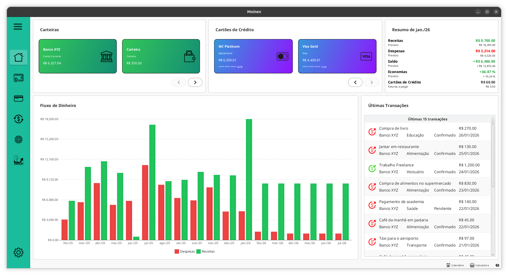
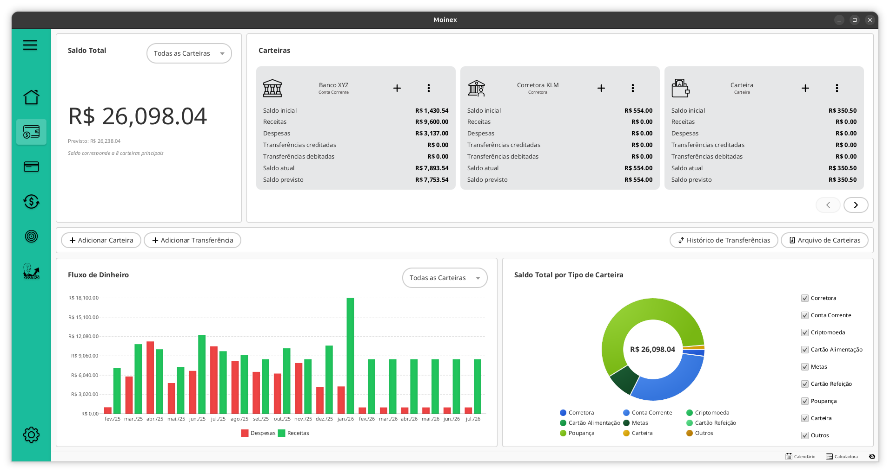
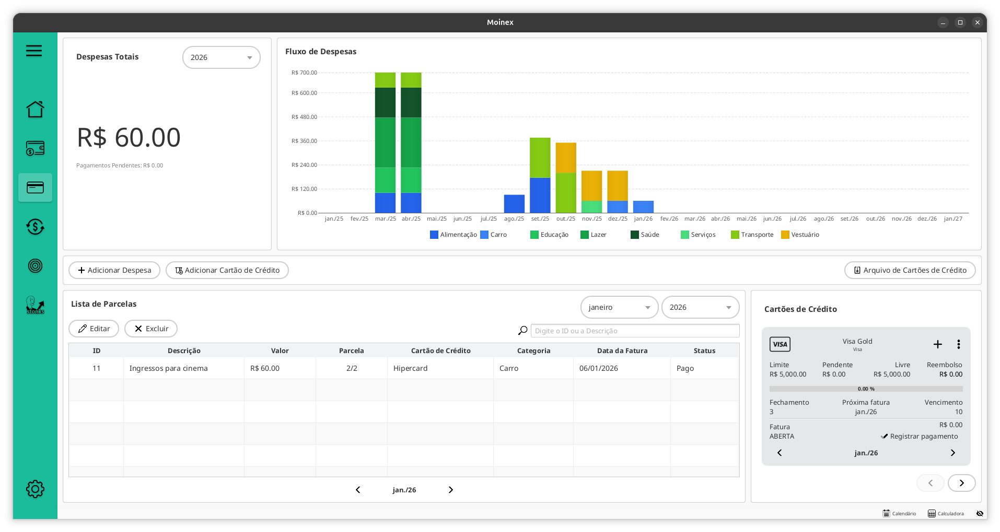
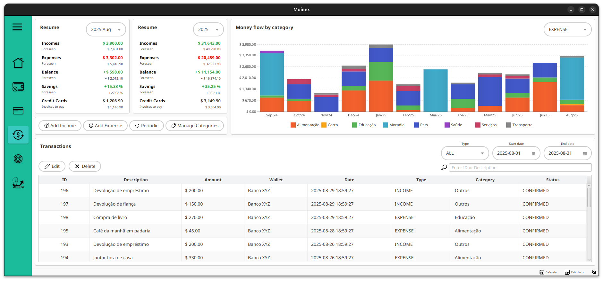
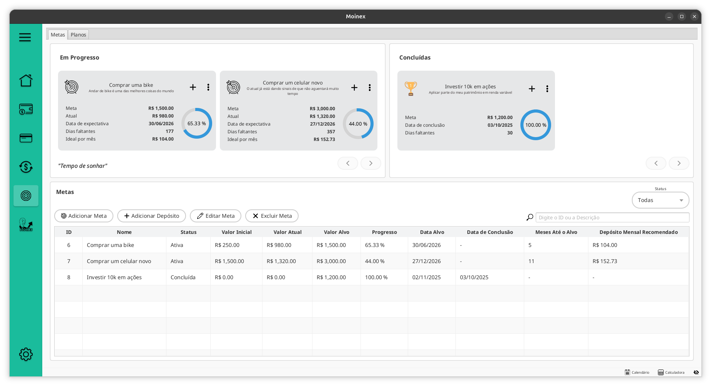
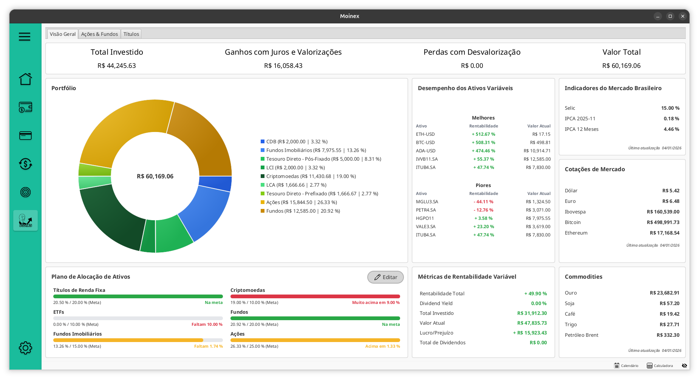

<h1 align="center">
<br>

<br>
</h1>

<p align="center">


</p>

MOINEX é uma aplicação de gestão financeira pessoal que permite aos utilizadores registar, visualizar e acompanhar as
suas transações financeiras. A aplicação possibilita a categorização de receitas e despesas, o cálculo de balanços
mensais e a exibição de gráficos, proporcionando uma visão clara da saúde financeira de forma intuitiva.



### Mais Capturas de Tela

<details>
<summary>Clique para ver mais imagens da aplicação</summary>

#### Carteiras


#### Cartão de Crédito


#### Gestão de Transações


#### Metas


#### Investimentos



</details>

## Funcionalidades Principais

- **Gestão de Múltiplas Carteiras:** Controle contas correntes, poupanças, investimentos e muito mais.
- **Registo de Transações:** Adicione receitas e despesas com categorização detalhada.
- **Metas de Poupança:** Crie objetivos financeiros e acompanhe o seu progresso.
- **Relatórios e Gráficos:** Visualize a sua saúde financeira com gráficos intuitivos de balanço, despesas por categoria,
  etc.
- **Assistente de IA (BYOK):** Converse com um assistente financeiro usando a sua própria chave de API (OpenAI,
  Anthropic, Gemini ou OpenRouter). Pergunte sobre as suas finanças, lance transações por linguagem natural ou
  importe extratos (CSV/PDF) para revisão, incluindo operações de investimento (ações, dividendos, CDB).
- **Privacidade:** Os seus dados financeiros são armazenados localmente no seu computador. O assistente de IA é
  opcional - quando configurado, mensagens e arquivos anexados são enviados ao provedor de IA escolhido, mas a IA
  nunca grava nada sozinha: toda transação proposta só é salva depois da sua revisão e confirmação manual.
- **Software Livre:** Código aberto e transparente.

## Tecnologias Utilizadas

- **Linguagem:** Kotlin 2.1.0
- **Backend:** Spring Boot 3.5, Spring Data JPA
- **Interface Gráfica:** JavaFX 21
- **Base de Dados:** SQLite com Flyway para migrações
- **Build:** Gradle com Kotlin DSL
- **Testes:** Kotest

## Compatibilidade

O Moinex está disponível para **Linux** e **Windows**.

## Instalação

### Windows

1. Acesse a [página de releases](https://github.com/luk3rr/MOINEX/releases/latest)
2. Baixe o arquivo `Moinex-X.X.X.exe` da última versão
3. Execute o instalador e siga o assistente de instalação
4. Pronto! Encontre o Moinex no Menu Iniciar

**Localização dos dados:**
- Aplicação: `%USERPROFILE%\.moinex\`
- Base de dados: `%USERPROFILE%\.moinex\data\moinex.db`
- Logos de ações: `%USERPROFILE%\.moinex\logos\`
- Logs: `%LOCALAPPDATA%\moinex\state`

### Linux

#### Pré-requisitos

Certifique-se de ter instalado:
- **Git**
- **Java 21** ou superior
- **Gradle** (ou use o wrapper incluído `./gradlew`)
- **Python 3** com pip (para scripts de APIs financeiras)

#### Instalação via Script

1. Clone o repositório:
```bash
git clone https://github.com/luk3rr/MOINEX.git
cd MOINEX
```

2. Execute o script de instalação:
```bash
sh scripts/install.sh
```

3. Escolha a versão:
   - **main** - versão de desenvolvimento (pode conter recursos experimentais)
   - **Versões estáveis (tags)** - recomendadas para uso diário

#### Instalação Manual

1. Clone o repositório:
```bash
git clone https://github.com/luk3rr/MOINEX.git
cd MOINEX
```

2. Instale as dependências Python (necessárias para cotação de ações e outros dados financeiros):
```bash
python3 -m pip install --user --break-system-packages -r requirements.txt
```

3. Compile:
```bash
./gradlew build
```

4. Execute a aplicação:
```bash
./gradlew bootRun
```

**Localização dos dados:**
- Aplicação: `$HOME/.moinex/`
- Base de dados: `$HOME/.moinex/data/moinex.db`
- Logos de ações: `$HOME/.moinex/logos/`
- Logs: `$HOME/.local/state/moinex`

## Desinstalação

### Windows

1. Abra **Configurações** do Windows
2. Vá em **Aplicativos** → **Aplicativos instalados**
3. Procure por **Moinex**
4. Clique em **Desinstalar**
5. Siga o assistente de desinstalação

> [!WARNING]
> A desinstalação remove a aplicação, mas seus dados em `%USERPROFILE%\.moinex\` são preservados. Para remover completamente, delete manualmente esta pasta após desinstalar.

### Linux

Execute o script de desinstalação:

```bash
sh scripts/uninstall.sh
```

> [!WARNING]
> Este comando irá apagar permanentemente a sua base de dados com todas as suas transações. Faça um backup do diretório `$HOME/.moinex/data/` se desejar restaurar os seus dados no futuro.

## Licença

Este projeto está licenciado sob a licença AGPL-3.0. Veja o arquivo [LICENSE](LICENSE) para mais detalhes.
